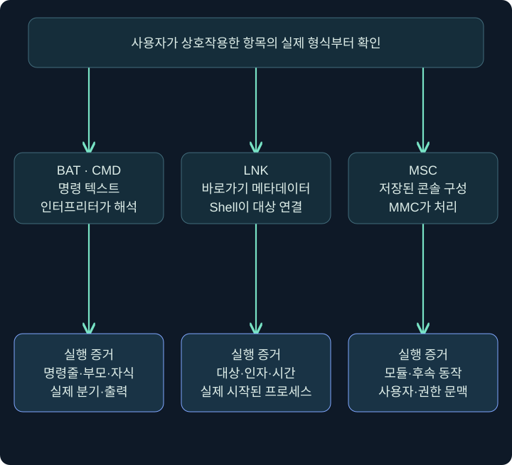
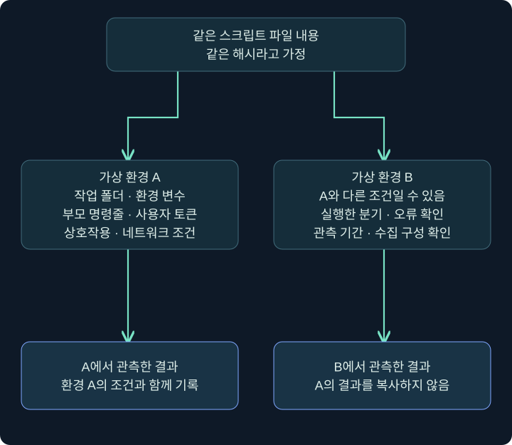
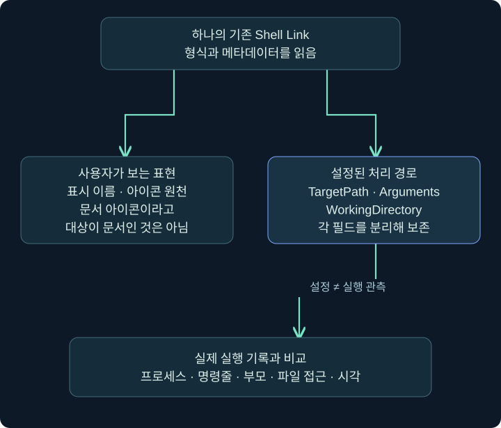

## 1. 사용자의 클릭과 실행 프로그램 사이에는 무엇이 있을까요?

파일을 더블클릭하면 Windows는 파일 형식과 연결된 처리 프로그램을 참고합니다. 클릭한 항목이 문서인지, 명령 스크립트인지, 바로가기인지에 따라 다음 동작은 달라집니다. 이번 강의의 **트리거(trigger)**는 이러한 상호작용을 실행 경로와 연결하는 역할을 뜻합니다.

같은 문서 아이콘이라도 내부 구조가 같지는 않습니다. 사용자는 ‘보고서를 열었다’고 기억하지만 실제 처리 주체는 문서 뷰어, 명령 인터프리터, 스크립트 호스트, 관리 콘솔 중 하나일 수 있습니다. 사용자의 진술은 중요한 출발점이며 실제 파일 형식과 프로세스 기록으로 연결해야 합니다.

여기서는 배치 파일·Shell Link·Microsoft Saved Console의 구조와 증거를 읽습니다. 의심 파일을 실행해 확인하지 않으며, 가상 이름과 승인된 분석 사본을 이용한 정적 조회 예제입니다. 실제 Windows·PowerShell 실행 결과는 제시하지 않습니다.

## 2. 세 종류의 처리 주체를 나란히 비교합니다

| 형식 | 일반적인 처리 주체 | 정적으로 볼 정보 | 실행을 입증할 정보 |
| --- | --- | --- | --- |
| BAT·CMD | cmd.exe 등 명령 인터프리터 | 텍스트 명령·인용·환경 변수 | 실제 명령줄·부모·자식 프로세스 |
| LNK | Windows Shell의 바로가기 처리 | 대상·인자·작업 폴더·아이콘 | 실제 시작된 프로그램과 인자 |
| MSC | mmc.exe의 저장된 콘솔 처리 | 콘솔 구성·참조·포함 데이터 | 실제 모듈·자식·통신·권한 문맥 |



화살표는 정상적인 형식 처리 관계를 단순화했습니다. 이 이름의 프로그램이 나타났다는 이유만으로 악성이라고 판단하지 않습니다. 반대로 Microsoft가 제공하는 프로그램이라는 이유만으로 입력 파일과 후속 동작까지 모두 정상으로 취급하지 않습니다.

## 3. 배치 파일을 텍스트로 읽는 순서

배치 파일은 명령 인터프리터가 해석하는 명령을 담는 텍스트 파일입니다. 먼저 인코딩과 줄바꿈, 변수 확장, 따옴표, 이어지는 명령·출력 처리를 확인합니다. 읽어 보지 않고 더블클릭해 동작을 확인하는 것은 정적 분석과 다릅니다.

아래는 아무 프로그램도 시작하지 않고 문장 하나만 출력하는 설명용 예제입니다. Windows에서 실행하지 않았습니다.

```batch
@echo off
echo TRAINING_ONLY
```

첫 줄은 이후 명령 자체를 화면에 표시하는 동작을 조절합니다. 둘째 줄은 해당 문자열을 출력합니다. `@echo off`가 보인다고 출력·로그·프로세스 생성이 모두 사라지는 것은 아닙니다. 화면 표시와 시스템 관측을 구별해야 합니다.

| 문법·요소 | 읽을 의미 | 잘못된 확대 해석 |
| --- | --- | --- |
| 따옴표 | 공백이 있는 경로·인자의 경계를 확인 | 따옴표가 있으면 내부가 모두 한 가지 방식으로 처리됨 |
| 환경 변수 | 실행 문맥의 값을 대신 참조 | 분석가 컴퓨터의 값이 당시 대상과 같음 |
| 출력 리디렉션 | 표준 출력·오류의 전달 위치 변경 | 파일·프로세스·EDR 기록이 전부 없어짐 |
| 조건부 분기 | 앞의 결과나 조건에 따라 경로가 달라짐 | 정적 텍스트의 모든 줄이 실제 실행됨 |

예를 들어 `%cmdcmdline%`은 시작할 때의 명령줄 문맥과 관련되고 `%~f0`는 현재 배치 파일의 전체 경로로 확장되는 표현입니다. 이러한 값을 참조하는 코드를 발견하면 분석 환경과 원래 실행 환경에서 값이 달랐을 가능성을 조사할 수 있습니다. 실제 비교 결과와 어느 분기로 진행했는지는 별도이며, 이 변수를 봤다는 이유만으로 회피 성공을 확정하지 않습니다.

명령을 보고 ‘어떻게 실행됐을 것’이라고 추정하는 단계와 실제 프로세스 기록으로 확인하는 단계를 분리합니다. 인코딩된 문자열이나 복잡한 인용이 있으면 원본을 보존한 상태에서 승인된 정적 분석 도구로 범위를 좁힙니다.

## 4. 실행 문맥에 따라 결과가 달라질 수 있습니다

같은 스크립트라도 현재 작업 폴더·환경 변수·부모 프로세스·인터프리터 옵션·사용자 토큰이 다르면 결과가 달라질 수 있습니다. 상대 경로를 사용하는 파일은 특히 작업 폴더의 영향을 받습니다. ‘분석 환경에서 아무것도 안 했다’는 관찰은 환경 조건과 함께 남겨야 합니다.



그림의 두 갈래는 서로 다른 환경에서의 가상 사례입니다. 한쪽 결과를 다른 환경으로 복사할 수 없다는 뜻이지, 두 환경에서 반드시 다르게 동작한다는 뜻은 아닙니다. 무반응이 관측됐다면 실패·조건 불충족·차단·관측 누락 같은 설명을 검토합니다.

이 원리는 자동 분석 결과를 읽을 때도 유용합니다. 샌드박스의 실행 여부, 사용자 상호작용, 네트워크 허용 상태와 수집 기간을 확인해야 합니다. ‘행위가 보고되지 않았다’와 ‘어떤 환경에서도 실행할 수 없다’는 같은 결론이 아닙니다.

## 5. 바로가기의 이름·아이콘·대상·인자를 분리합니다

**Shell Link(.lnk)**는 다른 Shell 객체를 찾아 접근하는 정보를 담는 구조입니다. 평문 스크립트가 아니며 여러 메타데이터를 가질 수 있습니다. 이름과 아이콘은 사용자가 보는 표현이고, 대상과 인자는 실제 처리 경로를 이해하는 핵심 단서입니다.

Windows에서 승인된 기존 바로가기의 **우클릭 → 속성(Properties) → 바로가기(Shortcut)** 탭을 확인합니다. UI 언어·항목 종류에 따라 표시가 다를 수 있습니다. 단순히 탐색기 이름만 보고 확장자와 대상 프로그램을 확정하지 않습니다.

| 속성 화면의 칸 | 무엇을 읽나요? | 가상 예시 |
| --- | --- | --- |
| 대상(Target) | 시작할 프로그램과 함께 표시된 인자 | 메모장 프로그램과 안내문 경로 |
| 시작 위치(Start in) | 실행 시 작업 폴더 | C:\Lab\review |
| 실행(Run) | 창 표시 방식 등 | 일반 창·최소화 등의 표시 설정 |
| 아이콘 변경(Change Icon) | 표시용 아이콘 원천 | 프로그램 자체 또는 별도 아이콘 리소스 |

여기서 Run의 창 표시 옵션을 관리자 권한이나 실행 성공 여부로 읽으면 안 됩니다. 아이콘 원천이 문서 뷰어여도 대상이 그 뷰어라는 보장은 없습니다. 대상·인자·작업 폴더는 각각 기록합니다.



이 그림은 속성 정보의 관계를 독립적으로 그린 개념도입니다. 실제 Windows 속성 창의 스크린샷으로 제시한 것이 아닙니다. 한 줄의 대상 표시를 분석할 때는 따옴표와 경로·인자 경계를 보존해야 합니다.

## 6. 기존 LNK의 메타데이터를 읽는 예제

다음 코드는 존재하는 로컬 `.lnk`에 대한 속성 조회를 설명합니다. 이 게시 과정에서 실행하지 않았습니다. 승인된 분석 사본을 가정하며, 대상 프로그램 실행이나 바로가기 저장은 하지 않습니다.

```powershell
$linkPath = 'C:\Lab\review\training-note.lnk'
if (-not (Test-Path -LiteralPath $linkPath -PathType Leaf)) {
    throw '기존 분석 사본이 필요합니다.'
}
Get-Item -LiteralPath $linkPath |
    Select-Object Name, Extension, Length, LastWriteTime

$shellReader = New-Object -ComObject WScript.Shell
$linkInfo = $shellReader.CreateShortcut($linkPath)
$linkInfo | Select-Object TargetPath, Arguments, WorkingDirectory, IconLocation
```

`Test-Path`는 기존 파일이 있는지 먼저 확인합니다. `Get-Item`은 파일 자체의 이름·확장자·크기 등을 읽습니다. WScript.Shell의 `CreateShortcut`이라는 이름은 새 바로가기 생성 예제에도 등장하지만, 여기서는 존재하는 바로가기를 객체로 열어 속성을 읽습니다. 값을 지정하거나 `Save`를 호출하지 않습니다. 정적 파서를 이용할 수 있다면 해당 도구의 검증 범위와 버전도 기록합니다.

`TargetPath`와 `Arguments`가 분리되어 나오는 이유는 프로그램과 전달 인자를 따로 읽기 위해서입니다. `WorkingDirectory`가 비어 있으면 특정 폴더였다고 추측해서 채우지 않습니다. 출력은 설정된 정보의 관측이지, 바로가기를 사용자가 실행했다는 관측은 아닙니다.

## 7. MSC와 관리 콘솔을 해석합니다

**MSC(Microsoft Saved Console)**는 Microsoft Management Console이 사용하는 저장된 콘솔 구성입니다. 관리자 도구에서 정상적으로 사용하는 형식이므로 `mmc.exe`와 MSC의 존재만으로 악성 여부를 판단하지 않습니다. 반대로 문서처럼 전달된 MSC가 어떤 참조와 동작을 포함하는지는 확인할 필요가 있습니다.

Elastic이 2024년에 공개한 **GrimResource** 연구는 관리 콘솔 형식을 악용한 실행 경로의 역사적 사례입니다. 공개 당시의 환경·관측과 현재 Windows의 패치·정책 상태는 구별합니다. 과거 글의 ‘미패치’나 특정 실행 결과를 현재 모든 컴퓨터에 적용되는 사실로 옮기지 않습니다.

조사에서는 MSC의 출처·파일 내용·원본 해시, mmc.exe의 실제 경로·명령줄·부모, 적재 모듈·후속 프로세스·외부 연결을 확인합니다. XML이나 포함 데이터의 존재만으로 실행을 확정하지 않습니다. 이 강의는 악용 파일이나 실행용 XML을 만들지 않습니다.

UAC도 별도입니다. 관리자 도구라는 이유만으로 클릭한 모든 MSC가 곧바로 높은 무결성으로 실행된다고 보지 않습니다. 계정 종류·현재 토큰·UAC 정책·동의·실제 프로세스 무결성을 확인해야 합니다. 높은 무결성 프로세스가 관측됐다는 사실과 사용자가 의도적으로 동의했다는 사실도 구별합니다.

## 8. 실행 경로를 로그와 연결하는 가상 연습

다음은 설명용 가상 기록이며 실제 Windows 이벤트가 아닙니다.

```text
14:10:00  파일 사본: training-note.lnk
14:10:02  정적 조회: TargetPath = 문서 뷰어 경로
14:10:05  프로세스 기록: 같은 사용자의 문서 뷰어 생성
14:10:09  사용자 진술: 안내문이 화면에 표시됨
```

이 자료로는 바로가기 설정과 문서 뷰어 실행이 맞물릴 가능성을 조사할 수 있습니다. 그러나 뷰어가 반드시 그 바로가기 때문에 실행됐다고 확정하려면 부모·명령줄·파일 접근과 시간 연결이 더 필요합니다. ‘같은 사용자’만으로 인과관계를 완성하지 않습니다.

조건을 바꿔 대상에 명령 인터프리터가 설정돼 있다고 가정해 보겠습니다. 그 사실은 조사 우선순위를 높일 수 있지만, 실제로 실행된 명령과 후속 동작까지 자동으로 알려 주지는 않습니다. 정적 인자와 실제 명령줄을 비교하면서 환경 변수 확장·인용·경로의 차이도 기록합니다.

## 9. 차단·무반응·실행을 서로 다른 결과로 씁니다

| 결과 표현 | 최소한 확인할 것 |
| --- | --- |
| 정적 참조 확인 | 파일 안 대상·인자·설정과 분석 도구 범위 |
| 실행 시도 관측 | 실제 처리 주체·명령줄·시각 |
| 특정 단계 차단 관측 | 차단 대상·정책·결과와 남은 상태 |
| 실행 완료 확인 | 해당 작업의 출력·종료·효과에 대한 근거 |
| 무반응 | 관측 환경·기간·상호작용·오류·수집 한계 |

‘파일이 실행되지 않았다’라는 표현을 쓸 때는 근거를 더 좁힐 수 있는지 살펴보세요. 예를 들어 “관측한 30초 동안 프로세스 생성 기록이 없었으며 해당 수집기의 구성은 다음과 같다”는 문장은 무엇을 확인했고 무엇을 아직 모르는지 드러냅니다.

## 10. 복습과 바로 읽는 해설

### 복습 1. 문서 아이콘이면 문서 뷰어가 실행되나요?

**해설:** 아이콘과 실제 대상은 별도입니다. 파일 종류·대상·인자·파일 연결과 실행 기록을 확인해야 합니다.

### 복습 2. @echo off가 있으면 보안 로그도 사라지나요?

**해설:** 아닙니다. 명령의 화면 표시를 조절하는 기능입니다. 출력·프로세스·파일·보안 제품 관측까지 없애는 설정이 아닙니다.

### 복습 3. 같은 스크립트가 항상 같은 결과를 내나요?

**해설:** 작업 폴더·환경·부모·옵션·권한과 외부 조건에 영향을 받을 수 있습니다. 관측 결과에는 실행 문맥을 함께 기록합니다.

### 복습 4. 바로가기의 시작 위치와 대상 프로그램 경로는 같은가요?

**해설:** 아닙니다. 시작 위치는 작업 폴더와 연결되고 대상은 실행 대상입니다. 상대 경로 해석을 위해 둘을 구별해야 합니다.

### 복습 5. 예제에서 CreateShortcut을 부르면 새 파일이 저장되나요?

**해설:** 기존 파일 존재를 확인해 객체로 열고 속성을 읽으며 Save를 호출하지 않습니다. 메서드 이름만으로 저장이나 실행이 일어났다고 해석하지 않습니다.

### 복습 6. MMC가 실행되면 자동으로 관리자 실행인가요?

**해설:** 그렇게 단정하지 않습니다. 계정·토큰·UAC 정책과 실제 프로세스 무결성 등 환경을 확인합니다.

### 복습 7. 2024년 연구의 미패치 표현을 현재에도 그대로 써도 되나요?

**해설:** 안 됩니다. 당시 관측과 현재 상태를 구별하고 최신 패치·정책·버전을 별도로 확인해야 합니다.

### 복습 8. 사용자가 클릭한 뒤 프로세스가 생겼다면 인과관계가 완성되나요?

**해설:** 시간상 근접성은 출발점입니다. 대상·명령줄·부모·파일 접근 등 연결 근거가 필요합니다.

## 11. 공식 근거와 다음 학습

공식·원 연구 자료 확인일은 **2026년 11월 3일**입니다. 예제는 미실행이며 속성 관계 그림은 독립 개념도입니다.

- [Microsoft Shell Links](https://learn.microsoft.com/en-us/windows/win32/shell/links): 바로가기의 정보와 역할.
- [Microsoft cmd](https://learn.microsoft.com/en-us/windows-server/administration/windows-commands/cmd): 명령 인터프리터와 인자 해석.
- [Get-Item](https://learn.microsoft.com/en-us/powershell/module/microsoft.powershell.management/get-item), [Test-Path](https://learn.microsoft.com/en-us/powershell/module/microsoft.powershell.management/test-path): 파일 메타데이터와 기존 경로 검사.
- [Elastic GrimResource 원 연구](https://www.elastic.co/security-labs/threat-command/grimresource): 2024년 관리 콘솔 악용 관측. 현재 모든 환경의 재현성을 보장하는 자료로 사용하지 않습니다.

다음 강의에서는 ZIP·디스크 이미지 같은 컨테이너와 Mark of the Web의 출처 정보를 배웁니다. 파일이 어디서 왔는지와 실행됐는지를 또 한 번 분리해 보겠습니다.
