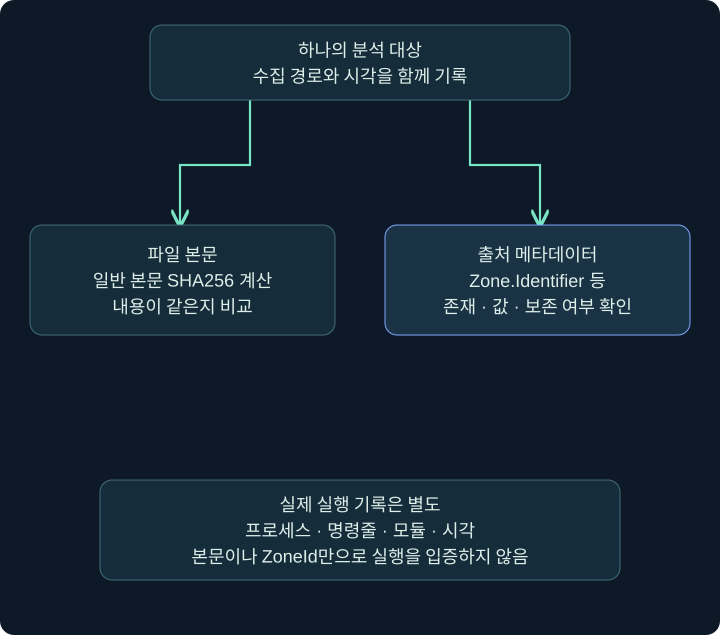
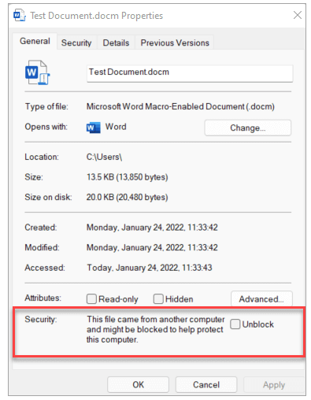
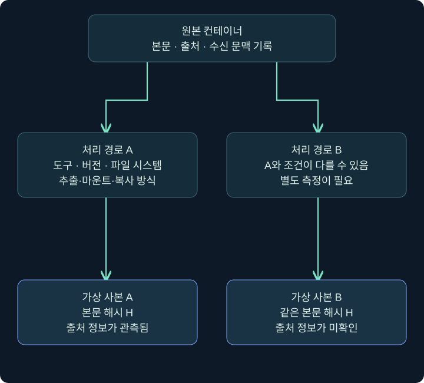
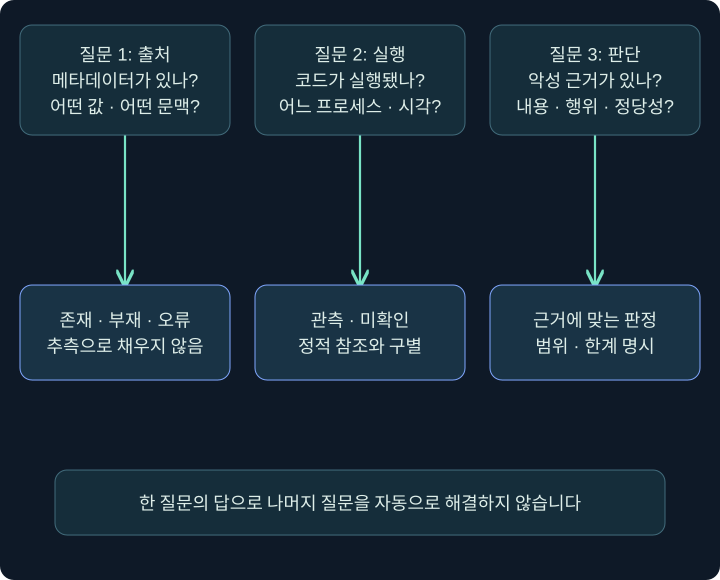

## 1. 포장을 풀면 파일의 출처도 그대로 남을까요?

웹에서 받은 ZIP에는 경고가 보였는데 안의 PDF에는 같은 표시가 보이지 않습니다. 그러면 PDF는 안전해진 것일까요? 아닙니다. 포장 형식, 복사·추출 프로그램, 파일 시스템과 정책이 출처 정보 처리에 영향을 줄 수 있습니다. 출처 표시가 없다는 사실과 내용이 안전하다는 판단은 다릅니다.

**컨테이너(container)**는 여러 구성 요소를 묶는 포장을 설명합니다. ZIP 같은 압축 파일, ISO·IMG 같은 디스크 이미지, 설치 패키지는 처리 방식이 다르지만 구성 요소를 묶는 역할을 할 수 있습니다. 안에 어떤 내용이 있고 사용자가 어느 항목과 상호작용했는지를 분리해 봅니다.

이번 강의는 포장을 만들거나 보호 표시를 제거하는 실습이 아닙니다. 출처 정보가 어디에 있고 어떻게 읽으며 무엇을 결론낼 수 있는지 배웁니다. Python 합성 자료 해석은 실제 실행했고, Windows의 스트림 조회·추출·마운트는 수행하지 않았습니다.

## 2. 파일 본문과 출처 정보는 다른 층입니다

**Mark of the Web(MotW)**는 인터넷 등 특정 출처에서 온 파일임을 표시하는 정보와 관련된 Windows 보안 개념입니다. 파일에서는 흔히 `Zone.Identifier`라는 별도 데이터 스트림을 통해 볼 수 있습니다. 프로그램과 전달 경로가 관련 정보를 기록하고 소비하는 방식도 함께 확인해야 합니다.



그림에서 파일 본문의 SHA256과 출처 정보는 다른 갈래입니다. 본문이 같은 두 파일의 해시가 같더라도, 한쪽에 Zone.Identifier가 있고 다른 쪽에는 없을 수 있습니다. 파일 본문 해시 하나로 별도 메타데이터까지 같다고 말할 수 없는 이유입니다.

출처 정보는 악성코드 판별 결과가 아닙니다. 인터넷에서 받은 정상 문서도 Internet 영역일 수 있고, 악성 내용에 출처 정보가 없을 수도 있습니다. 또한 현재 저장된 문자열이 과거의 전달 경로를 변경 불가능하게 증명하는 인증서인 것도 아닙니다.

## 3. 실제 파일 속성의 어느 부분을 확인할까요?

### 실제 화면 19: 파일 Properties의 Security 영역



출처는 [Microsoft의 인터넷 매크로 차단 안내](https://learn.microsoft.com/en-us/microsoft-365-apps/security/internet-macros-blocked)입니다. 화면은 공식 문서의 DOCM 예시이며, 이 강의에서 내려받아 확인한 파일이 아닙니다. 빨간 테두리는 원본에 포함되어 있습니다.

승인된 파일 사본의 **우클릭 → 속성(Properties) → 일반(General)**을 엽니다. 아래 **보안(Security)** 안내에 다른 컴퓨터에서 온 파일이라는 설명과 **차단 해제(Unblock)** 칸이 있는지 읽습니다. 체크하거나 적용하지 않고 현재 상태를 기록한 뒤 **취소(Cancel)**로 닫습니다. 조사 중 출처 정보를 바꾸면 비교해야 할 원래 상태가 달라지기 때문입니다.

이 영역이 보이지 않아도 ‘인터넷에서 오지 않았다’고 확정할 수 없습니다. 파일 시스템·전달 프로그램·복사 경로·기존 처리 이력·정책에 따라 다를 수 있습니다. UI 표시와 스트림 조회 결과를 실제 환경 문맥에 연결해야 합니다.

## 4. Zone.Identifier를 PowerShell로 읽습니다

다음은 Windows에서 기존 분석 사본을 조회하는 미실행 예제입니다. 파이프 뒤에 파일 쓰기나 실행 명령을 연결하지 않습니다.

```powershell
Get-Item -LiteralPath 'C:\Lab\review\training-note.txt' -Stream '*'

try {
    Get-Content -LiteralPath 'C:\Lab\review\training-note.txt' `
        -Stream Zone.Identifier -ErrorAction Stop
}
catch {
    $_.Exception.Message
}
```

첫 줄의 `-Stream '*'`는 해당 파일에서 공급자가 보여 주는 스트림 목록을 조회합니다. 둘째 조회의 `-Stream Zone.Identifier`는 그 이름의 스트림 내용을 읽습니다. 줄 끝의 백틱은 PowerShell에서 명령을 다음 줄로 이어 적기 위해 사용했습니다. `-ErrorAction Stop`은 실패를 catch에서 다루기 위한 설정이지 보호 표시를 바꾸는 옵션이 아닙니다.

오류가 나면 메시지와 원인을 기록합니다. ‘스트림 없음’뿐 아니라 권한·경로·파일 시스템·공급자 지원 문제일 수 있어 모든 실패를 “MotW 없음”으로 바꾸지 않습니다. 아래는 형식을 이해하기 위한 가상 텍스트이며 실제 파일에서 읽은 출력이 아닙니다.

```ini
[ZoneTransfer]
ZoneId=3
HostUrl=https://training.example/note.txt
```

`HostUrl` 같은 값은 존재 여부와 해석에 도움이 되지만 모든 파일에 반드시 기록되는 필드가 아닙니다. 실제 URL에는 사용자 식별 정보나 토큰이 포함될 수 있으므로 공개 강의나 일반 보고서에 그대로 붙이지 않습니다. 이 예제의 `.example` 도메인은 설명용이며 접속하지 않습니다.

## 5. ZoneId는 영역 값이지 감염 점수가 아닙니다

| ZoneId | 영역 이름 | 해석할 때의 핵심 |
| --- | --- | --- |
| 0 | Local Machine | 로컬 영역 분류이지 안전 보증이 아닙니다 |
| 1 | Local Intranet | 인트라넷 영역이며 실제 정책을 확인합니다 |
| 2 | Trusted Sites | 신뢰 영역 설정과 연결되며 코드 안전 판정은 아닙니다 |
| 3 | Internet | 인터넷 영역으로 분류된 출처 정보입니다 |
| 4 | Restricted Sites | 제한 영역 분류입니다 |

숫자가 높다고 악성 확률이 높아지는 점수표가 아닙니다. 값이 없거나 형식이 잘못됐거나 예상 범위를 벗어나면 ‘확인 불가’나 ‘형식 오류’로 남깁니다. `ZoneId=0`으로 추측해 채우지 않습니다.

파일 출처의 영역, Office의 신뢰 위치, 인증서 서명, 실제 코드 실행은 별개입니다. 각 기능이 같은 값을 소비하거나 영향을 줄 수 있어도 결과를 하나의 “신뢰됨”으로 합치면 중요한 조건을 놓칩니다.

## 6. 추출·마운트·복사를 같은 작업으로 취급하지 않습니다

ZIP을 푸는 것, 디스크 이미지를 마운트해 보는 것, 다른 드라이브로 복사하는 것은 처리 경로가 다릅니다. 출처 정보의 전달 여부를 비교하려면 Windows 빌드, 추출 프로그램과 버전, 저장 파일 시스템, 원본 다운로드 프로그램, 실제 경로를 기록합니다.



그림은 차이가 날 수 있는 관계를 나타내며 특정 형식이 언제나 MotW를 없앤다는 뜻이 아닙니다. **‘ISO면 무조건 출처 표시가 사라진다’ 같은 고정 결론은 사용하지 않습니다.** 패치·도구·소비 프로그램에 따라 결과가 달라질 수 있기 때문입니다.

| 비교 시점 | 기록할 것 |
| --- | --- |
| 원본 수신 직후 | 파일 본문 해시·출처 스트림·다운로드 문맥 |
| 추출·마운트 후 | 도구·버전·처리 방식·내부 파일의 식별 정보 |
| 사본 확보 후 | 복사 목적지 파일 시스템·스트림 보존 여부 |
| 실행 조사 시점 | 현재 상태와 당시 실행·정책 기록의 연결 |

별도 제공된 실제 압축·이미지 파일과 Windows 실습 환경은 없으므로 특정 추출 도구의 결과표를 측정한 것처럼 만들지 않습니다. 실습 자료가 없을 때 일반 원리를 설명하는 것과 결과를 확인했다고 주장하는 것은 다릅니다.

## 7. 실제 실행한 합성 자료 해석 실습

이 강의는 [읽기 전용 출처 정보 해석기](../../assets/red-team-foundations/initial_access_review.py)를 제공합니다. Python 3.10 이상에서 외부 패키지 없이 실행할 수 있습니다. Windows 스트림을 수집하거나 파일을 추출·실행하는 도구가 아닙니다.

```bash
python3 initial_access_review.py --demo
```

이 명령은 제작 과정에서 Linux Python으로 **실제 실행했습니다**. 메모리 안의 합성 문구와 네 가지 메타데이터 사례를 해석합니다. 네트워크 요청은 0, 실행한 대상 파일도 0입니다. 모든 사례의 본문은 같은 `TRAINING_ONLY` 문구이고 본문 SHA256도 같습니다.

| 합성 사례 | 실제 확인한 해석 결과 | 그 결과로 주장하지 않는 것 |
| --- | --- | --- |
| internet | state=present, zone_id=3, zone=Internet | 감염 또는 실행 완료 |
| metadata-missing | state=missing, zone_id=null | 안전 또는 로컬 출처 확정 |
| invalid-zone | state=invalid, zone_id=null | 없는 값을 0으로 보정 |
| intranet | state=present, zone_id=1, zone=Intranet | 조직이 내용까지 승인함 |

모든 사례의 `execution_proven`은 `false`, `maliciousness`는 `undetermined`입니다. 이것은 악성 여부를 검사해 안전하다고 판정한 결과가 아니라, 입력 형식만으로는 실행과 악성을 입증하지 않는다는 도구의 범위 표시입니다.

## 8. 출력 일부를 한 줄씩 해석합니다

실제로 실행한 합성 Internet 사례의 핵심 필드는 다음과 같습니다. 본문 해시는 출력에 함께 포함되지만 여기서는 관련 부분만 보여 줍니다.

```json
{
  "state": "present",
  "zone_id": 3,
  "zone": "Internet",
  "host_url_present": true,
  "execution_proven": false,
  "maliciousness": "undetermined"
}
```

`state`는 해석 가능한 영역 값의 존재 상태입니다. `host_url_present`는 해당 키에 값이 있다는 뜻이며 URL에 접속하거나 진위를 검증했다는 뜻이 아닙니다. 도구는 URL 문자열 자체를 결과에 반복 출력하지 않습니다.

이미 텍스트로 내보낸 승인 자료는 `python3 initial_access_review.py --zone-text zone-copy.txt`처럼 읽을 수 있습니다. 이 명령은 사용자 파일에서 실행하지 않았습니다. 입력은 UTF-8 텍스트이고 최대 65,536바이트로 제한합니다. 크기 초과·읽기 실패·인코딩 오류는 오류로 처리하며, 불완전한 입력을 안전한 값으로 채우지 않습니다. 이 도구는 Windows의 모든 ADS·정책·파일 특성을 구현한 검증기가 아닙니다.

## 9. 출처·실행·판정을 서로 다른 질문으로 남깁니다



첫 질문에 답했다고 나머지 두 질문이 자동으로 해결되지 않습니다. MotW가 없으면 수집 경로·보존 여부를 확인하고, 실행이 의심되면 프로세스·파일·모듈·통신을 연결합니다. 악성 여부는 내용·출처·행위·업무 맥락 등 더 넓은 근거가 필요합니다.

조건을 바꿔 같은 본문 파일 두 개의 ZoneId가 다르다고 해 보겠습니다. 그 관측은 메타데이터 차이를 보여 줍니다. 어떤 도구가 언제 바꿨는지와 그 차이가 실제 보안 판단에 어떤 영향을 주었는지는 별도 확인합니다. 결과만 보고 누군가 의도적으로 보호를 우회했다고 동기를 붙이지 않습니다.

## 10. 복습과 바로 읽는 해설

### 복습 1. MotW가 없으면 파일이 안전한가요?

**해설:** 아닙니다. 메타데이터 부재와 내용 안전성은 다른 판단입니다. 전달·복사·수집 경로와 파일 시스템 지원을 확인합니다.

### 복습 2. 본문 SHA256이 같으면 출처 정보도 같나요?

**해설:** 일반적인 본문 해시는 별도 스트림까지 동일하다고 보장하지 않습니다. 원본과 사본의 출처 정보를 따로 확인해야 합니다.

### 복습 3. ZoneId=3은 감염을 뜻하나요?

**해설:** 인터넷 영역 분류입니다. 악성 여부·실행 여부·피해 결과는 그 값만으로 입증되지 않습니다.

### 복습 4. 스트림 조회 실패는 언제나 스트림 없음인가요?

**해설:** 아닙니다. 권한·경로·공급자·파일 시스템 문제일 수 있습니다. 오류 원인과 조회 범위를 기록합니다.

### 복습 5. ISO나 ZIP의 MotW 전달 결과를 형식만으로 고정할 수 있나요?

**해설:** 없습니다. Windows 빌드·패치·처리 도구·파일 시스템·프로그램에 따라 다를 수 있어 실제 조건을 기록해야 합니다.

### 복습 6. Properties의 Unblock을 눌러서 확인해야 하나요?

**해설:** 이 조회에서는 현재 표시를 읽고 변경하지 않습니다. 출처 표시를 바꾸면 조사 중 비교해야 할 원래 상태가 달라질 수 있습니다.

### 복습 7. 합성 실습의 missing과 invalid는 무엇이 다른가요?

**해설:** missing은 입력 메타데이터가 없는 사례, invalid는 제공된 텍스트에서 유효한 영역 값을 해석하지 못한 사례입니다. 둘 다 안전 판정으로 바꾸지 않습니다.

### 복습 8. 실제 검증 범위는 어디까지인가요?

**해설:** Python으로 메모리 안의 합성 문구·네 가지 메타데이터를 해석했습니다. Windows 스트림 수집·추출·마운트·코드 실행이나 실제 사건 판정까지 검증한 것이 아닙니다.

## 11. 공식 근거와 다음 학습

공식 자료 확인일은 **2026년 11월 3일**입니다. 공식 화면 외의 사례와 도구는 독립 제작했습니다.

- [Microsoft 인터넷 매크로 차단과 MotW](https://learn.microsoft.com/en-us/microsoft-365-apps/security/internet-macros-blocked): 출처 영역과 파일 속성의 의미.
- [URLZONE](https://learn.microsoft.com/en-us/previous-versions/windows/internet-explorer/ie-developer/platform-apis/ms537175%28v%3Dvs.85%29): 영역 값 정의.
- [Get-Item](https://learn.microsoft.com/en-us/powershell/module/microsoft.powershell.management/get-item), [Get-Content](https://learn.microsoft.com/en-us/powershell/module/microsoft.powershell.management/get-content): Windows 스트림 조회 계약.

다음 강의에서는 웹 응답으로 받은 바이트와 브라우저 안에서 조립된 파일을 구별하고, Cobalt Strike의 파일 호스팅 화면을 무해한 텍스트 예시로 읽습니다.
