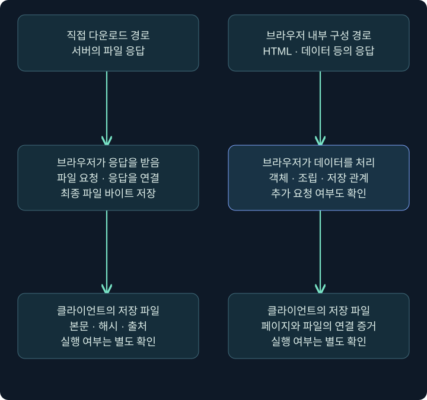
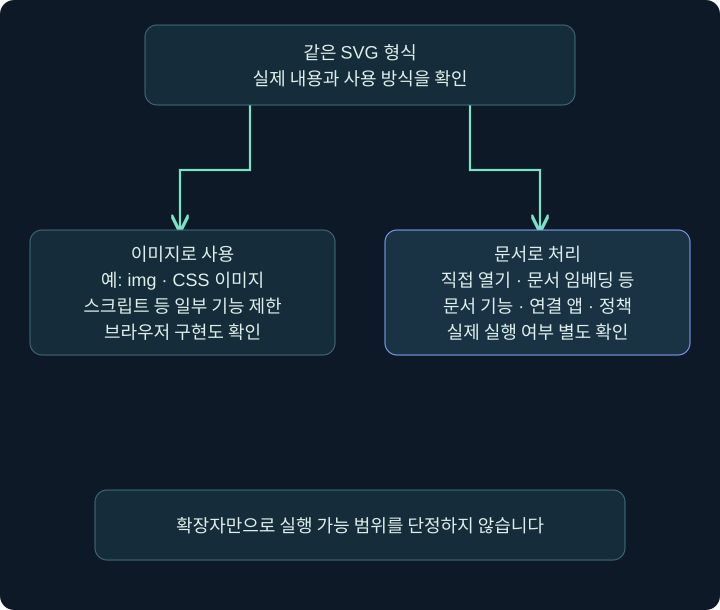
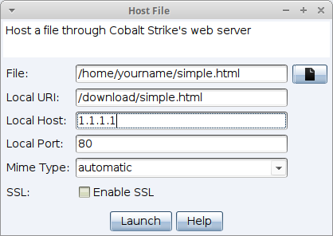
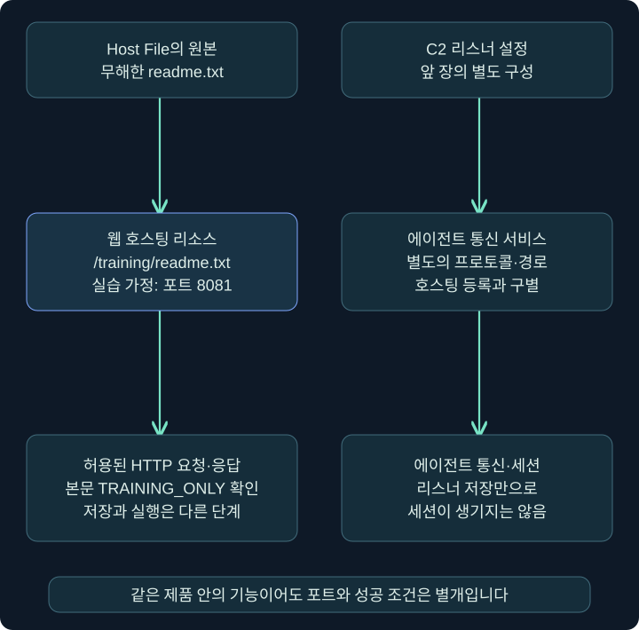

## 1. 다운로드 파일은 어디에서 만들어졌을까요?

웹 페이지를 본 뒤 다운로드 폴더에 파일이 생겼습니다. 네트워크에서 그 파일을 직접 내려받았을 수도 있고, 브라우저가 이미 받은 데이터를 조합해 파일을 만들었을 수도 있습니다. 두 경우의 최종 파일이 같아 보여도 네트워크와 단말에서 연결해야 할 증거는 다릅니다.

이번 강의는 HTML·SVG를 이용한 전달의 원리와 관측, Cobalt Strike의 **Host File** 화면을 다룹니다. 설정 예시는 격리 실습망의 단순한 안내문 `readme.txt`를 가정합니다. 실행 파일·매크로·자동 다운로드 페이지·입력 수집 페이지를 만들거나 전송하지 않습니다. 실제 웹 서버나 제품 기능을 실행한 결과도 아닙니다.

앞의 장에서 배운 구분을 한 번 더 적용해 보세요. 호스팅 설정, URL 접근, 브라우저의 파일 저장, 파일 실행, C2 세션 생성은 각각 다른 사건입니다. 마지막 사건을 보았다는 이유로 앞의 모든 전달 단계를 추측으로 채우지도 않습니다.

## 2. 직접 다운로드와 브라우저 내부 조립을 비교합니다

전통적인 직접 다운로드에서는 브라우저가 파일 URL을 요청하고 서버 응답의 바이트를 저장합니다. 반면 **HTML smuggling**이라고 부르는 전달 방식에서는 HTML·스크립트 등으로 받은 데이터를 브라우저 안에서 다시 구성해 저장 경로와 연결할 수 있습니다. 브라우저의 정상 기능이 악용될 수 있다는 원리입니다.

그림 오른쪽에서도 처음의 HTML·스크립트·포함 데이터를 전달하는 네트워크 활동은 있습니다. ‘최종 파일 이름의 HTTP 요청이 없다’와 ‘네트워크로 아무것도 받지 않았다’는 같은 결론이 아닙니다. 뒤에서 추가 리소스를 요청하는 구현도 있어 모든 사례가 네트워크 한 건으로 끝나는 것도 아닙니다.

Microsoft는 이러한 원리를 이용한 실제 캠페인을 연구했습니다. 그러나 브라우저의 데이터 처리·파일 저장 API 자체는 정상 웹 앱에서도 사용합니다. 특정 API 이름이나 인코딩 문자열만으로 악성 판정을 하지 않고, 전달 문맥·생성 파일·이후 실행까지 연결합니다.

## 3. Base64·Blob·blob URL을 서로 다른 개념으로 읽습니다

**Base64**는 바이트를 텍스트로 표현하는 인코딩입니다. 암호화와 다르므로 비밀 키가 있어야 읽을 수 있는 보호라고 설명하지 않습니다. **Blob**은 브라우저에서 데이터 덩어리를 표현하는 객체이고, **blob URL**은 그 객체를 참조하기 위한 브라우저 내부의 URL 형태입니다.

| 항목 | 분석에서 읽을 의미 | 단정하면 안 되는 것 |
| --- | --- | --- |
| Base64 데이터 | 표현을 바꾼 바이트일 가능성 | 곧바로 악성·암호화·탐지 불가 |
| Blob 객체 | 브라우저가 메모리 등에서 다루는 데이터 | 반드시 인터넷 서버에 있는 파일 |
| blob URL | 브라우저가 연결한 객체 참조 | 그대로 외부 DNS에 조회할 도메인 |
| 다운로드 파일 | 실제 저장된 바이트 | 저장 즉시 실행·침해 완료 |

관측 자료에 blob URL만 있다면 이를 외부 서버 URL처럼 조회해 원본을 찾으려 하지 않습니다. 대신 관련 페이지·스크립트·다운로드 메타데이터·저장된 파일을 연결합니다. 저장된 파일이 있다면 본문 해시·실제 형식·출처 정보도 별도로 기록합니다.

이 강의는 실행용 전달 스크립트 대신 구조를 읽는 원리를 설명합니다. 인코딩을 한 번 해석했다고 여러 단계의 최종 동작까지 검증한 것이 아니며, 내용을 해석한 범위와 아직 남은 층을 함께 적어야 합니다.

## 4. SVG는 어떻게 사용되는지에 따라 동작이 다릅니다

SVG는 XML 기반 벡터 그래픽 형식입니다. 확대해도 선명한 도형과 텍스트를 표현할 수 있어 이 과정의 개념도에도 사용합니다. 하지만 같은 `.svg`라도 단순 이미지로 삽입되는 경우와 문서로 열리는 경우를 구별해야 합니다.

MDN은 SVG를 이미지로 사용할 때 스크립트 등 일부 기능이 제한된다고 설명합니다. 따라서 ‘SVG에는 스크립트를 넣을 수 있으니 모든 미리보기와 이미지 표시가 코드를 실행한다’는 결론은 틀립니다. 반대로 모든 SVG 처리 경로가 무조건 같은 제한을 적용한다고 봐서도 안 됩니다. 임베딩 방식·기본 연결 프로그램·브라우저 정책과 실제 내용을 확인합니다.

분석 메모에는 ‘메일의 이미지 미리보기’, ‘브라우저에서 문서로 열림’, ‘다른 앱에서 처리됨’ 중 어떤 문맥이 관측됐는지 적습니다. 이 사이트의 독립 개념도는 정적 SVG이며 스크립트·외부 리소스·다운로드 동작을 포함하지 않습니다.

## 5. 네트워크와 단말에서 무엇을 연결할까요?

승인된 정상 실습 페이지의 관측을 연습한다면 브라우저의 **개발자 도구 → Network**에서 요청 URL·Status·Type·Initiator·응답 헤더를 볼 수 있습니다. 페이지 이동 전 로그를 유지하려면 **Preserve log**의 현재 상태를 확인합니다. 개발자 도구 UI·제품 버전에 따라 명칭은 달라질 수 있습니다. 실제 의심 페이지를 이 강의 과정에서 열지는 않았습니다.

| 관측 위치 | 확인할 것 | 한계 |
| --- | --- | --- |
| 메일·웹 게이트웨이 | 전달 링크·응답·검사·차단 결과 | 단말 내부의 모든 저장·실행을 보여 주지 않음 |
| 브라우저 요청 기록 | URL·응답·호출 주체·시간 | 암호화·캐시·기록 범위와 수집 시점을 고려 |
| 다운로드 기록·파일 | 원천 참조·본문·해시·MotW | 기록이나 메타데이터가 없을 수도 있음 |
| 프로세스·EDR | 저장 이후의 실제 실행·연관 행위 | 제품 구성과 관측 범위에 영향을 받음 |

TLS로 암호화된 통신의 내용 가시성과 엔드포인트 관측도 구별해야 합니다. MIME이 `text/html`이라는 사실만으로 내부 데이터가 안전하거나 보안 제품이 볼 수 없다고 말하지 않습니다. 저장 전·후 관측을 함께 확인해야 합니다.

## 6. 실제 Host File 화면의 입력 위치

### 실제 화면 20: Site Management → Host File

출처는 [Fortra Hosting Files](https://hstechdocs.helpsystems.com/manuals/cobaltstrike/current/userguide/content/topics/init-access_hosting-files.htm)입니다. 공식 원본은 `simple.html`, `1.1.1.1`, 포트 `80`, MIME `automatic` 예시입니다. 이 값들을 실제 대상으로 사용하지 않습니다. 아래의 사설 주소와 텍스트 파일은 **별도로 가정한 격리 실습망 예시**이며 실행하지 않았습니다.

제품에서 **Site Management → Host File**을 열면 파일과 웹 경로를 지정하는 창이 나옵니다. 로컬 파일 경로와 웹 URI는 다른 칸입니다. 파일 경로를 URL 칸에 그대로 넣는 실수를 피하려면 두 기준을 먼저 구별하세요.

| 화면 항목 | 의미 | 무해한 격리 실습 가정 |
| --- | --- | --- |
| File | 호스팅할 원본 파일을 선택 | 로컬의 readme.txt, 본문은 TRAINING_ONLY |
| Local URI | 웹 서버가 노출할 경로 | /training/readme.txt |
| Local Host | 안내할 URL의 호스트 정보 | 192.168.56.10 |
| Local Port | 이 웹 리소스의 서비스 포트 | 8081 |
| Mime Type | 응답의 콘텐츠 형식 | text/plain |
| Enable SSL | TLS 사용과 관련된 선택 | 이 가정에서는 미선택이며 HTTPS라고 표시하지 않음 |
| Launch | 지정한 리소스의 호스팅 시작 | 창의 설정 확인 후 수행하는 별도 동작 |

사설 주소라고 자동으로 실습용 장비가 되는 것은 아닙니다. 실제 사용 시에는 자신에게 허용된 격리망과 일치해야 합니다. `Local Host` 문자열을 적는 행위만으로 DNS·라우팅·방화벽·인증서가 준비되지는 않습니다. `Enable SSL`도 적절한 인증서와 제품 설정이 전제되며 체크 하나로 모든 환경의 HTTPS가 완성되는 것은 아닙니다.

## 7. 저장 후 어디에서 확인할까요?

설정이 실행된 환경에서는 **Site Management → Manage**에서 호스팅 리소스 목록을 확인하는 흐름입니다. 대상 행의 호스트·포트·경로가 의도한 텍스트 파일과 연결되는지 읽고, 해당 리소스의 **Copy URL**이 제공되면 표시 URL을 비교합니다. 실제 이 게시 과정에서 리소스를 등록하거나 URL에 접속하지 않았습니다.

격리 실습 가정을 문자열로 조합하면 `http://192.168.56.10:8081/training/readme.txt`입니다. 이는 접속을 확인한 링크가 아니라 항목들이 어떻게 URL을 구성하는지 보여 주는 예입니다. Host File의 8081과 앞 장의 Client 관리 포트·C2 리스너 포트를 혼동하지 않습니다.

| 확인할 단계 | 성공을 설명할 최소 근거 |
| --- | --- |
| 리소스 등록 | 관리 목록에 의도한 경로·파일이 있음 |
| HTTP 응답 | 허용된 클라이언트의 요청과 상태·본문을 확인 |
| 내용 일치 | 본문이 TRAINING_ONLY이고 예상 MIME인지 확인 |
| 파일 저장 | 클라이언트에서 실제 저장한 파일과 연결 |
| 코드 실행 | 텍스트 호스팅과 별도이며 이 예제에서는 수행하지 않음 |

목록에 행이 있는 것과 클라이언트가 접근할 수 있는 것은 다릅니다. 접근 실패를 해석할 때에는 호스트·포트·경로·라우팅·서비스 충돌·정책을 나누어 확인합니다. 이 예제는 다운로드한 텍스트를 실행하도록 구성하지 않습니다.

## 8. Site Clone과 파일 호스팅을 구별합니다

Site Clone은 페이지를 복제해 제공하는 기능이고 Host File은 지정한 리소스를 제공하는 기능입니다. 둘은 같은 메뉴 영역에 있어도 목적과 입력이 다릅니다. 페이지가 비슷하게 보인다는 사실, 파일이 전달됐다는 사실, 코드가 실행됐다는 사실은 따로 검증합니다.

공식 Clone Site 설명에서 **Clone URL**은 원본 페이지, **Local URI·Host·Port**는 제공할 페이지 주소, 리소스 지정 칸(일부 공식 삽화의 **Attack**, 안내서 본문의 **Embed**)은 연결할 리소스, **Log keystrokes**는 입력 기록과 관련된 선택 항목입니다. 이 강의는 각 항목의 의미를 구별하며 복제·자동 전달·입력 수집 설정을 수행하지 않습니다. 격리 실습의 안내문 전달은 앞 절의 Host File만으로 역할을 확인할 수 있습니다.

현대 브라우저의 자동 다운로드·프레임·보안 정책도 고려해야 합니다. 오래된 화면 설명의 ‘자동으로 다운로드된다’를 모든 브라우저에서 관측한 결과처럼 적지 않습니다. 페이지 전달을 확인했어도 다운로드 차단이나 사용자 동작 요구로 다음 단계가 달라질 수 있습니다.

## 9. 가상 사례를 최종 조사 메모로 바꿉니다

가상의 사건에서 ‘브라우저가 HTML을 받음’, ‘그 뒤 ZIP 파일이 생성됨’, ‘ZIP 안에 LNK가 있음’이라는 세 정보만 확보했다고 해 보겠습니다. 이 정보는 전달 방식을 조사할 이유가 됩니다. 하지만 HTML 내부 조립, LNK 실행, 후속 프로그램 실행을 모두 입증하지는 않습니다.

더 정확한 메모는 “HTML 응답과 ZIP 생성 사이의 연관성을 확인 중이며 브라우저 기록·저장 파일 해시·페이지 처리 내용을 추가 확인한다. 내부 LNK는 정적으로 확보했고 실행 여부는 미확인이다”입니다. 네트워크·브라우저·파일·실행을 차례로 연결하면 없는 증거를 한 번에 건너뛰지 않게 됩니다.

조건을 바꾸어 실제 실행 기록이 추가됐다면 그 프로세스의 명령줄·부모·파일 해시와 저장된 항목을 연결할 수 있습니다. 그래도 외부 통신이나 자료 유출까지 자동으로 확인되는 것은 아닙니다. 처음 배운 분류가 마지막 사고 판단에서도 그대로 도움이 됩니다.

## 10. 복습과 바로 읽는 해설

### 복습 1. 최종 파일 이름의 HTTP 요청이 없으면 아무것도 받지 않았나요?

**해설:** 아닙니다. 앞의 HTML·스크립트·포함 데이터 전달과 브라우저 처리 경로를 확인해야 합니다. 캐시와 기록 범위도 고려합니다.

### 복습 2. Base64는 암호화인가요?

**해설:** 바이트를 텍스트로 표현하는 인코딩입니다. 비밀 키 기반 보호와 다르며 그 존재만으로 악성이나 탐지 불가를 뜻하지 않습니다.

### 복습 3. blob URL을 외부 서버 주소처럼 조회하면 되나요?

**해설:** 브라우저 객체 참조 문맥을 먼저 확인합니다. 관련 페이지·처리 코드·다운로드·저장 파일을 연결해야 합니다.

### 복습 4. 모든 SVG 표시에서 스크립트가 실행되나요?

**해설:** 아닙니다. 이미지로 사용될 때와 문서로 처리될 때의 기능 제한이 다를 수 있습니다. 임베딩·브라우저·정책을 확인합니다.

### 복습 5. Host File의 File과 Local URI는 같은 경로인가요?

**해설:** File은 원본 파일 선택, Local URI는 웹에서 제공하는 경로입니다. 로컬 파일 시스템과 URL의 기준이 다릅니다.

### 복습 6. 호스팅 목록에 있으면 클라이언트 다운로드도 성공했나요?

**해설:** 등록만 확인한 것입니다. 실제 요청·응답·내용·저장을 각각 확인해야 합니다. 네트워크 도달성도 별도입니다.

### 복습 7. 페이지가 복제되면 파일 실행까지 보장되나요?

**해설:** 아닙니다. 페이지 표시·리소스 전달·브라우저 정책·저장·실행은 다른 단계입니다. 각 단계의 근거가 필요합니다.

### 복습 8. 이번 장의 실제 실행 검증은 무엇이었나요?

**해설:** 5강의 합성 자료 Python 해석입니다. Windows·Office·제품 호스팅·메일 전송·실행 패키지를 실제 수행한 결과는 아닙니다. 공식 화면과 가정 예시를 구별합니다.

## 11. 공식 근거와 장 마무리

공식 자료 확인일은 **2026년 11월 3일**입니다. 공개 Fortra 4.13 문서와 Microsoft·MDN 설명을 대조했습니다. 제품 원본 화면은 실제 새 실습 결과와 구별합니다.

- [Microsoft HTML smuggling 원 연구](https://www.microsoft.com/en-us/security/blog/2021/11/11/html-smuggling-surges-highly-evasive-loader-technique-increasingly-used-in-banking-malware-targeted-attacks/): 브라우저 내부 조립 전달의 역사적 관측.
- [MDN Blob](https://developer.mozilla.org/en-US/docs/Web/API/Blob), [blob URL](https://developer.mozilla.org/en-US/docs/Web/URI/Reference/Schemes/blob), [SVG as an image](https://developer.mozilla.org/en-US/docs/Web/SVG/Guides/SVG_as_an_image): 데이터 표현과 처리 문맥.
- [Microsoft Edge Network 도구](https://learn.microsoft.com/en-us/microsoft-edge/devtools/network/): 요청·응답·호출 주체 확인.
- [Fortra Hosting Files](https://hstechdocs.helpsystems.com/manuals/cobaltstrike/current/userguide/content/topics/init-access_hosting-files.htm), [Website Cloning](https://hstechdocs.helpsystems.com/manuals/cobaltstrike/current/userguide/content/topics/init-access_clone-a-site.htm): 메뉴와 기능의 구별. 화면·실제 버전에 따른 차이는 확인해야 합니다.

5장에서는 전달·포장·트리거·실행 내용·표시 자료를 나누고, 로딩·설치·출처·브라우저·단말의 증거를 연결했습니다. 실제 사건을 읽을 때도 ‘어디까지 직접 확인했는가’를 질문하면서 같은 방법을 적용해 보세요.
