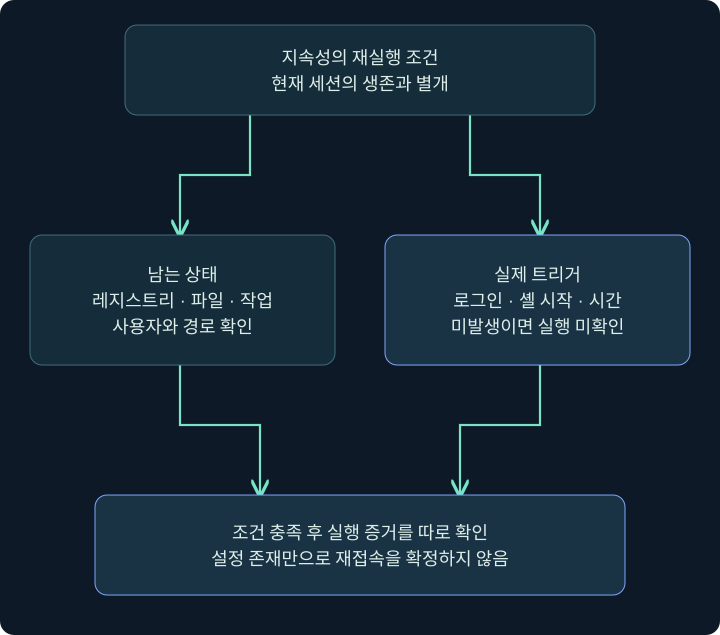
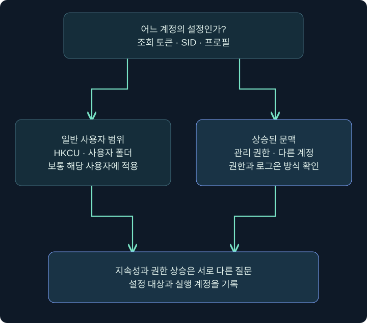
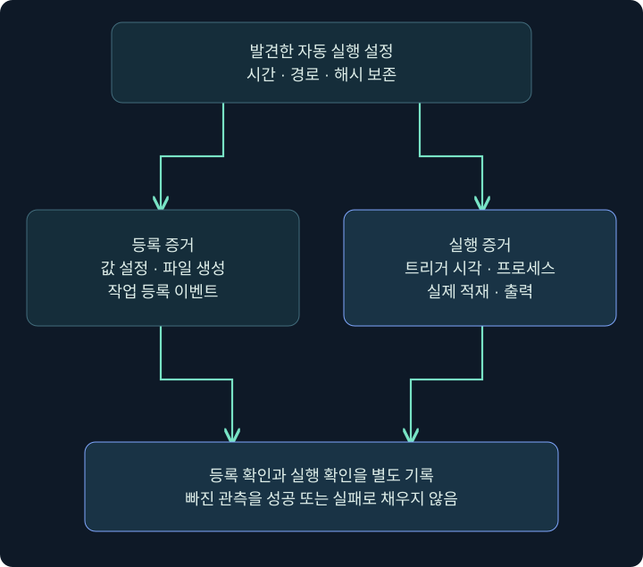

## 1. 세션이 끊어져도 남는 것은 무엇일까요?

원격 지원 담당자가 연결을 끊었다고 컴퓨터의 예약 작업까지 없어지지는 않습니다. 반대로 예약 작업이 남아 있다고 지원 연결이 계속 살아 있는 것도 아닙니다. **현재 실행 중인 연결**과 **나중에 다시 실행될 조건**을 구별하면 지속성(Persistence)을 이해하기 쉬워집니다. 지속성은 재부팅·로그오프·프로세스 종료 같은 중단 뒤에도 다시 동작할 기회를 유지하려는 목적입니다.

창고의 문이 지금 열려 있는 상태를 현재 세션에 비유해 봅시다. 내일 아침 관리자가 열도록 예약된 장치는 재실행 조건에 가깝습니다. 예약표가 있어도 관리자가 출근하지 않거나 장치 전원이 꺼져 있으면 문은 열리지 않습니다. Windows에서도 설정·사용자·트리거·프로그램·실행 조건이 맞아야 합니다.

이 장은 일반 사용자 범위의 Run·RunOnce, 시작 폴더, 로그온 스크립트, PowerShell 프로필, 예약 작업, COM 등록을 다룹니다. 정상 자동 실행과 그 악용은 같은 기능을 공유하므로 구성과 실행 증거를 연결합니다. 실습은 현재 사용자·격리 VM의 무해한 메모장 예와 읽기 전용 조회를 중심으로 진행합니다.

## 2. 지속성을 다섯 칸으로 나누어 읽기

| 질문 | 기록할 항목 | 가상 예제의 의미 |
|---|---|---|
| 무엇이 남는가? | 레지스트리 값·파일·작업 정의 | 자동 실행을 요청하는 상태 |
| 누구에게 적용되는가? | SID·프로필·설정 범위 | HKCU의 기준이 되는 사용자 |
| 언제 실행 기회가 생기는가? | 로그인·셸 시작·시간·이벤트 | 단순 재부팅과 다른 트리거 |
| 무엇이 실행되는가? | 전체 경로·인수·작업 폴더·DLL | 표시 이름과 다른 실제 대상 |
| 무엇으로 확인했는가? | 설정·프로세스·적재·로그·결과 | 존재와 실행을 별도 입증 |

이름이 `TrainingNote`인 예약 작업에서 동작이 메모장이라면 이름·설명·작성자는 참고 메타데이터입니다. 실제 동작은 Actions의 프로그램과 인수에 있습니다. 작성자에 유명 회사명이 들어 있어도 그 문자열만으로 회사가 작성했다고 증명할 수 없습니다.



왼쪽은 남는 구성, 오른쪽은 발생해야 할 사건입니다. 아래 상자는 둘이 맞아도 실제 실행을 확인하라는 판단입니다. 실행 결과 사진이 아닌 독립 개념도입니다.

## 3. HKCU의 현재 사용자는 누구인가요?

HKCU는 HKEY_CURRENT_USER의 약자로, 호출하는 문맥의 사용자 레지스트리를 가리킵니다. 화면 앞의 사람, Client 운영자, 대상 세션의 Windows 사용자, 나중에 작업을 실행할 계정은 다를 수 있습니다. Client 로그인 이름을 Windows 사용자로 적으면 조사 대상이 틀어집니다.

가상의 `LAB-PC\student`와 `LAB-PC\helper`는 같은 컴퓨터를 써도 프로필과 HKCU가 다릅니다. student의 시작 폴더 항목이 helper 로그인에도 항상 실행된다고 가정하지 않습니다. 다른 사용자 하이브가 로드되어 있는지도 별도 조건입니다.

| 범위 | 조사할 위치 | 주의할 경계 |
|---|---|---|
| 현재 사용자 | HKCU·사용자 시작 폴더·프로필 | 조회 토큰과 대상 SID |
| 컴퓨터 기본 설정 | HKLM·공통 시작 폴더 | 읽기와 쓰기 권한의 차이 |
| 예약 작업 | Principal·LogonType·RunLevel | 트리거 사용자와 실행 계정 |
| COM | HKCU/HKLM Software Classes | 호출자·UAC·아키텍처·뷰 |

일반 사용자로 등록한 자동 실행이 다음 로그인에도 같은 사용자로 실행된다면 권한 상승이 입증된 것은 아닙니다. 지속성과 권한 상승은 별도 질문입니다. 3장에서 배운 접근 토큰과 무결성 수준을 여기서 적용합니다.



## 4. Cobalt Strike에서 대상 세션 고르기

### 실제 화면 30: Cobalt Strike에서 대상 세션 고르기


출처: [Fortra Sessions](https://hstechdocs.helpsystems.com/manuals/cobaltstrike/current/userguide/content/topics/ui_session-target-visualizations.htm). 공식 삽화의 호스트·사용자·시각은 강의의 실습값과 다릅니다. 과거 버전 화면이 포함될 수 있으며 현재 설치 버전의 메뉴·열을 확인해야 합니다. 직접 실행해 얻은 사진이 아닙니다.

1. Client에 이미 허가된 실습 세션이 있다는 전제에서 상단 표를 봅니다.
2. 목표 컴퓨터를 Computer, Windows 계정을 User, 주소를 내부 주소 열과 맞춥니다. 열 이름은 버전에 따라 다를 수 있습니다.
3. 해당 행을 우클릭하고 **Interact**를 선택하여 콘솔을 엽니다. 선택한 행과 아래 콘솔 탭을 함께 확인합니다.
4. 여러 행을 동시에 선택하지 않습니다. 한 사용자·한 호스트를 비교하는 예제이므로 결과가 섞이면 해석할 수 없습니다.
5. 운영 기록에 대상·사용자·시각·조회할 레지스트리 뷰를 적습니다. 표의 사용자 정보만으로 토큰 전체가 확인되는 것은 아닙니다.

## 5. 콘솔 입력 줄과 레지스트리 조회

### 실제 화면 31: 콘솔 입력 줄과 레지스트리 조회


출처: [Fortra Beacon Console](https://hstechdocs.helpsystems.com/manuals/cobaltstrike/current/userguide/content/topics/post-exploitation_main.htm). 그림은 배치를 보여 줍니다. 아래 조회를 실행한 사진이 아닙니다. 이 장의 모든 Windows 설정을 하나의 전용 Persistence 대화상자에서 설정한다고 설명하지 않습니다. 기본 콘솔 명령·추가 확장·Windows 관리 화면을 구별합니다.

1. 아래 `beacon>` 줄을 클릭합니다. 여기에 PowerShell 문법을 그대로 입력하지 않습니다.
2. `help reg`를 입력하고 Enter를 눌러 설치 버전의 도움말을 확인합니다.
3. 공식 `reg query [x86|x64] [root\path]` 문법과 맞는지 확인한 뒤 아래 예를 한 줄씩 입력합니다.
4. 위 기록에서 입력 시각, 작업 전달 상태, 돌아온 출력 또는 오류를 읽습니다. 응답이 오기 전을 빈 결과라고 판단하지 않습니다.
5. 루트·경로·뷰·사용자를 출력과 함께 기록합니다. 읽기 전용 조회에는 Windows 설정을 저장하는 Save 버튼이 없습니다.

```text
help reg
reg query x64 HKCU\Software\Microsoft\Windows\CurrentVersion\Run
reg query x64 HKCU\Environment
```

`x64`는 조사할 레지스트리 뷰를 명시한 예입니다. 대상 OS와 조사 목적에 맞춰 고릅니다. 모든 키가 32/64비트별로 다르다는 의미는 아닙니다. 과거 자료의 `reg_query`나 확장의 `reg_set`을 같은 기본 명령의 다른 철자로 취급하지 않습니다. 설치 도움말이 다르면 먼저 그 문법과 확장 출처를 확인합니다.

| 출력 상태 | 확인한 내용 | 아직 확인하지 못한 내용 |
|---|---|---|
| 값 목록 반환 | 해당 문맥·뷰의 구성 | 로그인 뒤 실제 실행 |
| 키 찾기 실패 | 해당 조회의 실패 | 다른 사용자·뷰의 전체 부재 |
| 접근 거부 | 권한·문맥 점검 필요 | 자동 실행 설정 부재 |
| 응답 대기 | 연결·작업 상태 점검 필요 | 조회 성공 또는 빈 목록 |

## 6. 등록·트리거·실행·결과는 별개입니다

정상 앱 설치가 Run 값을 만들고 다음 로그인에 창을 띄운다고 해 봅시다. 값 변경은 등록, 사용자 로그온은 트리거의 맥락, 프로세스 생성은 실행의 일부, 기대 파일 생성은 결과입니다. 한 줄의 SUCCESS를 네 단계의 성공으로 확대하지 않습니다.



콘솔 입력은 운영자가 작업을 요청한 기록입니다. 서버가 작업을 보관한 상태와 대상의 결과 반환은 다릅니다. 세션이 다시 보여도 호스트·사용자·프로세스와 재실행 원인을 확인해야 합니다. 수동 실행한 다른 프로세스가 만든 세션일 가능성도 남습니다.

## 7. 어떤 이벤트를 연결할까요?

| 질문 | 참고 자료 | 한계 |
|---|---|---|
| 값이 바뀌었나? | Sysmon 12·13·14·EDR | 수집된 키와 이벤트만 관측 |
| 프로세스가 생겼나? | Sysmon 1·Security 4688 | 사용자·명령줄·ProcessGuid·시각 필요 |
| 모듈이 적재됐나? | Sysmon 7·ProcMon Load Image | ImageLoad는 별도 수집 설정 필요 |
| 작업이 등록됐나? | Security 4698와 작업 정의 | 감사 정책·보존 기간에 의존 |
| 목적한 동작을 마쳤나? | 종료·산출물·앱 기록 | 등록·프로세스 시작만으로 대체 불가 |

이벤트는 공급자와 채널까지 적습니다. 숫자가 같아도 공급자가 다르면 의미가 다릅니다. 현재 상태 조회만 있으면 과거 생성 주체와 시각은 미확인으로 남깁니다. 로그 부재는 미발생뿐 아니라 미수집·필터 제외·보존 기간 경과로도 설명됩니다.

## 8. 정상 기능과 의심 항목 비교하기

정상 업데이트 프로그램도 사용자 폴더와 예약 작업을 사용할 수 있습니다. 프로그램 이름에 Update나 Microsoft가 들어 있다고 정상이라는 보장은 없습니다. 배포 이력·기업 기준·서명·실제 경로·변경 주체·주변 시간표를 함께 비교합니다.

사례 A는 회사 배포 기록 직후 Run 값이 생기고 서명된 앱이 로그인에 실행됩니다. 사례 B는 파일 다운로드 직후 기존 Run 값의 데이터가 다른 경로로 바뀝니다. 자동 실행이라는 공통점이 있어도 정상 변경 확인과 조사 우선순위는 달라집니다. 서명 유무 하나로 결론을 내리지 않습니다.

보고서에는 `HKCU Run에서 항목 발견`이라는 사실과 `최근 파일 수신과 연관 가능`이라는 가설을 다른 문장에 씁니다. 명령·시각·대상·증거 위치를 남겨 다른 사람이 같은 범위에서 검토할 수 있게 합니다.

## 9. 변경 전후와 복구를 기록하기

Windows 화면 예는 소유한 격리 VM의 현재 사용자와 `TrainingNote`라는 학습 이름을 가정합니다. 기존 같은 이름의 항목이 있으면 덮어쓰지 않습니다. 실제 업무 항목 대신 별도 실습 환경에서 시작합니다.

변경 전에 값·유형·경로·권한·파일 해시를 보존합니다. 변경 후에는 정의 조회와 후속 실행을 따로 확인합니다. 정리는 새 학습 항목만 대상으로 하고 원래 값은 복원합니다. 설정을 지워도 이미 열린 메모장이나 셸이 남을 수 있으므로 프로세스 수명도 확인합니다.

이 장의 Windows·Cobalt Strike 화면 절차는 미실행 예제입니다. 6강에서는 Windows 변경 없이 합성 XML을 읽는 Python 예제만 실제 실행해 정적 분석과 실행 확인의 차이를 체험합니다.

## 10. 복습과 바로 읽는 해설

### 복습 1. 지속성이 남으면 현재 세션도 살아 있나요?

**해설:** 별개입니다. 프로세스가 종료돼도 구성이 남을 수 있고, 설정이 있어도 트리거가 없어 새 실행이 없을 수 있습니다.

### 복습 2. Client 로그인 이름이 HKCU 사용자인가요?

**해설:** 운영자와 Windows 실행 토큰은 다른 문맥입니다. 대상 사용자·SID·프로필을 확인합니다.

### 복습 3. 사용자 자동 실행은 권한 상승인가요?

**해설:** 같은 계정의 재실행은 권한 상승 증거가 아닙니다. 토큰·권한 변화는 별도로 확인합니다.

### 복습 4. 응답이 없으면 키가 비었나요?

**해설:** 작업 대기·연결·응답 상태를 확인합니다. 미응답은 빈 결과가 아닙니다.

### 복습 5. reg_query와 reg query를 섞어도 되나요?

**해설:** 버전과 확장에 따라 다른 명령입니다. 설치 도움말과 공식 문서에 맞춰 사용합니다.

### 복습 6. 등록 성공이면 재실행도 확인됐나요?

**해설:** 등록만 확인됐습니다. 트리거·프로세스·결과를 연결해야 합니다.

### 복습 7. Sysmon 로그 부재는 변경 부재인가요?

**해설:** 수집 설정·필터·보존 기간을 먼저 확인해야 합니다. 미수집과 미발생은 다릅니다.

### 복습 8. 설정 삭제만으로 복구가 완료되나요?

**해설:** 원래 설정·남은 프로세스·다음 트리거·증거 보존을 나누어 확인합니다.

## 11. 공식 자료와 적용 범위

확인일: **2026년 11월 4일**. 제품·Windows 실행은 수행하지 않았습니다. 공식 삽화와 설치된 제품의 버전은 다를 수 있습니다.

- [MITRE Persistence TA0003](https://attack.mitre.org/tactics/TA0003/): 목적과 분류.
- [Fortra Running Commands](https://hstechdocs.helpsystems.com/manuals/cobaltstrike/current/userguide/content/topics/post-exploitation_running-commands.htm): reg query와 콘솔 문법.
- [Fortra Beacon Console](https://hstechdocs.helpsystems.com/manuals/cobaltstrike/current/userguide/content/topics/post-exploitation_main.htm): 실제 콘솔.
- [Microsoft Sysmon](https://learn.microsoft.com/en-us/sysinternals/downloads/sysmon): 레지스트리·프로세스·적재 관측.
- [Microsoft Security 4698](https://learn.microsoft.com/en-us/previous-versions/windows/it-pro/windows-10/security/threat-protection/auditing/event-4698): 작업 생성 기록.
