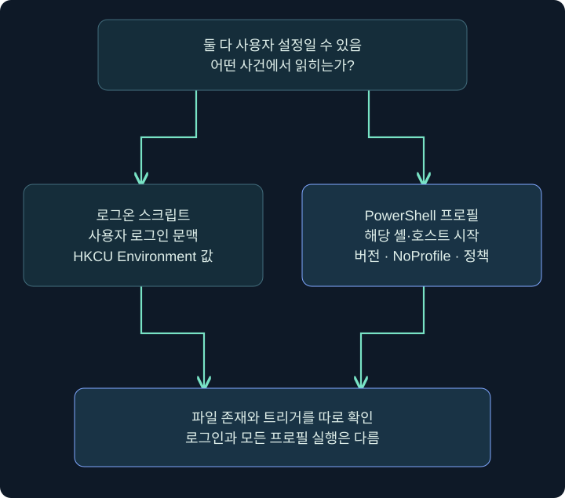
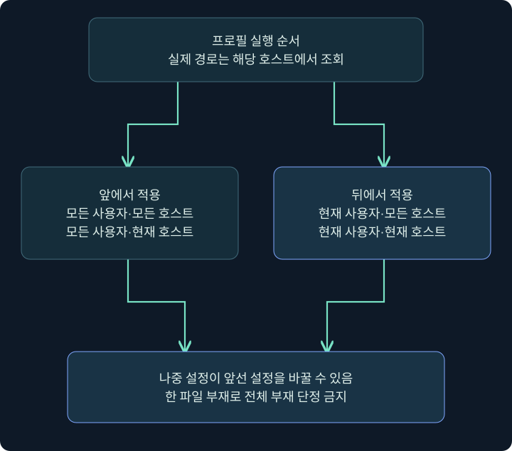
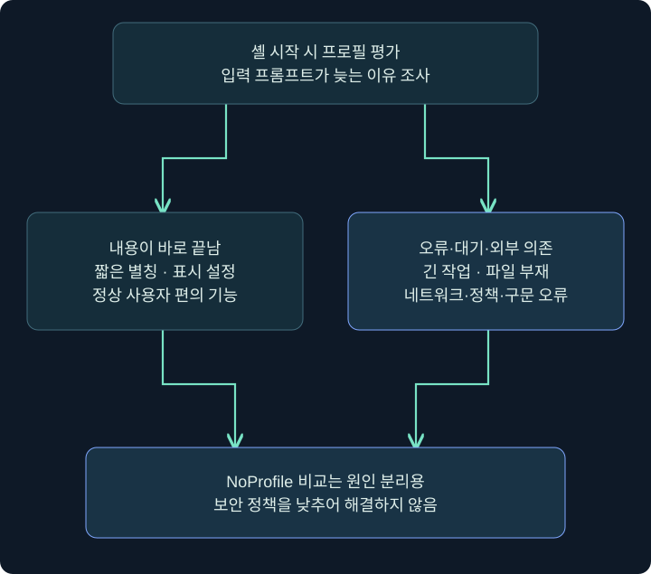

## 1. 로그인과 PowerShell 창 열기는 다른 사건입니다

사무실에 들어올 때 받는 안내와 개발 도구를 켤 때 불러오는 개인 설정은 다릅니다. Windows의 로그온 스크립트와 PowerShell 프로필도 비슷합니다. 둘 다 사용자 설정을 통해 코드를 다시 실행할 수 있지만 **언제, 누가, 어떤 프로그램에서 읽는가**가 다릅니다.

로그온 스크립트는 사용자 로그인 과정과 연결됩니다. PowerShell 프로필은 해당 PowerShell 세션·호스트의 시작과 연결됩니다. 사용자가 로그인해도 PowerShell을 시작하지 않았다면 프로필을 읽을 기회가 없을 수 있습니다. 반대로 로그인 한 번 뒤 셸 창을 여러 번 열면 같은 프로필이 여러 번 평가될 수 있습니다.

정상 사례는 드라이브 연결, 별칭, 프롬프트, 개발 환경 설정입니다. 의심 사례는 기존 설정의 내용이 예상하지 못한 프로그램 실행으로 바뀌는 것입니다. 파일 이름 하나보다 적용 범위·내용·변경 시점·실제 실행을 살펴봅니다.



## 2. 사용자 로그온 스크립트는 어디를 보나요?

이번 범위에서 확인할 항목은 다음 레지스트리 위치의 `UserInitMprLogonScript` 값입니다. 이름은 길지만 나누어 읽으면 사용자 초기화·네트워크 공급자·로그온 스크립트와 관련된 항목이라는 점을 기억하기 쉽습니다. 값 이름 철자까지 정확히 보존합니다.

```text
키: HKCU\Environment
값 이름: UserInitMprLogonScript
```

| 항목 | 확인할 내용 | 이유 |
|---|---|---|
| HKCU 사용자 | 조회 토큰·프로필·SID | 다른 사용자의 설정과 구별 |
| 값 이름·유형 | 정확한 이름과 REG_SZ/확장 문자열 등 | 이름과 데이터 혼동 방지 |
| 값 데이터 | 스크립트·명령 경로와 인수 | 실제 대상을 조사하기 위함 |
| 대상 파일 | 존재·내용·해시·서명·권한 | 값 존재만으로 실행 보장 불가 |
| 주변 기록 | 변경 주체·로그인·프로세스 | 정상 관리 설정과 악용 구분 |

HKCU Environment에는 Path·TEMP 같은 정상 사용자 환경도 있습니다. 이 키 전체를 삭제하면 정상 환경을 망가뜨릴 수 있습니다. 조사에서는 정확한 값만 보존하고 비교합니다. 도메인 그룹 정책의 로그온 스크립트나 다른 초기화 설정을 이 단일 값과 같은 저장 위치로 일반화하지 않습니다.

## 3. Cobalt Strike에서 로그온 항목 조회

### 실제 화면 34: Cobalt Strike에서 로그온 항목 조회


출처: [Fortra Beacon Console](https://hstechdocs.helpsystems.com/manuals/cobaltstrike/current/userguide/content/topics/post-exploitation_main.htm). 원본에 보이는 출력은 공식 예시이며 아래 Environment 조회 결과가 아닙니다. 사용자 정의 `reg_set` 확장의 설정창을 가정하지 않습니다.

1. 대상 세션 우클릭 → **Interact**를 선택합니다. 콘솔의 사용자·PID·호스트를 기록합니다.
2. 아래 입력 줄에 `help reg`를 입력하여 설치된 버전의 기본 조회 문법을 확인합니다.
3. `reg query x64 HKCU\Environment`를 입력하고 Enter를 누릅니다. 설정을 저장하거나 파일을 올리지 않습니다.
4. 응답이 돌아온 뒤 `UserInitMprLogonScript`의 존재, 유형, 데이터와 다른 환경값을 구별합니다.
5. 빈 목록·찾기 실패·접근 거부·작업 미응답을 각각 기록합니다. 미발견은 해당 사용자와 뷰의 조회 범위에 한정합니다.

```text
help reg
reg query x64 HKCU\Environment
```

이 예는 읽기 전용입니다. 값이 발견되면 그 파일을 실행하는 대신 내용을 정적으로 읽고 기업 배포 기준과 비교합니다. 나중에 변경이 승인된 실제 대응에서는 원래 상태를 보존하고 정확한 값만 다루어야 합니다.

## 4. PowerShell 프로필을 네 범위로 나누기

PowerShell 프로필은 세션 시작 때 환경을 준비하는 스크립트입니다. 모든 사용자/현재 사용자와 모든 호스트/현재 호스트의 두 축으로 네 범위가 있습니다. 여기서 호스트(host)는 컴퓨터 이름이 아니라 PowerShell을 담는 콘솔·ISE·VS Code 같은 프로그램 문맥을 뜻합니다.

| 적용 순서 | 자동 변수 | 범위 |
|---|---|---|
| 1 | $PROFILE.AllUsersAllHosts | 모든 사용자·모든 호스트 |
| 2 | $PROFILE.AllUsersCurrentHost | 모든 사용자·현재 호스트 |
| 3 | $PROFILE.CurrentUserAllHosts | 현재 사용자·모든 호스트 |
| 4 | $PROFILE.CurrentUserCurrentHost | 현재 사용자·현재 호스트 |

기본 `$PROFILE`은 현재 사용자·현재 호스트 경로입니다. `profile.ps1` 하나만 찾아서 모든 프로필을 확인했다고 말하면 나머지 범위가 빠집니다. 나중에 실행되는 프로필이 앞의 별칭이나 함수를 바꿀 수도 있습니다.



## 5. 경로는 추측하지 말고 해당 셸에서 읽기

Windows PowerShell 5.1은 보통 Documents 아래 `WindowsPowerShell`을, PowerShell 7은 `PowerShell`을 사용합니다. Documents 리디렉션이나 OneDrive, 호스트 프로그램에 따라 실제 경로가 달라질 수 있습니다. `C:\Users\이름\Documents`를 무조건 붙이지 말고 실제 세션의 자동 변수를 조회합니다.

아래 코드는 **Windows PowerShell 또는 pwsh의 입력 프롬프트**에 넣는 읽기 전용 예입니다. `beacon>` 줄에 그대로 넣는 명령이 아닙니다. 스크립트 내용을 실행하는 대신 존재·속성·본문을 읽습니다.

```powershell
$PSVersionTable.PSVersion
$Host.Name
$PROFILE | Select-Object *
Test-Path -LiteralPath $PROFILE.CurrentUserCurrentHost
if (Test-Path -LiteralPath $PROFILE.CurrentUserCurrentHost) {
    Get-Item -LiteralPath $PROFILE.CurrentUserCurrentHost |
        Select-Object FullName, Length, LastWriteTimeUtc
    Get-Content -LiteralPath $PROFILE.CurrentUserCurrentHost
}
```

| 입력·출력 위치 | 읽을 것 | 해석 |
|---|---|---|
| PSVersion 출력 | 실제 엔진 버전 | 파일 경로·동작 전제 |
| Host.Name | 콘솔·호스트 이름 | 현재 호스트 프로필 구별 |
| PROFILE의 속성 | 네 범위 실제 경로 | 조사 누락 방지 |
| Test-Path | 해당 경로 존재 | 존재 여부만 확인 |
| Get-Content | 텍스트 본문 | 실행 결과나 안전 보증은 아님 |

PowerShell 실제 프로필 편집창 사진은 확보하지 못했습니다. 공식 Cobalt Strike 콘솔 화면은 제품 입력 위치, 이 코드와 표는 Windows 셸의 미실행 예제로 구별합니다. 임의로 재구성한 터미널 그림을 실제 실행 캡처로 제시하지 않습니다.

## 6. 무해한 프로필 설정은 어떻게 설명하나요?

별도 격리 VM에서 프로필이 없는 현재 사용자·현재 호스트를 학습 대상으로 삼을 수 있습니다. 기존 프로필이 있으면 덮어쓰지 말고 본문을 보존하고 정적으로 읽는 데서 시작합니다. 이 강의는 원래 설정을 자동 덮어쓰는 명령을 제공하지 않습니다.

학습용 내용은 `Write-Output 'TRAINING_ONLY profile loaded'` 한 줄처럼 즉시 끝나는 표시로 충분합니다. 프로필 경로를 조회하고 텍스트 편집기로 해당 파일을 열어 그 한 줄을 저장한 뒤, 같은 PowerShell 버전·호스트를 새로 시작하여 표시를 확인하는 순서입니다. 이 절차는 미실행이며 실제 제품 사진으로 증명된 결과가 아닙니다.

| 단계 | 위치·값 | 확인할 것 |
|---|---|---|
| 대상 결정 | $PROFILE.CurrentUserCurrentHost | 현재 사용자·호스트 경로 |
| 편집 | 해당 파일의 텍스트 | 기존 내용 보존·학습 한 줄만 |
| 저장 | 편집기의 저장 | 다른 확장자 .txt가 붙지 않았는지 |
| 새 세션 | 같은 엔진·호스트 | 이전 세션 출력과 구별 |
| 비교 | 같은 셸의 -NoProfile 시작 | 프로필을 읽지 않는 비교 조건 |
| 정리 | 학습 한 줄 또는 새 학습 파일 | 기존 프로필 원형 복원 |

프로필이 자동으로 만들어진다고 가정하지 않습니다. 새 폴더·파일이 필요할 수 있지만 기존 환경을 바꾸기 전에 경로와 권한을 확인해야 합니다. 사용자 로그온 스크립트와 프로필을 동시에 바꾸면 원인을 분리하기 어려워집니다.

## 7. NoProfile과 실행 정책을 구별하기

`pwsh -NoProfile`은 새 PowerShell을 프로필 없이 시작하는 비교 방법입니다. 일반 시작에서는 지연되는데 NoProfile 시작은 빠르다면 프로필 내용·그 의존성에 조사 범위를 좁힐 수 있습니다. 이것만으로 악성 코드를 발견했다고 결론 내릴 수는 없습니다.

실행 정책(Execution Policy)은 스크립트 실행·프로필 로드에 영향을 줄 수 있지만 보안 경계 전체를 대신하는 기능은 아닙니다. 정책이 막고 있다면 적용 범위와 조직 설정을 확인합니다. 프로필을 실행시키기 위해 정책을 낮추거나 우회 옵션을 붙이는 방식으로 문제를 해결하지 않습니다.

호스트 차이도 중요합니다. VS Code에서만 보이는 함수가 일반 콘솔에 없으면 현재 호스트 프로필의 정상 차이일 수 있습니다. 한 엔진의 파일 부재를 다른 엔진까지의 부재로 확대하지 않습니다.

## 8. 프로필이 입력창을 막을 수도 있습니다

프로필이 긴 작업을 기다리거나 없는 네트워크 자원에 접근하면 입력 프롬프트가 늦어질 수 있습니다. 오류가 나면 세션 시작 때마다 반복될 수 있습니다. 따라서 정상 설정도 짧고 예측 가능해야 하며 자동 실행의 안정성과 사용성은 보안과 별도로 살펴야 합니다.



이 장에서는 지연 작업을 숨기거나 원격 코드를 내려받아 실행하는 예제로 보완하지 않습니다. 원인은 정적 내용·버전·파일 존재·정책·의존성으로 나누어 조사합니다. 셸을 강제로 반복 실행하면 동일한 부작용이 반복될 수 있으므로 먼저 내용과 경로를 보존합니다.

## 9. 증거와 복구는 어떻게 묶나요?

프로필 파일의 수정 시각만으로 누가 내용을 바꿨는지 알 수는 없습니다. 파일 변경 관측, 작성 프로세스, 사용자, 셸 시작 시각, 실제 명령 실행 흔적을 연결합니다. 시각·경로·해시를 보존하고 정상 개발 환경 설정과 비교합니다.

복구에서는 로그온 값과 프로필 파일을 구별합니다. 원래 로그온 경로를 복원해도 이미 시작한 프로세스가 남을 수 있습니다. 프로필에서 줄을 지워도 현재 세션에 이미 정의된 함수·별칭은 남을 수 있으므로 새 세션에서 확인해야 합니다. 모든 사용자 프로필을 통째로 지우는 방식은 정상 설정도 잃게 합니다.

가상 보고서의 좋은 문장은 `student의 현재 호스트 프로필에 새 표시 한 줄이 있고 다음 동일 호스트 시작 때 출력됨`입니다. `Windows 로그인 때마다 모든 셸에서 실행됨`은 그 자료로 입증하지 않은 일반화입니다.

## 10. 복습과 바로 읽는 해설

### 복습 1. 로그인하면 PowerShell 프로필도 항상 실행되나요?

**해설:** 해당 PowerShell·호스트를 시작하고 프로필을 읽는 조건이 필요합니다. 로그인과 셸 시작은 다릅니다.

### 복습 2. HKCU Environment 전체를 삭제하면 정리가 되나요?

**해설:** 정상 사용자 환경도 들어 있습니다. 정확한 값과 원래 상태를 구별해야 합니다.

### 복습 3. $PROFILE은 모든 프로필 경로의 하나뿐인 파일인가요?

**해설:** 기본값은 현재 사용자·현재 호스트 경로이고 속성으로 다른 범위를 조회합니다.

### 복습 4. 왜 네 범위의 순서를 보나요?

**해설:** 나중 프로필이 앞선 설정을 바꿀 수 있습니다. 한 파일만 보면 최종 환경 설명이 빠질 수 있습니다.

### 복습 5. 5.1과 7의 기본 프로필 폴더가 같나요?

**해설:** 보통 WindowsPowerShell과 PowerShell로 다릅니다. 실제 엔진·호스트에서 경로를 조회합니다.

### 복습 6. NoProfile에서 지연이 없어지면 악성인가요?

**해설:** 프로필 또는 그 의존성이 원인일 가능성을 좁힌 것입니다. 정상 긴 초기화도 가능합니다.

### 복습 7. Get-Content는 프로필을 실행하나요?

**해설:** 텍스트를 읽는 명령입니다. 읽었다는 사실과 실행 결과·안전성은 다릅니다.

### 복습 8. 프로필 줄을 지우면 현재 함수도 사라지나요?

**해설:** 이미 로드한 세션의 상태는 남을 수 있습니다. 원형 복원 후 새 세션으로 확인합니다.

## 11. 공식 자료와 적용 범위

확인일: **2026년 11월 4일**. Windows·셸·제품 실행은 하지 않았습니다. 프로필 경로·정책·호스트 차이는 해당 환경에서 확인해야 합니다.

- [MITRE T1037.001 Logon Script](https://attack.mitre.org/techniques/T1037/001/): 사용자 로그온 스크립트 악용 분류.
- [Microsoft about_Profiles](https://learn.microsoft.com/en-us/powershell/module/microsoft.powershell.core/about/about_profiles?view=powershell-7.6): 범위·순서·자동 변수·NoProfile.
- [Microsoft about_Execution_Policies](https://learn.microsoft.com/en-us/powershell/module/microsoft.powershell.core/about/about_execution_policies?view=powershell-7.6): 적용 범위와 정책의 의미.
- [Microsoft Get-Content](https://learn.microsoft.com/en-us/powershell/module/microsoft.powershell.management/get-content?view=powershell-7.6): 파일 본문 조회.
- [MITRE T1546.013 PowerShell Profile](https://attack.mitre.org/techniques/T1546/013/): 프로필 악용 분류.
- [Fortra Running Commands](https://hstechdocs.helpsystems.com/manuals/cobaltstrike/current/userguide/content/topics/post-exploitation_running-commands.htm): 기본 조회 명령과 실행 문맥.
