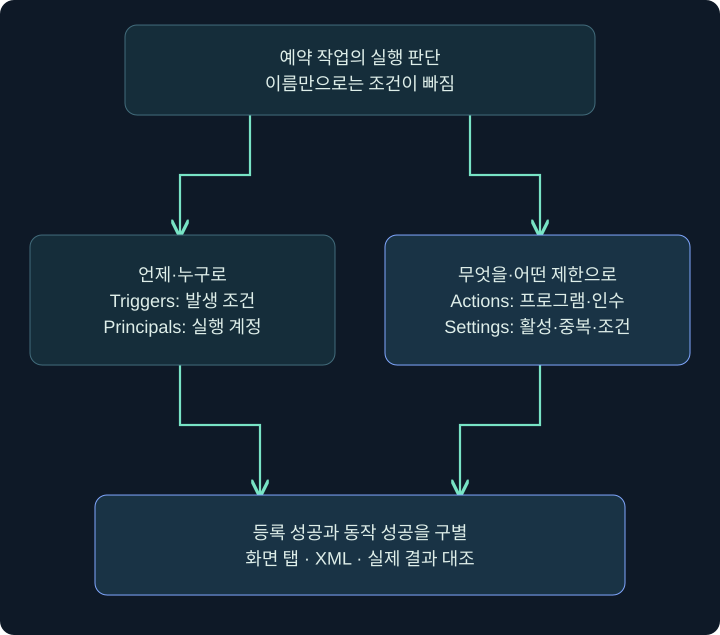
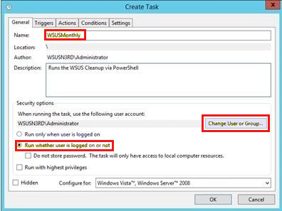
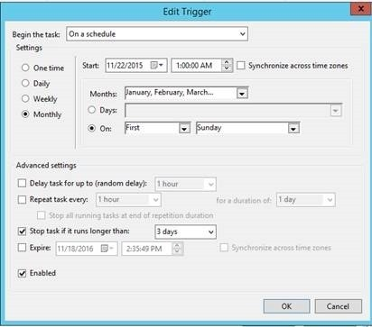
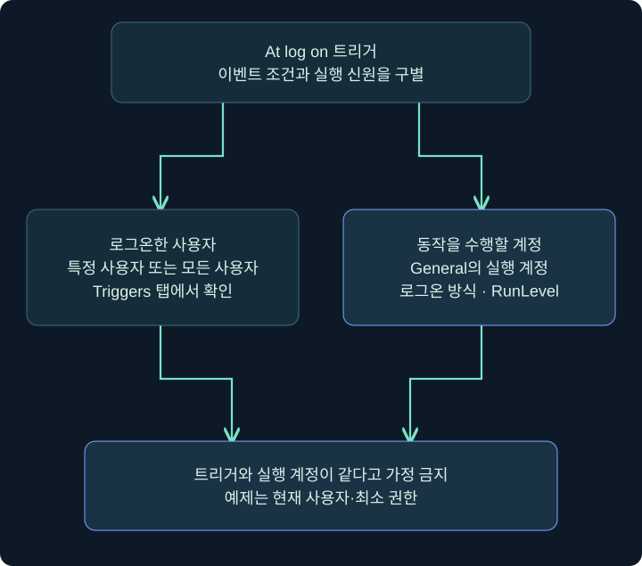
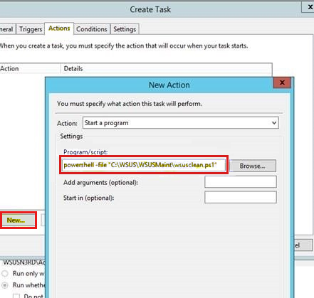
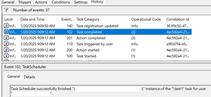
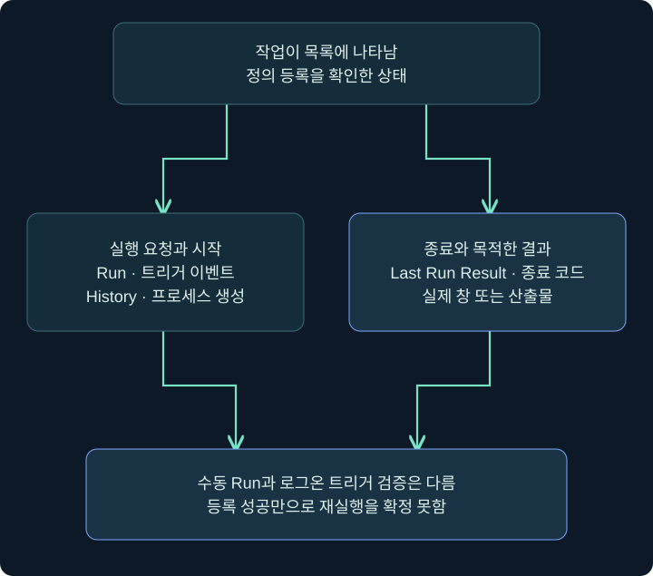

## 1. 예약 작업은 시간표와 실행 계약입니다

Windows 작업 스케줄러(Task Scheduler)는 정해진 시간이나 사건에 프로그램을 실행하는 기능입니다. 정상 업데이트·백업·유지관리에서도 널리 쓰입니다. 일정표에 제목만 적혀 있다고 누가 무엇을 해야 하는지 알 수 없는 것처럼, 작업 이름만 보면 실행 조건을 이해할 수 없습니다.

**언제(Triggers), 누구로(Principals), 무엇을(Actions), 어떤 제한 아래(Settings)**라는 네 질문으로 나누어 봅니다. 이 기능이 지속성에 쓰일 때도 핵심은 같은 네 요소입니다. 로그인 조건이 있다고 관리자로 실행되는 것도 아니고, 작업이 등록됐다고 동작이 끝난 것도 아닙니다.

이 강의는 공식 Windows 실제 화면에서 칸을 찾고, 격리 VM의 현재 사용자로 메모장만 여는 `TrainingNote` 학습 작업을 설명합니다. 실제 작업 등록·로그인·프로그램 실행은 수행하지 않은 절차입니다. 화면의 회사 유지관리 예시값과 강의 예시값을 구별합니다.



## 2. 관리 화면과 작업 정의를 대응시키기

| Windows 탭 | XML의 주요 위치 | 질문 |
|---|---|---|
| General | RegistrationInfo·Principals | 이름·실행 계정·로그온 방식·권한 |
| Triggers | Triggers | 로그인·시간·이벤트 등 시작 조건 |
| Actions | Actions·Exec | 프로그램·인수·작업 폴더 |
| Conditions | Settings의 관련 조건 | 유휴·전원·네트워크 등의 제약 |
| Settings | Settings | 활성·요청 실행·중복·시간 제한 |
| History | 별도 이벤트 기록 | 실제 등록·시작·종료가 관측됐는가 |

XML은 작업의 정의를 표현하는 형식입니다. History를 XML 정의의 한 탭이라고 생각하지 않습니다. 정의를 내보내면 실행 조건을 알 수 있지만 실제 과거 실행을 전부 알 수 있는 것은 아닙니다. 작성자·설명은 문자열이므로 실행 주체나 신뢰의 증명으로 대체하지 않습니다.

## 3. General에서 실행 계정 설정

### 실제 화면 35: General에서 실행 계정 설정



출처: [Microsoft WSUS 유지관리 안내](https://learn.microsoft.com/en-us/troubleshoot/mem/configmgr/update-management/wsus-maintenance-guide). 과거 Windows Server의 **Create Task** 원본입니다. 기존 작업 Properties 사진은 아니며 WSUSMonthly와 원본 계정을 강의에 복사하지 않습니다. 원본의 강조 표시도 그대로 보존했습니다.

1. Windows 시작 메뉴에서 **Task Scheduler(작업 스케줄러)**를 검색해 엽니다. 왼쪽 Task Scheduler Library를 선택합니다.
2. 새 격리 학습 작업은 오른쪽 **Create Task(작업 만들기)**를 엽니다. 단순 마법사 Create Basic Task와 같은 창이라고 설명하지 않습니다.
3. General의 Name에 `TrainingNote`를 입력합니다. 같은 이름의 기존 작업이 있으면 취소하고 덮어쓰지 않습니다.
4. Security options에서 현재 실습 사용자를 확인합니다. Change User or Group은 실행 계정을 바꾸는 기능이므로 사진 속 서버 계정으로 바꾸지 않습니다.
5. **Run only when user is logged on**을 선택합니다. 메모장 창을 같은 사용자의 대화형 환경에서 확인하기 위한 예제입니다.
6. **Run with highest privileges**와 Hidden은 선택하지 않습니다. 일반 사용자 메모장 실습에 상승 권한이나 숨김은 필요하지 않습니다.
7. 아직 전체 창의 OK로 끝내지 말고 Triggers와 Actions를 차례로 설정합니다. 필수 동작이 없는 빈 작업을 성공 예로 제시하지 않습니다.

| 칸 | 학습 예시 | 의미와 이유 |
|---|---|---|
| Name | TrainingNote | 명시적인 학습 이름 |
| Description | TRAINING_ONLY: opens Notepad | 목적을 짧게 기록 |
| 실행 계정 | 현재 격리 VM 사용자 | 다른 계정·SYSTEM 사용 없음 |
| 로그온 방식 | 사용자가 로그온한 경우만 | 창이 보이는 대화형 예 |
| Highest privileges | 해제 | 권한 상승과 지속성을 구별 |
| Hidden | 해제 | 구성과 검증을 쉽게 확인 |

## 4. Triggers에서 시작 조건 읽기

### 실제 화면 36: Triggers에서 시작 조건 읽기



출처는 같은 Microsoft 유지관리 문서입니다. **이 사진은 At log on 설정 사진이 아닙니다.** 월간 일정과 2015~2016년 시각을 보여 주는 역사적 예시입니다. 여기서는 Begin the task와 Enabled 등의 위치를 읽고 아래 학습 예제와 비교합니다.

1. 작업 창의 **Triggers → New**를 선택합니다. 기존 항목을 살펴보는 조사라면 선택 후 Edit로 내용을 읽고 Cancel을 사용합니다.
2. 위쪽 **Begin the task** 드롭다운을 찾습니다. 원본의 On a schedule 대신 학습 예에서는 **At log on**을 선택합니다.
3. 특정 사용자를 고르는 항목이 표시되면 현재 실습 사용자로 한정합니다. Any user와 특정 사용자 조건은 다릅니다.
4. 지연·반복·만료 같은 고급 조건을 확인하고 이 단순 예제에는 추가하지 않습니다. Enabled가 선택돼 있어야 활성 트리거라는 점을 확인합니다.
5. 내부 트리거 창의 OK를 누른 뒤 Triggers 목록에서 At log on과 대상 사용자를 다시 읽습니다. 이 단계도 실제 로그인 발생을 증명하지는 않습니다.



General의 실행 사용자와 Triggers의 로그온 사용자는 역할이 다릅니다. 예제에서는 둘을 같은 현재 사용자로 맞췄지만 다른 작업을 조사할 때 자동으로 같다고 쓰면 안 됩니다. XML에서도 트리거 UserId와 Principal UserId를 구별합니다.

## 5. Actions의 세 입력 칸

### 실제 화면 37: Actions의 세 입력 칸



공식 원본은 유지관리용 PowerShell 문자열이 Program/script에 들어 있는 과거 예시입니다. **그 복합 문자열을 권장 입력값으로 복사하지 않습니다.** 이 강의는 프로그램·인수·작업 폴더를 각각의 칸으로 나눕니다. 원본은 기존 작업의 실행 성공 사진도 아닙니다.

1. **Actions → New**를 선택하고 Action을 **Start a program**으로 둡니다.
2. **Program/script → Browse**에서 격리 VM의 정상 메모장 실행 파일을 선택합니다. 일반적인 예시는 `C:\Windows\System32\notepad.exe`이며 실제 존재 경로를 확인합니다.
3. **Add arguments**는 비워 둡니다. 아무 문서도 열지 않는 메모장 예제이므로 인수가 필요하지 않습니다.
4. **Start in**도 이 단순 예제에서는 비워 둡니다. 상대 경로를 사용하는 실제 작업이라면 작업 폴더가 별도 조건이 됩니다.
5. 내부 OK를 누른 뒤 Actions 목록의 실행 경로를 재확인합니다. Conditions·Settings의 전원·유휴·중복 실행 제한도 읽은 뒤 전체 창 OK로 저장합니다.

| 화면의 칸 | 예시 | 무엇을 혼동하지 말아야 하나요? |
|---|---|---|
| Action | Start a program | 작업 제목과 실제 동작 종류 |
| Program/script | 확인한 메모장 전체 경로 | 프로그램과 뒤의 인수 |
| Add arguments | 비움 | 필요 없는 옵션을 임의 추가하지 않음 |
| Start in | 비움 | 프로그램 위치와 현재 작업 폴더 |
| 내부 OK | 동작 항목 확인 | 작업 전체 저장과 구별 |
| 작업 전체 OK | 정의 저장 | 실제 트리거·실행과 구별 |

기존 작업을 조사할 때는 동일 탭에서 값을 읽고 Cancel로 닫습니다. 단순히 읽으려고 연 창에서 변경한 값을 OK로 저장하지 않습니다. 원본 스크린샷의 월간 서버 유지관리 작업을 실제 사용자 환경에 만들 필요는 없습니다.

## 6. 저장 뒤 목록과 XML 확인하기

전체 저장 뒤 Task Scheduler Library에서 정확한 이름·경로를 선택합니다. 다른 폴더의 같은 이름과 구별해야 합니다. 목록의 Ready 같은 상태는 현재 등록·대기 상태이지 다음 로그인 성공 보장이 아닙니다.

미실행 읽기 전용 Windows 예제는 다음과 같습니다. 첫 줄은 정의, 둘째 줄은 상세 상태를 봅니다. PowerShell이나 명령 프롬프트에서 Windows 프로그램으로 실행하는 문법입니다.

```text
schtasks.exe /query /tn "\TrainingNote" /xml
schtasks.exe /query /tn "\TrainingNote" /fo LIST /v
```

XML에서는 Triggers의 LogonTrigger, Principals의 사용자·LogonType·RunLevel, Actions의 Command와 Arguments, Settings의 Enabled와 조건을 대응시킵니다. 등록 이름이 맞아도 Enabled가 false이거나 트리거가 비활성이라면 기대와 다릅니다. 일부 속성은 XML에 생략되면 스키마 기본값을 사용하므로 단순 빈 문자열로 뜻을 만들어 내지 않습니다.

## 7. Cobalt Strike에서 같은 작업 조회

### 실제 화면 38: Cobalt Strike에서 같은 작업 조회


출처: [Fortra Beacon Console](https://hstechdocs.helpsystems.com/manuals/cobaltstrike/current/userguide/content/topics/post-exploitation_main.htm). 이 사진은 아래 schtasks 실행 결과가 아닌 콘솔 배치 예시입니다.

대상 세션 우클릭 → **Interact** → 아래 입력 줄 → `help run` → 프로그램과 조회 옵션 입력 → 위쪽 반환 출력 확인 순서입니다. 현재 토큰이 볼 수 있는 범위에서 조회하며 원격 호스트나 다른 계정 자격 증명을 추가하지 않습니다.

```text
help run
run schtasks.exe /query /tn "\TrainingNote" /xml
run schtasks.exe /query /tn "\TrainingNote" /fo LIST /v
```

`run`은 cmd.exe를 거치지 않고 프로그램을 실행해 출력을 돌려받는 Fortra 명령입니다. `shell`은 cmd.exe를 거치며 `execute`는 출력을 캡처하지 않습니다. 따라서 execute에서 출력이 없다고 작업이 없다고 해석하면 안 됩니다. `run`도 대상에 프로세스를 만들 수 있으므로 읽기 전용 조회라고 영향이 전혀 없는 관측은 아닙니다.

오류가 돌아오면 작업의 전체 경로·권한·지원 옵션을 확인합니다. 명령 이름이나 XML 등록 BOF 확장이 설치되지 않았다고 조회를 우회하기 위해 다른 확장을 무작정 로드하지 않습니다. 제품에서 입력·다운로드·출력 수신의 시각을 분리해 기록합니다.

## 8. History와 Last Run Result 읽기

### 실제 화면 39: History와 Last Run Result 읽기



출처: [Microsoft 예약 작업 실행 문제 해결](https://learn.microsoft.com/en-us/troubleshoot/windows-server/system-management-components/troubleshoot-scheduled-tasks-not-running). 전체 메인창이 아닌 History 탭의 일부입니다. 원본 Event 102 Task completed를 우리 메모장 실행 결과로 설명하지 않습니다.

선택한 학습 작업의 **History**를 열고 시각·이벤트·작업 인스턴스를 읽습니다. 기록이 꺼져 있으면 과거 실행이 자동으로 복구되지 않습니다. 기록 활성화는 시스템 설정 변경이므로 조사 중에는 먼저 현재 상태를 기록하고 관리 절차에 맞춰 다룹니다. Event Viewer의 **Applications and Services Logs → Microsoft → Windows → TaskScheduler → Operational**도 관련 위치입니다.



학습자가 별도 격리 VM에서 **Run**을 눌러 메모장을 열었다면 그것은 수동 실행 경로를 확인한 것입니다. At log on 트리거는 같은 사용자로 실제 새 로그온을 관측해야 합니다. 메모장을 닫기 전에는 작업이 실행 중일 수 있고 Last Run Result는 이전 실행 값을 보여 줄 수도 있습니다. 0x0도 그 실행이 반환한 코드의 의미이며 업무 목표 전체의 성공을 보장하지 않습니다.

## 9. 실패 분석과 정리 순서

| 증상 | 먼저 확인할 것 | 구별할 것 |
|---|---|---|
| 목록에 작업 없음 | 전체 경로·등록 오류·권한 | 다른 폴더와 다른 사용자 |
| 등록됐지만 시작 안 됨 | 트리거 활성·로그온 사용자·조건 | 저장과 트리거 발생 |
| 수동 Run만 동작 | 로그온 조건·대상 사용자·시각 | 실행 동작과 자동 조건 |
| 실행 중에서 끝나지 않음 | 프로그램 대기·중복 정책·시간 제한 | 정상 대기와 오류 |
| 성공 코드인데 결과 없음 | 실제 프로그램·인수·환경·산출물 | 코드와 목적한 효과 |
| History가 비어 있음 | 수집 상태·보존·작업 인스턴스 | 미수집과 미실행 |

실습 종료 때 자신이 만든 `\TrainingNote`만 선택해 정의와 필요한 결과를 보존한 뒤 제거합니다. 기존 업무 작업을 삭제하지 않습니다. 열린 메모장은 따로 닫고 목록·조회 결과를 재확인합니다. 정의 삭제와 이미 실행 중인 프로그램 종료는 별개입니다. 다음 로그인 검증이 필요하다면 다른 등록 위치가 남아 있지 않은지도 확인합니다.

## 10. 복습과 바로 읽는 해설

### 복습 1. 작업 이름으로 실행 프로그램을 알 수 있나요?

**해설:** Actions의 프로그램·인수를 확인해야 합니다. 이름·작성자 문자열은 신뢰 보증이 아닙니다.

### 복습 2. 트리거 사용자와 실행 계정은 같은 속성인가요?

**해설:** 로그인 사건의 조건과 동작 수행 신원은 다릅니다. 예제에서 같게 설정했어도 따로 기록합니다.

### 복습 3. 공식 Trigger 사진은 At log on인가요?

**해설:** On a schedule의 월간 예입니다. 학습 로그온 설정은 같은 드롭다운에서 다르게 고르는 미실행 절차입니다.

### 복습 4. 메모장 예에서 Highest privileges가 필요한가요?

**해설:** 필요하지 않습니다. 현재 사용자·대화형·최소 권한으로 구성합니다.

### 복습 5. 내부 New Action의 OK로 전체 작업이 저장되나요?

**해설:** 동작 항목 확인과 전체 Create Task 저장은 다릅니다. 최종 정의를 다시 조회합니다.

### 복습 6. 수동 Run 성공으로 로그인 트리거도 검증됐나요?

**해설:** 아닙니다. 자동 조건이 발생하는 별도 관측이 필요합니다.

### 복습 7. execute에서 출력이 없으면 조회 결과가 빈 것인가요?

**해설:** execute는 출력을 캡처하지 않습니다. 조회에는 출력 수신 방식을 구별해야 합니다.

### 복습 8. Task completed면 목적한 업무도 성공했나요?

**해설:** 해당 작업 생명주기의 기록입니다. 종료 코드와 실제 효과·산출물을 별도로 확인합니다.

## 11. 공식 자료와 적용 범위

확인일: **2026년 11월 4일**. 네 장의 Microsoft 실제 UI 원본과 공식 Cobalt Strike 콘솔을 사용했습니다. 원본의 과거 계정·날짜·월간 일정은 현재 실습과 구별합니다. Windows·제품·작업 생성·실행은 미수행입니다.

- [Microsoft Task Scheduler Schema Elements](https://learn.microsoft.com/en-us/windows/win32/taskschd/task-scheduler-schema-elements): 정의 요소.
- [Microsoft Logon Trigger Example](https://learn.microsoft.com/en-us/windows/win32/taskschd/logon-trigger-example--xml-): 로그온과 Principal·메모장 예.
- [Microsoft WSUS 유지관리 안내](https://learn.microsoft.com/en-us/troubleshoot/mem/configmgr/update-management/wsus-maintenance-guide): General·Trigger·Action 원본 화면.
- [Microsoft 예약 작업 문제 해결](https://learn.microsoft.com/en-us/troubleshoot/windows-server/system-management-components/troubleshoot-scheduled-tasks-not-running): History와 실행 조사.
- [Microsoft schtasks query](https://learn.microsoft.com/en-us/windows-server/administration/windows-commands/schtasks-query): 조회·XML·옵션.
- [Fortra Running Commands](https://hstechdocs.helpsystems.com/manuals/cobaltstrike/current/userguide/content/topics/post-exploitation_running-commands.htm): run·shell·execute 차이.
- [MITRE T1053.005](https://attack.mitre.org/techniques/T1053/005/): 예약 작업 악용 분류.
