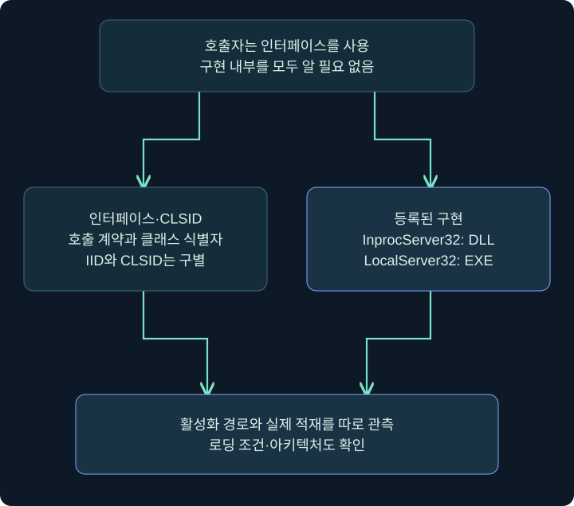
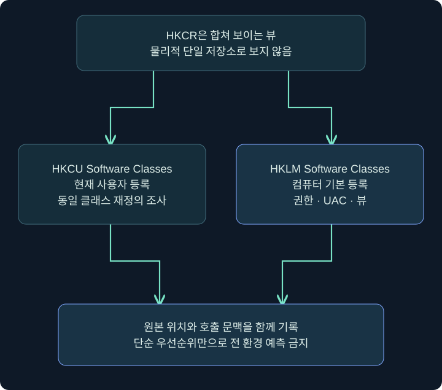
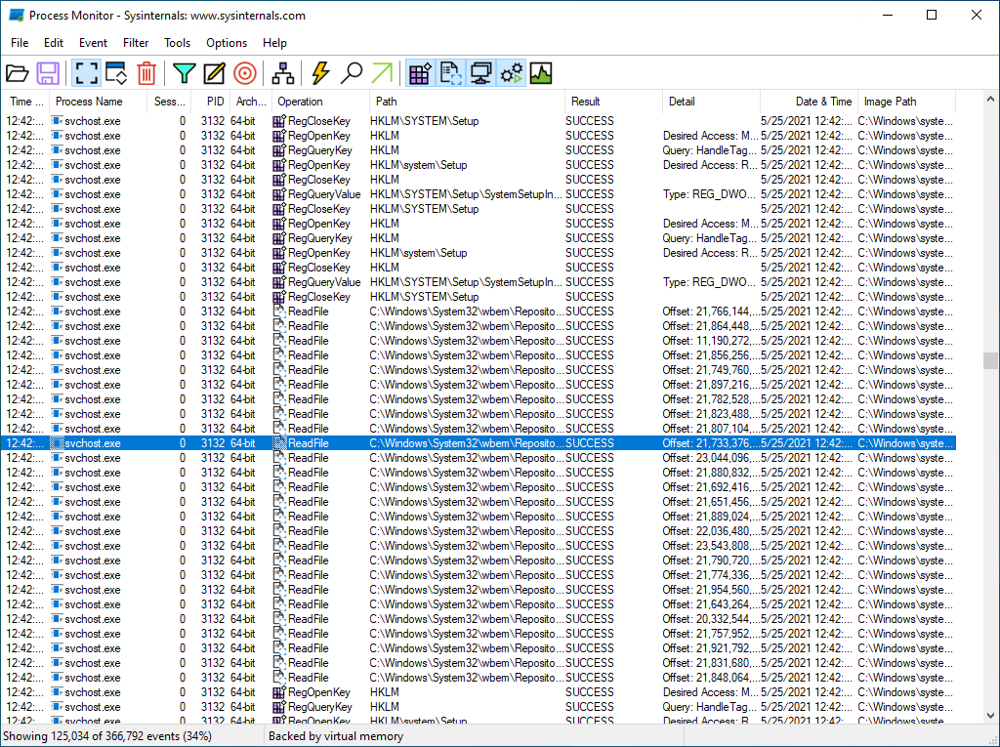
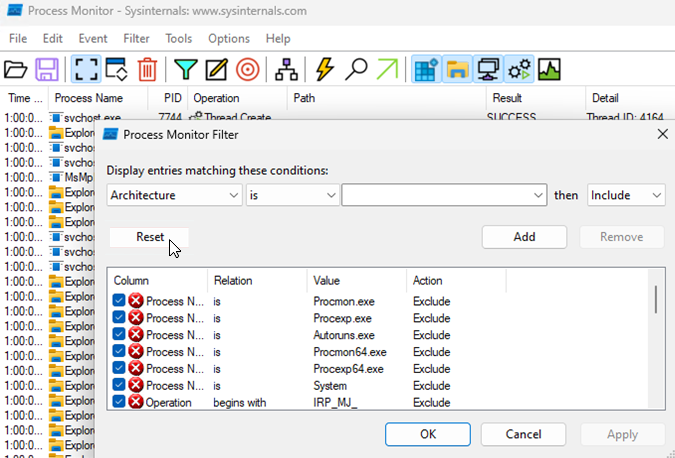
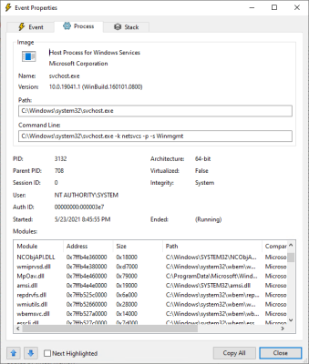
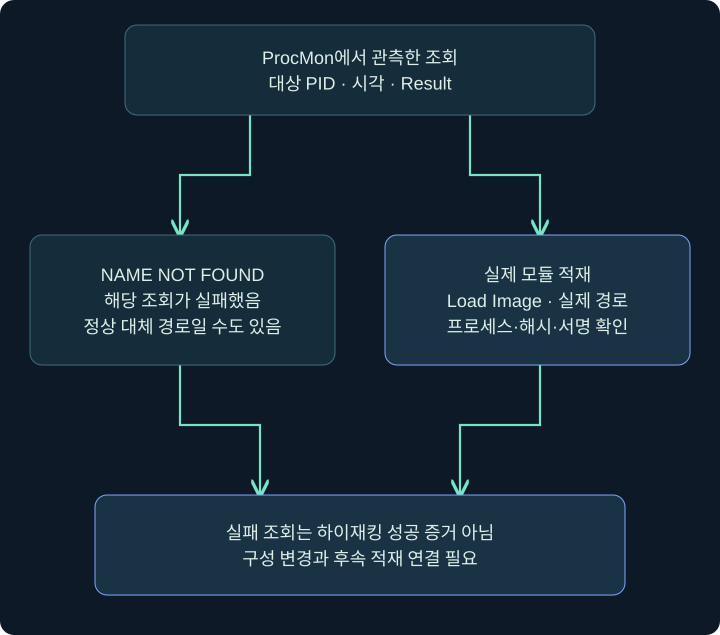

## 1. COM은 프로그램끼리 쓰는 공통 호출 약속입니다

Component Object Model(COM)은 서로 다른 프로그램이 정해진 인터페이스를 통해 구성 요소를 사용하는 Windows 기술입니다. 인터페이스(interface)는 호출할 메서드·입력·반환의 약속입니다. 구현(implementation)은 그 약속을 실제로 수행하는 코드입니다. 사용자는 프린터의 내부 회로를 몰라도 정해진 버튼으로 인쇄를 요청하는 것처럼, 호출자도 구현 내부를 모두 알 필요 없이 계약을 사용할 수 있습니다.

COM 객체는 단순히 DLL 파일의 다른 이름이 아닙니다. 클래스·인터페이스·활성화·실행 문맥 등 여러 개념이 연결됩니다. 지속성을 이해하는 데 필요한 첫 질문은 **어떤 클래스 요청이 어느 등록 위치를 통해 어떤 구현 파일로 연결되는가**입니다.

COM 하이재킹(COM Hijacking)은 그 연결의 구성이나 대상 파일이 바뀌어 호출자가 예상하지 않은 코드를 적재·실행하게 되는 유형입니다. 이 강의는 원리와 읽기 전용 비교, 실제 ProcMon 필터 화면을 다룹니다. 시스템 COM 등록을 바꾸거나 DLL을 대체하는 실습은 수행하지 않습니다.

## 2. CLSID·IID·서버 경로를 구별하기

| 용어 | 역할 | 조사할 내용 |
|---|---|---|
| CLSID | COM 클래스 식별자 | 어떤 클래스의 등록을 요청했는가 |
| IID | 인터페이스 식별자 | 어떤 호출 계약을 기대하는가 |
| InprocServer32 | 프로세스 안에서 사용할 구현 등록 | DLL 경로와 ThreadingModel |
| LocalServer32 | 별도 프로세스 서버 등록 | EXE 명령줄과 활성화 문맥 |
| ThreadingModel | 스레딩·아파트먼트 관련 속성 | 호출 환경과 구현의 호환성 |

CLSID와 IID는 모두 GUID 형태일 수 있어도 역할이 다릅니다. GUID 문자열이 보인다고 모두 같은 종류의 키라고 쓰지 않습니다. `InprocServer32`의 32라는 이름만으로 실제 모듈이 언제나 32비트라고 결론 내리지 않습니다. 64비트 시스템의 등록 뷰와 실제 파일 아키텍처를 확인해야 합니다.



개념도는 호출 계약과 구현 위치를 나누어 보여 줍니다. 실제 COM 활성화에는 컨텍스트·호스팅·권한·등록 형태에 따른 추가 조건이 있습니다. 모든 COM 요청이 오직 이 두 키만 읽는다는 전체 구현도로 보지 않습니다.

## 3. HKCR은 단일 저장소가 아닙니다

HKEY_CLASSES_ROOT(HKCR)는 주로 파일 연결과 COM 클래스 정보를 합쳐 보여 주는 뷰입니다. 원본 저장소를 함께 기록해야 어느 범위의 설정이 작용했는지 설명할 수 있습니다.

```text
HKCU\Software\Classes
HKLM\Software\Classes
HKCR
```

사용자별 정보가 컴퓨터 기본 정보를 재정의하는 경우가 있지만, `항상 HKCU가 모든 환경에서 우선`으로 단순화하지 않습니다. 중복 하위 키를 합치는 규칙이 있고 호출자 계정·프로필·UAC·권한·32/64비트 뷰에 따라 해석할 조건이 달라집니다. Microsoft는 관리자 권한 실행과 UAC 비활성화 조합에서 per-user 구성을 무시하는 조건도 설명합니다.



이 그림의 두 갈래는 원본 비교입니다. 모든 값이 단순히 합쳐지거나 사용자 항목 하나가 기계 등록 전체를 무조건 바꾼다는 의미가 아닙니다. 조사 기록에는 HKCR에서 보인 결과와 HKCU/HKLM 원본을 구별합니다.

## 4. 왜 정상 기능과 악용이 같은 위치에 보이나요?

정상 앱은 사용자별 COM 등록을 사용할 수 있습니다. 앱 제거 뒤 일부 등록이 남거나 선택적 구성 요소 조회가 실패하는 일도 있습니다. 따라서 사용자별 CLSID, 없는 파일, NAME NOT FOUND 중 하나만으로 침해를 확정할 수 없습니다.

의심도를 높이는 조합은 정상 기준과 다른 사용자 경로, 최근 바뀐 등록 데이터, 그 직후 실제 적재, 작성 주체의 비정상성, 설명되지 않는 후속 동작 등이 함께 있는 경우입니다. 각 사실을 연결해야 하며 서명 유무나 파일명 하나로 대체하지 않습니다.

특히 자주 조회되는 시스템 클래스를 함부로 바꾸면 여러 앱이 멈추거나 사용자 경험이 손상될 수 있습니다. 삭제·대체 전에 원래 등록·소프트웨어 기준·의존성과 변경 주체를 확인해야 합니다. 이 강의는 실패 조회를 찾아 교체할 표적으로 바꾸는 자동화를 만들지 않습니다.

## 5. ProcMon에서 열과 대상 프로세스 읽기

### 실제 화면 40: ProcMon에서 열과 대상 프로세스 읽기



출처: [Microsoft Process Monitor](https://learn.microsoft.com/en-us/sysinternals/downloads/procmon). 일반적인 도구 원본 화면이며 아래 COM 필터가 적용된 결과 사진은 아닙니다. 공식 원본의 프로세스·시간·이벤트를 이 강의에서 측정한 결과로 설명하지 않습니다.

1. 허가된 격리 VM에서 ProcMon을 열고 관측할 정상 앱과 시간 범위를 정합니다. 이미 확보된 PML을 읽는다면 수집 조건도 기록합니다.
2. Process Name만 보지 말고 PID·시각을 함께 봅니다. 같은 이름의 여러 프로세스가 있을 수 있습니다.
3. 상단 이벤트 표에서 Operation, Path, Result를 구별합니다. 파일 경로와 레지스트리 경로가 같은 열에 보여도 작업 종류는 다릅니다.
4. 캡처·중지 버튼과 필터는 다른 기능입니다. 필터 변경이 원본 이벤트를 모두 삭제한다는 뜻이 아니며 Drop Filtered Events 등 수집 옵션도 구별해야 합니다.
5. 원본 수집본을 보존한 상태에서 아래 필터로 표시를 좁힙니다. CSV 발췌만 남기면 스택·프로세스 속성 같은 맥락이 줄어들 수 있습니다.

## 6. COM 조회 실패를 보는 필터 입력

### 실제 화면 41: COM 조회 실패를 보는 필터 입력



출처: [Microsoft ProcMon 공식 문제 해결 문서](https://learn.microsoft.com/en-us/troubleshoot/windows-client/shell-experience/troubleshoot-apps-start-failure-use-process-monitor). 이 원본은 일반 필터 창으로, 아래 COM 조건이 이미 저장된 사진이 아닙니다. 그림의 기존 기본 제외 조건을 강의 결과로 읽지 않습니다.

**Filter → Filter** 또는 Ctrl+L로 열고 아래 조건을 한 행씩 입력한 뒤 **Add**를 누릅니다. 같은 열의 Include 조건은 OR, 서로 다른 열은 AND로 결합되는 일반 필터 규칙을 고려합니다. InprocServer32와 LocalServer32를 서로 다른 별도 필수 조건처럼 AND로 묶으면 필요한 결과가 사라질 수 있습니다.

| Column | Relation | Value | Action |
|---|---|---|---|
| Operation | is | RegOpenKey | Include |
| Path | contains | InprocServer32 | Include |
| Path | contains | LocalServer32 | Include |
| Result | is | NAME NOT FOUND | Include |

1. Column에서 Operation → Relation is → Value RegOpenKey → Action Include → Add 순서로 넣습니다.
2. Path contains InprocServer32와 Path contains LocalServer32를 각각 Add합니다. 어느 한 경로를 포함하는 조회를 봅니다.
3. Result is NAME NOT FOUND를 Add합니다. 성공·접근 거부까지 포함하는 전체 조사와 목적이 다릅니다.
4. 특정 앱만 볼 때는 Process ID 등의 조건을 추가하고 실제 PID와 일치하는지 확인합니다.
5. **Apply → OK** 뒤 표시된 행의 네 조건을 직접 대조합니다. 화면에 보이는 행이 없다면 필터·시간 범위·캡처 상태부터 점검합니다.

이 예는 `해당 프로세스가 해당 COM 등록을 못 찾은 관측`을 모으는 방법입니다. 쓰기 권한, 실제 파일 대체 가능성, 후속 적재, 안정성까지 검증한 것은 아닙니다. 원본 등록을 변경하지 않고 비교를 계속합니다.

## 7. 이벤트 속성에서 문맥 확인

### 실제 화면 42: 이벤트 속성에서 문맥 확인



출처: [Microsoft Process Monitor](https://learn.microsoft.com/en-us/sysinternals/downloads/procmon). 원본은 **Process 탭** 예시입니다. Event 탭의 COM 레지스트리 상세 결과라고 부르지 않습니다.

표의 행 더블클릭 → Event Properties → Event 또는 Process 탭으로 이동합니다. Event에서 원래 행의 시각·작업·결과·경로를 읽고, Process에서는 실행 이미지·명령줄·사용자·프로세스 시작 정보를 연결합니다. 사진에 없는 탭의 결과를 사진이 증명한다고 설명하지 않습니다.

레지스트리 경로가 HKCU라고 보여도 수집 당시 어느 사용자 프로필이었는지 확인합니다. 높은 빈도로 같은 이름이 반복되면 시간 구간·프로세스 인스턴스·반복 호출을 분리합니다. 빈도는 정상 동작의 반복일 수 있고 낮은 빈도도 정상 보장이나 악성 보장이 아닙니다.

## 8. 원본 등록과 실제 모듈을 읽기 전용으로 비교

특정 CLSID는 **자기 환경의 확보된 이벤트에서** 읽습니다. 아래 `<관측한 CLSID>`는 설명용 자리표시자이며 그대로 실행하는 값이 아닙니다. 임의 시스템 클래스를 골라 새 키를 만드는 절차가 아닙니다.

```text
reg.exe query "HKCU\Software\Classes\CLSID\<관측한 CLSID>\InprocServer32" /ve /reg:64
reg.exe query "HKLM\Software\Classes\CLSID\<관측한 CLSID>\InprocServer32" /ve /reg:64
```

이것은 Windows `reg.exe` 문법입니다. Cobalt Strike 기본 `reg query`와 다릅니다. x86/x64 뷰가 중요한 조사라면 양쪽 원본의 비교 조건을 맞추고 결과의 부재·오류를 그대로 보존합니다. LocalServer32를 관측했다면 그 경로와 명령줄을 별도로 조사합니다.



실제 모듈 적재를 보려면 실패 필터만으로는 부족합니다. 원본을 보존한 뒤 별도 보기에서 기존 **Operation is RegOpenKey**, 두 **Path contains ...Server32**, **Result is NAME NOT FOUND** 조건을 모두 제거하거나 비활성화합니다. 대상 PID·시간 범위는 유지하고 **Operation is Load Image**를 새로 넣어 실제 경로를 확인합니다. 레지스트리 경로·실패 조건을 남겨 두면 성공한 DLL 적재 행이 숨겨질 수 있습니다. 확인한 DLL의 해시·서명·아키텍처·권한과 정상 기준을 비교합니다. 별도 서버라면 프로세스 생성·명령줄도 연결합니다.

## 9. Cobalt Strike와 복구 기록은 어디에 연결하나요?

Cobalt Strike에서는 1강의 실제 Beacon Console에서 `help reg`를 확인하고 조회할 수 있습니다. COM 설정 전체를 바꾸는 GUI를 새로 만들어 설명하지 않습니다. 아래는 HKCU Software Classes의 존재를 읽는 예이며 특정 시스템 클래스를 하이재킹하는 명령이 아닙니다.

```text
reg query x64 HKCU\Software\Classes
```

입력 위치와 원본 콘솔은 [6장 1강 실제 화면 31](https://dfirwiz.github.io/dfir-training/courses/red-team-foundations/20-persistence-state-context.html#screen-31)에서 바로 볼 수 있습니다. 결과 수신 뒤 조사한 정확한 하위 경로를 좁히고 HKLM 원본과 비교합니다. 대량 CLSID 목록만으로 위험도나 실행 성공을 판정하지 않습니다.

복구는 정상 기준을 확인한 뒤 원래 등록값·파일·권한으로 되돌리는 별도 작업입니다. 사용자 키 전체나 CLSID 전체를 통째로 삭제하면 정상 앱이 망가질 수 있습니다. 설정이 복원돼도 기존 프로세스 안에 적재된 모듈이 남을 수 있으므로 프로세스 수명과 재시작 뒤 동작을 확인합니다. 이 강의는 복구 완료를 실제 실행 결과로 주장하지 않습니다.

## 10. 복습과 바로 읽는 해설

### 복습 1. CLSID와 IID는 같은 역할인가요?

**해설:** 클래스 식별과 인터페이스 식별로 역할이 다릅니다. GUID 형태가 같아도 의미를 구별합니다.

### 복습 2. InprocServer32는 항상 32비트 DLL인가요?

**해설:** 이름만으로 판단하지 않습니다. 실제 등록 뷰와 파일 아키텍처를 확인해야 합니다.

### 복습 3. HKCR은 단독 원본 저장소인가요?

**해설:** 사용자·컴퓨터 범위 정보를 합쳐 보는 뷰입니다. 원본 위치와 호출자 문맥을 함께 조사합니다.

### 복습 4. NAME NOT FOUND는 COM 하이재킹 성공인가요?

**해설:** 해당 조회 실패일 뿐입니다. 정상 대체 탐색일 수도 있고 실제 적재·변경은 별도입니다.

### 복습 5. Path Include 두 행은 둘 다 포함해야 하나요?

**해설:** 같은 열 Include는 일반적으로 OR입니다. 다른 열 조건과의 결합도 함께 확인합니다.

### 복습 6. 공식 필터 사진은 COM 조건이 적용된 결과인가요?

**해설:** 일반 필터 창입니다. COM 조건은 표로 안내한 미실행 예제이며 실제 결과로 제시하지 않습니다.

### 복습 7. 실패 필터에서 Load Image 성공을 모두 볼 수 있나요?

**해설:** 아닙니다. 원본을 보존하고 별도 적재 관측 보기로 조건을 바꿔야 합니다.

### 복습 8. 등록 복원 뒤 기존 DLL도 즉시 메모리에서 사라지나요?

**해설:** 프로세스 내부 적재 상태는 남을 수 있습니다. 설정 복원과 프로세스 수명을 나누어 확인합니다.

## 11. 공식 자료와 적용 범위

확인일: **2026년 11월 4일**. ProcMon 화면은 공개 공식 원본이고 COM 필터·조회·복구는 미실행 설명입니다. 등록 변경·DLL 교체·시스템 클래스 실행은 하지 않았습니다.

- [Microsoft Component Object Model](https://learn.microsoft.com/en-us/windows/win32/com/component-object-model--com--portal): 기본 용어.
- [Microsoft HKEY_CLASSES_ROOT](https://learn.microsoft.com/en-us/windows/win32/sysinfo/hkey-classes-root-key): 원본과 사용자 범위.
- [Microsoft Merged View](https://learn.microsoft.com/en-us/windows/win32/sysinfo/merged-view-of-hkey-classes-root): 병합 규칙과 예외.
- [Microsoft InprocServer32](https://learn.microsoft.com/en-us/windows/win32/com/inprocserver32): 구현과 ThreadingModel.
- [Microsoft LocalServer32](https://learn.microsoft.com/en-us/windows/win32/com/localserver32): 별도 프로세스 서버 등록.
- [Microsoft Process Monitor](https://learn.microsoft.com/en-us/sysinternals/downloads/procmon): 캡처·필터·속성·적재 관측.
- [MITRE T1546.015](https://attack.mitre.org/techniques/T1546/015/): COM 하이재킹 분류.
