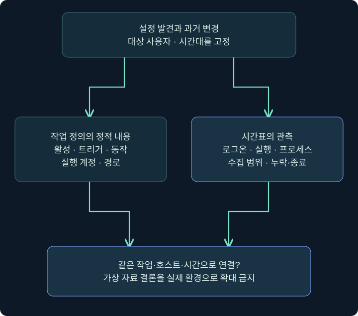
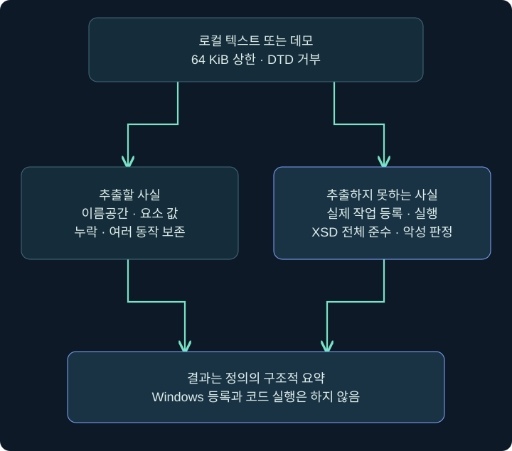
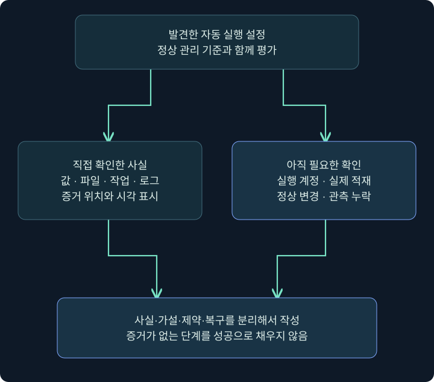

## 1. 자동 실행을 발견한 뒤에는 연결이 필요합니다

이 장에서 여러 등록 위치를 배웠습니다. 마지막에는 흩어진 설정을 같은 사건의 시간표로 묶어 보겠습니다. 파일·레지스트리·작업 XML을 읽는 것은 정적 관측입니다. 로그인·프로세스 생성·모듈 적재·프로그램 결과는 동적 관측입니다. 두 종류를 연결해야 `어떤 조건으로 무엇이 실행됐는가`를 설명할 수 있습니다.

가상의 LAB-PC에서 `\TrainingNote` 작업을 발견했다고 해 봅시다. 메모장만 여는 무해한 학습 작업이며 실제 침해 사건이 아닙니다. 아래 시간표와 XML·콘솔 예는 독립 작성한 합성 자료입니다. 실제 고객 로그·제품 실행·Windows 작업 등록 결과로 제시하지 않습니다.

이번 강의의 Python 검사기는 합성 XML의 구조만 읽습니다. 작업을 등록·시작하거나 프로그램을 실행하지 않고 네트워크에도 접근하지 않습니다. 실제 실행해 확인한 범위는 그 파서의 입력·출력과 오류 처리입니다.

## 2. 시간표에서 사실과 가설을 나누기

| 가상 시각 | 확보한 자료 | 직접 말할 수 있는 사실 | 추가 확인 |
|---|---|---|---|
| 09:00 | 작업 정의 수집 | 수집 시점의 정의 내용 | 누가 언제 처음 등록했는가 |
| 09:05 | 작업 생성 감사 기록 | 그 호스트의 해당 이름 등록 | 정의 버전과 주체 일치 |
| 09:10 | student 로그온 | 해당 계정의 로그온 관측 | 트리거와 같은 사용자·방식인가 |
| 09:10:03 | 메모장 프로세스 | 해당 사용자·경로의 실행 | 작업 인스턴스와 연결되는가 |
| 09:12 | 메모장 종료·작업 기록 | 관측된 종료와 상태 | 학습 목적의 실제 결과 |

수집 시각 09:00이 생성 시각이라는 뜻은 아닙니다. 같은 이름의 작업이 삭제·재등록됐다면 정의 버전과 인스턴스를 구별해야 합니다. 여러 컴퓨터의 시간을 섞는다면 시간대·시계 오차도 기록합니다. 예시의 몇 초 차이를 모든 환경의 정상 지연으로 일반화하지 않습니다.



위 그림은 두 갈래의 증거를 합치는 조사 관점입니다. 화살표 자체가 실제 인과관계를 입증하지 않습니다. 파일이나 로그가 비어 있는 구간은 `미확인`으로 남깁니다.

## 3. 콘솔 기록에서 무엇을 보존하나요?

### 실제 화면 43: 콘솔 기록에서 무엇을 보존하나요?


출처: [Fortra Beacon Console](https://hstechdocs.helpsystems.com/manuals/cobaltstrike/current/userguide/content/topics/post-exploitation_main.htm). 사진의 기존 명령과 결과는 공식 예시이고 아래 합성 사건의 로그가 아닙니다.

1. 대상 세션 우클릭 → **Interact**로 열고 호스트·사용자·PID와 마지막 확인 시각을 기록합니다.
2. 아래 입력 줄에 `help run`을 확인한 뒤 다음 조회를 한 번 입력합니다. 현재 대상의 정확한 학습 작업 이름을 가정합니다.
3. 명령이 기록된 줄과 Beacon이 작업을 가져간 시각, 출력이 반환된 줄을 따로 읽습니다.
4. XML이 돌아오면 원문과 조회 시각·대상·명령을 함께 보존합니다. 레지스트리 조회와 다른 사용자의 출력을 하나로 섞지 않습니다.
5. 응답이 없다면 작업 큐·연결·반환 상태를 확인합니다. 출력이 없다는 사실만으로 정의가 없다고 쓰지 않습니다.

```text
help run
run schtasks.exe /query /tn "\TrainingNote" /xml
```

이것은 미실행 조회 예제입니다. `run`은 프로그램 실행과 출력 수신을 연결하는 명령이고 `schtasks.exe /query`는 Windows 작업 조회입니다. 두 인터페이스의 옵션 경계를 구별합니다. 조회를 위해 새 지속성 작업을 설치하거나 에이전트를 다시 생성할 필요는 없습니다.

## 4. 합성 XML에서 다섯 가지를 읽기

아래 XML은 읽기 학습을 위한 최소 구조 예입니다. 실제 Windows 등록용 완전성·호환성 검증을 통과했다고 주장하지 않습니다. UserId는 가상의 로컬 사용자이고 실제 계정으로 접속하지 않습니다.

```xml
<Task xmlns="http://schemas.microsoft.com/windows/2004/02/mit/task">
  <Triggers>
    <LogonTrigger>
      <UserId>LAB-PC\student</UserId>
      <Enabled>true</Enabled>
    </LogonTrigger>
  </Triggers>
  <Principals>
    <Principal>
      <UserId>LAB-PC\student</UserId>
      <LogonType>InteractiveToken</LogonType>
      <RunLevel>LeastPrivilege</RunLevel>
    </Principal>
  </Principals>
  <Settings><Enabled>true</Enabled></Settings>
  <Actions>
    <Exec><Command>C:\Windows\System32\notepad.exe</Command></Exec>
  </Actions>
</Task>
```

| 위치 | 이번 예에서 읽을 사실 | 입증하지 못하는 사실 |
|---|---|---|
| xmlns | 작업 스케줄러 이름공간 | 모든 스키마 제약 충족 |
| LogonTrigger | student 로그온 조건 정의 | 실제 로그인 발생 |
| Principal | student·InteractiveToken·LeastPrivilege | 실제 토큰·실행 권한 |
| Settings Enabled | 정의상 활성 | Windows에 현재 등록됨 |
| Exec Command | 메모장 실행 경로 문자열 | 파일 존재·프로세스 실행·완료 |

XML이 구문상 잘 읽혀도 Windows가 등록을 받아 준다는 보장은 없습니다. 실제 정의에는 추가 속성·조건·여러 트리거·여러 동작이 있을 수 있습니다. 문자열을 추출하는 작은 검사기를 Windows의 전체 스키마 검증기로 설명하지 않습니다.

## 5. Python 읽기 전용 검사기 실행하기

[읽기 전용 persistence_review.py 다운로드](../../assets/red-team-foundations/persistence_review.py)를 저장하고 Python 3.10 이상에서 실행합니다. 데모는 파일을 만들지 않고 내장된 네 가지 XML만 읽어 JSON을 출력합니다. Windows·관리자·Cobalt Strike 없이도 구조 차이를 볼 수 있습니다.

```text
python3 persistence_review.py --demo
python3 persistence_review.py --xml saved-task.xml
```

`--xml`은 이미 보존된 UTF-8 XML 텍스트 하나를 읽습니다. 64 KiB보다 큰 입력, DTD·엔티티 선언, 잘못된 Task 이름공간, 잘못된 XML 문법을 거부합니다. 파일을 덮어쓰거나 네트워크에서 가져오지 않습니다. schtasks가 내보낸 파일의 인코딩이 UTF-16이라면 원본을 보존하고 별도 UTF-8 분석 사본으로 변환해야 합니다. 바뀐 바이트의 해시는 원본과 다릅니다.



출력의 sha256과 bytes는 입력 텍스트의 바이트 식별입니다. 파일 해시가 같다고 실제 OS 등록·실행 상태도 같다는 뜻은 아닙니다. 임의 실행 명령이 들어 있어도 파서는 그것을 문자열로만 다룹니다.

## 6. 실제로 확인한 데모 결과

아래는 이 강의 제작 중 Python으로 확인한 결과의 요약입니다. 출력 JSON 전체는 더 길며 경로·주체·동작·제약을 포함합니다. 실행한 것은 이 파서와 합성 자료이며 Windows 작업이 아닙니다.

| 데모 이름 | 입력 차이 | 확인 결과 | 결론의 경계 |
|---|---|---|---|
| enabled-logon | 활성·로그온·메모장 | enabled=true, LogonTrigger, Exec 추출 | 실행 성공 판정 아님 |
| disabled-task | Settings Enabled=false | 정의 비활성 경고 | 현재 OS 상태 조회 아님 |
| no-triggers | Triggers 비움 | 트리거 없음 경고 | 수동 실행 불가능 판정 아님 |
| wrong-namespace | 다른 xmlns | 오류로 거부 | 잘못된 구조를 빈 작업으로 숨기지 않음 |

`enabled`에는 값과 함께 출처를 표시합니다. XML에 명시됐는지, 요소가 없어 스키마 기본값을 사용한 것인지 구별합니다. Task와 Trigger의 Enabled는 기본 true로 읽지만, 이 파서는 지원하지 않는 모든 속성의 기본값까지 채우지는 않습니다.

기존 정의에 Exec가 두 개면 둘 다 보존합니다. ComHandler 같은 다른 동작은 종류와 ClassId를 보존하고 별도 활성화는 하지 않습니다. 파서의 warnings가 비었다고 악성 요소가 없거나 완전한 정의라는 뜻은 아닙니다.

## 7. 어떤 검증을 더 했나요?

제작 과정에서는 데모뿐 아니라 잘못된 문법, 잘못된 불리언, 큰 입력, DTD·엔티티, UTF-16 입력, 네임스페이스 부재, 여러 동작을 확인했습니다. 입력 오류는 오류로 반환하며 실행·등록의 증거로 바꾸지 않습니다. 이름공간이 다른 루트를 정상 작업의 빈 목록으로 처리하면 중요한 해석 오류가 되므로 이를 구별합니다.

| 검증 항목 | 기대 동작 | 의미 |
|---|---|---|
| Enabled 생략 | 기본 true와 출처 표시 | 명시값·기본값 구분 |
| Enabled=banana | 오류 | 임의 문자열을 true로 바꾸지 않음 |
| 64 KiB 초과 | 오류 | 크기 제한 유지 |
| DTD·엔티티 선언 | 오류 | 외부 정의에 의존하지 않음 |
| Exec 여러 개 | 모두 출력 | 첫 동작만 보고 누락 방지 |
| 깨진 XML | 오류 | 빈 결과와 구별 |

이 검증은 코드가 약속한 입력 경계를 확인하는 것입니다. 공격 탐지율·Windows 버전 호환성·포렌식 도구 인증을 입증한 시험이 아닙니다. 분석 도구의 유용성과 한계를 같은 문서에서 볼 수 있어야 합니다.

## 8. 실패·부재·미수집을 서로 바꾸지 않기

`작업 정의가 비활성이다`, `로그온 이벤트를 못 찾았다`, `프로세스가 실행되지 않았다`는 서로 다른 문장입니다. 첫째는 정적 상태, 둘째는 관측 범위의 결과, 셋째는 실행 여부 결론입니다. 둘째만으로 셋째를 쓰려면 수집·보존·대상·시각이 충분했는지 확인해야 합니다.

한 번의 메모장 실행이 작업 때문인지도 바로 확정하지 않습니다. 수동 실행이나 Run·Startup의 중복 등록이 있을 수 있습니다. 작업 인스턴스·실행 시각·명령줄·프로세스 문맥을 연결합니다. 시작 성공과 종료·업무 효과도 분리합니다.

Cobalt Strike 콘솔의 출력은 그 조회 문맥의 관측이고, Windows 이벤트는 각 공급자의 관측입니다. 서로 보완할 수 있지만 어느 한쪽이 나머지 모든 사실을 대신 증명하지 않습니다. 시계·로그 누락·정의 갱신 가능성을 보고서 제약에 적습니다.

## 9. 짧은 조사 보고서 작성하기



가상 보고 예: `LAB-PC의 student 문맥에서 09:00에 확보한 작업 XML에 LogonTrigger와 메모장 Exec가 있다. 입력 바이트의 SHA256을 보존했고 정적 파서에서 활성 정의로 읽혔다. 실제 등록 상태와 로그인 뒤 실행은 이 XML만으로 확인하지 못했다. 별도 작업 기록·프로세스 관측·정상 변경 이력을 대조해야 한다.`

실행 자료까지 있다면 그 근거와 연결 키를 덧붙입니다. 없는 자료를 빈칸 대신 추정으로 채우지 않습니다. 복구 항목에는 원래 정의 보존, 승인된 변경 범위, 남은 프로세스, 다음 트리거 검증을 적습니다. 로그 삭제를 정리 절차로 쓰지 않습니다.

6장을 마치면 자동 실행 항목을 발견했을 때 `지속성 성공`이라고 먼저 부르는 대신 사용자·트리거·대상·등록·실행·복구를 각각 설명할 수 있어야 합니다. 다음 장은 별도 게시 요청에 따라 이어집니다.

## 10. 복습과 바로 읽는 해설

### 복습 1. XML 수집 시각이 작업 생성 시각인가요?

**해설:** 아닙니다. 수집 시점의 정의를 확보한 것입니다. 생성·갱신은 별도 자료로 확인합니다.

### 복습 2. 파서가 enabled=true라고 하면 실제 작업도 있나요?

**해설:** XML의 정의만 읽었습니다. OS 등록과 현재 상태는 조회하지 않습니다.

### 복습 3. 트리거가 없으면 수동 Run도 불가능한가요?

**해설:** 그 결론은 낼 수 없습니다. 정기 트리거와 요청 실행의 설정은 다릅니다.

### 복습 4. 왜 잘못된 이름공간을 거부하나요?

**해설:** 다른 구조를 빈 정상 작업으로 해석하지 않기 위해서입니다. 오류와 빈 결과를 구별합니다.

### 복습 5. 이 파서는 XSD 전체를 검증하나요?

**해설:** 아닙니다. 제한된 요소를 정적으로 추출합니다. Windows 등록 가능성까지 판정하지 않습니다.

### 복습 6. UTF-8 분석 사본의 해시가 원본과 달라도 되나요?

**해설:** 인코딩 변환으로 바이트가 달라집니다. 원본과 사본의 경로·변환·해시를 구분해 보존합니다.

### 복습 7. 경고가 없으면 정상·안전한 작업인가요?

**해설:** 작은 파서가 정한 구조적 경고가 없다는 뜻입니다. 악성 판정이나 실행 안전성을 보장하지 않습니다.

### 복습 8. Windows 없이 무엇을 실제 검증했나요?

**해설:** 합성 XML 파싱·추출·오류 경계만 실제 확인했습니다. 작업 등록·로그온·프로그램·제품 실행은 하지 않았습니다.

## 11. 공식 자료와 적용 범위

확인일: **2026년 11월 4일**. Python 합성 자료 해석만 실제 실행했습니다. Windows·제품·작업 생성·C2 동작은 실행하지 않았습니다. 코드는 정적 교육 도구이며 실제 조사는 조직의 증거 보존 절차와 함께 수행합니다.

- [Microsoft Task Scheduler Schema](https://learn.microsoft.com/en-us/windows/win32/taskschd/task-scheduler-schema): 이름공간·요소·기본값.
- [Microsoft Task Scheduler Schema Elements](https://learn.microsoft.com/en-us/windows/win32/taskschd/task-scheduler-schema-elements): Triggers·Principals·Actions·Settings.
- [Microsoft schtasks query](https://learn.microsoft.com/en-us/windows-server/administration/windows-commands/schtasks-query): 실제 조회의 범위.
- [Microsoft Security 4698](https://learn.microsoft.com/en-us/previous-versions/windows/it-pro/windows-10/security/threat-protection/auditing/event-4698): 등록 주체와 정의의 감사 기록.
- [Python ElementTree](https://docs.python.org/3/library/xml.etree.elementtree.html): 정적 XML 파싱.
- [Fortra Beacon Console](https://hstechdocs.helpsystems.com/manuals/cobaltstrike/current/userguide/content/topics/post-exploitation_main.htm): 입력·작업·출력 구별.
