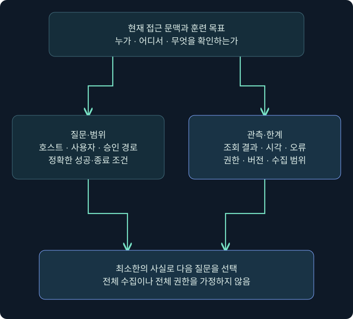
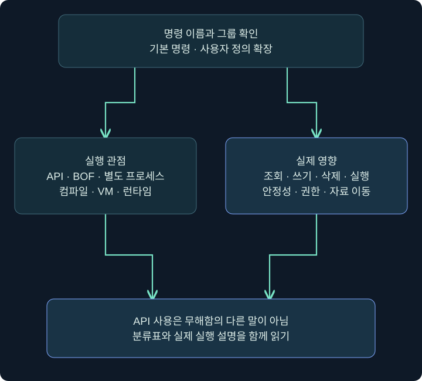
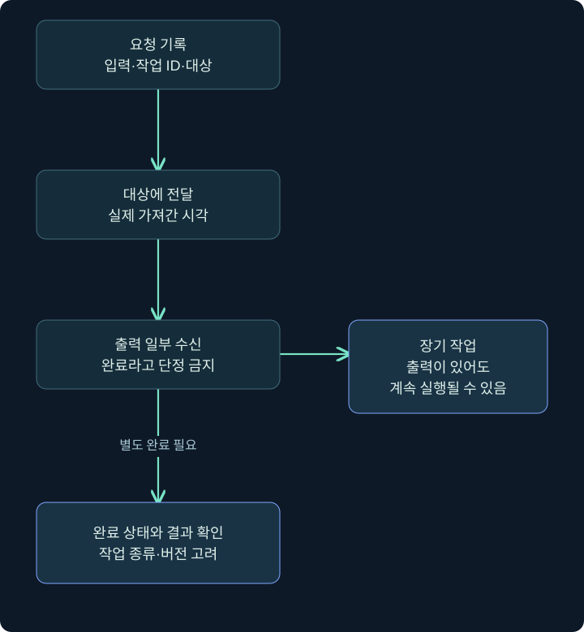

## 1. 접근 뒤에는 무엇을 먼저 알아야 할까요?

문이 열렸다고 건물 구조를 아는 것은 아닙니다. 현재 방이 어디인지, 누가 사용할 수 있는지, 어떤 시설이 정상으로 돌아가는지 알아야 다음 행동을 판단할 수 있습니다. 접근 후 활동(Post-Exploitation)에서도 처음에는 **상황 파악(Situational Awareness)**이 필요합니다. 현재 호스트·사용자·프로세스·경로·환경과 훈련 목표 사이의 관계를 확인하는 과정입니다.

파일 하나를 발견했다고 목표 자료에 접근할 수 있다는 뜻은 아닙니다. 공유 경로가 보여도 읽기 권한이나 업무상 의미는 별도입니다. 실행 중인 보안 제품 이름도 정책·가동 상태·실제 탐지 범위를 모두 설명하지 않습니다. 이 장은 관측한 사실에서 어디까지 말할 수 있는지 구별하며 도구 사용을 설명합니다.

앞 장의 지속성은 재실행 조건에 관한 주제였습니다. 이번 장은 **현재 실행 문맥에서 무엇을 조회하고 어떤 방식으로 작업이 수행되는가**에 초점을 둡니다. 같은 명령 결과라도 API 호출·새 프로세스·인프로세스 실행처럼 내부 동작이 다르면 안정성·증거·부작용이 달라집니다.

## 2. 수집 전에 질문과 범위를 정하기

| 확인할 질문 | 필요한 최소 정보 | 그 정보만으로 알 수 없는 것 |
|---|---|---|
| 어느 컴퓨터인가? | 호스트명·주소·OS·대상 식별 | 같은 이름의 다른 호스트 여부 |
| 어느 사용자 문맥인가? | 사용자·SID·현재 토큰 정보 | 모든 자원에 대한 권한 |
| 현재 위치는 어디인가? | 작업 폴더·드라이브·경로 | 폴더 아래 모든 파일 내용 |
| 어떤 앱이 실행 중인가? | PID·경로·사용자·시각 | 앱 취약성·실제 정책 상태 |
| 어떤 실행 환경인가? | 셸·.NET 버전·아키텍처 | 모든 도구와의 호환성 |
| 무엇이 훈련 목표인가? | 합의한 검증 대상과 성공 조건 | 다른 사용자의 자료 수집 허가 |

처음부터 전체 디스크·모든 사용자·모든 화면을 수집하면 정보량과 노출 범위가 커집니다. 가상의 격리 VM `LAB-PC`, 사용자 `student`, 미리 만든 `C:\Lab\TrainingOnly` 폴더로 예를 한정하겠습니다. 실제 업무 경로·브라우저 저장 정보·개인 메시지는 예제 데이터로 사용하지 않습니다.

좋은 시작 질문은 `이 폴더가 현재 사용자에게 보이는가?`, `이 명령이 새 프로세스를 만드는가?`처럼 결과를 확인할 수 있습니다. `시스템 전체를 알아보기`처럼 끝이 없는 목표는 명령 선택과 종료 조건을 흐리게 합니다.



## 3. 대상과 명령 입력 위치 확인

### 실제 화면 44: 대상과 명령 입력 위치 확인


출처: [Fortra Session and Target Visualizations](https://hstechdocs.helpsystems.com/manuals/cobaltstrike/current/userguide/content/topics/ui_session-target-visualizations.htm). 공개 안내서 원본이며 화면 속 호스트·시간은 강의 가정과 다릅니다. 이미 허가된 실습 세션이 있다는 전제이고 새 에이전트를 설치한 결과가 아닙니다.

1. 세션 표에서 현재 목표 호스트의 한 행만 선택합니다. Computer·User·주소·PID 등 보이는 정보를 기록합니다.
2. 해당 행 우클릭 → **Interact**를 선택합니다. 여러 행을 선택하면 같은 작업이 여러 대상에 갈 수 있으므로 한 대상 학습과 구별합니다.
3. 아래 열린 콘솔 탭과 상태 줄의 호스트·사용자·PID를 다시 확인합니다. Client 운영자 이름과 Windows 사용자 이름을 혼동하지 않습니다.
4. 아래 입력 줄에 `help`를 입력하고 Enter를 누릅니다. 도움말을 읽는 단계와 대상에서 조회가 실행되는 단계는 다릅니다.


출처: [Fortra Beacon Console](https://hstechdocs.helpsystems.com/manuals/cobaltstrike/current/userguide/content/topics/post-exploitation_main.htm). 사진에 이미 보이는 명령과 출력은 공식 예시입니다. 다음 절의 도움말을 여기서 직접 실행한 캡처가 아닙니다.

## 4. 도움말에서 기본 기능과 확장을 나누기

현행 도움말은 목록·그룹 표시와 기본/사용자 정의 명령 구분을 지원합니다. 같은 이름의 명령이 보여도 사용 중인 버전과 로드한 스크립트가 다르면 의미·인자가 달라질 수 있습니다. 블로그에서 본 한 줄을 설치 환경의 기본 기능으로 단정하지 않습니다.

```text
help #groups @builtin
help #groups @userdefined
help pwd
help ps
```

아래 `beacon>` 줄에 한 줄씩 입력하고 위쪽 설명의 이름·인자·반환·주의를 읽습니다. `help ps`는 프로세스 목록 자체를 가져오는 `ps`와 다릅니다. 명령을 설명하는 도움말이 나왔다고 조회가 수행됐다고 기록하지 않습니다.

| 도움말에서 볼 것 | 확인 목적 | 예 |
|---|---|---|
| 명령 그룹 | 기본·확장·분류 구별 | @builtin·@userdefined |
| 필수 인자 | 실제 문법 확인 | 경로·뷰·프로그램 이름 |
| 대상과 실행 위치 | Client·서버·대상 구분 | 로컬 도구 경로와 원격 파일 경로 |
| 출력 방식 | 반환·백그라운드·전용 탭 | 콘솔 출력과 Screenshots 구별 |
| 종료 조건 | 일회·장기 작업 구별 | 결과 완료와 작업 중지 |

도움말에 `@native`나 `BOF` 같은 분류가 보여도 그 분류만으로 읽기 전용·무해함을 뜻하지 않습니다. 분류와 실제 동작은 다른 축입니다.

## 5. 명령 동작을 네 관점에서 읽기

| 관점 | 설명 | 확인할 영향 |
|---|---|---|
| 상태·운영 명령 | 설정·목록·Client UI 등 관리 | 후속 작업 조건이 달라지는가 |
| Windows API 사용 | 운영체제 API로 기능 수행 | 파일·권한·통신·프로세스 변화 |
| Beacon 내부 실행 | 같은 프로세스에서 확장 코드 평가 | 오류가 현재 세션에 미치는 영향 |
| 별도 프로세스·주입 | 새 프로세스 또는 기존 프로세스에서 기능 수행 | 생성·적재·주입·출력·종료 증거 |

이 표는 사고를 정리하는 관점입니다. 서로 완전히 배타적인 공식 구현 분류표라고 보지 않습니다. BOF도 API를 호출하고, API를 사용하는 명령도 새 프로세스를 만들 수 있습니다. 실제 명령에 어느 경계가 있는지 따로 확인해야 합니다.

예를 들어 `pwd`는 현재 위치 조회이고 `rm`은 삭제입니다. 둘이 같은 Native 명령 표에 있어도 영향은 전혀 다릅니다. `sleep`은 상태 설정에 해당하지만 이후 응답 간격과 작업 완료 시점에 영향을 줍니다. `ppid`·`spawnto`도 단순 표시값이 아니라 이후 프로세스 실행 조건에 영향을 주는 설정입니다.



## 6. BOF와 fork-and-run은 어디가 다른가요?

Beacon Object File(BOF)은 Beacon이 정해진 규약에 따라 적재·실행하는 객체 코드입니다. 같은 프로세스 안에서 실행되는 코드는 별도 프로그램 창이 없어도 동작할 수 있습니다. 오류·메모리 손상·오래 걸리는 동작이 현재 프로세스에 영향을 줄 수 있다는 안정성 문제도 있습니다.

전통적인 **fork-and-run** 설명은 임시 프로세스를 만들고 후속 기능을 그 안에서 실행하여 출력을 돌려받는 패턴입니다. **explicit** 방식은 이미 존재하는 특정 프로세스를 대상으로 하는 패턴입니다. 새 프로세스가 있는지, 어느 PID에서 기능이 수행되는지, 출력 통로와 종료가 무엇인지로 구별합니다.

프로세스가 새로 생기지 않았다고 아무 동작도 없었다는 뜻은 아닙니다. 반대로 임시 프로세스가 생겼다고 모든 활동이 그 프로세스로 완전히 격리되는 것도 아닙니다. 권한·런타임·메모리·IPC·원래 세션 수명과 연결된 조건을 확인합니다.

## 7. 현행 4.13과 과거 설명을 대조하기

2026년 11월 4일 대조한 공식 문서는 4.13을 표시하며 Beacon Interpreter·BOF-PE 같은 실행 기능을 포함합니다. Interpreter는 Client에서 작성한 코드를 Team Server가 바이트코드로 컴파일하고 Beacon의 가상 머신이 해석하는 별도 경로입니다. 과거 네 분류가 앞으로 가능한 실행 방법 전부라고 가르치지 않습니다.

현행 Running Commands 표는 `execute-assembly`와 `inline-execute`를 Native에 표시하면서도 설명에서는 임시 CLR 프로세스·BOF의 인프로세스 실행을 각각 설명합니다. **표의 Type과 실제 실행 패턴을 동일한 말로 바꾸지 않는 것**이 중요합니다. `reg`는 해당 표에서 BOF로 표시됩니다.

또한 `beacon-interpreter-lint`는 컴파일 오류를 확인하는 단계이며 대상에 코드를 보내 실행하는 `beacon-interpreter`와 다릅니다. 편집·검사·전달·실행의 경계를 구분하는 방법은 다른 도구에도 그대로 적용됩니다. 실행 엔진 비교는 5강에서 이어집니다.

## 8. 입력·전달·출력·완료는 다른 상태입니다



`명령을 입력함`은 요청 기록입니다. `대상이 작업을 가져감`은 전달이며 `출력 일부가 옴`은 결과의 일부입니다. 별도 완료 상태와 실제 기대 결과까지 확인해야 수행이 끝났다고 말할 수 있습니다. 장기 작업은 출력이 와도 계속 실행될 수 있습니다.

현재 버전의 작업 상태 표시와 구버전 콘솔 문구는 다를 수 있습니다. 4.13 변경 이력에는 작업 완료 추적과 전사 기록 정비가 포함되어 있습니다. 과거 캡처의 성공 줄 하나를 새 버전의 모든 완료 조건으로 일반화하지 않습니다.

작업이 늦으면 응답 간격·연결·작업 종류·출력 통로를 먼저 확인합니다. 기다리는 동안 같은 명령을 반복 입력하면 작업이 중복될 수 있습니다. 단순히 잠시 조용하다는 이유로 실패·빈 결과·중지 완료라고 쓰지 않습니다.

## 9. 한 번의 조회를 기록하는 작은 예

가상의 운영 기록을 `호스트 LAB-PC / 사용자 student / 세션 S-A / 명령 pwd / 입력 10:00 / 출력 10:00:08 / 결과 C:\Lab\TrainingOnly`로 적어 봅시다. 이것은 현재 위치가 그 경로로 반환됐다는 예입니다. 폴더 내용·쓰기 권한·전체 파일 내용은 아직 확인하지 않았습니다.

다음 질문이 폴더 목록이라면 2강의 File Browser 또는 `ls`로 이어집니다. 질문이 실행 사용자라면 3강의 사용자·프로세스·레지스트리 조회로 이어집니다. 입력·화면 관측이 꼭 필요한 별도 학습은 4강에서 대상·범위·종료 조건을 분리합니다.

이 강의의 Cobalt Strike·Windows 절차는 미실행 안내입니다. 6강의 합성 이벤트 상태 계산만 실제 Python으로 검증합니다. 개념도와 실제 공식 화면, 예시 출력과 실제 측정을 문서에서 구별합니다.

## 10. 복습과 바로 읽는 해설

### 복습 1. 접근했으면 시스템 구조를 모두 아는 것인가요?

**해설:** 현재 호스트·사용자·경로·권한·목표와의 관계를 추가 확인해야 합니다. 접근과 상황 파악은 다른 단계입니다.

### 복습 2. 도움말 출력은 ps 수행 결과인가요?

**해설:** `help ps`는 문법 설명입니다. 실제 프로세스 조회인 `ps`와 구별합니다.

### 복습 3. 기본 명령과 사용자 정의 명령을 왜 나누나요?

**해설:** 이름이 비슷해도 로드한 확장과 버전에 따라 인자·구현·출력이 달라질 수 있습니다.

### 복습 4. API-only이면 무해한 조회인가요?

**해설:** 아닙니다. 파일 삭제·프로세스 실행도 API로 수행할 수 있습니다. 동작과 영향을 따로 봅니다.

### 복습 5. 인프로세스 실행은 안정성도 보장하나요?

**해설:** 오류가 같은 프로세스와 세션에 영향을 줄 수 있습니다. 별도 프로세스가 없다는 것과 안전성은 다릅니다.

### 복습 6. 네 분류로 모든 4.13 실행을 설명할 수 있나요?

**해설:** 개념 구분에 유용하지만 Interpreter·BOF-PE 같은 버전별 기능과 실제 실행 경로를 함께 확인해야 합니다.

### 복습 7. 출력 한 줄이 오면 작업이 종료됐나요?

**해설:** 장기 작업과 스트리밍은 계속될 수 있습니다. 완료 상태와 기대 결과를 별도로 확인합니다.

### 복습 8. 작업이 늦으면 바로 반복 입력하나요?

**해설:** 먼저 전달·연결·응답 상태를 봅니다. 반복 입력은 중복 작업을 만들 수 있습니다.

## 11. 공식 자료와 적용 범위

확인일: **2026년 11월 4일**. 실제 제품·에이전트·Windows 조회는 수행하지 않았습니다. 공식 원본 화면의 버전·기존 결과와 강의 예를 구별했습니다.

- [Fortra Beacon Console](https://hstechdocs.helpsystems.com/manuals/cobaltstrike/current/userguide/content/topics/post-exploitation_main.htm): 입력·상태·결과 위치.
- [Fortra Running Commands](https://hstechdocs.helpsystems.com/manuals/cobaltstrike/current/userguide/content/topics/post-exploitation_running-commands.htm): 도움말·분류·각 명령 계약.
- [Fortra Beacon Interpreter](https://hstechdocs.helpsystems.com/manuals/cobaltstrike/current/userguide/content/topics/post-exploitation_beacon-interpreter.htm): 편집·검사·컴파일·VM 실행 경계.
- [Cobalt Strike Release Notes](https://download.cobaltstrike.com/releasenotes.txt): 4.13 변경과 작업 상태 추적.
- [Fortra Beacon Object Files](https://hstechdocs.helpsystems.com/manuals/cobaltstrike/current/userguide/content/topics/beacon-object-files_main.htm): 확장 코드의 실행 규약.
