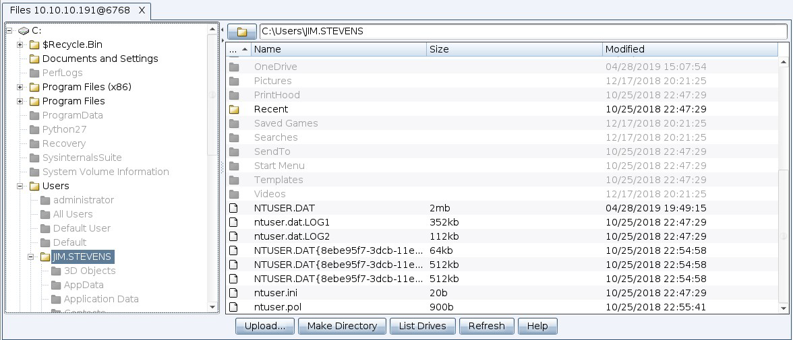
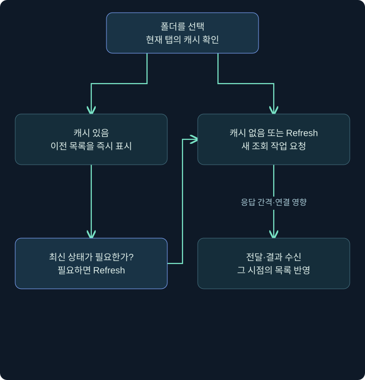
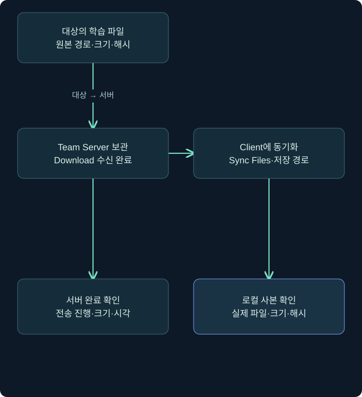
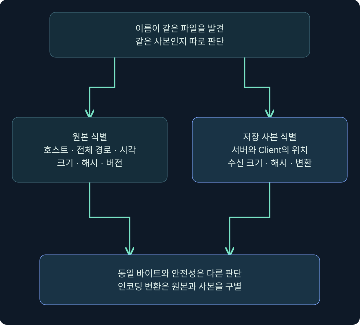

## 1. 목록 조회와 파일 전송은 다른 행동입니다

폴더 목록을 보는 일, 파일을 대상 컴퓨터에서 Team Server로 가져오는 일, 서버의 파일을 Client 컴퓨터에 저장하는 일은 서로 다릅니다. 화면에서 파일명이 보인다는 사실이 파일 본문 전체가 내 컴퓨터에 저장됐다는 뜻은 아닙니다.

이 강의는 File Browser의 실제 창에서 경로·캐시·Refresh를 읽고 Downloads에서 전송과 동기화를 구별합니다. 실습 예제는 미리 허가된 격리 폴더 `C:\Lab\TrainingOnly`와 내용이 `TRAINING_ONLY`인 작은 안내문 `readme.txt`만 가정합니다. 사용자 문서나 자격 증명 저장소를 수집하는 예가 아닙니다.

조사 기록에는 항상 **대상 경로·조회 시각·파일 크기·전송 상태·저장 위치·해시**를 나누어 적습니다. 경로가 같아도 그 사이 파일이 바뀔 수 있고, 표시된 목록이 캐시라면 현재 상태와 달라질 수 있습니다.

## 2. 현재 작업 폴더와 전체 경로

### 실제 화면 45: 콘솔에서 pwd·ls·drives 읽기


출처: [Fortra Beacon Console](https://hstechdocs.helpsystems.com/manuals/cobaltstrike/current/userguide/content/topics/post-exploitation_main.htm). 아래 예를 수행한 사진이 아니라 입력·출력 배치 원본입니다.

대상 한 행 우클릭 → **Interact** → 아래 입력 줄 → `help ls` 확인 → 조회 한 줄 → 위 반환 출력 순서로 읽습니다. `pwd`로 기준 경로를 알고 `ls`에 전체 경로를 주면 다른 작업의 디렉터리 변경과 혼동을 줄일 수 있습니다.

```text
pwd
ls C:\Lab\TrainingOnly
drives
```

| 입력 | 질문 | 결과의 한계 |
|---|---|---|
| pwd | 현재 작업 폴더는? | 그 폴더의 내용·쓰기 권한은 별도 |
| ls 전체 경로 | 해당 위치의 목록은? | 파일 본문을 모두 읽은 것은 아님 |
| ls 상대 경로 | 현재 위치 기준 목록은? | 기준 폴더가 바뀌면 대상도 달라짐 |
| drives | 보이는 드라이브는? | 모든 공유·권한·연결 상태의 완전한 지도 아님 |
| cd | 현재 위치 변경 | 이후 상대 경로 동작에 영향 |

`cp`·`mv`·`rm`·`upload`는 목록 조회와 달리 대상 상태나 데이터 위치를 바꿉니다. 이번 조회 흐름에는 필요하지 않습니다. 파일 브라우저의 Delete도 단순히 행을 숨기는 버튼으로 취급하지 않습니다.

## 3. File Browser 열기와 칸 읽기

### 실제 화면 46: File Browser 열기와 칸 읽기



출처: [Fortra File Browser](https://hstechdocs.helpsystems.com/manuals/cobaltstrike/current/userguide/content/topics/post-exploitation_file-browser.htm). 공식 원본의 사용자 폴더와 파일은 강의 학습 경로가 아닙니다. 원본은 새로 수집한 실습 결과가 아니며 버전에 따라 색·버튼·배치가 다를 수 있습니다.

1. 대상 세션 우클릭 → **Explore → File Browser**를 선택합니다. 콘솔의 `file_browser`도 같은 기능의 진입점입니다.
2. 처음에는 해당 Beacon의 현재 작업 폴더 목록을 요청하므로 창을 열자마자 모든 디스크의 최신 내용이 보이는 것은 아닙니다.
3. 왼쪽 트리에서 드라이브·폴더를 확인하고 오른쪽 목록의 Name·종류·크기·시각 등 표시 열을 읽습니다.
4. 오른쪽 위 경로를 확인한 뒤 가상 학습 폴더만 선택합니다. 폴더 트리 클릭 또는 오른쪽 폴더 더블클릭으로 내려갑니다.
5. **List Drives**는 드라이브 조회, **Refresh**는 현재 폴더 재조회를 요청하는 기능입니다. 파일 선택과 전송은 아직 하지 않습니다.

| 화면 위치 | 확인할 값 | 학습 예에서의 선택 |
|---|---|---|
| 왼쪽 트리 | 드라이브·폴더·캐시 상태 | 승인된 TrainingOnly 폴더 |
| 오른쪽 경로 | 현재 표시 위치 | C:\Lab\TrainingOnly |
| 목록 행 | 파일 이름·크기·시각 | readme.txt 한 개 |
| Refresh | 재조회 요청 | 현재 상태가 필요할 때 한 번 |
| 상위 폴더 버튼 | 부모 경로 이동 | 권한 범위를 넘기지 않도록 경로 확인 |

## 4. 캐시를 보면 즉시 나오지만 최신 보장은 없습니다

공식 설명에서 색이 있는 폴더는 해당 브라우저가 목록을 캐시했고, 짙은 회색 폴더는 아직 캐시하지 않은 상태를 나타냅니다. 캐시된 폴더로 이동하면 새 조회 없이 이전 목록을 볼 수 있습니다. 색이 있다고 현재 파일이 그대로 있다는 뜻은 아닙니다.



Refresh를 누른 뒤에는 Beacon이 작업을 가져가고 결과가 돌아와야 합니다. 응답 간격보다 빠르게 최신 상태를 얻는 마술 버튼은 아닙니다. 창을 닫고 다시 열면 같은 캐시가 유지된다고 가정하지 않으며, 실제 버전과 탭 수명을 확인합니다.

가령 10:00에 readme.txt가 14바이트로 보였고 10:05에 캐시 폴더를 다시 열었다면 그 목록의 관측 시각은 여전히 이전일 수 있습니다. 최신 내용이 필요하면 재조회와 결과 수신 시각을 기록합니다. 최신 목록과 이미 수집한 원본 파일의 버전도 구별합니다.

## 5. 작은 학습 파일 한 개를 전송하는 순서

이미 격리 VM에 준비된 TRAINING_ONLY 안내문만 대상으로 삼습니다. 실제 대상이나 서버에서 이 절차를 실행하지 않았습니다. 명령 입력 전에 그 파일이 허가된 범위인지, 예상 크기가 작은지, 개인정보가 없는지 확인하는 것이 학습의 전제입니다.

1. File Browser에서 정확한 readme.txt 한 행을 선택합니다. 여러 행 선택이나 상위 폴더 전체 선택과 구별합니다.
2. 우클릭 → **Download**를 선택합니다. 또는 콘솔에서 설치 도움말을 확인한 뒤 아래의 정확한 파일 경로를 지정합니다.
3. 콘솔의 시작·진행·완료 출력을 확인합니다. 전송 중 목록은 `downloads`로 조회할 수 있습니다.
4. 여기서 완료는 대상에서 Team Server까지의 파일 전송 상태입니다. Client의 사용자 다운로드 폴더에 저장됐다는 뜻이 아닙니다.

```text
help download
download C:\Lab\TrainingOnly\readme.txt
downloads
```

와일드카드·재귀 수집을 사용하지 않는 한 파일 예입니다. `download`와 `downloads`는 각각 전송 요청과 진행 목록으로 역할이 다릅니다. 전송 중지인 `cancel`은 장기 작업 중지 `jobkill`이나 프로세스 종료와 별개이며 정확한 대상과 현재 도움말을 확인해야 합니다.

## 6. Downloads에서 Client로 동기화

실제 Downloads 창의 공개 공식 원본 사진은 확보하지 못했습니다. 이 절은 공식 문서에 근거한 메뉴·버튼 설명이며 아래 표를 실제 설정창이나 전송 결과 사진으로 제시하지 않습니다.

출처: [Fortra Upload and Download Files](https://hstechdocs.helpsystems.com/manuals/cobaltstrike/current/userguide/content/topics/post-exploitation_upload-download-files.htm). 서버 보관과 Client 동기화가 별도 단계임을 확인한 근거입니다. 실제 전송 완료는 관측하지 않았습니다.

1. 상단 **View → Downloads**를 엽니다. 메뉴가 재배치된 버전이면 같은 Downloads 기능을 찾습니다.
2. 호스트·파일 경로·크기·수집 시각을 확인하고 승인된 readme.txt 한 행만 선택합니다. 같은 이름의 다른 호스트 파일과 구별합니다.
3. **Sync Files**를 누르고 저장 대화상자에서 Client 컴퓨터의 학습 결과 폴더를 선택합니다.
4. 저장 뒤 Client 측 파일 존재·크기·SHA256을 확인합니다. Team Server 파일과 Client 사본의 해시 비교는 동일 바이트 확인이지 악성 여부 판단이 아닙니다.
5. **Delete Files**는 서버 보관 파일에 영향을 주는 기능입니다. 화면에서 내려받기 위해 누르는 버튼이 아니며 다른 운영자가 사용하는 자료도 함께 고려해야 합니다.

| 단계 | 출발 → 도착 | 확인할 사실 |
|---|---|---|
| Download | 대상 → Team Server | 정확한 파일·수신 크기·완료 상태 |
| Downloads 목록 | 서버 보관 목록 조회 | 호스트·경로·크기·시각 |
| Sync Files | Team Server → Client | 실제 저장 경로·로컬 사본 |
| 해시 비교 | 두 사본의 바이트 식별 | 무결성 일치·버전 차이 |
| 정리 | 보존·접근·삭제 범위 | 전송 취소·원본 삭제와 구별 |



## 7. 속도·크기·중지 상태를 해석하기

전송 시간은 파일 크기뿐 아니라 C2 전송 방식·실제 처리량·응답 간격·경유 경로·연결 상태의 영향을 받습니다. 예전의 특정 DNS 모드와 HTTP 예를 모든 네트워크의 고정 속도로 일반화하지 않습니다. 1 MiB는 1,048,576바이트이고 진행 바이트와 표시 단위가 다르면 비교 기준을 맞춥니다.

진행 중 총크기보다 작은 바이트를 받았다면 아직 완전한 사본이 아닐 수 있습니다. 전송 완료 후 파일이 바뀌었거나 잘못된 행을 Sync했을 수도 있으므로 크기·해시·시각·원본 버전을 묶어 봅니다. 단지 파일명이 같다는 이유로 재수집 자료를 덮어쓰지 않습니다.

중지 요청과 중지 확인도 다릅니다. cancel을 요청했어도 이미 일부 수신된 데이터나 Client에 저장한 사본이 자동으로 사라지는 것은 아닙니다. 로그·증거 보존과 보관 정책을 전송 취소와 나누어 다룹니다.

## 8. 경로·시각·해시를 함께 보존하기



파일명 readme.txt는 식별력이 낮습니다. 같은 이름이 여러 폴더·호스트에 있을 수 있습니다. 호스트·전체 원본 경로·수집 시각·바이트 크기·해시를 함께 적고 서버 보관본과 Client 사본에 별도 저장 경로를 부여합니다.

해시가 다르면 무엇이 바뀌었는지 조사해야 합니다. 텍스트 인코딩·줄바꿈 변환, 전송 중 원본 변경, 다른 버전 선택도 원인일 수 있습니다. 바이트가 다르다는 사실을 곧바로 악성 변조로 단정하지 않습니다. 원본과 분석 사본을 별도로 보존하면 변환 이유를 설명하기 쉽습니다.

## 9. 화면이 조용하거나 파일이 없을 때

| 증상 | 먼저 확인 | 잘못된 단정 |
|---|---|---|
| File Browser가 비어 있음 | 대상·경로·작업 전달·권한 | 빈 디스크 |
| 폴더가 회색 | 캐시 여부·새 조회 수신 | 접근 거부 |
| Refresh 뒤 변화 없음 | 응답 수신 시각·실제 변경 여부 | 버튼이 반드시 실패함 |
| 서버 완료, 로컬 파일 없음 | Downloads 선택·Sync Files·저장 폴더 | 대상 전송 실패 |
| 같은 이름인데 크기 다름 | 호스트·경로·버전·원본 변경 | 파일명만으로 동일 파일 |
| 전송 중지 뒤 사본 존재 | 이미 수신·저장된 범위 | 취소가 모든 자료 삭제 |

좋은 기록은 `서버 수신 완료, Client 동기화 미확인`처럼 단계를 그대로 드러냅니다. 이 구분은 6강의 합성 이벤트 실습에서 다시 계산합니다. 실제 제품 전송과 합성 상태 계산을 같은 실행 결과로 제시하지 않습니다.

## 10. 복습과 바로 읽는 해설

### 복습 1. 목록에 파일이 보이면 본문도 로컬에 있나요?

**해설:** 목록 조회·대상 전송·Client 동기화는 서로 다른 단계입니다.

### 복습 2. 상대 경로는 무엇을 기준으로 하나요?

**해설:** 현재 작업 폴더를 기준으로 합니다. pwd와 전체 경로를 확인해야 합니다.

### 복습 3. 캐시된 폴더는 최신 상태인가요?

**해설:** 이전 목록일 수 있습니다. Refresh 요청과 새 응답 시각을 확인합니다.

### 복습 4. 회색 폴더는 접근 거부인가요?

**해설:** 공식 설명에서는 아직 목록이 캐시되지 않은 상태일 수 있습니다. 실제 오류와 구별합니다.

### 복습 5. Download 완료면 Client에도 저장됐나요?

**해설:** 먼저 Team Server 수신 상태입니다. Sync Files와 실제 저장을 따로 확인합니다.

### 복습 6. Delete Files는 로컬 저장 버튼인가요?

**해설:** 아닙니다. 서버 보관 자료에 영향을 주는 삭제 기능이며 Sync Files와 다릅니다.

### 복습 7. 해시 일치는 안전한 파일이라는 뜻인가요?

**해설:** 비교한 바이트가 일치한다는 뜻입니다. 안전성·정상성 판단을 대신하지 않습니다.

### 복습 8. cancel 요청으로 이미 받은 사본도 지워지나요?

**해설:** 전송 취소와 보관 사본 삭제는 다릅니다. 남은 자료와 보존 범위를 확인합니다.

## 11. 공식 자료와 적용 범위

확인일: **2026년 11월 4일**. 공식 제품 화면 원본과 가상의 격리 안내문을 구별합니다. 파일 조회·전송·Client 저장은 실제 실행하지 않았습니다.

- [Fortra File Browser](https://hstechdocs.helpsystems.com/manuals/cobaltstrike/current/userguide/content/topics/post-exploitation_file-browser.htm): 메뉴·캐시·Refresh·목록 조회.
- [Fortra Upload and Download Files](https://hstechdocs.helpsystems.com/manuals/cobaltstrike/current/userguide/content/topics/post-exploitation_upload-download-files.htm): 서버 보관과 Sync Files.
- [Fortra Running Commands](https://hstechdocs.helpsystems.com/manuals/cobaltstrike/current/userguide/content/topics/post-exploitation_running-commands.htm): 파일 명령·진행·취소.
- [Microsoft Get-FileHash](https://learn.microsoft.com/en-us/powershell/module/microsoft.powershell.utility/get-filehash?view=powershell-7.6): 바이트 식별과 해시 비교.
