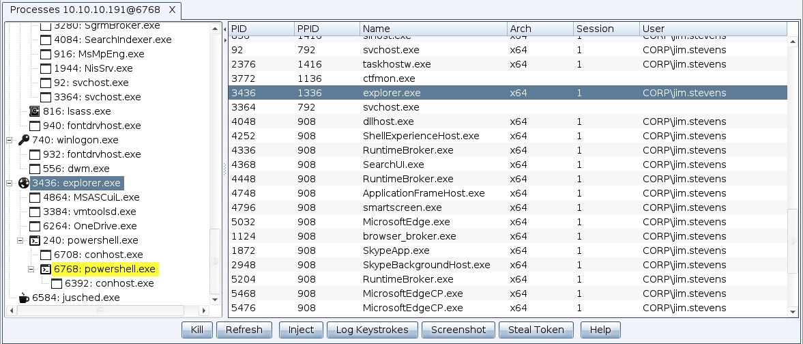
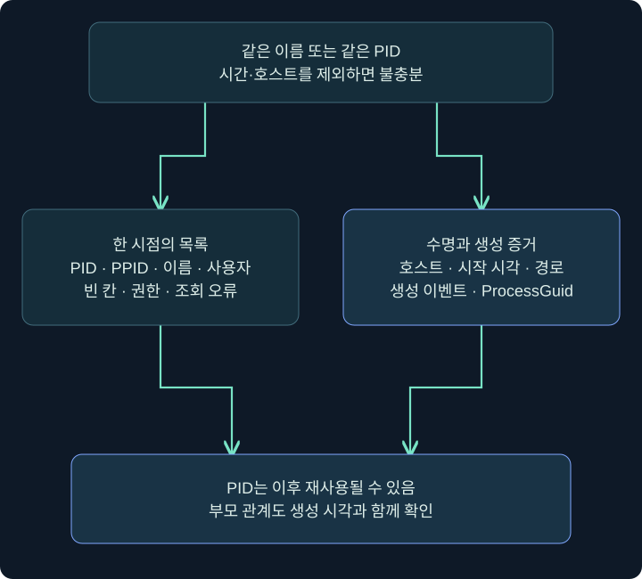
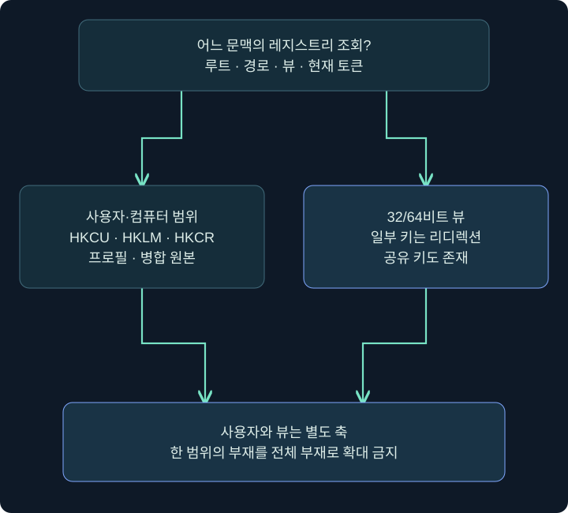
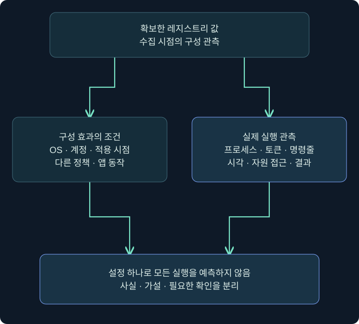

## 1. 프로세스 이름만으로 실행 문맥을 알 수 있나요?

한 컴퓨터에 메모장 두 개가 열려 있다고 해 봅시다. 이름은 같아도 PID·시작 시각·사용자·연 문서가 다를 수 있습니다. 프로세스 목록은 앱 이름을 모으는 표가 아니라 **어떤 실행 인스턴스가 어느 문맥에 있는지** 확인하는 자료입니다.

상황 파악에서는 현재 Beacon 자체가 어느 프로세스·사용자에 있는지부터 확인합니다. Windows의 데스크톱 세션 번호, Cobalt Strike의 세션 ID, 프로세스 PID는 서로 다른 식별자입니다. 숫자가 같거나 같은 화면에 보인다는 이유로 같은 의미로 쓰지 않습니다.

이 강의는 실제 Process Browser와 콘솔에서 조회 위치를 읽고, 레지스트리 뷰·값·권한을 연결합니다. 다른 프로세스에 코드를 주입하거나 토큰을 바꾸는 실행은 하지 않습니다. 아래 결과는 가상 사례이며 실제 Windows에서 수집한 자료가 아닙니다.

## 2. Process Browser의 표와 버튼

### 실제 화면 48: Process Browser의 표와 버튼



출처: [Fortra Process Browser](https://hstechdocs.helpsystems.com/manuals/cobaltstrike/current/userguide/content/topics/post-exploitation_process-browser.htm). 공개 데모 호스트·계정이 있는 원본이며 강의의 LAB-PC 자료가 아닙니다. 현행 문서에 포함된 삽화도 과거 UI일 수 있습니다.

1. 대상 세션 우클릭 → **Explore → Show Processes**를 선택합니다. 구버전이나 다른 공식 페이지에는 Process List라는 표현도 남아 있으므로 같은 기능인지 설치 도움말로 확인합니다.
2. 콘솔에서는 `process_browser`로 열 수도 있습니다. 창을 여는 명령과 대상의 새 목록 수신은 구별합니다.
3. 왼쪽 트리는 부모·자식 관계를, 오른쪽은 PID·PPID·Name·Arch·Session·User 등의 값을 보여 줍니다.
4. 노란 강조는 공식 설명상 현재 Beacon 프로세스를 나타냅니다. 다른 모든 강조색을 악성 판정으로 읽지 않습니다.
5. **Refresh**는 목록 갱신입니다. 아래 Kill·Inject·Log Keystrokes·Screenshot·Steal Token 등은 조회와 다른 동작 버튼입니다. 이 조회 단계에서는 누르지 않습니다.

| 위치 | 읽을 내용 | 주의 |
|---|---|---|
| 왼쪽 트리 | 부모·자식의 표시 관계 | 생성 원인 전체를 입증하지 않음 |
| PID·PPID | 현재 실행·부모 식별자 | 과거 PID 재사용 확인 |
| Arch | x86·x64 등 표시 | OS 비트수와 프로세스 비트수 구별 |
| Session | Windows 세션 번호 | Beacon 세션 ID와 구별 |
| User | 접근 가능한 소유자 정보 | 빈 칸을 SYSTEM으로 해석하지 않음 |
| Refresh | 새 목록 요청 | 즉시 모든 상태 최신 보장은 아님 |

## 3. 콘솔 ps와 화면 목록을 맞추기

### 실제 화면 49: ps·getuid 입력과 결과 읽기


출처: [Fortra Beacon Console](https://hstechdocs.helpsystems.com/manuals/cobaltstrike/current/userguide/content/topics/post-exploitation_main.htm). 화면 속 기존 출력은 공식 예시입니다. 아래 조회를 수행한 사진이 아닙니다.

대상 세션 우클릭 → **Interact** → `help ps` → `ps` → 반환 출력 → `getuid` 순서로 읽습니다. `getuid`는 현재 토큰의 사용자를 확인하는 기본 명령이며 Client 운영자 계정 이름을 반환하는 것으로 설명하지 않습니다.

```text
help ps
ps
getuid
```

가상의 목록에 `PID 4240 / PPID 3000 / notepad.exe / x64 / Session 1 / LAB-PC\student`가 있다고 해 봅시다. 이것은 그 조회 시점에 표시된 값입니다. 메모장이 무엇을 편집했는지, 어떤 파일을 열었는지, 누가 어떤 방식으로 생성했는지는 목록만으로 알 수 없습니다.

여러 대상에서 동시에 프로세스 창을 열면 호스트 열을 함께 확인해야 합니다. PID는 전 세계적으로 유일하지 않으며 다른 호스트의 같은 숫자를 한 프로세스로 합치면 안 됩니다.

## 4. PID·PPID·시작 시각을 함께 보는 이유



Windows의 PID는 프로세스 객체의 수명과 연결되고 이후 재사용될 수 있습니다. 10:00의 PID 4240과 오후의 PID 4240이 같은 프로세스라고 단정하지 않습니다. 호스트·생성 시각·이미지 경로·ProcessGuid 같은 추가 키를 함께 사용합니다.

PPID도 현재 목록에 부모가 안 보일 수 있습니다. 부모가 종료됐거나 식별자가 재사용됐을 수 있기 때문입니다. 프로세스 트리는 중요한 출발점이지만 한 시점의 트리만으로 과거 생성 맥락 전체를 복원하지 못합니다. 원래 생성 이벤트와 대조해야 합니다.

같은 프로그램 이름은 경로·해시·서명을 확인해야 하고, 다른 이름이라도 같은 파일일 수 있습니다. 서명이 있다는 사실은 참고 정보이며 실행 목적·명령줄·허가 범위까지 보증하지 않습니다.

## 5. 빈 칸과 접근 거부는 관측 한계입니다

권한이 부족하면 다른 사용자의 프로세스 세부 정보 일부를 읽지 못할 수 있습니다. 접근 거부·빈 사용자·아키텍처 미표시는 대상 부재와 다릅니다. 높은 무결성에서도 보호된 프로세스·권한·OS 정책 때문에 모든 정보가 무조건 보이는 것은 아닙니다.

| 관측 | 가능한 설명 | 다음 확인 |
|---|---|---|
| 프로세스 이름만 보임 | 세부 접근 제한 | 현재 권한·지원 API·오류 |
| 부모가 목록에 없음 | 종료·필터·시점 차이 | 생성 이벤트·부모 생성 시각 |
| User 빈 칸 | 조회 실패·지원 차이 | 결과 상태·토큰·정책 |
| 앱 이름 같고 PID 다름 | 별도 실행 인스턴스 | 시작 시각·경로·명령줄 |
| PID 같고 시각 크게 다름 | 재사용 가능 | 호스트·생성 키·ProcessGuid |

정보가 부족하다고 곧바로 권한 상승이나 토큰 전환을 시도하는 것이 이 조회의 다음 단계는 아닙니다. 먼저 부족한 항목과 수집 한계를 기록하고 합의한 검증 목표에서 필요한지 판단합니다.

## 6. 레지스트리 조회도 사용자와 뷰가 있습니다

레지스트리는 이름·유형·데이터를 가진 구성 저장소입니다. 6장에서 본 자동 실행 외에도 OS·앱·정책 정보를 담습니다. HKCU는 조회 문맥의 사용자, HKLM은 컴퓨터 범위, HKCR은 병합 뷰라는 차이를 기억합니다.

64비트 Windows에는 일부 키를 32/64비트별 논리 뷰로 나누는 리디렉션이 있습니다. 모든 키가 분리되는 것은 아니며 공유 키도 있습니다. x86/x64를 바꿔 결과가 같거나 다를 때 실제 키의 규칙을 확인해야 합니다.



`HKCU`라는 이름만으로 읽는 사람의 바탕 화면 사용자라고 가정하지 않습니다. 실행 토큰·프로필과 연결해야 합니다. 다른 문맥에서 얻은 결과를 같은 사용자 설정으로 섞지 않습니다.

## 7. reg query와 queryv의 입력 경계

### 실제 화면 50: reg query와 queryv의 입력 경계


공식 원본은 입력 위치를 설명합니다. 아래 EnableLUA 조회 결과가 보이는 사진이 아닙니다. 해당 세션 콘솔의 아래 줄에 `help reg`로 현재 문법을 확인한 뒤 한 줄씩 입력합니다.

```text
help reg
reg query x64 HKLM\SOFTWARE\Microsoft\Windows\CurrentVersion\Policies\System
reg queryv x64 HKLM\SOFTWARE\Microsoft\Windows\CurrentVersion\Policies\System EnableLUA
```

첫 조회는 해당 키의 하위 키·값, 둘째는 지정한 값에 대한 좁은 조회입니다. 현재 공식 도움말의 queryv 마지막 인자 표기는 subkey이지만 설명·실제 도움말에 맞춰 값 이름을 구별합니다. Windows `reg.exe query`와 Beacon `reg query`는 다른 인터페이스입니다.

| 입력 요소 | 예 | 의미 |
|---|---|---|
| 연산 | query / queryv | 키 목록과 특정 값 조회 구별 |
| 뷰 | x64 | 64비트 논리 뷰를 명시한 예 |
| 루트 | HKLM | 컴퓨터 구성 범위 |
| 경로 | Policies\System | 조회 대상 위치 |
| 값 이름 | EnableLUA | 읽을 특정 구성 값 |
| 결과 확인 | 유형·데이터·오류 | 존재·부재·권한·응답 대기 구별 |

이것은 정책을 바꾸는 절차가 아닙니다. UAC 관련 값 하나로 실제 모든 프롬프트·토큰 동작을 예측하지 않습니다. OS·계정·다른 정책·실제 실행 문맥이 필요합니다. 레지스트리 편집·정책 약화는 학습 예제에 포함하지 않습니다.

## 8. 현재 상태와 정책 효과를 구별하기

예를 들어 구성 값이 1로 보인다는 사실과 특정 앱이 실제로 어떤 토큰으로 실행됐다는 사실은 다릅니다. 설정의 적용 시점·그룹 정책·앱 동작·사용자 유형 등이 사이에 있습니다. 값 조회만 확보했다면 `해당 값이 이 문맥·뷰에서 이렇게 반환됨`으로 기록합니다.

파일 경로·프로세스·레지스트리 세 가지가 같은 이름을 포함해도 인과관계가 자동으로 생기는 것은 아닙니다. 앱 설치가 등록을 바꿨는지, 앱 실행 때 그 값을 읽었는지, 후속 프로세스가 그 결과인지 시간과 이벤트로 연결합니다.



## 9. 작은 조사 기록 작성하기

가상 기록: `LAB-PC / Beacon S-A / PID 4240 / 조회 사용자 student / reg x64 / HKLM...EnableLUA / 값 1 / 응답 수신 10:05`. 여기까지는 조회 사실입니다. `모든 관리자 실행이 이 조건으로 동작한다`는 문장은 추가 시험이 필요합니다.

프로세스 기록에는 호스트·PID·PPID·생성 시각·사용자·아키텍처·이미지 경로를, 설정 기록에는 루트·전체 경로·뷰·유형·값·오류를 나누어 적습니다. 재조회했다면 새 시각을 붙이고 앞의 결과를 덮어쓰지 않습니다.

다음 강의의 화면·입력 관측은 훨씬 많은 개인정보를 포함할 수 있습니다. 프로세스 목록에 사용자 이름이 보인다는 사실이 그 사용자의 입력·화면 수집 허가가 되는 것은 아닙니다. 자료의 종류와 범위를 분리해서 생각합니다.

## 10. 복습과 바로 읽는 해설

### 복습 1. Process Browser의 Session은 Beacon ID인가요?

**해설:** Windows 세션 번호입니다. Beacon 세션 ID·PID와 서로 다른 식별자입니다.

### 복습 2. 노란 프로세스가 악성 판정인가요?

**해설:** 공식 설명에서는 현재 Beacon 프로세스의 강조입니다. 색을 보편적인 악성 판정으로 확대하지 않습니다.

### 복습 3. PID가 같으면 계속 같은 프로세스인가요?

**해설:** 이후 재사용될 수 있습니다. 호스트·생성 시각·실행 키를 함께 봅니다.

### 복습 4. 부모 프로세스가 없으면 잘못된 목록인가요?

**해설:** 부모가 종료됐거나 시점·필터 차이가 있을 수 있습니다. 생성 기록과 대조합니다.

### 복습 5. User 빈 칸은 SYSTEM이라는 뜻인가요?

**해설:** 아닙니다. 접근 제한·지원 차이·조회 오류 등 관측 한계일 수 있습니다.

### 복습 6. 모든 레지스트리 키는 x86/x64로 둘인가요?

**해설:** 일부는 리디렉션되고 일부는 공유됩니다. 키별 공식 규칙과 실제 뷰를 확인합니다.

### 복습 7. EnableLUA 조회로 실제 앱 토큰을 알 수 있나요?

**해설:** 구성 값만 읽었습니다. 계정·정책·OS·실제 프로세스 문맥은 별도입니다.

### 복습 8. Refresh와 아래 Kill은 같은 목록 관리인가요?

**해설:** Refresh는 재조회이고 Kill은 대상 프로세스에 영향을 주는 동작입니다. 구별해야 합니다.

## 11. 공식 자료와 적용 범위

확인일: **2026년 11월 4일**. 실제 제품·Windows·정책 조회는 미실행입니다. 원본 UI와 버전별 메뉴·학습값을 구별했습니다.

- [Fortra Process Browser](https://hstechdocs.helpsystems.com/manuals/cobaltstrike/current/userguide/content/topics/post-exploitation_process-browser.htm): 표·강조·조회와 동작 버튼.
- [Microsoft Process Handles and Identifiers](https://learn.microsoft.com/en-us/windows/win32/procthread/process-handles-and-identifiers): 프로세스 식별 수명.
- [Microsoft Win32_Process](https://learn.microsoft.com/en-us/windows/win32/cimwin32prov/win32-process): 부모·생성 시각·PID 재사용 해석.
- [Microsoft Registry Redirector](https://learn.microsoft.com/en-us/windows/win32/winprog64/registry-redirector): 논리 뷰.
- [Microsoft Registry Keys Affected by WOW64](https://learn.microsoft.com/en-us/windows/win32/winprog64/shared-registry-keys): 키별 공유·리디렉션.
- [Microsoft UAC 정책](https://learn.microsoft.com/en-us/windows/security/application-security/application-control/user-account-control/settings-and-configuration): 구성과 실제 조건.
