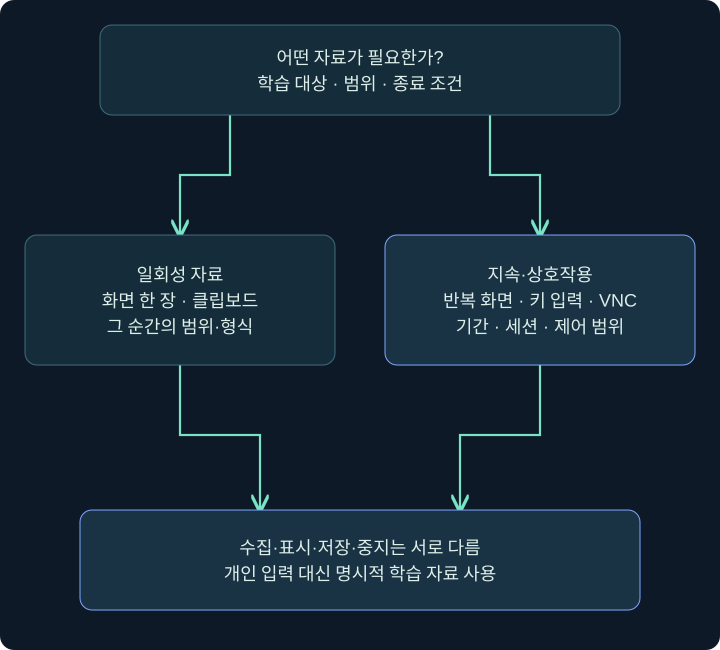
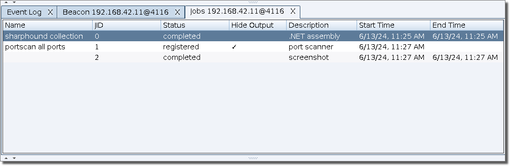
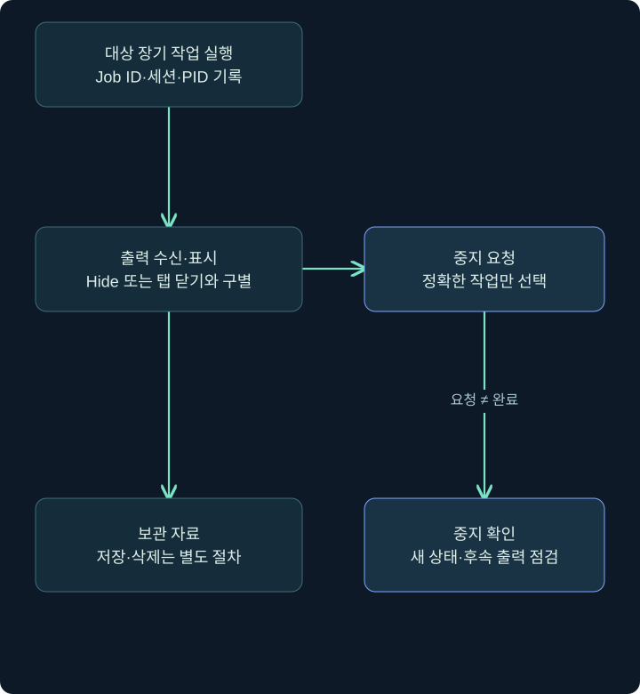
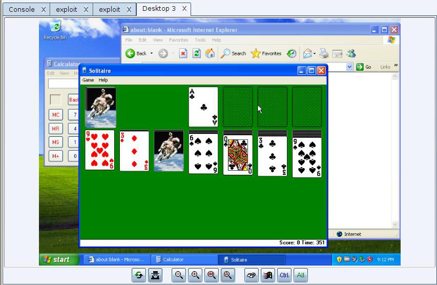
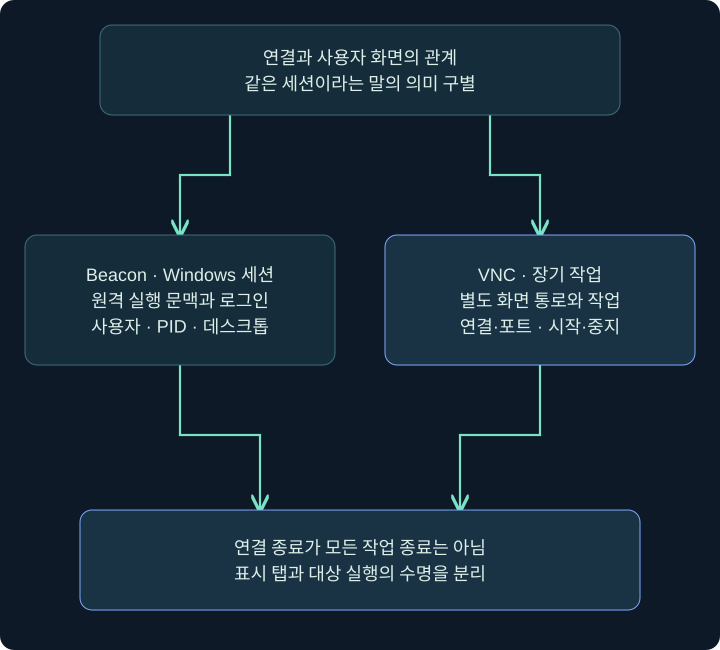

## 1. 화면·입력·클립보드는 서로 다른 자료입니다

화면 한 장에는 그 순간 보이는 내용이 담깁니다. 키 입력 기록은 시간이 흐르는 동안 누른 키를, 클립보드는 복사한 데이터의 일부 형식을, 원격 데스크톱은 화면과 조작 경로를 다룹니다. 같은 사용자의 컴퓨터라는 이유로 네 가지 자료를 하나의 수집 기능으로 생각하면 범위와 영향이 흐려집니다.

교육용 관측을 설계할 때는 `현재 학습용 메모장 화면 한 장`, `TRAINING_ONLY 문구만 있는 테스트 문서`처럼 대상을 구체적으로 정합니다. 실제 사용자 키 입력·암호·개인 메시지를 수집하는 것을 실습 예로 삼지 않습니다. 이미 도구가 보이는 상태와 자료 수집을 시작하는 행동도 구별합니다.

이번 강의는 공식 기능의 역할·실제 창·출력 위치·장기 작업 수명·종료 확인을 설명합니다. 키 입력·클립보드·화면 수집과 VNC 연결은 실행하지 않았습니다. 실제 민감 자료를 포함하는 캡처를 제공하지 않습니다.

## 2. 기능별 자료와 지속 시간 비교

| 기능 이름 | 자료·동작의 성격 | 확인할 차이 |
|---|---|---|
| clipboard | 텍스트 클립보드 조회 | 화면 전체나 모든 과거 복사 기록은 아님 |
| printscreen | 키 동작·클립보드 경유 캡처 방식 | 사용자 클립보드 변경·정리 영향 |
| screenshot | 일회 화면 캡처 기능 | 캡처 시각·세션·출력 탭 |
| screenwatch | 반복 화면 관측의 장기 작업 | 활성 기간·주기·중지 확인 |
| keylogger | 키 입력 관측의 장기 작업 | 해당 사용자·프로세스·수집 범위 |
| Desktop(VNC) | 데스크톱 화면과 조작 경로 | 보기 전용과 제어·포트·연결 수명 |

기능 이름을 나열하는 것만으로 동일한 Windows 세션의 화면을 반드시 얻는다는 보장은 없습니다. 프로세스·사용자·데스크톱 세션·권한·보호 경계를 고려해야 합니다. UI가 열렸다는 사실과 대상에서 실제 수집이 수행됐다는 사실도 다릅니다.



## 3. 도움말을 읽는 단계와 시작하는 단계를 나누기

### 실제 화면 51: 콘솔에서 기능 설명만 확인하기


출처: [Fortra Beacon Console](https://hstechdocs.helpsystems.com/manuals/cobaltstrike/current/userguide/content/topics/post-exploitation_main.htm). 원본의 기존 기록은 공개 예시이고 실제 사용자 관측 결과가 아닙니다.

대상 세션 우클릭 → **Interact** → 아래 입력 줄 → 다음 도움말 → 위 설명에서 인자·출력·종료 조건을 읽습니다. 아래는 도움말 명령이므로 관측 기능을 시작하지 않습니다.

```text
help screenshot
help screenwatch
help clipboard
help keylogger
help jobs
```

설명에서 특정 PID·아키텍처 인자를 받는 방식과 인자 없이 임시 프로세스를 사용하는 방식이 어떻게 다른지 읽습니다. 도움말을 조회한 기록에 `키 입력 수집 성공`을 적으면 안 됩니다. 본문은 실제 입력 수집을 활성화하는 명령열을 연습 대상으로 사용하지 않습니다.

출력 통로도 확인합니다. 클립보드 텍스트는 콘솔에 나올 수 있지만 화면 자료는 별도 Screenshots, 키 입력 자료는 Keystrokes 기능에 표시되는 식으로 다릅니다. 콘솔이 조용하다는 이유만으로 전용 탭 자료까지 없다고 결론 내리지 않습니다.

## 4. Jobs에서 장기 작업 읽기

### 실제 화면 52: Jobs에서 장기 작업 읽기



출처: [Fortra Job Browser](https://hstechdocs.helpsystems.com/manuals/cobaltstrike/current/userguide/content/topics/job%20browser.htm). 공개 원본입니다. 원본 작업의 상태·종류는 강의가 실행한 작업이 아닙니다. 버전에 따라 열과 버튼 배치가 다를 수 있습니다.

1. 해당 세션 또는 콘솔 탭 우클릭 → **Jobs**를 엽니다. 전체 작업 보기는 **View → All Jobs**로 구별합니다.
2. 행에서 호스트·세션·작업 이름·상태와 보이는 식별자를 읽습니다. 같은 숫자의 작업이 다른 세션에서 있을 수 있습니다.
3. **Interact**는 작업의 출력·상호작용 화면을 여는 기능입니다. 모든 작업을 다시 시작하는 버튼으로 설명하지 않습니다.
4. Name·Hide/Show Output 기능이 있는 버전에서는 작업 표시명과 출력 표시 상태를 바꾸는 것인지 확인합니다. 출력 숨김은 작업 중지가 아닙니다.
5. **Kill**은 실제 중지 요청입니다. 단순히 창을 닫으려고 누르지 않습니다. 중지할 대상과 승인된 범위를 먼저 확인합니다.

| 식별자·상태 | 역할 | 혼동하면 생기는 문제 |
|---|---|---|
| Beacon ID | 원격 세션 식별 | 다른 호스트·사용자 작업을 제어 |
| Job ID | 해당 작업 식별 | PID와 섞어 잘못된 대상 선택 |
| PID | Windows 프로세스 식별 | 작업 하나와 프로세스 전체를 동일시 |
| 출력 탭 | 결과 표시 | 닫기·숨김을 중지로 오해 |
| 중지 요청·완료 | 작업 생명주기 | 요청만 보고 완료라고 기록 |

## 5. 콘솔 jobs와 중지 확인의 경계

`jobs`는 장기 작업 목록을 조회합니다. `jobkill`은 지정한 장기 작업을 중지하는 명령이며 Windows 프로세스 전체의 `kill`과 다릅니다. 아래는 문법을 읽고 목록만 보는 미실행 예입니다.

```text
jobs
help jobkill
help kill
```

실제 허가된 실습에서 이미 존재하는 학습 작업을 정리한다면 세션·JID·PID·설명을 맞추고 해당 작업의 중지 요청을 보낸 뒤 새 목록·완료 출력·후속 산출물이 멈췄는지를 확인해야 합니다. 이 강의에서 임의 JID를 골라 중지하거나 그 결과를 재현했다고 주장하지 않습니다.



콘솔 탭이나 Client 창을 닫아도 대상 작업이 자동 종료된다고 가정하지 않습니다. 네트워크 연결이 잠시 끊겨도 해당 프로세스·장기 작업의 수명이 끝난 증거는 아닙니다. 기능별 종료 동작을 공식 문서·실제 상태와 대조합니다.

## 6. Screenshots·Keystrokes에서 확인할 항목

공식 기능은 **View → Screenshots**, **View → Keystrokes**로 결과를 구별합니다. 현재 확보한 공식 자료에는 두 결과 목록의 적절한 실제 원본 사진이 없어 이 절은 설명표로 제공합니다. 아래 표를 실제 탭의 실행 결과 캡처로 제시하지 않습니다.

| 확인 항목 | 학습에서 기록할 값 | 이유 |
|---|---|---|
| 대상 | 승인된 격리 VM·사용자·세션 | 다른 데스크톱 자료와 구별 |
| 시각 | 관측·수신 시각 | 지연과 실제 화면 시점 구별 |
| 종류 | 일회·반복·키 입력 | 자료의 해석과 수명 차이 |
| 행·이미지 | 선택한 대상 하나 | 여러 사용자 자료 혼합 방지 |
| Save | 필요한 학습 결과의 Client 저장 | 서버 보관과 로컬 저장 구별 |
| Delete | UI 목록·표시 자료에서 제거 | 서버 원본·로그·사본 삭제를 보장하지 않음 |

공식 설명에는 결과 행의 Save·Delete와 이미지 확대 기능이 있습니다. 저장·확대는 표시·보관 단계이고 이미 실행 중인 관측 기능의 종료와 다릅니다. Delete의 UI 제거를 서버 원본·로그·다른 저장 사본까지 삭제됐다는 증거로 확대하지 않습니다. 반복 관측의 이미지가 없으면 수집 주기·유휴 상태·전달 지연·권한·출력 통로를 함께 확인합니다.

`printscreen` 계열은 키 동작과 클립보드 경유의 부작용을 고려해야 합니다. 클립보드는 텍스트 외 형식도 있고 다른 앱이 사용 중일 수 있습니다. 사용자 작업을 방해하지 않는다고 이름만으로 가정하지 않습니다.

## 7. Desktop(VNC)의 보기와 제어

### 실제 화면 53: Desktop(VNC)의 보기와 제어



출처: [Fortra Desktop Control](https://hstechdocs.helpsystems.com/manuals/cobaltstrike/current/userguide/content/topics/post-exploitation_desktop-control.htm). 원본은 매우 오래된 Windows 데모 화면입니다. 현재 Windows 또는 이 강의의 격리 VM을 캡처한 결과가 아니며 공개 데모 게임·빈 브라우저 화면을 보여 줍니다.

진입 경로는 대상 세션 우클릭 → **Explore → Desktop(VNC)**입니다. 이것은 도움말만 여는 동작과 달리 대상에 VNC 기능을 준비하고 연결을 만드는 행동입니다. 사진을 읽기 위해 실제 대상에서 이 메뉴를 실행할 필요는 없습니다.

| 화면·설정 | 의미 | 학습에서 구별할 것 |
|---|---|---|
| high / low 품질 | 전송 화면 품질 선택 | 화질·부하와 권한은 별개 |
| 기본 보기 전용 | 화면 관측 | 제어 권한이 자동 허용됐다는 뜻 아님 |
| 아래 키보드·마우스 제어 | 원격 조작 경로 | 보기와 실제 입력 전달의 차이 |
| 터널·서버 포트 | 화면 연결의 통신 자원 | 일반 콘솔 작업과 별도 수명 |
| 탭 닫기 | 표시 종료와 연결 정리를 구별 | 해당 연결·바인딩 해제 여부를 별도 확인 |

실제 실습은 명시적으로 허가된 학습 데스크톱에서만 별도로 설계합니다. 보기 전용과 제어 모드를 구별하고 대상 사용자·세션·종료 조건을 먼저 정해야 합니다. 이 문서에서 원격 조작이나 포트 연결은 수행하지 않았습니다.

## 8. 왜 세 가지 세션을 분리하나요?



Beacon 세션은 운영 도구의 원격 실행 문맥이고, Windows 세션은 로그인·데스크톱 자원과 관련된 경계이며, VNC 연결은 화면 전송·조작의 별도 통로입니다. Beacon이 살아 있다고 원하는 사용자의 화면을 볼 수 있다는 보장은 없습니다. VNC 탭을 닫은 뒤에도 해당 연결·바인딩이 실제로 해제됐는지 따로 확인해야 하며, 다른 장기 작업까지 끝났다는 뜻도 아닙니다.

일회 캡처와 반복 캡처도 같은 수명으로 쓰지 않습니다. 현재 창 하나를 확인하는 학습 목표에 장기 관측이 필요한지 먼저 판단합니다. 반복 관측은 기간이 길어지므로 대상 범위·종료 확인·보관 자료가 더 중요해집니다.

## 9. 확인·복구 기록을 작게 만들기

가상의 기록은 `승인된 LAB-PC/student의 학습용 빈 메모장 한 장 / 수집 기간 명시 / 저장 위치 명시 / 장기 작업 없음`처럼 구체적으로 쓸 수 있습니다. 실제 자료를 수집한 경우에만 해당 결과를 확인 사실로 씁니다. 이 강의는 공식 원본 읽기와 미실행 절차를 설명하는 단계입니다.

장기 작업이 있다면 종료 요청·종료 확인·남은 프로세스·연결·보관 자료를 나누어 체크합니다. 창 닫기, Hide Output, Delete 자료, jobkill, kill, 세션 exit는 목적과 영향이 다릅니다. 하나를 눌러 전체 정리가 끝났다고 기록하지 않습니다.

이 구분을 이해하면 실제 도구의 버튼이 많아도 무엇을 확인하는 조작인지 설명할 수 있습니다. 다음 강의에서는 프로그램·셸·런타임·BOF의 실행 위치를 같은 방식으로 구별합니다.

## 10. 복습과 바로 읽는 해설

### 복습 1. screenshot과 screenwatch는 같은 수명인가요?

**해설:** 일회 캡처와 반복 장기 작업을 구별합니다. 종료 조건과 결과 확인이 다릅니다.

### 복습 2. help keylogger는 관측을 시작하나요?

**해설:** 도움말을 읽는 명령입니다. 실제 시작·결과와 구별해야 합니다.

### 복습 3. Hide Output은 작업을 멈추나요?

**해설:** 표시 상태와 작업 수명은 다릅니다. 중지 요청과 완료를 별도로 확인합니다.

### 복습 4. Job ID와 PID는 같은가요?

**해설:** 도구 작업과 Windows 프로세스의 식별자로 의미·범위가 다릅니다.

### 복습 5. 결과 자료 Delete가 관측 작업도 끝내나요?

**해설:** 보관 자료 제거와 대상 작업 중지는 다른 단계입니다.

### 복습 6. Desktop 메뉴는 도움말 보기와 같은가요?

**해설:** 대상 기능 준비·연결을 만드는 동작입니다. 원본 사진을 읽는 것과 실제 실행은 다릅니다.

### 복습 7. VNC 탭을 닫으면 모든 장기 작업이 종료되나요?

**해설:** 해당 연결·바인딩 해제부터 따로 확인해야 합니다. 다른 작업·프로세스·자료의 수명도 별개입니다.

### 복습 8. 어떤 실제 사용자 자료를 수집했나요?

**해설:** 이 강의에서는 수집하지 않았습니다. 공식 공개 원본과 기능·작업 수명의 미실행 설명을 제공합니다.

## 11. 공식 자료와 적용 범위

확인일: **2026년 11월 4일**. 공개 원본과 버전 차이를 표시했습니다. 실제 사용자 입력·클립보드·화면·VNC 연결은 수집·실행하지 않았습니다.

- [Fortra Job Browser](https://hstechdocs.helpsystems.com/manuals/cobaltstrike/current/userguide/content/topics/job%20browser.htm): Jobs·All Jobs·상호작용·중지·출력 표시.
- [Fortra Desktop Control](https://hstechdocs.helpsystems.com/manuals/cobaltstrike/current/userguide/content/topics/post-exploitation_desktop-control.htm): 실제 VNC 화면과 연결 수명.
- [Fortra Running Commands](https://hstechdocs.helpsystems.com/manuals/cobaltstrike/current/userguide/content/topics/post-exploitation_running-commands.htm): 관측 기능·jobs·중지의 계약.
- [Fortra Keystrokes and Screenshots](https://hstechdocs.helpsystems.com/manuals/cobaltstrike/current/userguide/content/topics/post-exploitation_keystrokes-screenshots.htm): 결과 탭과 자료 표시.
- [Microsoft Clipboard Operations](https://learn.microsoft.com/en-us/windows/win32/dataxchg/clipboard-operations): 형식·사용·소유권·변경.
