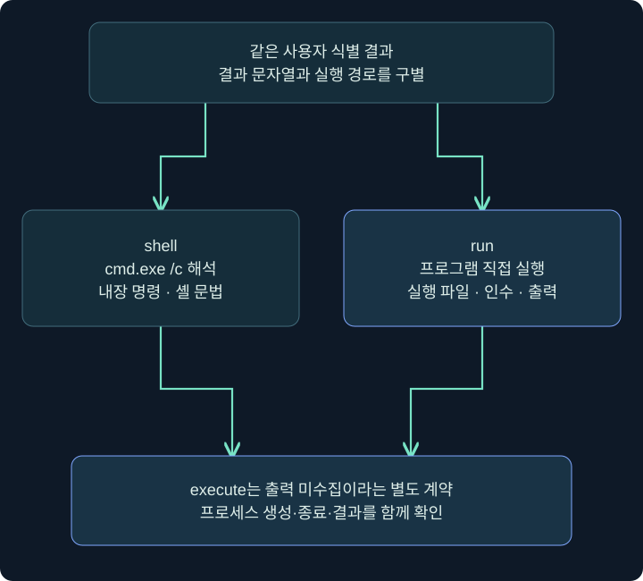
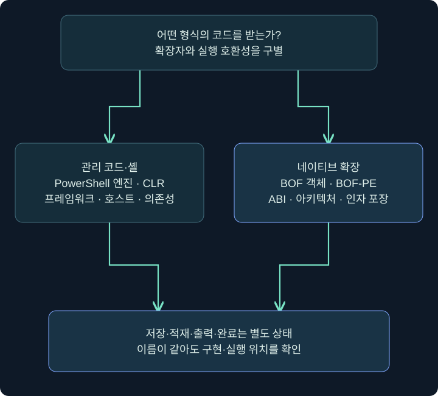
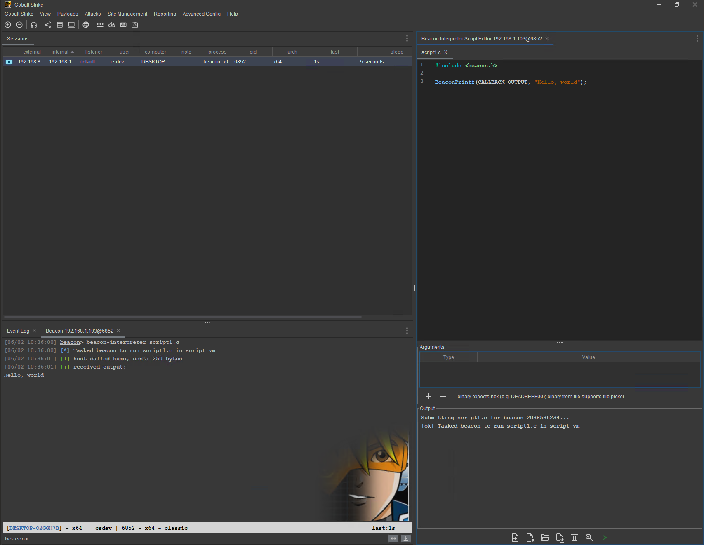
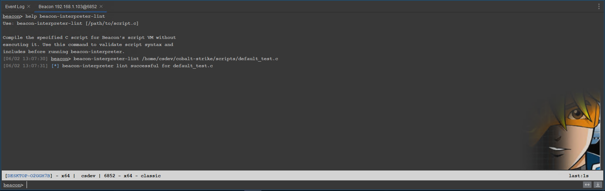
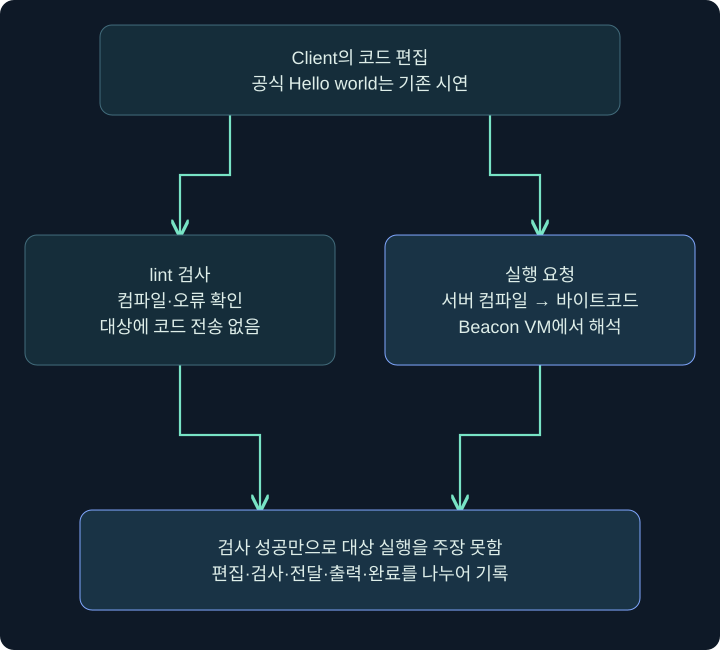

## 1. 같은 출력이어도 실행 경로는 다릅니다

현재 사용자 이름을 출력하는 두 명령이 같은 문자열을 반환했다고 해 봅시다. 하나는 cmd.exe를 거쳤고 다른 하나는 프로그램을 직접 실행했을 수 있습니다. 결과 텍스트가 같다는 사실과 프로세스·런타임·메모리 동작이 같다는 사실은 다릅니다.

이 강의는 shell·run, PowerShell 실행 방식, .NET 어셈블리, BOF와 Interpreter를 **입력 위치 → 해석하는 엔진 → 실행 위치 → 출력 → 종료**로 읽습니다. 도구의 내부 구조를 이해하여 관측과 오류를 설명하는 것이 목적입니다. 보안 기능을 끄거나 메모리를 패치하는 옵션은 학습 설정으로 사용하지 않습니다.

가상의 무해한 조회와 공식 Hello world 화면만 사용합니다. 실제 대상에 도구·어셈블리·BOF를 올려 실행하거나 원격 코드를 내려받는 실습은 수행하지 않았습니다.

## 2. shell·run의 입력과 출력

### 실제 화면 54: shell·run의 입력과 출력


출처: [Fortra Beacon Console](https://hstechdocs.helpsystems.com/manuals/cobaltstrike/current/userguide/content/topics/post-exploitation_main.htm). 아래 조회의 실행 결과 사진이 아닌 공식 배치 원본입니다.

대상 세션 우클릭 → **Interact** → `help shell`·`help run` 확인 → 아래 입력 줄 → 실행 요청 기록 → 결과 반환 순서로 읽습니다. Windows 사용자 식별을 보여 주는 다음 예는 미실행입니다.

```text
help shell
help run
run whoami.exe /user
shell whoami.exe /user
```

| 명령 | 중간 해석기 | 프로그램·출력 의미 |
|---|---|---|
| shell | cmd.exe /c를 거침 | cmd 내장 문법·프로그램 호출과 출력 |
| run | cmd.exe 없이 프로그램 실행 | 실제 실행 파일과 인수·반환 출력 |
| execute | 프로그램을 백그라운드 실행 | 출력 미수집이므로 빈 결과 판정 금지 |
| pwd·getuid 등 | 해당 기본 기능의 구현 | 같은 질문을 더 좁은 기능으로 조회 가능 |

`whoami.exe`는 실행 파일이라 두 경로에서 사용할 수 있습니다. `dir`은 cmd 내장 명령이므로 `run dir`를 같은 방식으로 가르치지 않습니다. 셸의 파이프·리디렉션·따옴표도 직접 프로그램 실행과 해석 경계가 다릅니다. 표준 출력이 왔다고 종료 코드나 목적한 효과 전체가 자동 검증되는 것은 아닙니다.



## 3. PowerShell은 프로그램 이름 이상의 실행 환경입니다

PowerShell은 언어·엔진·호스트·프로필·모듈이 연결된 환경입니다. 별칭 하나가 두 호스트에서 다르게 보일 수 있고 .NET 기능도 버전과 런타임 조건에 영향을 받습니다. 파일 확장자가 ps1이라는 이유로 어디서나 같은 결과를 보장하지 않습니다.

| 기능 | 실행 관점 | 확인할 증거·조건 |
|---|---|---|
| powershell | powershell.exe를 사용하는 명령 | 생성 프로세스·명령줄·엔진 버전·출력 |
| powerpick | Unmanaged PowerShell 후속 기능 | 호스트 프로세스·런타임·주입·작업 수명 |
| psinject | 특정 기존 프로세스의 실행 문맥 | 대상 PID·아키텍처·권한·출력 통로 |
| powershell-import | 이후 호출에 사용할 스크립트 등록 | Client 파일·수입 상태·후속 실행과 구별 |

뒤의 두 실행 방식에 powershell.exe가 없다고 PowerShell 엔진 활동이나 관련 증거가 없다는 뜻은 아닙니다. 이 표는 회피 방법 선택표가 아니라 실행 경계 비교표입니다. 특정 이름의 프로세스가 없다는 이유로 행위가 없다고 결론 내리지 않도록 사용합니다.

## 4. 스크립트 경로·import·호출을 구별하기

`powershell-import`의 파일 인자는 Client 쪽에 있는 스크립트 경로입니다. 대상 Windows의 `C:\Lab\...` 파일을 지정하는 명령과 다릅니다. 경로 문자열이 비슷해도 어느 컴퓨터가 파일을 읽는지부터 확인해야 합니다.

설치된 도움말을 읽을 때는 다음처럼 기능 설명만 조회합니다. import 자체와 스크립트 내부 명령 실행은 다른 단계입니다. 현재 공식 안내는 한 번에 한 스크립트를 유지한다고 설명하므로 다음 import가 앞선 상태를 바꿀 수 있다는 점도 기록합니다.

```text
help powershell-import
help powershell
help powerpick
help psinject
```

교육용 파일을 별도로 검토할 때는 내용이 `Write-Output 'TRAINING_ONLY'`처럼 짧고 바로 끝나는지 정적으로 읽는 것으로 충분합니다. 이 문서에서는 해당 파일을 Client에서 import하거나 대상에서 호출하지 않았습니다. import 성공이 곧 정상 출력·권한·전체 스크립트 완료라는 뜻은 아닙니다.

PowerShell 버전·호스트·프로필은 앞 장에서 설명한 네 범위와 연결합니다. 다른 사용자의 프로필이나 문서를 실행 인자로 가져오지 않습니다. 실행 정책 우회나 보안 로깅 비활성화를 무해한 출력 예의 필수 조건으로 만들지 않습니다.

## 5. .NET 어셈블리는 어떤 런타임을 요구하나요?

.NET 어셈블리는 관리 코드와 메타데이터를 담고 CLR 같은 런타임이 실행을 지원합니다. 일반 네이티브 EXE와 같은 방식으로만 동작하는 것은 아닙니다. 대상 프레임워크·아키텍처·의존성·엔트리 포인트를 확인해야 합니다.

현행 Fortra 설명은 `execute-assembly`가 임시 프로세스에 CLR을 로드하고 어셈블리를 실행한다고 명시합니다. 파일 인자는 Client의 로컬 어셈블리이며 출력과 작업 상태가 돌아오는 방식입니다. `.exe`라는 확장자만 보고 대상 디스크에 그대로 저장된 일반 EXE 실행과 동일시하지 않습니다.

과거 설명의 .NET Framework 계열 조건과 현대 .NET/.NET Core를 구별해야 합니다. 확인한 현재 공개 문서에는 모든 현대 .NET을 보장하는 버전별 지원표가 없으므로 `모든 .NET 바이너리 실행 가능`이라고 말하지 않습니다. 설치 버전의 도움말·대상 런타임·공식 지원 조건을 따로 대조합니다.



어셈블리가 로드됐다는 사실, 출력 한 줄을 보냈다는 사실, 프로그램이 기대 작업을 끝냈다는 사실은 다릅니다. 외부 의존성·종료·작업 제한을 함께 확인합니다. 메모리 실행이라는 표현도 로그·모듈·프로세스 흔적이 없다는 뜻은 아닙니다.

## 6. BOF와 사용자 정의 명령의 계약

BOF는 정해진 ABI·엔트리 포인트·인자 포장 규약에 따라 Beacon이 실행하는 객체 코드입니다. 일반 EXE처럼 독립 실행하는 파일과 다릅니다. `inline-execute`는 호출 수단이고 실제 객체의 내용·아키텍처·인자 해석은 별도입니다.

도구 모음은 Aggressor Script가 명령 별칭과 인자 변환을 감싸기도 합니다. 그러므로 확장 명령 이름이 ipconfig와 같아도 Windows ipconfig.exe 실행이라고 단정하지 않습니다. 동일 이름·동일 출력과 실제 실행 경로는 다른 관계입니다.

```text
help inline-execute
help execute-assembly
help data-store
```

이 세 줄은 계약을 읽는 도움말 예입니다. 임의 객체·어셈블리를 실행하지 않습니다. data-store가 있는 버전에서는 저장된 항목의 종류·이름과 실제 실행을 나누어 기록합니다. 저장소에 있다는 사실만으로 이미 실행됐다고 쓰지 않습니다.

현재 4.13의 BOF-PE도 별도 기능입니다. 이를 기존 BOF 객체·관리 어셈블리·일반 EXE가 서로 완전히 같은 형식이라는 뜻으로 설명하지 않습니다. 지원 규약과 API·의존성·아키텍처는 기능별로 확인합니다.

## 7. 4.13 Interpreter 편집 화면

### 실제 화면 55: 4.13 Interpreter 편집 화면



출처: [Fortra Beacon Interpreter](https://hstechdocs.helpsystems.com/manuals/cobaltstrike/current/userguide/content/topics/post-exploitation_beacon-interpreter.htm). 공식 제작자의 Hello world 데모와 기존 출력입니다. 이 강의에서 제품에 연결하거나 코드를 실행해 캡처한 결과가 아닙니다. 글자를 읽을 수 있도록 원본 폭을 유지했습니다. 처음에는 오른쪽 편집기가 보이며 그림 안을 가로로 이동하면 왼쪽 Sessions·콘솔까지 확인할 수 있습니다. 이미지를 누르면 전체 원본도 열립니다.

1. 공식 설명의 진입점은 Sessions의 대상 Beacon 또는 콘솔 탭 우클릭으로 여는 **Beacon Menu**입니다. 설치 버전의 Interpreter 편집 기능을 확인합니다. 확인되지 않은 하위 메뉴 이름을 새로 지어 안내하지 않습니다.
2. 원본 오른쪽 Script Editor의 코드 탭을 봅니다. 코드 편집은 즉시 대상 실행과 다른 단계입니다.
3. 아래 Arguments 표의 **Type·Value**를 읽습니다. 함수가 기대하는 자료형과 값이 맞아야 하며 인자 없는 표시 예라면 불필요한 값을 넣지 않습니다.
4. Output 영역과 왼쪽 콘솔 결과를 구별합니다. 원본의 기존 Hello world 출력은 공식 시연의 결과입니다.
5. 아래 실행 아이콘을 누르는 것은 검사만 하는 것과 다릅니다. 원본 사진에서 보이지 않는 툴팁·저장 버튼 이름은 만들어 쓰지 않습니다. 아래 lint 예를 통해 검사 경계를 먼저 읽습니다.

Interpreter는 모든 기존 명령을 대체하는 엔진이 아닙니다. Team Server의 컴파일과 대상 Beacon VM의 해석 실행이라는 추가 경로입니다. 편집기 탭을 열었다고 코드가 전달됐다고 기록하지 않습니다.

## 8. lint 성공과 대상 실행 구별

### 실제 화면 56: lint 성공과 대상 실행 구별



공식 원본의 `/home/csdev/.../default_test.c`는 제작자의 예시 경로입니다. 이 과정이 제공하거나 실제 검사한 파일 경로가 아닙니다. 출처는 같은 Interpreter 공식 문서입니다.

해당 Beacon Console 아래 줄에서 **help beacon-interpreter-lint**로 설치 문법을 읽습니다. 선택하는 파일은 Client에서 준비한 검토된 학습 소스이고, 상대/전체 경로가 어느 컴퓨터 기준인지 확인합니다. 실제 lint를 실행할 별도 환경에서는 도움말의 인자 순서에 맞춰 파일을 지정하고 컴파일 오류·검사 출력을 확인합니다. 본문은 이 과정을 수행한 결과로 원본 이미지를 제시하지 않습니다.

```text
help beacon-interpreter-lint
help beacon-interpreter
```



공식 문서상 lint는 코드를 Beacon에 보내지 않습니다. 따라서 성공해도 대상에서 Hello world가 출력됐거나 원하는 작업을 마쳤다는 결론을 낼 수 없습니다. 실행 명령은 바이트코드를 대상 VM에 보내는 별도 단계입니다. 저장·검사·전달·실행·출력의 다섯 상태를 구별합니다.

## 9. 오류가 나면 어느 경계를 확인하나요?

| 증상 | 점검할 경계 | 섣부른 결론 |
|---|---|---|
| 명령이 없음 | 버전·기본/확장·도움말 | 대상 Windows 고장 |
| 파일 열기 실패 | Client 경로·존재·권한 | 원격 파일 부재 |
| 인자 처리 오류 | 셸 해석·자료형·포장 | 도구 전체 비호환 |
| 런타임 로드 실패 | 프레임워크·아키텍처·의존성 | 모든 .NET 불가 |
| 출력 일부만 도착 | 장기 작업·전달·종료 | 작업 전체 성공 |
| lint 성공·실행 출력 없음 | 검사와 대상 실행 구별 | 대상 실행 성공 |

문제 해결을 위해 임의의 보안 패치를 적용하거나 로그를 끄는 대신 실패한 경계를 먼저 찾아야 합니다. 도움말·현재 설정·정적 파일 정보·반환 오류가 그 출발점입니다. 다음 강의에서는 세션 전달과 작업·파일 전송의 상태를 가상 자료로 계산합니다.

## 10. 복습과 바로 읽는 해설

### 복습 1. shell과 run 출력이 같으면 동작도 같나요?

**해설:** cmd.exe 해석 여부와 프로세스 경로가 다를 수 있습니다. 결과와 실행 경로를 구별합니다.

### 복습 2. 왜 run dir를 같은 예로 쓰지 않나요?

**해설:** dir는 cmd 내장 명령입니다. 직접 실행 파일 호출과 다릅니다.

### 복습 3. powershell.exe가 없으면 PowerShell 행위도 없나요?

**해설:** 엔진이 다른 호스트에서 동작할 수 있습니다. 프로세스 이름 하나로 부재를 단정하지 않습니다.

### 복습 4. powershell-import 경로는 대상 파일인가요?

**해설:** 공식 문법에서는 Client의 로컬 스크립트 경로입니다. import와 후속 호출도 다른 단계입니다.

### 복습 5. execute-assembly는 모든 현대 .NET을 보장하나요?

**해설:** 공개 현재 설명만으로 보장하지 않습니다. 대상 프레임워크·런타임·아키텍처·의존성을 확인합니다.

### 복습 6. 확장의 ipconfig는 반드시 ipconfig.exe인가요?

**해설:** BOF 별칭 등 다른 구현일 수 있습니다. 이름과 실제 구현을 구별합니다.

### 복습 7. Interpreter 탭을 열면 대상에서 실행되나요?

**해설:** 편집·검사·전달·실행은 별도입니다. 창을 연 사실로 실행을 주장하지 않습니다.

### 복습 8. lint 성공으로 실제 대상 출력이 검증됐나요?

**해설:** 아닙니다. 공식 설명상 대상에 코드를 보내지 않는 컴파일·검사 단계입니다.

## 11. 공식 자료와 적용 범위

확인일: **2026년 11월 4일**. 공식 실제 화면과 학습 예를 구별했습니다. Cobalt Strike·Windows·CLR·BOF·Interpreter 실행과 lint는 수행하지 않았습니다.

- [Fortra Running Commands](https://hstechdocs.helpsystems.com/manuals/cobaltstrike/current/userguide/content/topics/post-exploitation_running-commands.htm): 실행 명령과 출력·경로 계약.
- [Fortra Command Behavior](https://hstechdocs.helpsystems.com/manuals/cobaltstrike/current/userguide/content/topics/appendix-a_beacon-opsec-considerations.htm): API·BOF·별도 프로세스 실행 관점.
- [Fortra Beacon Object Files](https://hstechdocs.helpsystems.com/manuals/cobaltstrike/current/userguide/content/topics/beacon-object-files_main.htm): 객체 규약.
- [Fortra Beacon Interpreter](https://hstechdocs.helpsystems.com/manuals/cobaltstrike/current/userguide/content/topics/post-exploitation_beacon-interpreter.htm): 실제 편집·lint·VM 경계.
- [Microsoft .NET 구현](https://learn.microsoft.com/en-us/dotnet/fundamentals/implementations): .NET Framework와 현대 .NET·런타임 차이.
- [Microsoft cmd](https://learn.microsoft.com/en-us/windows-server/administration/windows-commands/cmd): 셸 해석과 실행.
