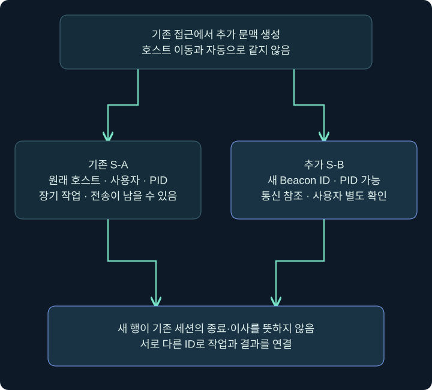
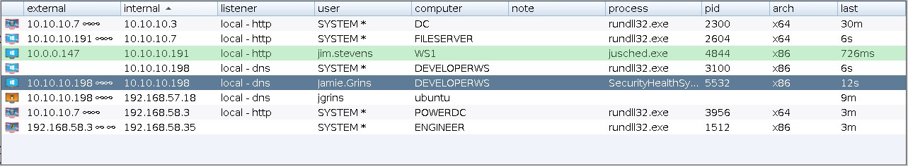
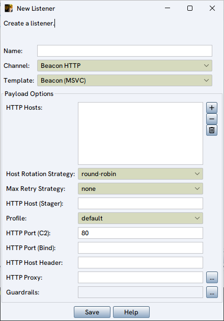
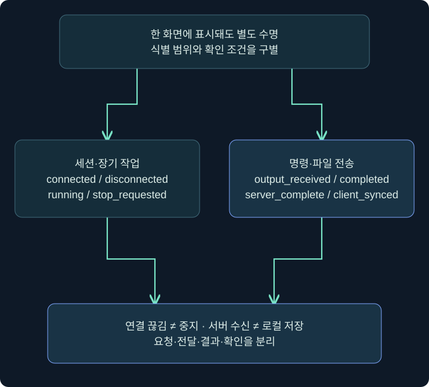
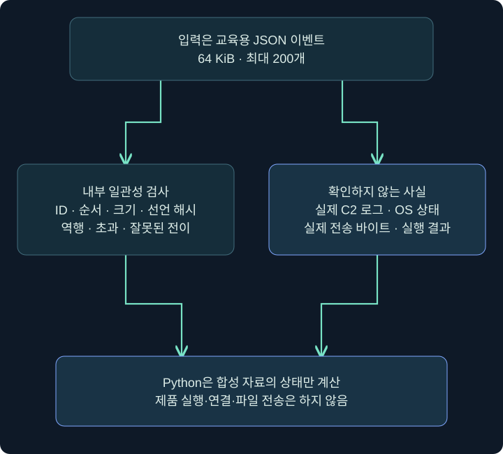

## 1. 새 세션은 기존 세션을 자동으로 옮기는 것인가요?

전화 한 통이 연결된 상태에서 다른 전화기를 추가로 연결하는 것과 기존 통화를 다른 번호로 변경하는 것은 다릅니다. **Session Passing(세션 전달)**도 기존 접근을 바탕으로 새 실행·연결 문맥을 만드는 과정으로 이해해야 합니다. 새 Beacon이 생겨도 기존 세션이 자동 종료되거나 기존 작업이 모두 이사하는 것은 아닙니다.

같은 호스트·같은 사용자라도 새 PID와 새 Beacon ID를 가질 수 있습니다. 반대로 전송 채널 이름이 달라졌다고 다른 컴퓨터에 이동한 것은 아닙니다. 새 세션·다른 사용자·다른 호스트·다른 통신 경로를 각각 확인합니다.

이번 강의는 실제 Sessions·리스너 화면에서 참조할 항목, 명령 도움말과 오류 해석, 작업·파일 전송 상태를 합성 자료로 계산하는 실습을 다룹니다. 새 Beacon 생성·주입·자격 증명 사용은 실행하지 않았습니다.

## 2. 기존 세션과 새 세션의 식별 관계

| 구별할 항목 | 기존 S-A | 가상의 새 S-B | 따로 확인할 이유 |
|---|---|---|---|
| 호스트 | LAB-PC | LAB-PC | 새 세션이 새 호스트라는 오해 방지 |
| 사용자 | student | student 또는 허가된 다른 문맥 | 사용자 전환과 세션 추가 구별 |
| PID | 기존 프로세스 | 별도 실행 PID 가능 | 프로세스 수명 구별 |
| Beacon ID | S-A | S-B | 작업·출력·중지 대상 구별 |
| Listener 참조 | 원래 통신 구성 | 선택한 다른 구성 가능 | 이름과 실제 경로 구별 |
| 기존 작업 | S-A에 남을 수 있음 | 자동 복사된다고 가정 금지 | 장기 작업·출력 수명 |

spawn은 새 프로세스에 해당 세션 코드를 실행하는 기능이고 spawnas는 지정한 다른 계정 문맥을 사용하는 기능입니다. 후자는 정상 계정 인증·Windows API 조건과 관련되며 이름만으로 권한 상승이 보장되는 것이 아닙니다. 현행 도움말은 SYSTEM 문맥에서는 spawnas가 보통 실패할 수 있다는 조건도 밝힙니다. 이 제한을 권한이 높으면 모든 방식이 된다는 생각으로 덮어쓰지 않습니다. 실제 비밀번호를 명령·스크린샷·교재 예에 남기지 않습니다.



## 3. Sessions에서 새 행을 어떻게 비교하나요?

### 실제 화면 57: Sessions에서 새 행을 어떻게 비교하나요?



출처: [Fortra Sessions](https://hstechdocs.helpsystems.com/manuals/cobaltstrike/current/userguide/content/topics/ui_session-target-visualizations.htm). 실제 세션 전달을 수행한 전후 사진이 아닙니다. 원본 예시의 호스트·시간과 강의의 S-A/S-B는 다릅니다.

1. 기존 대상 한 행의 호스트·사용자·PID·주소·Beacon 식별 정보를 기록합니다.
2. **Interact**로 해당 콘솔을 열고 입력·반환이 어느 세션의 기록인지 확인합니다.
3. 별도로 승인된 실습에서 새 행이 관측됐다면 동일 열을 기록해 기존 행과 비교합니다. 새 행이 있다고 기존 세션이 끝났다고 간주하지 않습니다.
4. 다른 사용자로 표시되더라도 전체 토큰·권한·대상 자원 접근은 별도로 확인합니다.
5. 작업과 산출물의 소속을 S-A/S-B별로 나눕니다. 같은 호스트 이름만으로 작업 ID·파일 전송을 합치지 않습니다.

## 4. Listener 참조에서 무엇을 확인하나요?

### 실제 화면 58: Listener 참조에서 무엇을 확인하나요?



출처: [Fortra HTTP·HTTPS Listener](https://hstechdocs.helpsystems.com/manuals/cobaltstrike/current/userguide/content/topics/listener-infrastructure_beacon-http-https.htm). 4장에서 사용한 공개 원본을 재사용합니다. 강의의 세션 전달 실행 화면이나 새 네트워크 연결 결과가 아닙니다.

구성 위치는 **Cobalt Strike → Listeners → 해당 항목 선택 → Edit**입니다. 현재 버전에서 기존 항목을 읽을 때는 저장하지 않고 취소하여 비교할 수 있습니다. 리스너 설정을 바꾸면 다른 세션과 생성물에도 영향을 줄 수 있으므로 참조를 읽는 것과 새 구성을 만드는 것을 구별합니다.

| 확인할 칸 | 가상의 격리 구성 | 의미 |
|---|---|---|
| Name | LAB-HTTP | 명령이 참조할 정확한 이름 |
| Payload | 해당 HTTP/HTTPS 종류 | 관리 포트가 아닌 에이전트 통신 종류 |
| Hosts | 소유한 격리 서버의 주소 | 대상에서 도달해야 할 목적지 |
| Port | 그 격리 구성의 포트 | Client 접속 관리 포트와 별개 |
| 저장·취소 | 조회는 Cancel | 읽기와 구성 변경 구별 |

**아키텍처 선택은 위 HTTP Listener 사진의 입력 칸이 아닙니다.** 세션 생성 명령의 별도 입력 조건이며 `help spawn`에서 대상 OS·프로세스·생성물의 호환 조건과 함께 확인합니다. 실제 주소·포트는 허가된 환경의 기존 구성에서 읽습니다. 공개 인터넷 목적지를 새로 지정하거나 임의 호스트를 테스트하는 예가 아닙니다. 현재 4.13은 Listener뿐 아니라 Payload Store 참조 문법도 있으므로 설치된 `help spawn`에서 지원 참조 형식을 확인합니다.

## 5. 입력·조건·결과를 분리해 읽기

아래는 기능 도움말을 읽는 예입니다. 새 Beacon을 시작하는 실행 명령열을 이 강의에서 수행하지 않습니다.

```text
help spawn
help spawnas
help windows_error_code
windows_error_code 267
```

| 확인 단계 | 읽을 것 | 해석의 경계 |
|---|---|---|
| 도움말 | 아키텍처·Listener/Store 참조 | 문법 지원과 생성 성공은 별개 |
| 입력 전 조건 | 현재 토큰·작업 폴더·파일·경로 | 다른 사용자 인증·권한을 추정하지 않음 |
| 요청 기록 | 기존 세션의 입력·전달 시각 | 새 세션 생성 확인 아님 |
| 대상 동작 | 새 프로세스·오류·통신 | 한 단계 성공으로 전부 성공 단정 금지 |
| 새 행 | 실제 host·user·PID·시각 | 기존 작업의 자동 이동 아님 |

Win32 오류 **267은 ERROR_DIRECTORY, 디렉터리 이름이 유효하지 않다는 의미**입니다. 다른 오류 체계의 숫자와 섞지 않습니다. 작업 폴더·존재·경로 형식·사용자별 접근 문맥을 점검할 단서지만, 오류 하나로 반드시 특정 사용자의 ACL 때문이라고 결론 내리지 않습니다. 인증 오류·다른 API 실패와도 구별해야 합니다.

## 6. 세션·장기 작업·전송을 하나의 상태로 만들지 않기



세션 연결이 끊겼다는 관측은 프로세스 종료·작업 중지·파일 삭제를 모두 뜻하지 않습니다. 출력 일부를 받았다는 관측은 작업 완료가 아닙니다. 대상 파일의 서버 수신 완료도 Client 동기화 완료가 아닙니다. 이 장에서 반복한 구분을 실제 상태 이름으로 적어 보겠습니다.

합성 실습의 task는 queued → delivered → output_received → completed_success/failed를 사용합니다. 이 순서는 교육용 모델이며 실제 Cobalt Strike 모든 버전의 로그 형식을 그대로 재현한 것이 아닙니다. 실제 도구의 이벤트·ID·순서가 다른 경우 전용 해석이 필요합니다.

장기 job은 running → stop_requested → stopped, 파일은 receiving → server_complete → client_synced로 나눕니다. 같은 S-A 안의 T-1·J-1·F-1은 서로 다른 종류의 식별자입니다. 같은 숫자를 복사해 한 작업으로 합치지 않습니다.

## 7. 읽기 전용 Python 합성 이벤트 실습

[postex_review.py 다운로드](../../assets/red-team-foundations/postex_review.py)를 저장하고 Python 3.10 이상에서 실행합니다. 내장된 여섯 사건의 상태를 계산하며 네트워크·C2 연결·대상 명령·다운로드·파일 쓰기를 하지 않습니다.

```text
python3 postex_review.py --demo
python3 postex_review.py --json postex_events_sample.json
```

[합성 이벤트 예제 JSON 다운로드](../../assets/red-team-foundations/postex_events_sample.json)는 출력은 받았지만 완료는 없는 네 이벤트를 담습니다. 이 파일을 위 두 번째 명령으로 읽으면 output_received가 됩니다. `--json`은 **이 교재의 합성 스키마**로 작성된 기존 UTF-8 파일 하나를 읽습니다. 실제 Beacon 전사 기록·EDR·Windows 이벤트 로그를 넣는 도구가 아닙니다. 입력은 64 KiB와 200이벤트로 제한하고 알 수 없는 ID·역순 진행·크기·해시 불일치를 오류로 구별합니다.

학습 안내문의 바이트는 `TRAINING_ONLY` 뒤 LF 한 개를 붙인 14바이트입니다. 데모에서 계산한 SHA256은 이 합성 바이트의 식별값입니다. 실제 대상 파일을 전송해 무결성을 검증한 결과가 아니며 JSON에 적힌 해시를 실제 파일 검사로 오해하지 않습니다.

## 8. 실제로 확인한 여섯 가지 결과

| 데모 | 마지막 관측 | 실제 Python 계산 결과 | 하면 안 되는 결론 |
|---|---|---|---|
| output-without-completion | 출력 1개 | output_received | 작업 전체 성공 |
| server-only | 서버 수신 완료 | server_complete | Client 파일 저장 완료 |
| client-synced | 크기·해시 일치 동기화 이벤트 | client_synced | 실제 파일 안전성 |
| wrong-client-hash | 합성 해시 불일치 | 오류 | 동기화 정상 |
| disconnect-with-running-job | 세션 끊김 | 연결 false·job running | 장기 작업 종료 |
| completion-before-delivery | 전달 전 완료 | 순서 오류 | 정상 완료 기록 |

입력에 적힌 상태를 믿고 문자열만 바꾸는 것이 아니라 앞 상태와 식별 범위를 확인합니다. 전송 진행 바이트가 줄거나 총크기를 넘으면 오류입니다. Client 동기화는 서버 완료 뒤에만 읽고 크기와 선언된 SHA256이 맞는지 확인합니다. 이 검사는 합성 데이터의 내부 일관성이며 실제 네트워크 전송 입증은 아닙니다.



## 9. 검증 범위와 조사 보고서 쓰기

제작 중에는 여섯 데모, 알 수 없는 세션·작업, 중복 ID, 진행 역행·초과, 완료 전 동기화, 잘못된 해시·크기, 잘못된 JSON·인코딩·크기 상한을 확인했습니다. 다른 세션에서 같은 T-1을 사용하는 경우는 별도 키로 보존합니다. 파일 읽기 오류는 빈 사건으로 숨기지 않습니다.

가상 보고 예: `S-A에서 F-1의 서버 수신 완료가 기록됐고 Client 동기화는 미확인이다. T-1은 출력만 수신하여 완료 상태는 없다. 연결 끊김 뒤 J-1 중지 확인이 없으므로 작업 종료를 단정하지 않는다.` 이 문장은 없는 증거를 추정으로 메우지 않습니다.

실제 업무에서는 호스트·사용자·프로세스·작업·파일 해시·시각과 증거 원본 위치를 더 연결해야 합니다. 원본 로그를 지우는 것을 정리로 쓰지 않고, 중지·프로세스 종료·네트워크 자원·보관 자료를 각 범위에 맞춰 다룹니다. 다음 장은 별도 게시 요청에 따라 이어집니다.

## 10. 복습과 바로 읽는 해설

### 복습 1. 새 Beacon은 반드시 다른 호스트인가요?

**해설:** 같은 호스트의 다른 프로세스·세션일 수 있습니다. 호스트·사용자·PID·ID를 각각 비교합니다.

### 복습 2. S-B가 생기면 S-A 작업도 옮겨지나요?

**해설:** 자동 이동으로 가정하지 않습니다. 기존 장기 작업과 전송은 소속을 따로 확인합니다.

### 복습 3. Listener 이름이 통신 성공을 보장하나요?

**해설:** 정확한 참조일 뿐입니다. 생성·대상 조건·연결·새 행 관측을 별도로 확인합니다.

### 복습 4. 오류 267은 반드시 비밀번호 오류인가요?

**해설:** Win32 ERROR_DIRECTORY입니다. 경로·작업 폴더·문맥을 조사하며 특정 원인 하나로 단정하지 않습니다.

### 복습 5. 세션 끊김이면 job도 stopped인가요?

**해설:** 별도 수명입니다. 중지 요청·확인이 없으면 종료를 결론 내리지 않습니다.

### 복습 6. 서버 완료가 Client 동기화인가요?

**해설:** 대상→서버와 서버→Client는 두 단계입니다. 이 모델도 상태를 분리합니다.

### 복습 7. 검사기에 실제 Beacon 로그를 넣어도 되나요?

**해설:** 이 교재의 합성 JSON 스키마만 다룹니다. 실제 제품 로그 파서가 아닙니다.

### 복습 8. 어떤 실제 동작을 검증했나요?

**해설:** Python 합성 상태 계산과 오류 경계만 검증했습니다. 제품·대상·세션 생성·전송은 실행하지 않았습니다.

## 11. 공식 자료와 적용 범위

확인일: **2026년 11월 4일**. Python 합성 자료 분석만 실제 수행했습니다. 실제 세션 전달·다른 계정 인증·프로세스 주입·대상 통신·파일 전송은 하지 않았습니다.

- [Fortra Session Passing](https://hstechdocs.helpsystems.com/manuals/cobaltstrike/current/userguide/content/topics/post-exploitation_session-passing.htm): 새 세션·참조·프로세스·연결의 관계.
- [Fortra Running Commands](https://hstechdocs.helpsystems.com/manuals/cobaltstrike/current/userguide/content/topics/post-exploitation_running-commands.htm): spawn·spawnas 도움말·오류 해석 진입점.
- [Microsoft System Error Codes 0–499](https://learn.microsoft.com/en-us/windows/win32/debug/system-error-codes--0-499-): ERROR_DIRECTORY 267.
- [Fortra Upload and Download Files](https://hstechdocs.helpsystems.com/manuals/cobaltstrike/current/userguide/content/topics/post-exploitation_upload-download-files.htm): 전송·보관·Client 동기화.
- [Python json](https://docs.python.org/3/library/json.html): 합성 JSON 읽기.
- [Python hashlib](https://docs.python.org/3/library/hashlib.html): 입력 바이트 식별.
