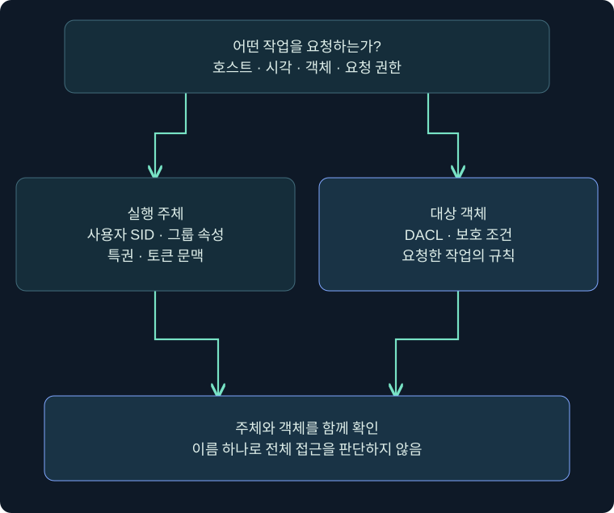
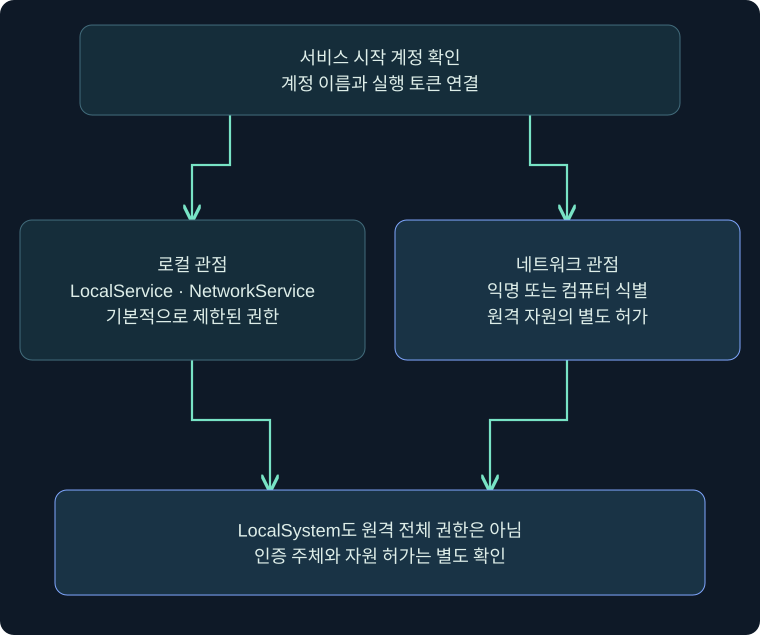
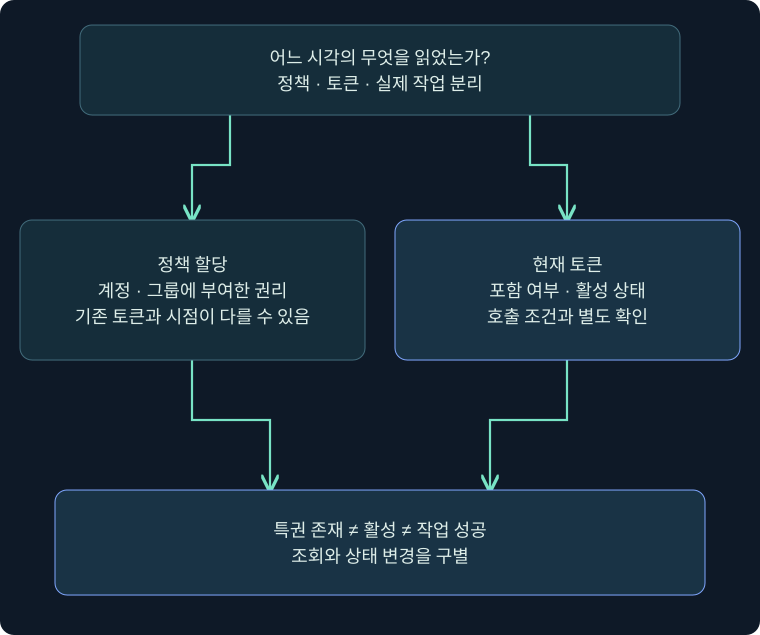

## 1. 권한 상승은 어느 경계를 넘는 일일까요?

회사 건물 출입증에 이름이 인쇄되어 있어도 모든 방의 문이 열리지는 않습니다. 출입증의 소속·유효 상태와 문마다 정한 규칙이 함께 맞아야 합니다. Windows에서도 사용자 이름, 그룹 가입, 현재 실행 토큰, 자원의 접근 규칙은 서로 다른 정보입니다. **권한 상승(Privilege Escalation)**은 현재 허용된 범위를 넘어 더 강한 실행 권한을 얻는 행동을 설명합니다. 관리자라는 문자열을 찾는 작업과 실제 권한 변화의 검증은 다릅니다.

앞 장에서는 현재 문맥에서 파일·프로세스를 조회했습니다. 이번 장에서는 그 조회가 왜 허용되거나 거부되는지, 서비스의 잘못된 구성과 실행 문맥이 어떻게 연결되는지 배웁니다. 이 강의는 계정과 토큰을 읽는 기초이며 취약점 실행이나 토큰 변경을 수행하지 않습니다. 예시는 독립적으로 정한 격리 VM `LAB-PC`와 `student` 계정을 가정합니다.

같은 호스트라도 일반 사용자 프로그램과 서비스는 다른 문맥에서 실행될 수 있습니다. 따라서 조사 단위는 단순히 컴퓨터 한 대가 아니라 **호스트·시각·프로세스·토큰·요청한 작업**의 조합입니다. 접근 거부가 나왔다는 사실만으로 보안 제품이 차단했다고 결론 내리지 않습니다.

## 2. 계정 이름·SID·그룹·토큰 구별하기

| 구분 | 무엇을 설명하나요? | 혼동하면 생기는 오류 |
|---|---|---|
| 계정 이름 | 사람이 읽기 쉬운 사용자 표시 | 이름 변경을 다른 사용자로 오인 |
| SID | 보안 주체를 식별하는 값 | 같은 이름의 로컬·도메인 계정 혼동 |
| 그룹 가입 | 권한을 부여할 때 쓰는 집합 | 가입 사실을 현재 활성 권한으로 단정 |
| 접근 토큰 | 실행 문맥에 들어 있는 SID·특권 등의 상태 | 데스크톱 사용자와 서비스 사용자 혼동 |
| 자원 DACL | 객체에 대한 허용·거부 규칙 | 한 폴더의 허용을 모든 폴더로 확대 |

접근 토큰은 비밀번호 파일이나 네트워크 접속용 문자열이 아닙니다. OS가 실행 주체의 보안 문맥을 표현하는 객체입니다. 프로세스의 기본 토큰과 스레드가 클라이언트를 대신할 때 쓰는 가장 토큰도 구별해야 합니다. 도구가 어느 문맥을 조회했는지 설명하지 않으면 두 결과가 달라도 어느 쪽이 틀렸는지 바로 알 수 없습니다.



그림의 왼쪽은 요청 주체, 오른쪽은 자원 규칙입니다. 두 정보가 아래 접근 판단에서 만납니다. 이름만 보고 자원 접근을 예측하지 말라는 관계를 나타내며 Windows 내부 검사의 모든 순서를 재현한 알고리즘은 아닙니다.

## 3. 표준 사용자와 관리자도 현재 문맥을 확인합니다

일반 사용자는 자신의 자료를 사용할 수 있지만 공유 폴더·업무 앱처럼 추가 허용을 받은 자원에도 접근할 수 있습니다. 따라서 “자기 파일 외에는 아무것도 못 한다”는 표현은 지나친 단순화입니다. 반대로 Administrators 가입도 실행 중인 모든 프로그램이 전체 관리자 권한을 가진다는 뜻은 아닙니다.

일반적인 UAC 관리자 승인 모드에서는 관리자 사용자의 평상시 앱도 제한된 토큰으로 시작합니다. 그룹 목록에 관리자 SID가 보이더라도 `Deny only` 같은 속성과 무결성 수준을 함께 읽어야 합니다. 높은 무결성은 모든 파일에 대한 무조건 접근 허가를 뜻하지도 않습니다. 보호된 프로세스와 별도 보호 경계도 존재합니다.

가상 사례에서 `LAB-PC\student`의 일반 콘솔과 관리자 승인을 거친 별도 콘솔은 이름이 같습니다. 그러나 토큰 상태와 허용되는 관리 작업은 다를 수 있습니다. 여기서는 승인 창을 조작하거나 권한을 올리는 절차를 실행하지 않습니다. 두 문맥을 비교할 때 무엇을 기록해야 하는지를 설명합니다.

## 4. 서비스 내장 계정은 로컬과 네트워크를 나누어 봅니다

| 서비스 문맥 | 로컬 권한의 기본 성격 | 네트워크에서의 기본 식별 | 주의할 해석 |
|---|---|---|---|
| LocalService | 제한된 로컬 권한 | 익명 자격 제시 | 개별 서비스의 추가 권한·설정 확인 |
| NetworkService | 제한된 로컬 권한 | 컴퓨터 자격 제시 | 네트워크 식별과 원격 자원 허가는 별도 |
| LocalSystem | 광범위한 로컬 권한 | 컴퓨터 자격 제시 | 원격 서버 전체 관리자라는 뜻은 아님 |
| 별도 사용자·관리형 계정 | 할당한 그룹·권한에 따름 | 해당 구성에 따름 | 서비스마다 실제 시작 계정 확인 |

서비스 계정은 이 세 가지로 끝나지 않습니다. 로컬·도메인 사용자, 가상 계정, 관리형 서비스 계정 등도 사용됩니다. `net user`에 내장 서비스 문맥이 일반 사용자처럼 나타나지 않는다고 계정이 존재하지 않는다고 판단하지 않습니다. SID와 서비스 구성을 연결합니다.

LocalSystem의 SID는 `S-1-5-18`, LocalService는 `S-1-5-19`, NetworkService는 `S-1-5-20`입니다. 이 값은 잘 알려진 SID이며 가상의 사용자 SID를 만든 것이 아닙니다. 컴퓨터 자격으로 인증한다는 설명도 네트워크 연결 성공을 보장하지 않습니다. 도메인 가입·프로토콜·원격 ACL·서비스의 가장 여부를 확인해야 합니다.



위에서 아래로 계정의 두 관점을 나누어 읽습니다. 로컬에서 강한 권한을 가진다는 결론을 오른쪽의 모든 네트워크 자원 허가로 옮기지 않습니다.

## 5. 로그온 권한·특권·객체 권한의 차이

로그온 권한은 어떤 방식으로 시스템에 들어올 수 있는지에 관한 규칙입니다. 예를 들어 배치 로그온과 서비스 로그온은 대화형 로그온과 다른 범주입니다. 특권은 백업·시스템 시간 변경 등 특정 시스템 작업과 관련됩니다. 객체 접근 권한은 파일·레지스트리 키·서비스 같은 개별 객체의 작업 허가입니다.

`SeBackupPrivilege`를 가졌다고 평범한 파일 읽기가 모두 자동으로 성공하는 것은 아닙니다. 특권의 활성 상태와 백업 의미를 사용하는 API·옵션 등의 조건이 필요합니다. `SeImpersonatePrivilege` 역시 존재한다는 사실만으로 SYSTEM 실행이 입증되지 않습니다. 필요한 클라이언트 문맥과 호출 조건 등 별도 전제가 있습니다.

정책 화면의 할당 상태, 현재 토큰에 포함된 상태, 활성화된 상태는 같은 시점의 같은 정보가 아닙니다. 정책 변경이 기존 토큰에 즉시 반영된다고 단정하지 않습니다. 이 강의는 정책을 수정하지 않고 관측 차이를 기록합니다.

## 6. 실제 Cobalt Strike 화면에서 입력 위치 확인

### 실제 화면 59: 세션 선택과 현재 사용자 도움말


출처: [Fortra Session and Target Visualizations](https://hstechdocs.helpsystems.com/manuals/cobaltstrike/current/userguide/content/topics/ui_session-target-visualizations.htm). 공식 공개 원본을 재사용했습니다. 사진의 호스트·시각은 공식 예시이며 `LAB-PC`를 직접 실행한 화면이 아닙니다. 현행 문서 확인일은 2026-11-05이며 삽화는 과거 UI를 포함할 수 있습니다.

1. 이미 승인된 실습 세션이 있다는 가정에서 표의 호스트·사용자·PID를 읽습니다. 이번 절은 새 세션을 만드는 안내가 아닙니다.
2. 한 행만 선택 → 우클릭 → **Interact**를 선택합니다. 아래 열린 콘솔의 대상 정보가 선택한 행과 일치하는지 확인합니다.
3. 아래 입력 줄에 `help getuid`를 입력하고 Enter를 누릅니다. 도움말에서 현재 토큰의 사용자 식별을 설명하는지 확인합니다. 이 조회 설명에는 별도의 Save 버튼이 없습니다.
4. 결과 영역에 도움말이 표시됐다는 사실과 대상 사용자 조회 결과가 수신됐다는 사실을 구별합니다. 실제 대상 조회는 다음 절의 미실행 예시로 분리했습니다.


출처: [Fortra Beacon Console](https://hstechdocs.helpsystems.com/manuals/cobaltstrike/current/userguide/content/topics/post-exploitation_main.htm). 원본의 기존 출력은 본 강의의 명령 실행 결과가 아닙니다. `help getuid`를 입력한 뒤의 별도 실제 사진은 확보하지 못했습니다. 위 사진은 입력 위치만 안내합니다.

## 7. 조회 예시값과 결과 확인을 연결하기

다음은 **미실행 절차**입니다. 본 작성 과정에서 Windows·제품·대상 세션에 명령을 보내지 않았습니다. 이미 허가된 VM의 콘솔에서 학습자가 결과를 비교하는 경우만 가정합니다.

```text
help getuid
getuid
help run
run whoami.exe /user
run whoami.exe /groups
run whoami.exe /priv
```

각 줄을 별도로 입력하고 응답을 기다립니다. `getuid`는 현재 토큰에 연관된 사용자 식별을 위한 것이며 SID·그룹·특권 전체 보고서가 아닙니다. `run whoami.exe`는 별도 프로그램을 실행하는 경로입니다. 가장 문맥과 자식 프로세스 생성 방식에 따라 두 조회의 보안 문맥이 같다고 보장하지 않으므로 결과가 다르면 토큰·명령 동작부터 확인합니다.

| 입력 | 선택 이유 | 결과에서 확인할 것 |
|---|---|---|
| help getuid | 설치된 버전의 계약 확인 | 설명·인자·확장 여부 |
| getuid | 현재 사용자 식별 | 사용자 표시·응답 시각·선택 대상 |
| whoami /user | SID와 이름 연결 | 사용자 SID·실행 문맥 |
| whoami /groups | 그룹 속성 읽기 | SID·활성 속성·무결성 레이블 |
| whoami /priv | 특권 상태 읽기 | 특권 이름·활성/비활성 상태 |

**getprivs는 단순 목록 조회로 사용하지 않습니다.** 공식 문서는 현재 토큰의 특권을 가능한 한 활성화하는 명령으로 설명합니다. 이름이 비슷해도 `whoami /priv`와 효과가 다릅니다. 이 강의에서는 상태를 바꾸는 명령을 실행하지 않습니다. 조회 실패 시 다른 세션으로 무작정 바꾸지 말고 대상·도움말·실행 파일 위치·오류 문자열부터 기록합니다.

## 8. 정책 화면은 읽고 닫기

Windows에서 정책을 대조할 때의 미실행 경로는 로컬 보안 정책 `secpol.msc` → **로컬 정책 → 사용자 권한 할당**입니다. 예를 들어 **서비스로 로그온** 항목을 열어 할당 목록을 읽고 **취소**로 닫습니다. 사용자나 그룹을 추가하지 않습니다. 도메인 GPO·MDM이 적용된 경우 로컬 화면만으로 최종 정책을 확정하지 않습니다. Windows 에디션에 따라 관리 도구가 없을 수 있습니다.

이 정책창의 실제 사진은 이번 강의에서 확보하지 못했습니다. 앞의 Cobalt Strike 콘솔 사진이나 아래 개념도를 Windows 정책 화면처럼 제시하지 않습니다. 도구가 없거나 목록 접근이 거부되면 확인 불가로 기록합니다. 빈 목록을 추측해 채우지 않습니다.



그림의 비교는 정책과 실행 문맥 사이의 시점 차이를 보여 줍니다. 비활성 특권이 없어진 특권과 같은 뜻은 아니며, 어느 쪽도 실제 작업 성공과 동일하지 않습니다.

## 9. 조건을 바꾸어 판단해 보기

가상 사례 A에서는 그룹에 Administrators가 보이지만 속성이 Deny only이고 무결성 레이블이 Medium입니다. 이 사실은 제한된 토큰 가설과 맞습니다. “관리자 계정을 탈취했다” 또는 “모든 관리 작업 가능”이라는 결론까지 지지하지 않습니다. 사례 B에서는 같은 이름으로 새 프로세스를 조회했지만 SID가 다릅니다. 계정 이름을 기준으로 결과를 합치지 않고 로컬·도메인 범위와 수집 대상을 재확인합니다.

사례 C에서는 NetworkService 프로세스가 원격 공유에 접근하지 못했습니다. 제한된 로컬 권한만으로 실패 원인을 설명할 수 없습니다. 실제 인증 주체·공유/파일 권한·연결 오류를 추가로 확인합니다. 사례 D에서는 특정 특권이 Enabled지만 작업이 거부됐습니다. 해당 작업의 API 계약·객체 ACL·보호 조건을 확인해야 하며 보안 제품 차단이라고 바로 기록하지 않습니다.

조사 메모에는 호스트·시각·사용자 SID·PID와 시작 시각·명령·현재/자식 토큰 여부·원문 오류를 남깁니다. 실제 업무 계정이나 민감한 SID를 공개 보고서 예시로 옮기지 말고 승인된 보관 범위에 맞춰 처리합니다.

## 10. 복습과 즉시 해설

### 복습 1. 사용자 이름이 같으면 같은 권한인가요?

**해설:** 아닙니다. SID·그룹 속성·토큰·무결성·대상 자원 규칙을 비교해야 합니다. 이름은 표시용 정보이며 결과의 동일성 기준으로 부족합니다.

### 복습 2. Administrators 가입만 확인하면 되나요?

**해설:** 현재 실행 토큰의 제한 여부까지 확인해야 합니다. 관리자 그룹이 Deny only로 들어 있는 문맥을 전체 관리자 권한으로 해석하면 안 됩니다.

### 복습 3. NetworkService는 로컬 관리자 계정인가요?

**해설:** 기본적으로 제한된 로컬 권한을 사용합니다. 컴퓨터 자격을 네트워크에 제시하는 성질과 로컬 관리 권한은 별개입니다.

### 복습 4. SYSTEM이면 원격 공유를 모두 읽을 수 있나요?

**해설:** 아닙니다. 원격 자원은 별도의 인증·권한·연결 조건을 적용합니다. 로컬 권한의 강도를 원격 허가로 일반화하지 않습니다.

### 복습 5. 비활성 특권은 없는 특권인가요?

**해설:** 아닙니다. 포함 여부와 활성 상태는 다릅니다. 활성화 가능성이나 실제 호출 성공도 별도로 검토합니다.

### 복습 6. getprivs를 조회 명령으로 쓰면 되나요?

**해설:** 공식 설명상 특권 활성화를 시도하므로 단순 조회와 다릅니다. 상태를 관찰할 때는 명령의 실제 효과를 먼저 확인합니다.

### 복습 7. getuid와 자식 whoami 결과가 다르면 조작인가요?

**해설:** 그 결론은 이릅니다. 현재 가장 토큰과 새 프로세스 문맥 차이, 선택 대상·수집 시점을 먼저 대조합니다.

### 복습 8. 이번 강의가 실제 권한 상승 성공을 보여 주나요?

**해설:** 아닙니다. 공식 사진의 기존 예시와 미실행 조회 절차를 설명했습니다. 권한 변경·취약점 실행·정책 수정은 수행하지 않았습니다.

## 11. 공식 근거와 다음 강의

확인일: **2026-11-05**. 현행 Fortra 안내서와 Microsoft 문서를 대조했습니다. 과거 UI 삽화는 현행 설치 버전의 모든 필드를 보장하지 않습니다. 다음 강의에서는 서비스 이름·시작 계정·실행 경로·서로 다른 접근 규칙을 연결합니다.

- [Microsoft Access tokens](https://learn.microsoft.com/en-us/windows/win32/secauthz/access-tokens)
- [Microsoft Privileges](https://learn.microsoft.com/en-us/windows/win32/secauthz/privileges)
- [Microsoft LocalService](https://learn.microsoft.com/en-us/windows/win32/services/localservice-account)
- [Microsoft NetworkService](https://learn.microsoft.com/en-us/windows/win32/services/networkservice-account)
- [Microsoft LocalSystem](https://learn.microsoft.com/en-us/windows/win32/services/localsystem-account)
- [Microsoft User Rights Assignment](https://learn.microsoft.com/en-us/previous-versions/windows/it-pro/windows-10/security/threat-protection/security-policy-settings/user-rights-assignment)
- [Microsoft whoami](https://learn.microsoft.com/en-us/windows-server/administration/windows-commands/whoami)
- [Microsoft How UAC works](https://learn.microsoft.com/en-us/windows/security/application-security/application-control/user-account-control/how-it-works)
- [Fortra Running Commands](https://hstechdocs.helpsystems.com/manuals/cobaltstrike/current/userguide/content/topics/post-exploitation_running-commands.htm)
