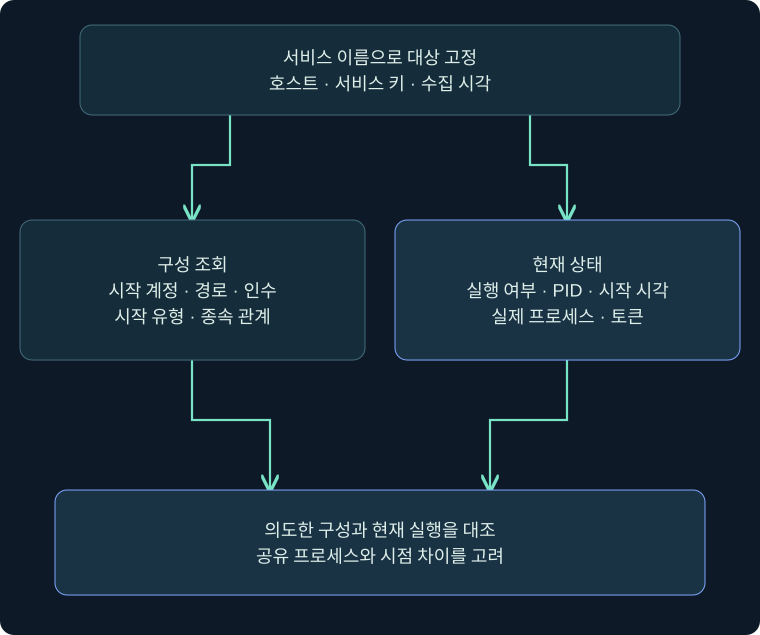
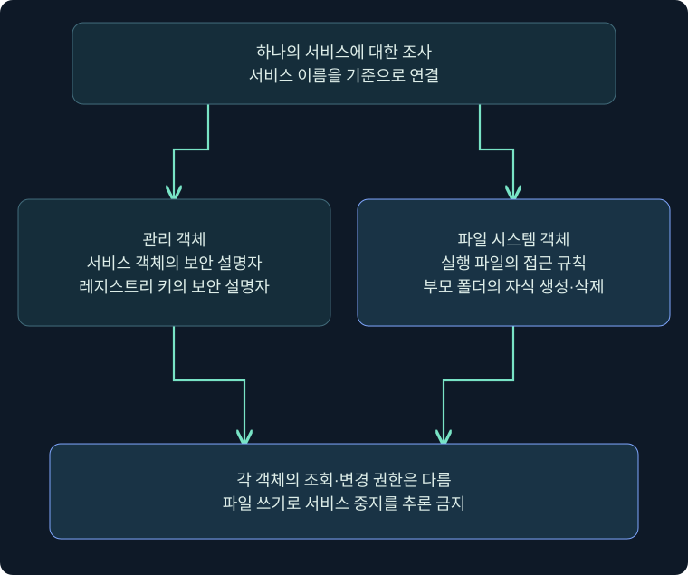
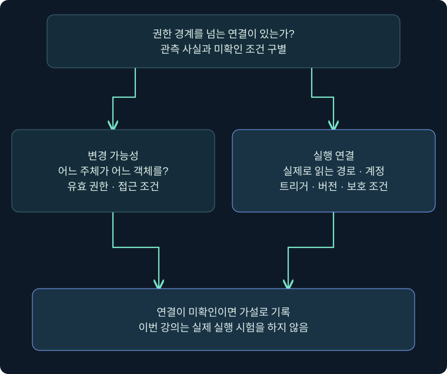

## 1. 서비스가 SYSTEM이면 취약한 것일까요?

건물 관리실이 강한 열쇠를 가지고 있다는 사실만으로 보안 사고가 발생하지는 않습니다. 누가 관리실에 작업 지시를 넣을 수 있는지, 어떤 파일을 읽어 실행하는지, 작업이 언제 시작되는지를 함께 살펴야 합니다. Windows 서비스도 같습니다. **강한 실행 계정**과 **낮은 권한 사용자가 바꿀 수 있는 입력** 사이의 연결이 핵심 질문입니다.

서비스는 Service Control Manager(SCM)가 관리하는 실행 단위입니다. 한 프로세스가 여러 서비스를 호스팅할 수도 있어 서비스 이름과 프로세스 이름이 일대일이라고 가정하지 않습니다. 실행 파일 경로 하나만 복사해 “취약”이라고 표시하면 실제 서비스 구조와 권한을 놓칩니다.

이 강의는 `TrainingReport`라는 가상의 사전 준비된 서비스에 대한 읽기 전용 조사를 설명합니다. 서비스 생성·중지·재시작·실행 파일 교체·시작 계정 변경은 수행하지 않습니다. Windows·Cobalt Strike에서도 아래 절차를 실제 실행하지 않았습니다. 개념도와 사례 표는 독립 작성한 학습 자료이며 실제 진단 결과가 아닙니다.

## 2. 서비스의 네 가지 식별 정보를 연결하기

| 정보 | 예시 가정 | 필요한 이유 |
|---|---|---|
| 서비스 이름 | TrainingReport | SCM 조회의 식별 키 |
| 표시 이름 | Training Report Service | 관리 콘솔에서 읽기 쉬운 표시 |
| 실행 경로와 인수 | C:\Lab\TrainingOnly\report.exe | 실행 대상과 인수 구별 |
| 실행 계정·상태·PID | 별도 확인 | 구성과 현재 실행 연결 |

표시 이름이 비슷하다고 같은 서비스가 아닙니다. 호스트와 서비스 이름을 먼저 고정합니다. 현재 PID는 프로세스 시작 시각과 묶어서 기록하고, 중지된 서비스에는 실행 PID가 없을 수 있음을 인정합니다. 서비스가 공유 프로세스에서 실행되면 같은 PID 아래 다른 서비스가 있을 수 있습니다.

시작 계정은 구성에서 의도한 문맥입니다. 현재 프로세스의 토큰과 항상 동일하다고 단정하지 않습니다. 실행 도중 구성 변경, 서비스의 가장, 제한된 서비스 토큰 같은 조건이 있을 수 있습니다. `구성상 LocalSystem`과 `이 시각 프로세스에서 확인한 토큰`을 별도 줄로 기록합니다.



왼쪽은 서비스가 어떻게 시작되도록 설정되었는지, 오른쪽은 지금 무엇이 실행 중인지에 관한 증거입니다. 화살표는 비교 관계이며 현재 상태가 과거의 모든 실행을 입증하지는 않습니다.

## 3. 실제 Cobalt Strike 콘솔에서 도움말부터 열기

### 실제 화면 60: 서비스 조회를 입력하는 위치


출처: [Fortra Beacon Console](https://hstechdocs.helpsystems.com/manuals/cobaltstrike/current/userguide/content/topics/post-exploitation_main.htm). 공식 공개 원본을 재사용했습니다. 사진 속 출력은 제작사의 예시이고 이번 서비스 조사 결과가 아닙니다. 현행 문서 확인일은 2026-11-05이며 과거 UI 사진과 설치 버전의 메뉴 차이를 확인해야 합니다.

1. Sessions 표에서 승인된 VM의 한 행 선택 → 우클릭 → **Interact**를 누릅니다. 콘솔의 호스트·PID를 확인합니다. 여러 세션 동시 선택을 피합니다.
2. 하단 입력 칸에 `help run`을 입력하고 Enter를 눌러 설치 버전의 실행·출력 계약을 읽습니다. 도움말 확인에는 별도 저장 버튼이 없습니다.
3. 아래 읽기 전용 예시를 한 줄씩 입력하는 상황을 가정합니다. `run sc.exe query TrainingReport`는 상태, `run sc.exe qc TrainingReport`는 구성이라는 질문 차이를 먼저 기록합니다.
4. Enter 뒤 작업 요청과 결과 수신을 나누어 확인합니다. 대상 응답 간격·연결 장애로 결과가 늦으면 미응답으로 남깁니다. 입력 줄이 비었다는 사실을 성공으로 표시하지 않습니다.

```text
help run
run sc.exe query TrainingReport
run sc.exe qc TrainingReport
run sc.exe sdshow TrainingReport
```

`TrainingReport`는 이 강의의 가정값으로 기존 업무 서비스 이름이 아닙니다. 해당 이름의 서비스가 없으면 조회 실패가 정상입니다. `query`는 상태, `qc`는 설정, `sdshow`는 서비스 객체 보안 설명자를 읽는 서로 다른 요청입니다. 이번 과정에서는 모두 미실행입니다. 위 입력 이후의 실제 응답 사진은 확보하지 못했으며 가상 성공 로그도 만들지 않았습니다.

과거 자료의 `sc_enum` 등을 모든 설치의 기본 명령으로 가정하지 않습니다. 확장 스크립트·BOF·버전에 따라 기능과 인자가 다를 수 있습니다. 도움말에 없는 명령은 “미지원 또는 확장 미확인”으로 남기고 이름만 비슷한 다른 기능을 실행하지 않습니다.

## 4. Windows 관리 화면에서 읽고 닫기

실제 Services 속성창의 공식 사진은 이번 강의에서 확보하지 못했습니다. 이 절은 **미실행 메뉴 안내**이며 앞 콘솔 그림을 Services 창 사진으로 대신하지 않습니다.

Windows의 실행 창에서 `services.msc` 입력 → 서비스 목록에서 사전 준비한 표시 이름 선택 → 속성 → **일반** 탭 순서로 읽습니다. 서비스 이름, 실행 파일 경로, 시작 유형, 서비스 상태를 기록합니다. **로그온** 탭에서는 어떤 계정 문맥을 사용하도록 되어 있는지 읽되 암호 칸은 입력하지 않습니다. **종속성** 탭에서는 관계를 확인하고 **취소**로 닫습니다.

여기서는 입력값을 저장하지 않으므로 **적용·시작·중지**를 누를 이유가 없습니다. 목록이 보인다는 사실과 속성 조회·상태 변경 권한은 다릅니다. GUI 접근이 거부되면 명령줄 결과와 시각·대상이 같은지 확인하고 확인 불가 범위를 기록합니다.

실행 파일 경로에 인수가 붙는 경우 실행 파일과 인수를 구별합니다. 공유 호스트 서비스라면 경로가 공용 호스트를 가리킬 수 있으므로 구현 DLL 등 별도 구성을 확인해야 합니다. 인수까지 모두 파일 경로로 취급해 ACL 조회에 넣으면 존재하지 않는 파일을 조사하게 됩니다.

## 5. 서비스 권한은 네 종류의 객체에서 봅니다

| 조사 객체 | 권한이 제어하는 작업 | 다른 객체와 혼동하면 생기는 오류 |
|---|---|---|
| 서비스 객체 | 구성 조회·변경·시작·중지 | 파일 쓰기를 서비스 중지 권한으로 오인 |
| 서비스 실행 파일 | 파일 읽기·수정 등 | 읽기 허용을 교체 가능으로 오인 |
| 부모 디렉터리 | 자식 생성·삭제 등 | 파일 ACL만 보고 교체 경로 누락 |
| 서비스 레지스트리 키 | 값·하위 키 조회·수정 | 키 읽기를 SCM 구성 변경 권한으로 오인 |

서비스 객체의 `SERVICE_QUERY_CONFIG`와 `SERVICE_CHANGE_CONFIG`, `SERVICE_START`와 `SERVICE_STOP`은 각각 다른 권한입니다. 조회할 수 있다고 중지·변경할 수 있다는 뜻이 아닙니다. 따라서 동작을 시험해 권한을 확인하려고 업무 서비스를 재시작하지 않습니다.

서비스 파일은 파일 객체 규칙을 따릅니다. 레지스트리 키도 별도 보안 설명자를 가집니다. SCM을 통한 변경과 레지스트리 직접 변경은 같은 API 경로가 아니며 관측·반영 시점도 별도입니다. 접근 규칙이 약하다는 증거를 찾았더라도 실제 구성 반영이나 실행 성공까지 입증했다고 쓰지 않습니다.



이 그림은 하나의 서비스 주변에 있는 별도 객체를 비교합니다. 가운데 서비스 이름을 기준으로 연결하되 서로 다른 보안 설명자를 하나의 ACL처럼 합치지 않습니다. 파일 객체와 서비스 객체의 권한 이름도 다릅니다.

## 6. 파일과 레지스트리 ACL의 읽기 전용 예시

승인된 로컬 VM의 일반 PowerShell에서 확인하는 미실행 예시입니다. 이름과 경로는 가정값입니다. 원격 대상 목록을 입력하지 않습니다.

```powershell
Get-CimInstance Win32_Service -Filter "Name='TrainingReport'" |
    Select-Object Name, DisplayName, StartName, State, ProcessId, PathName
icacls.exe 'C:\Lab\TrainingOnly\report.exe'
icacls.exe 'C:\Lab\TrainingOnly'
Get-Acl -LiteralPath 'HKLM:\SYSTEM\CurrentControlSet\Services\TrainingReport' |
    Format-List Owner, AccessToString, Sddl
```

`Get-CimInstance`는 이 예시에서 로컬 서비스 구성 한 건만 조회합니다. `Get-WmiObject`는 Windows PowerShell의 과거 예시와 구별하고, PowerShell 7에서 같은 가용성을 가정하지 않습니다. `wmic`도 최신 Windows에 항상 설치되어 있다고 보장하지 않습니다.

`icacls`에 경로만 주는 예시는 DACL 표시를 위한 것입니다. 권한을 수정하는 옵션은 포함하지 않았습니다. `F`·`M`·`RX`와 상속 표시 `(I)`, 자식 전파 `(OI)`·`(CI)`를 구별합니다. 한 ACE의 문자만으로 유효 권한 전체를 계산하지 말고 주체의 그룹·거부 항목·상속·소유자·경로 구성요소를 함께 봅니다. 과거 `cacls`의 `C`와 `icacls`의 `M`을 같은 출력 표기로 복사하지 않습니다.

레지스트리 조회는 선택한 키의 소유자·허용 항목을 읽습니다. 키의 `ReadKey`와 값 변경 권한은 다릅니다. 사용자가 가진 다른 그룹의 허용·거부도 확인합니다. 소유자 이름이 보인다는 사실을 현재 사용자의 변경 성공으로 기록하지 않습니다.

## 7. 위험 가설에는 조건의 연결이 필요합니다

서비스 위험을 설명할 때는 **변경 가능성 → 실제로 읽는 경로 → 실행 계정 → 실행 조건 → 관측 결과**를 연결합니다. 여기서 하나라도 확인되지 않았다면 그 칸을 비워 두고 다음 조사 질문을 씁니다. 제품 이름이나 경로의 공백만으로 전체 연결이 성립하지 않습니다.

가상 서비스의 실행 파일이 모든 사용자에게 읽기 가능하더라도 쓰기·교체가 불가능하면 파일 수정 가설을 지지하지 않습니다. 반대로 부모 폴더에서 자식 파일의 삭제·생성을 허용한다면 파일 자체의 수정 허용만 조사해서는 부족할 수 있습니다. 실제 교체를 시도하지 않고 접근 규칙을 분석하고 미확인 제약을 남깁니다.

높은 권한 프로세스가 어떤 파일을 실제로 읽는지, 절대 경로·서명 확인·로딩 정책 등의 조건이 있는지도 중요합니다. 파일이 존재하는 것과 로딩되는 것은 다른 증거입니다. 다음 경로 검색 강의에서는 이 연결을 더 상세히 다룹니다.



위 질문에서 변경과 실행의 두 가지 증거로 분기합니다. 아래 결론에 도달하려면 양쪽이 모두 필요합니다. 이번 강의는 실행 시험을 하지 않으므로 가설과 미확인 조건까지만 기록합니다.

## 8. 조건을 바꾸어 읽는 세 가지 사례

| 가상 사례 | 관측한 사실 | 아직 말할 수 없는 것 | 다음 읽기 전용 확인 |
|---|---|---|---|
| A | 실행 계정 LocalSystem, 파일 RX | 사용자 파일 교체 가능 | 부모 ACL·유효 주체 |
| B | 폴더에 특정 그룹 Modify | 서비스가 그 파일을 실행 | 경로·인수·구현·시간 |
| C | 서비스 구성 조회 가능 | 구성 변경·중지 가능 | 서비스 객체 보안 설명자 |

A에서 계정만 보면 우선순위를 높일 수 있지만 취약하다고 확정할 수는 없습니다. B에서 같은 이름의 오래된 파일을 발견했다면 실제 서비스 구성과 연결되는지도 먼저 확인해야 합니다. C의 조회 성공은 읽기 권한의 증거이며 변경 API 성공의 증거가 아닙니다.

추가 사례로 서비스가 중지 상태라면 과거 실행 기록과 현재 구성을 구별합니다. 시작 유형이 자동이어도 실행 실패나 지연·트리거 등의 조건이 있을 수 있습니다. 운영 영향을 확인하지 않은 재시작은 진단 방법으로 사용하지 않습니다. 조회만으로 결론을 내릴 수 없으면 “조건 미확인”이 정확한 결과입니다.

## 9. 기록·오류·정리 기준

한 서비스의 조사 기록에는 호스트, 수집 시각, 서비스 이름과 표시 이름, 구성상 시작 계정, 실행 경로 원문, 현재 상태와 PID, 객체별 ACL, 조회 오류를 분리합니다. 경로 원문은 보관하되 공개 예시에서는 실제 업무 경로와 계정을 노출하지 않습니다. 원본 자료와 해석 문장을 같은 칸에 섞지 않습니다.

`Access denied`는 선택한 요청에 필요한 접근이 허용되지 않았다는 관측입니다. 서비스 부재 오류와 구별하며, 빈 출력은 명령·필터·수집 도구의 가용성부터 확인합니다. 서로 다른 시각에 수집한 구성과 PID를 하나의 스냅샷으로 쓰지 않습니다.

이 강의의 정리는 조회 탭과 임시 메모를 승인된 보관 기준에 맞게 관리하는 것입니다. 서비스나 파일을 변경하지 않았으므로 되돌릴 변경은 없습니다. 실제 제품을 실행한 결과와 Python으로 만든 사례 표를 혼동하지 않으며, 다음 강의에서도 구성 취약점 설명과 실제 공격 수행을 구별합니다.

## 10. 복습과 즉시 해설

### 복습 1. SYSTEM 서비스를 찾으면 권한 상승 성공인가요?

**해설:** 아닙니다. 낮은 권한 주체의 변경 가능성, 실제 실행 경로, 실행 조건, 결과를 연결해야 합니다. 높은 계정만으로 취약점이나 성공을 확정할 수 없습니다.

### 복습 2. 표시 이름을 sc.exe 인수로 쓰면 되나요?

**해설:** 서비스 이름을 확인해야 합니다. 표시 이름과 SCM 식별 키는 다를 수 있어 잘못된 대상을 조회하거나 부재 오류가 날 수 있습니다.

### 복습 3. qc와 query는 같은가요?

**해설:** qc는 구성, query는 상태라는 질문이 다릅니다. 현재 실행과 다음 시작에 사용할 설정을 분리해 기록합니다.

### 복습 4. 구성 조회가 되면 서비스 중지도 되나요?

**해설:** 권한이 다릅니다. 조회·변경·시작·중지는 각각의 허가를 확인하며 변경 작업을 직접 시험하지 않습니다.

### 복습 5. 파일에 RX가 있으면 수정 가능한가요?

**해설:** 읽기·실행과 수정은 다릅니다. 다른 ACE와 부모 디렉터리 규칙도 분석하되 RX 자체를 교체 권한으로 해석하지 않습니다.

### 복습 6. 파일 ACL 하나면 서비스 권한을 모두 알 수 있나요?

**해설:** 서비스 객체·파일·부모 폴더·레지스트리 키는 별도 객체입니다. 각각의 접근 규칙을 확인해야 합니다.

### 복습 7. 서비스 경로에 공백이 있으면 취약한가요?

**해설:** 공백만으로 부족합니다. 따옴표·실제 호출 방식·후보 경로의 변경 가능성·실행 문맥을 확인해야 합니다. 다음 강의에서 이 조건을 분리합니다.

### 복습 8. 명령 예시는 실제 실행 기록인가요?

**해설:** 아닙니다. 공식 콘솔 사진은 입력 위치 설명이고, Windows 조회 명령과 TrainingReport 사례는 미실행 학습 예시입니다. 서비스 변경·취약점 실행은 수행하지 않았습니다.

## 11. 공식 근거와 다음 범위

확인일: **2026-11-05**. 서비스·토큰 관련 설명은 Microsoft의 객체별 API 계약, 명령 동작은 현행 Fortra 안내서와 대조했습니다. 버전에 따라 사용 가능한 명령·확장·관리 도구가 다릅니다. 다음은 PATH 환경 변수, 프로세스 생성 API의 검색 조건, 따옴표 없는 경로의 판정입니다.

- [Microsoft Service Configuration](https://learn.microsoft.com/en-us/windows/win32/services/service-configuration)
- [Microsoft Service Security and Access Rights](https://learn.microsoft.com/en-us/windows/win32/services/service-security-and-access-rights)
- [Microsoft Querying a Service Configuration](https://learn.microsoft.com/en-us/windows/win32/services/querying-a-service-s-configuration)
- [Microsoft Sc.exe query](https://learn.microsoft.com/en-us/windows-server/administration/windows-commands/sc-query)
- [Microsoft icacls](https://learn.microsoft.com/en-us/windows-server/administration/windows-commands/icacls)
- [Microsoft Get-CimInstance](https://learn.microsoft.com/en-us/powershell/module/cimcmdlets/get-ciminstance)
- [Microsoft Get-Acl](https://learn.microsoft.com/en-us/powershell/module/microsoft.powershell.security/get-acl)
- [Fortra Running Commands](https://hstechdocs.helpsystems.com/manuals/cobaltstrike/current/userguide/content/topics/post-exploitation_running-commands.htm)
