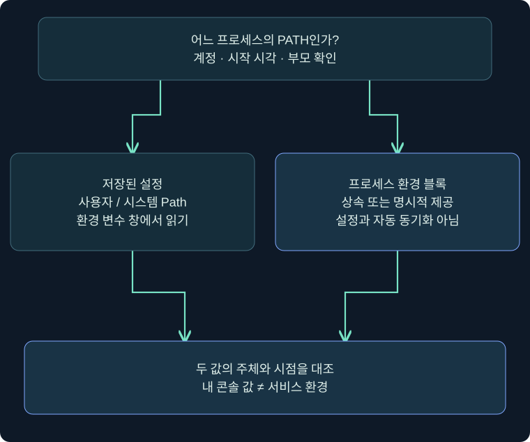
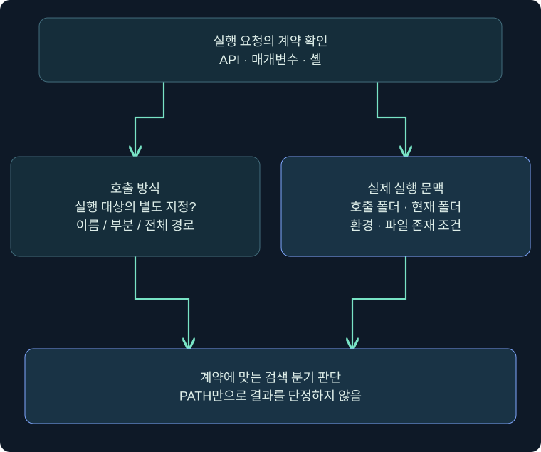
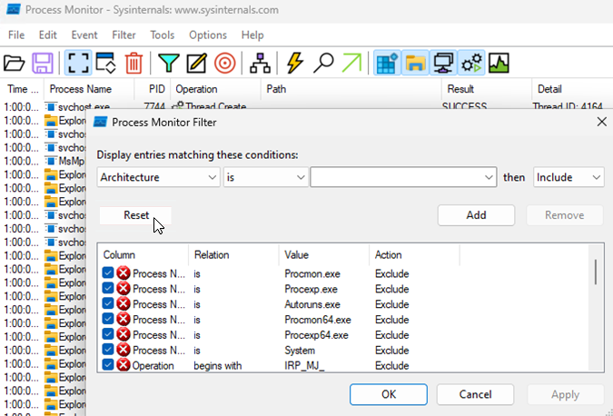
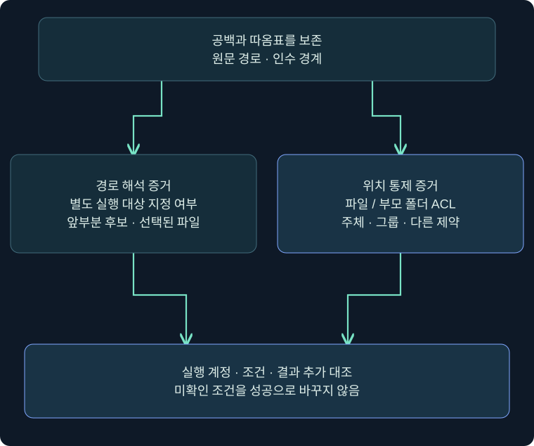

## 1. 같은 이름을 입력했는데 다른 파일이 실행될 수 있는 이유

도서관에서 책 제목만 말하면 사서는 정해진 순서로 서가를 찾습니다. 서가 주소까지 정확히 지정하면 찾는 방법이 달라집니다. 프로그램도 `report.exe`라는 이름만 전달할 때와 실행 파일의 전체 경로를 지정할 때의 동작이 다를 수 있습니다. **누가 어떤 함수와 인수로 실행을 요청했는가**가 검색 규칙을 결정합니다.

앞 강의에서 서비스의 계정·경로·ACL을 읽었습니다. 이번에는 경로가 실제 파일로 해석되는 중간 단계를 살펴봅니다. PATH 항목, 작업 폴더, 호출 프로그램의 폴더, 따옴표를 서로 구별하면 “이름이 같으니 이 파일이 실행될 것”이라는 추측을 줄일 수 있습니다.

가상 서비스 `TrainingReport`와 승인된 격리 VM을 가정합니다. 제품 사진은 공개 공식 원본이며 예시 입력과 실제 결과를 구별합니다. 아래 Windows·Cobalt Strike·ProcMon 절차는 미실행입니다. 파일 배치·프로그램 실행·서비스 재시작으로 가설을 시험하지 않고 조회와 기존 증거 분석을 설명합니다.

## 2. PATH 설정과 프로세스가 가진 PATH는 다릅니다

PATH는 여러 디렉터리를 세미콜론으로 나열한 환경 변수입니다. 사용자 설정과 시스템 설정이 있고, 실행 중인 프로세스는 자신의 환경 블록을 가집니다. 기본적으로 자식은 부모의 환경을 물려받지만 생성자가 별도 환경을 제공할 수도 있습니다. 설정 창을 바꿨다고 이미 실행 중인 서비스의 환경이 즉시 바뀌었다고 결론 내리지 않습니다.

| 확인 대상 | 어디서 읽는가 | 무엇을 알 수 있는가 |
|---|---|---|
| 현재 PowerShell 프로세스 | `$env:Path` | 이 PowerShell의 현재 값 |
| 사용자 범위 설정 | 환경 변수 창의 사용자 변수 Path | 해당 사용자의 저장된 설정 |
| 시스템 범위 설정 | 환경 변수 창의 시스템 변수 Path | 시스템 범위에 저장된 설정 |
| 서비스 프로세스의 환경 | 해당 프로세스에 대한 별도 관측 자료 | 실제 실행 문맥에 적용된 값 |

현재 사용자 콘솔에서 읽은 PATH를 LocalSystem 서비스의 PATH로 복사해 분석하면 대상을 바꾸어 버립니다. 프로세스 시작 시각, 부모, 계정, 별도 환경 지정 여부를 함께 기록합니다. 사용자 범위에 새 경로가 보인다는 사실만으로 높은 권한 프로세스에 영향을 준다고 쓰지 않습니다.



왼쪽은 저장된 설정, 오른쪽은 특정 시점의 프로세스 상태입니다. 가운데 비교는 값이 같은지 확인하라는 뜻이며 자동 동기화 화살표가 아닙니다. 먼저 “어느 프로세스의 값인가”를 질문합니다.

## 3. 실제 Cobalt Strike 화면에서 조회를 입력하는 위치

### 실제 화면 61: Beacon Console에서 도움말·작업 폴더·설정 조회


출처: [Fortra Beacon Console](https://hstechdocs.helpsystems.com/manuals/cobaltstrike/current/userguide/content/topics/post-exploitation_main.htm). 기존 공식 원본을 재사용했습니다. 사진 속 명령과 결과는 제작사 예시이며 아래 조사 출력이 아닙니다. 확인일 2026-11-05. 과거 UI 사진과 설치 버전의 차이를 확인합니다.

1. **Sessions → 승인된 VM의 한 행 → 우클릭 → Interact** 순서로 엽니다. 콘솔의 호스트·계정·PID를 조사 기록의 대상과 대조합니다.
2. 화면 아래 입력 줄에 `help run`을 넣고 Enter를 누릅니다. `run`은 별도 cmd.exe 없이 프로그램을 실행하고 출력을 돌려주는 명령입니다. 조회 프로그램도 대상 프로세스를 만들 수 있으므로 입력의 영향과 결과를 기록합니다.
3. `pwd`를 입력해 Beacon의 현재 작업 폴더를 읽는 상황을 가정합니다. 이것을 조사 대상 서비스의 작업 폴더로 대신 쓰지 않습니다.
4. 다음 구성 조회 한 줄을 입력하는 상황을 가정합니다. `TrainingReport`는 서비스 이름이며 실제 서비스 존재를 보장하지 않습니다.

```text
help run
pwd
run sc.exe qc TrainingReport
```

입력 후 별도 저장 버튼은 없습니다. Enter로 전달한 작업과 응답 수신을 나누어 보고, 반환된 `BINARY_PATH_NAME`의 따옴표와 인수를 원문 그대로 기록합니다. 화면에 작업이 등록되어도 아직 서비스 구성 결과가 도착하지 않았을 수 있습니다. 부재·접근 거부·미응답은 각각 다른 조사 결과입니다.

PATH의 세 범위 비교는 아래와 같이 **로컬 Windows PowerShell에서** 읽는 별도 예시입니다. 이 코드를 그대로 Beacon 명령으로 입력하는 뜻은 아닙니다. 결과는 그 PowerShell과 해당 사용자·시스템 설정에 한정되며 서비스 환경 증거는 별도로 확보합니다.

```powershell
[Environment]::GetEnvironmentVariable('Path', 'Process')
[Environment]::GetEnvironmentVariable('Path', 'User')
[Environment]::GetEnvironmentVariable('Path', 'Machine')
```

Windows GUI에서는 `sysdm.cpl` → **고급 → 환경 변수** → 위 사용자 변수와 아래 시스템 변수에서 각각 **Path → 편집**으로 행을 읽는 절차를 가정합니다. 새 항목·편집·삭제를 수행하지 않고 **취소**로 닫습니다. 이 환경 변수 창과 위 조회 결과의 실제 사진은 확보하지 못했습니다. Beacon Console 사진을 해당 창의 캡처로 표시하지 않습니다.

## 4. 호출 API와 셸을 먼저 구분합니다

Microsoft의 CreateProcessW 계약에서 `lpApplicationName`을 지정한 경우 부분 경로는 현재 드라이브·현재 디렉터리로 완성하며 PATH 검색을 사용하지 않습니다. `lpApplicationName`이 NULL이고 명령줄에 디렉터리 없는 실행 이름을 넣은 경우에는 문서에 정해진 검색 순서가 적용됩니다. 전체 경로·부분 경로·이름만 있는 경우를 하나로 묶지 않습니다.

| 호출 상황 | 판단 출발점 | 흔한 오해 |
|---|---|---|
| CreateProcessW에 실행 대상 지정 | lpApplicationName 값·현재 디렉터리 | 어떤 경우든 PATH를 처음부터 검색한다 |
| 실행 대상 NULL, 명령줄에 이름만 지정 | 호출 프로그램 폴더·현재 폴더·시스템 폴더 등, 이후 PATH | PATH 첫 항목이 무조건 승리한다 |
| cmd.exe를 통한 실행 | 셸의 명령 해석과 그 뒤 실행 | 셸 내장 명령도 항상 exe 파일이다 |
| PowerShell의 명령 이름 | 별칭·함수·cmdlet·외부 명령 구분 | 현재 폴더 exe를 이름만으로 항상 실행한다 |

CreateProcessW의 해당 이름 검색 조건에서는 호출 애플리케이션의 디렉터리, 부모의 현재 디렉터리, 32비트 시스템 디렉터리, 16비트 시스템 디렉터리, Windows 디렉터리, PATH 순으로 설명됩니다. 이 순서를 모든 셸·DLL·API에 적용하지 않습니다. App Paths도 이 함수의 동일 검색 목록에 들어간다고 가정하지 않습니다.

PowerShell에서 `sc` 같은 짧은 이름은 별칭과 혼동할 수 있어 서비스 조회 예시에서는 `sc.exe`를 사용합니다. PowerShell은 현재 폴더의 외부 파일을 이름만으로 자동 선택한다고 가정하지 않으며 경로 지정과 명령 우선순위를 구분합니다. `where.exe`나 `Get-Command` 결과도 조회한 셸의 증거이지 서비스 내부 API 호출의 재현 결과는 아닙니다.



왼쪽의 API·인수와 오른쪽의 실제 폴더·환경이 합쳐져야 결과를 해석할 수 있습니다. PATH 목록만 확보했다면 오른쪽 자료 일부만 얻은 것입니다. 시스템 루트에 설치된 폴더라고 모든 PC에서 일반 사용자 쓰기가 허용된다는 규칙도 없으므로 개별 ACL을 확인합니다.

## 5. 따옴표 없는 경로는 PATH와 다른 문제입니다

다음은 문자열 해석만 비교하는 독립 예시입니다. 두 줄 모두 실행하지 않습니다. 실행 파일 부분과 인수의 경계를 보세요.

```text
C:\Lab\Report Suite\Daily Agent\report.exe --mode audit
"C:\Lab\Report Suite\Daily Agent\report.exe" --mode audit
```

첫 줄처럼 공백을 포함하는 실행 경로의 경계가 모호하고 별도 실행 대상 지정으로 해결되지 않은 호출에서는, 의도한 긴 이름 앞부분이 다른 실행 파일 이름으로 해석될 가능성을 조사합니다. 두 번째 줄은 실행 파일 경로만 따옴표로 묶고 인수를 밖에 둡니다. 전체 문자열을 무조건 한 쌍의 따옴표로 감싸는 것이 모든 프로그램의 올바른 인수 구성을 보장하지는 않습니다.

가상의 첫 줄에서 `C:\Lab\Report.exe`, 이어 `C:\Lab\Report Suite\Daily.exe` 같은 앞부분 후보와 의도한 파일을 비교할 수 있습니다. 이는 명시한 단순 예시의 모호성을 설명하는 목록이며 모든 Windows 경로를 처리하는 파서가 아닙니다. 문서가 보장하지 않는 확장자 중복 후보를 덧붙여 실제 탐색 로그처럼 제시하지 않습니다.

공백과 따옴표 누락은 **검토할 구성 증거**입니다. 그 앞부분 후보를 낮은 권한 주체가 만들거나 변경할 수 있는지, 어떤 파일이 먼저 해석되는지, 실행 계정과 다음 시작 조건이 무엇인지까지 확인해야 위험 연결을 설명할 수 있습니다. 공백이 없는 인수만 보고 unquoted service path 문제라고 분류하지 않습니다.

## 6. 실제 ProcMon 필터에서 무엇을 설정하나요?

### 실제 화면 62: Filter 창에 대상 프로세스와 경로 조건 넣기



출처: [Microsoft Process Monitor](https://learn.microsoft.com/en-us/sysinternals/downloads/procmon). 기존 강의에서 출처를 확인한 공식 사진 재사용입니다. 사진의 원래 필터 값은 아래 `report.exe` 가정값과 다릅니다. 최신 다운로드 문서의 버전과 삽화 UI 버전이 같다고 보장하지 않습니다.

이미 확보된 승인된 PML 조사 자료를 분석하는 상황을 가정합니다. **File → Open → 준비된 PML**, **Filter → Filter** 순서로 엽니다. 새 실시간 수집이나 서비스 실행은 이번 강의에서 수행하지 않았습니다.

| 입력 위치 | 학습 가정값 | 클릭·확인 |
|---|---|---|
| 첫 드롭다운 | Process Name | 조회할 프로세스 열 선택 |
| 비교 칸 | is | 정확한 이름 비교 |
| 값 칸 | report.exe | 서비스 구성·PID와 먼저 대조 |
| 동작 칸 | Include | Add로 규칙 추가 |
| 추가 경로 규칙 | Path begins with C:\Lab\ | 다른 속성 조건으로 범위 제한 |
| 적용 | Apply → OK | 남은 행의 PID·시각·Path 읽기 |

같은 속성의 여러 Include 조건은 OR, 다른 속성의 Include 조건은 AND로 묶이는 점을 고려합니다. 기존 Include·Exclude도 먼저 검토합니다. 이름이 같은 다른 프로세스가 있을 수 있어 PID와 시작 시각을 함께 확인합니다. 필터 변경은 표시 범위 변경이며 과거 실행 동작을 바꾸는 설정이 아닙니다.

처음부터 `Result is NAME NOT FOUND`만 남기면 성공한 접근을 숨깁니다. 우선 실패와 성공을 함께 읽고, 같은 대상·시각 범위의 경로 접근과 프로세스 생성 증거를 비교합니다. `CreateFile`이라는 Operation 이름도 새 파일 생성 성공이라는 뜻으로 단정하지 않습니다. ProcMon 기록만으로 함수 인수가 모두 복원된다고 주장하지 않습니다.

## 7. 실패한 검색, 선택된 파일, 실행 결과를 나눕니다

가상의 기존 로그에 `C:\Lab\Report.exe` 접근 실패 뒤 다른 경로의 접근 성공이 있다고 해도 곧바로 “권한 상승 성공”이 되지는 않습니다. 파일 열기는 실행과 다르며, 어떤 PID가 접근했는지와 실제 자식 프로세스 이미지를 연결해야 합니다. 이벤트 누락·다른 실행 회차·동명이인 프로세스도 검토합니다.

| 증거 | 뒷받침하는 주장 | 추가로 필요한 증거 |
|---|---|---|
| 경로에 공백, 따옴표 없음 | 모호한 구성 검토 필요 | 호출·해석 방식 |
| 앞부분 후보 폴더의 변경 허용 | 해당 위치의 통제 가능성 검토 | 유효 주체·실제 접근 제약 |
| 파일 접근 실패 | 해당 요청의 실패 | 이후 성공 경로·누락 여부 |
| 새 프로세스 이미지·토큰 | 특정 실행 회차와 문맥 | 서비스 원인 연결·시각 대조 |



경로 해석과 위치 통제 가능성이 양쪽 가지입니다. 아래 실행 조건과 결과까지 연결되지 않았다면 남은 질문을 기록합니다. 이번 강의의 그림은 분석 관계이며 공격을 수행한 결과가 아닙니다.

## 8. 세 가지 사례로 판단해 보기

**사례 A:** 사용자 PATH 앞에 개인 폴더가 있지만 서비스는 별도 환경과 전체 실행 경로를 사용합니다. 사용자 PATH만으로 서비스 경로 변경을 주장할 근거가 부족합니다. 다음 질문은 서비스의 실제 자식 실행 호출과 환경입니다.

**사례 B:** 따옴표 없는 공백 경로를 발견했지만 앞부분 후보 위치는 낮은 권한 주체가 변경할 수 없습니다. 구성 개선은 검토할 수 있어도 이 사실만으로 일반 사용자의 파일 통제 가능성을 확인했다고 쓰지 않습니다.

**사례 C:** 후보 위치에 그룹 Modify가 있고 높은 계정의 서비스도 있습니다. 실행 조건과 호출 계약이 아직 미확인입니다. “우선 조사할 조건부 위험”으로 기록하고 실제 파일 생성·서비스 재시작 대신 구성·기존 로그를 대조합니다.

## 9. 조사 기록과 개선 확인

기록에는 호스트, 시각, 서비스 이름, PID·시작 시각, 실행 경로 원문, 인수 경계, 호출 방식의 확인 여부, 프로세스 환경의 출처, 후보 위치 ACL, 실제로 확보한 실행 증거를 별도로 남깁니다. 경로를 보기 좋게 고치며 원래 따옴표를 지우거나 추가하지 않습니다.

개선 검토에서는 지원되는 설정 경로로 실행 대상과 인수를 명확히 하고 필요한 폴더 쓰기만 허용하는지 확인합니다. 실제 변경·재시작은 운영자가 영향·종속성·복구 계획을 검토할 별도 작업입니다. 따옴표 추가만으로 파일 ACL 문제까지 해결됐다고 표시하지 않습니다.

오류를 만나면 서비스 이름, 경로 존재, 현재 사용자, 조회 도구의 버전, 기존 필터를 확인합니다. 이번 절차는 조회 안내이므로 되돌릴 서비스 변경은 없으며 확보 자료와 메모를 승인된 위치에 보관합니다.

## 10. 복습과 즉시 해설

### 복습 1. PATH 첫 행이 실행 파일 선택을 항상 결정하나요?

**해설:** 아닙니다. API와 인수, 셸, 앞서 검색하는 폴더에 따라 달라집니다. PATH만으로 전체 계약을 대신할 수 없습니다.

### 복습 2. 사용자 설정 창의 PATH는 서비스의 현재 환경인가요?

**해설:** 저장된 설정과 실행 프로세스의 환경은 다릅니다. 부모 상속·별도 환경·시각·계정을 확인합니다.

### 복습 3. lpApplicationName을 지정해도 PATH를 검색하나요?

**해설:** CreateProcessW 문서의 해당 매개변수는 PATH 검색을 사용하지 않습니다. 부분 경로의 현재 드라이브·디렉터리 완성과 이름 검색 조건을 구별합니다.

### 복습 4. 경로에 공백이 있으면 모두 취약한가요?

**해설:** 따옴표와 실행 대상 지정, 후보 위치 통제 가능성, 실행 문맥과 조건까지 확인해야 합니다. 인수에만 공백이 있는지도 구분합니다.

### 복습 5. 실행 파일과 인수를 모두 한 쌍의 따옴표로 감싸면 되나요?

**해설:** 실행 파일 경계를 표시하는 것과 인수 전달 규칙은 별도입니다. 이 강의의 올바른 비교 예시는 실행 파일 경로만 묶고 인수를 밖에 둡니다.

### 복습 6. NAME NOT FOUND는 공격 성공의 증거인가요?

**해설:** 해당 접근 실패입니다. 다른 경로의 성공, 선택된 이미지, 실행 주체·시각을 더 확인해야 하며 실제 공격을 시험한 기록도 아닙니다.

### 복습 7. ProcMon에서 실패만 남기면 분석하기 편하지 않나요?

**해설:** 성공 경로를 숨겨 결론을 왜곡할 수 있습니다. 대상·시간을 좁힌 뒤 실패와 성공을 연결하고 필요에 따라 표시 필터를 전환합니다.

### 복습 8. 콘솔 사진은 위 조회를 수행한 결과인가요?

**해설:** 공식 사진은 입력 위치를 보여줍니다. TrainingReport와 report.exe는 학습 가정이며 Windows·제품·서비스 실행은 수행하지 않았습니다.

## 11. 공식 근거와 다음 범위

확인일: **2026-11-05**. 원본의 PATH·검색 순서·따옴표 없는 경로 범위를 독립 설명으로 구성했습니다. API 조건을 생략한 고정 순서, 디렉터리 위치만으로 쓰기 허용을 단정하는 설명, 확장자 후보를 무조건 덧붙이는 설명은 일반 규칙으로 옮기지 않았습니다. 다음 강의는 파일·부모 폴더·서비스 객체·레지스트리 키의 권한 차이입니다.

- [Microsoft CreateProcessW](https://learn.microsoft.com/en-us/windows/win32/api/processthreadsapi/nf-processthreadsapi-createprocessw)
- [Microsoft Environment Variables](https://learn.microsoft.com/en-us/windows/win32/procthread/environment-variables)
- [Microsoft CreateServiceW: 경로와 인수](https://learn.microsoft.com/en-us/windows/win32/api/winsvc/nf-winsvc-createservicew)
- [Microsoft PowerShell Command Precedence](https://learn.microsoft.com/en-us/powershell/module/microsoft.powershell.core/about/about_command_precedence)
- [Microsoft Process Monitor](https://learn.microsoft.com/en-us/sysinternals/downloads/procmon)
- [Fortra Running Commands](https://hstechdocs.helpsystems.com/manuals/cobaltstrike/current/userguide/content/topics/post-exploitation_running-commands.htm)
