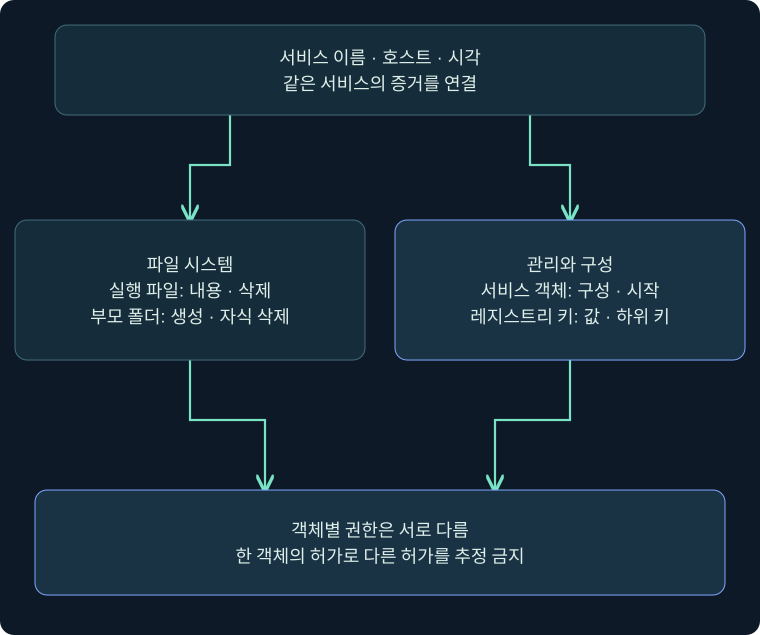
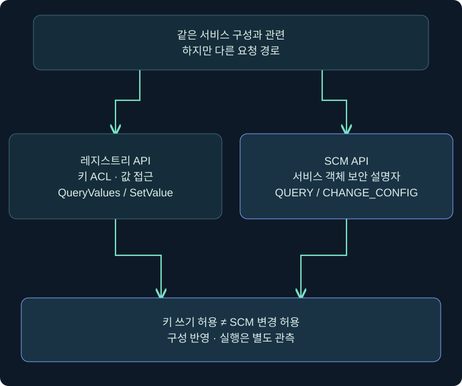
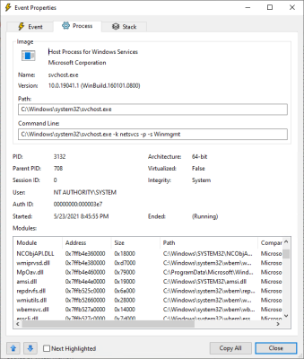
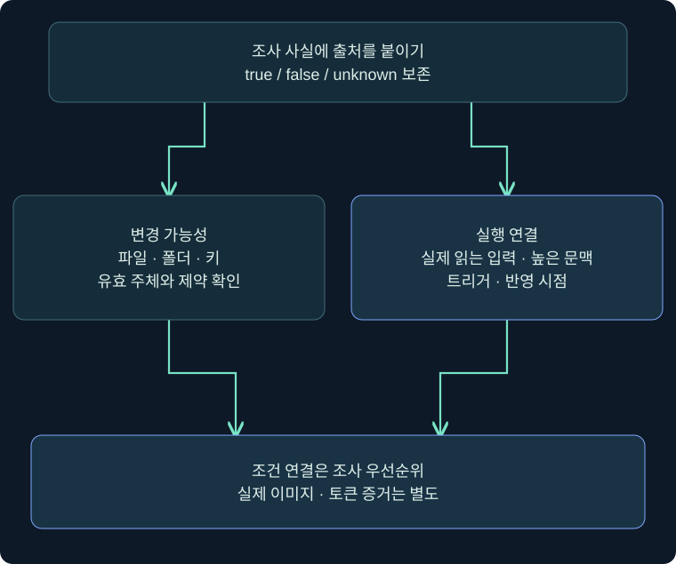

## 1. 서비스가 읽는 파일과 설정은 누가 바꿀 수 있나요?

관리실 열쇠는 안전해도 작업 지시서가 아무나 고칠 수 있는 게시판에 있다면 문제가 생깁니다. 서비스도 실행 계정만 볼 것이 아니라 실행 파일과 그 위치, 설정 저장소를 함께 조사해야 합니다. 이번 강의는 **낮은 권한 주체가 통제할 수 있는 객체가 높은 권한 실행과 연결되는가**를 질문합니다.

앞 강의의 경로 해석은 “어느 파일인가”에 관한 질문이었습니다. 이번 질문은 “그 파일·키에 누가 어떤 작업을 할 수 있는가”입니다. 두 질문은 이어지지만 같은 취약점은 아닙니다. 따옴표가 올바른 경로도 파일 ACL이 부적절할 수 있고, 키를 읽을 수 있어도 값을 바꿀 수는 없을 수 있습니다.

가상 서비스 `TrainingReport`, 실행 파일 `C:\Lab\TrainingOnly\report.exe`를 사용합니다. 실제 제품 사진과 독립 사례·개념도를 구별합니다. Windows·Cobalt Strike 조회·서비스 변경은 미실행입니다. 마지막 Python 연습은 미리 정의한 합성 사실만 읽으며 시스템 ACL을 수집하거나 유효 권한을 계산하지 않습니다.

## 2. 네 객체를 같은 서비스 이름으로 연결합니다

| 객체 | 조사할 질문 | 다른 객체로 대신하면 생기는 오류 |
|---|---|---|
| 실행 파일 | 내용 수정·삭제 등 무엇이 허용되는가 | 파일 RX를 서비스 중지 권한으로 오인 |
| 부모 폴더 | 자식 생성·삭제와 상속은 어떤가 | 파일 ACL 하나만 보고 교체 경로를 누락 |
| 서비스 객체 | SCM 구성 변경·시작·중지 권한은 있는가 | 레지스트리 쓰기를 ChangeServiceConfig 성공으로 오인 |
| 서비스 레지스트리 키 | 값 변경·하위 키 생성·DACL 변경은 어떤가 | ReadKey를 구성 변경 허용으로 오인 |

먼저 서비스 구성에서 정확한 경로와 인수를 읽고 파일과 폴더를 각각 조사합니다. 공유 호스트라면 서비스 구현이 DLL에 있을 수 있어 공용 호스트 exe만 조사했다고 끝내지 않습니다. 재분석 지점·다른 볼륨·설치 업데이트처럼 실제 경로 관계를 바꾸는 조건도 필요한 범위에서 확인합니다.



왼쪽은 파일 시스템, 오른쪽은 서비스 관리·구성 저장소입니다. 아래에서 같은 서비스와 시각으로 연결하되 각 보안 설명자를 합쳐 하나의 권한처럼 읽지 않습니다. 파일 쓰기와 서비스 재시작은 서로 다른 질문입니다.

## 3. 실제 Beacon Console에서 파일 ACL 조회를 준비하기

### 실제 화면 63: 조회 프로그램과 인수 입력 위치


출처: [Fortra Beacon Console](https://hstechdocs.helpsystems.com/manuals/cobaltstrike/current/userguide/content/topics/post-exploitation_main.htm). 공식 원본 재사용, 확인일 2026-11-05. 원본 화면의 출력은 아래 명령의 실행 결과가 아닙니다. 설치 버전에 맞는 도움말을 먼저 확인합니다.

1. **Sessions → 승인된 VM 한 행 → 우클릭 → Interact**를 엽니다. 호스트·사용자·PID와 사전 조사 기록을 대조합니다.
2. 하단 입력 줄에 `help run` → Enter. 다른 cmd.exe를 거치지 않고 조회 프로그램의 출력을 받는 동작인지 확인합니다.
3. `run sc.exe qc TrainingReport`의 응답을 받아 서비스 이름·실행 경로를 확인하는 상황을 가정합니다. 아래 경로는 그 응답으로 확인됐다고 가정한 학습값입니다.
4. 파일과 부모 폴더의 ACL을 **각각** 입력합니다. 한 줄의 결과가 도착한 뒤 다음 줄로 진행하는 방식으로 대상과 출력을 구별합니다.

```text
help run
run sc.exe qc TrainingReport
run icacls.exe "C:\Lab\TrainingOnly\report.exe"
run icacls.exe "C:\Lab\TrainingOnly"
run sc.exe sdshow TrainingReport
```

별도 Save 버튼은 없으며 Enter는 작업 제출입니다. 응답에서 경로, 주체, 허용·거부, 상속 표시를 기록합니다. `sdshow` 결과는 서비스 객체 보안 설명자이며 위 파일 DACL과 형식·권한 의미가 다릅니다. 실제 결과 사진은 확보하지 못했습니다. 예시 성공 출력을 실제 조사 기록처럼 만들지 않습니다.

`icacls`에 경로만 준 예시는 DACL을 표시합니다. `/grant`·`/deny`·`/reset` 등 수정 옵션은 이번 조회에 사용하지 않습니다. 도구가 없거나 접근이 거부되면 오류와 시각을 보존하고 그 객체는 미확인으로 남깁니다. 과거 교재의 `cacls` 표기를 현행 `icacls` 표기와 섞지 않습니다.

## 4. 파일 수정과 폴더의 자식 통제를 구별하기

파일 내용 쓰기, 기존 파일 삭제, 폴더 안에 새 파일 생성은 다른 요청입니다. 파일 자체가 읽기·실행만 허용하더라도 부모의 자식 삭제·생성 권한이 별도 검토 대상이 될 수 있습니다. 반대로 부모에 상속용 허용 항목이 보인다고 현재 파일에도 동일한 허용이 적용됐다고 단정하지 않습니다.

| icacls 표시 | 읽을 의미 | 바로 결론 내리면 안 되는 것 |
|---|---|---|
| RX | 읽기·실행 | 파일 내용 수정 가능 |
| M / F | Modify / Full access | 서비스 실행·시작 성공 |
| (I) | 부모에서 상속된 ACE | 현재 사용자가 소유자 |
| (OI) / (CI) | 파일·하위 폴더로의 상속 범위 | 현재 모든 자식의 동일 ACL 보장 |
| (IO) | 상속 전용 | 이 폴더 자체에도 같은 권한 적용 |

개별 ACE만 보고 유효 권한 전체를 선언하지 않습니다. 실제 사용자의 그룹과 토큰 속성, Allow·Deny, 적용 범위, 상속, 다른 접근 제약을 검토합니다. 파일이 실행 중이라는 사실도 모든 파일 작업이 언제나 가능·불가능하다는 판정기가 아닙니다. 공유 모드·매핑·보호 정책 등 실제 제약을 확인하지 않았다면 미확인으로 남깁니다.

파일 해시와 서명은 내용·신뢰 검토에 유용하지만 ACL을 대신하지 않습니다. 반대로 파일에 변경 권한이 있다는 사실도 악성 변경이 이미 일어났음을 입증하지 않습니다. 설치 관리자가 의도한 업데이트 계정과 불필요하게 넓어진 일반 사용자 권한을 구분할 근거가 필요합니다.

## 5. 레지스트리는 키의 권한과 값 내용을 나눠 봅니다

서비스 구성 키의 예시는 `HKLM\SYSTEM\CurrentControlSet\Services\TrainingReport`입니다. `ImagePath`는 실행 경로에 관한 값이고 `ObjectName`은 시작 계정에 관한 값입니다. 키의 보안 설명자가 값 접근을 제어하며 각 값을 파일처럼 별도 ACL 객체로 그리지 않습니다.

| 키 권한 | 관련 질문 | 구별할 권한 |
|---|---|---|
| QueryValues / ReadKey | 값을 읽을 수 있는가 | SetValue |
| SetValue | 값을 생성·삭제·설정할 수 있는가 | CreateSubKey |
| CreateSubKey | 하위 키 생성이 허용되는가 | 기존 값 변경·서비스 객체 변경 |
| ChangePermissions / TakeOwnership | DACL·소유자 관련 작업인가 | 단순 내용 조회 |

Windows 권한 이름과 .NET `RegistryRights`의 표시 이름은 도구에 따라 달라집니다. 예를 들어 Win32의 KEY_SET_VALUE와 PowerShell의 SetValue를 같은 의미 범주로 연결하되 출력 문자열을 섞어 복사하지 않습니다. `Get-Acl`은 보안 설명자를 읽는 기능이며 현재 토큰의 모든 유효 권한을 자동 계산해 주는 명령이라고 설명하지 않습니다.



같은 서비스 구성에 관련되어도 레지스트리 API와 SCM API는 다른 경로입니다. 키 쓰기 허용에서 곧바로 SERVICE_CHANGE_CONFIG 허용이나 SCM 반영 시점을 추론할 수 없습니다. 원본의 레지스트리 권한 예제와 SCM 구성 변경 예제를 한 권한 검사처럼 읽지 않도록 구별합니다.

## 6. 레지스트리 조회 위치와 확인 순서

앞 Beacon Console 사진은 입력 위치를 보여줍니다. 레지스트리 권한을 조회하는 아래 코드는 **별도 로컬 Windows PowerShell**에서의 미실행 예시입니다. Beacon 안에서 실행하려면 설치 버전의 PowerShell 명령 계약·인용 규칙을 별도 확인해야 하며 이 코드를 Beacon의 기본 명령으로 오인하지 않습니다.

```powershell
$trainingKey = 'HKLM:\SYSTEM\CurrentControlSet\Services\TrainingReport'
Get-ItemProperty -LiteralPath $trainingKey |
    Select-Object ImagePath, ObjectName, Start, Type
$trainingAcl = Get-Acl -LiteralPath $trainingKey
$trainingAcl | Format-List Owner, Sddl
$trainingAcl.Access | Format-Table IdentityReference, RegistryRights, AccessControlType, IsInherited, InheritanceFlags, PropagationFlags -AutoSize
```

처음 출력은 구성 값, 다음은 키 소유자와 SDDL, 마지막은 ACE별 주체·권한·허용 여부·상속입니다. 값이 없다는 결과와 키 접근 실패를 구별합니다. 경로의 따옴표와 인수는 조회 단계에서 수정하지 않습니다. 표가 잘리면 원본 객체·SDDL을 승인된 기록으로 함께 보존해 해석 누락을 줄입니다.

GUI 안내는 **Registry Editor → 지정된 서비스 키 → 우클릭 → 사용 권한 → 고급** 순서입니다. 보안 주체 한 항목의 적용 대상과 허용 범위를 읽고 **취소**로 닫습니다. 값 편집·사용 권한 변경·상속 해제는 하지 않습니다. 이 regedit 창의 실제 공식 사진은 확보하지 못했으므로 콘솔·ProcMon 사진으로 대체한 것처럼 표현하지 않습니다.

## 7. 실제 ProcMon 화면으로 기존 변경 증거 읽기

### 실제 화면 64: 이벤트 속성과 접근 결과를 대조하기



출처: [Microsoft Process Monitor](https://learn.microsoft.com/en-us/sysinternals/downloads/procmon). 기존 공식 원본 재사용입니다. 사진은 제작사 사례이며 **Process 탭이 선택된 상태**입니다. TrainingReport의 변경 성공 캡처나 권한 설정창은 아닙니다. Event 탭의 실제 표시 사진은 이 삽화에 포함되지 않습니다.

승인된 기존 PML을 **File → Open**으로 열고 **Filter → Filter**에서 대상 PID나 프로세스 이름과 서비스 키 경로를 Include하는 상황을 가정합니다. 파일 시스템과 레지스트리를 나누어 보고, 결과 행을 더블클릭해 **Event**의 시각·Operation·Path·Result·Detail, **Process**의 이미지·계정 정보를 대조합니다. 사진의 탭·필드 명칭은 버전과 다를 수 있습니다.

레지스트리 `RegSetValue`의 SUCCESS는 특정 값 설정 요청의 성공을 뒷받침할 수 있지만 서비스 재시작·새 이미지 실행 성공까지 입증하지 않습니다. 조회 요청 `RegQueryValue`와도 구별합니다. 파일 쓰기 이벤트가 있어도 내용 전체가 바뀌었는지와 실제 서비스가 읽었는지는 추가 증거입니다. 실패·성공을 모두 읽고 기존 로그의 누락과 수집 범위를 기록합니다.

파일 ACL·키 ACL·구성 변경의 모니터링에는 이벤트 정책과 수집 도구가 필요합니다. 로그가 없다는 사실을 변경 부재로 단정하지 않습니다. 보안 이벤트나 Sysmon 이벤트를 사용할 때도 사전에 수집된 정책·설정과 해당 이벤트의 의미를 확인합니다. 이번 강의에서 감사 정책을 바꾸거나 새 수집을 수행하지 않았습니다.

## 8. 합성 사실표로 조건부 위험을 분류하는 연습

아래는 독립 제작한 합성 사례입니다. 각 true·false·unknown은 **이미 조사자가 확인했다고 가정한 사실**이며 실제 ACL에서 계산한 값이 아닙니다. 서비스 재시작 권한은 이 표에 없고, 존재한다고 추정하지 않습니다.

| 사례 | 파일 변경 가능 | 키 값 변경 가능 | 높은 실행 문맥 | 실제 입력 연결 | 판단 |
|---|---|---|---|---|---|
| A | false | false | true | true | 이 두 변경 가설은 미지지 |
| B | true | false | true | unknown | 실행 연결 추가 확인 |
| C | false | true | true | true | 조건부 위험, 반영·실행 미검증 |
| D | true | false | false | true | 높은 문맥으로의 상승은 미지지 |



한쪽 자료만 확보했다면 반대쪽 질문이 남습니다. 모든 조건이 true인 사례도 실제 공격 성공 판정이 아니라 우선 검토할 연결입니다. 서비스 시작 계약, 반영 시점, 실제 이미지·토큰 관측은 별도입니다.

다운로드: [합성 사실 JSON](../../assets/red-team-foundations/35-service-evidence-cases.json), [오프라인 판정 연습 Python](../../assets/red-team-foundations/35-service-evidence-review.py). Python 3 표준 라이브러리만 사용합니다. 두 파일을 같은 폴더에 두고 아래처럼 실행합니다. 스크립트는 지정 JSON만 읽고 결과를 표준 출력으로 내보냅니다. 네트워크·명령 실행·파일 수정·ACL 조회는 하지 않습니다.

```text
python3 35-service-evidence-review.py 35-service-evidence-cases.json
A: 변경 가설 미지지
B: 추가 확인 필요
C: 조건부 위험 — 반영·실행 미검증
D: 높은 문맥 상승 미지지
```

이 출력은 게시 전 합성 JSON으로 실제 실행해 확인했습니다. 필수 항목 누락이나 true·false·null 이외 입력은 오류로 처리하며 null을 false로 바꾸지 않습니다. 이 연습은 Windows 유효 권한 계산기나 취약점 스캐너가 아닙니다. 새로운 사건을 분류하려면 먼저 각 사실의 근거를 별도로 수집해야 합니다.

## 9. 개선·오류·복구를 어떤 기준으로 기록하나요?

권한 문제의 개선 검토는 서비스 파일·폴더·키·서비스 객체 각각에 필요한 주체와 최소 작업을 확인하는 것입니다. 읽기만 필요한 일반 사용자에게 수정이 허용되는지, 업데이트용 계정의 허용 범위가 적절한지 검토합니다. 제품 설치 기준과 종속 서비스·업데이트 동작도 함께 고려합니다.

파일 내용이나 ImagePath를 직접 바꿔 증명하지 않습니다. 운영 변경은 별도 승인된 절차에서 기존 구성·ACL·파일의 복구 자료를 확보하고 영향 확인 후 수행할 작업입니다. 소유자 변경과 상속 해제를 일괄 해결책으로 적용하면 정상 운영을 망칠 수 있습니다. 조회 절차의 끝은 확보 사실과 미확인 조건을 전달하는 것입니다.

`Access denied`는 그 요청의 실패이며 서비스가 없다는 뜻이 아닙니다. 빈 결과는 경로·권한·명령 가용성·필터를 확인합니다. 수집 시각이 다르면 하나의 동시 스냅샷처럼 합치지 않습니다. 미실행 절차에는 결과가 없음을 밝히고, 실제 수행한 Python 검사는 합성 자료 범위로 기록합니다.

## 10. 복습과 즉시 해설

### 복습 1. 실행 파일에 RX만 있으면 주변 조사는 끝인가요?

**해설:** 부모 폴더의 자식 생성·삭제와 다른 ACE·유효 주체도 확인합니다. 파일 ACL만으로 모든 변경 경로를 판단할 수 없습니다.

### 복습 2. 폴더의 (OI)(CI)(IO) 허용은 폴더 자체에도 적용되나요?

**해설:** IO는 상속 전용입니다. 현재 객체와 자식의 적용 범위를 분리하고 자식의 실제 ACL도 확인합니다.

### 복습 3. Get-Acl이 보이면 현재 사용자의 유효 권한이 전부 계산됐나요?

**해설:** 보안 설명자를 읽은 것입니다. 토큰 그룹·거부·상속·다른 제약을 별도로 해석해야 합니다.

### 복습 4. ReadKey면 ImagePath 값을 바꿀 수 있나요?

**해설:** 읽기와 값 변경은 다른 권한입니다. SetValue와 해당 주체의 실제 허용 범위를 확인해야 합니다.

### 복습 5. 키 쓰기 권한이 있으면 sc.exe 구성 변경도 성공하나요?

**해설:** SCM 서비스 객체와 레지스트리 키의 접근 검사는 다릅니다. SERVICE_CHANGE_CONFIG 허용과 구성 반영 시점을 추론하지 않습니다.

### 복습 6. RegSetValue SUCCESS면 새 서비스 실행이 입증되나요?

**해설:** 특정 값 쓰기 성공의 증거입니다. 해당 서비스가 반영했는지와 실제 이미지·계정·실행 시각은 별도 증거가 필요합니다.

### 복습 7. 합성 스크립트가 조건부 위험을 출력하면 권한 상승 성공인가요?

**해설:** 아닙니다. 입력한 가정의 연결을 분류한 결과이며 시스템 검사나 서비스 실행을 하지 않습니다.

### 복습 8. 파일 쓰기가 가능하면 지금 즉시 서비스 재시작도 가능한가요?

**해설:** 시작·중지는 별도 서비스 객체 권한과 운영 조건입니다. 파일 쓰기 허용으로 추정하거나 실제 업무 서비스를 재시작하지 않습니다.

## 11. 공식 근거와 다음 범위

확인일: **2026-11-05**. 원본의 서비스 파일·레지스트리 권한 범위를 파일·키·SCM의 공식 권한 모델과 대조했습니다. Performance 같은 선택적 하위 키는 존재 여부·사용 주체·호출 조건을 확인할 별도 구성으로 보고, 생성만으로 코드가 실행된다고 설명하지 않습니다. 다음은 DLL 검색 조건과 소프트웨어 취약점, 이후 UAC·무결성·승격 결과 검증입니다.

- [Microsoft File Security and Access Rights](https://learn.microsoft.com/en-us/windows/win32/fileio/file-security-and-access-rights)
- [Microsoft File Access Rights Constants](https://learn.microsoft.com/en-us/windows/win32/fileio/file-access-rights-constants)
- [Microsoft icacls](https://learn.microsoft.com/en-us/windows-server/administration/windows-commands/icacls)
- [Microsoft Registry Key Security and Access Rights](https://learn.microsoft.com/en-us/windows/win32/sysinfo/registry-key-security-and-access-rights)
- [Microsoft Service Security and Access Rights](https://learn.microsoft.com/en-us/windows/win32/services/service-security-and-access-rights)
- [Microsoft Get-Acl](https://learn.microsoft.com/en-us/powershell/module/microsoft.powershell.security/get-acl)
- [Microsoft CreateServiceW](https://learn.microsoft.com/en-us/windows/win32/api/winsvc/nf-winsvc-createservicew)
- [Microsoft Process Monitor](https://learn.microsoft.com/en-us/sysinternals/downloads/procmon)
- [Fortra Running Commands](https://hstechdocs.helpsystems.com/manuals/cobaltstrike/current/userguide/content/topics/post-exploitation_running-commands.htm)
