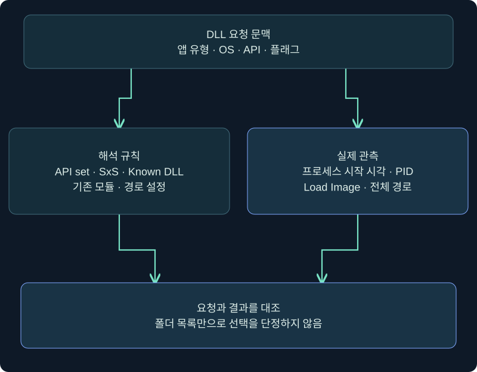
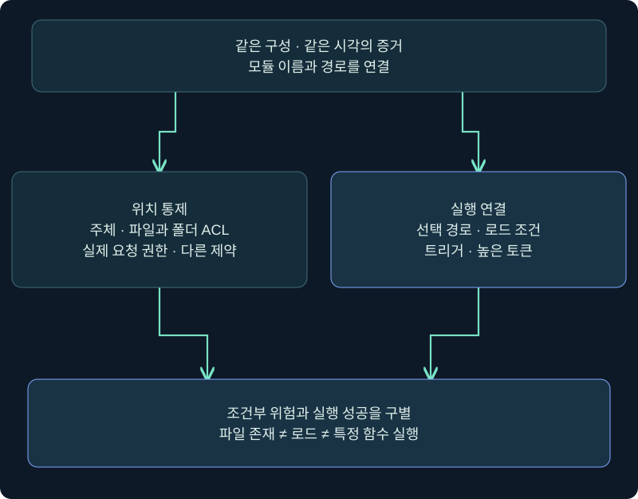
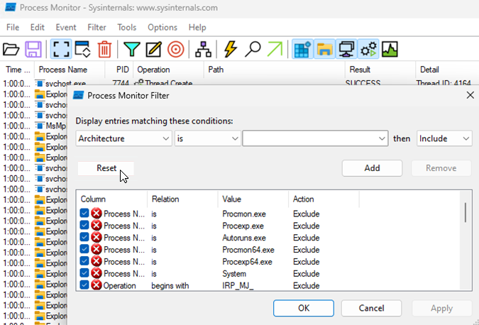
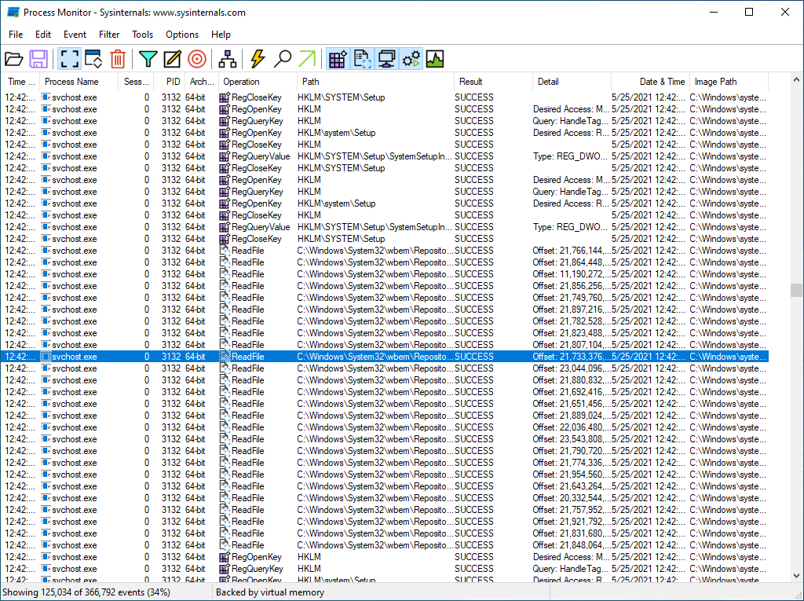
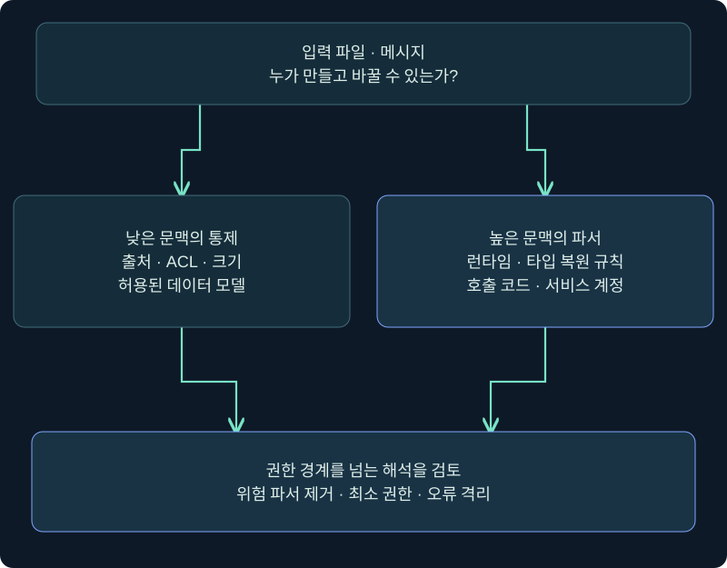

## 1. 실행 파일이 안전해도 로딩하는 부품을 확인해야 합니다

서비스 실행 파일은 보호되어 있는데 같은 프로세스에 들어오는 DLL은 일반 사용자가 바꿀 수 있는 위치에 있다면 어떨까요? 건물 출입문을 잠갔어도 관리실이 사용하는 부품의 공급 경로가 열려 있는 상황과 비슷합니다. 앞의 두 강의가 실행 파일의 선택과 권한을 다뤘다면 이번에는 **어떤 DLL과 데이터를 높은 권한 프로세스가 받아들이는가**를 살펴봅니다.

DLL은 여러 프로그램이 기능을 공유할 수 있게 하는 모듈입니다. 프로그램은 DLL의 함수를 호출하고 로더는 필요한 모듈을 프로세스 주소 공간에 연결합니다. 이름만 지정한 요청과 전체 경로를 지정한 요청은 해석 조건이 다릅니다. 같은 이름의 파일이 있다는 사실만으로 그 파일이 선택된다고 말할 수 없습니다.

가상 프로그램 `report.exe`와 가상 모듈 `TrainingReport.dll`을 예로 듭니다. 실제 DLL 배치·교체·서비스 시작·취약점 실행은 하지 않았습니다. 제품 사진은 공개 공식 원본이고 아래 경로·필터는 독립적으로 작성한 미실행 학습값입니다.

## 2. DLL 검색은 하나의 고정 목록이 아닙니다

먼저 앱이 패키지 앱인지, 일반 데스크톱 앱인지와 운영체제 버전을 기록합니다. 다음으로 호출 API·플래그·프로세스의 검색 설정을 조사합니다. 일반적인 폴더 검색 전에 API set, SxS 매니페스트, 이미 로드된 모듈, Known DLL 같은 해석이 관여할 수 있습니다. 이 단계는 임의 파일을 앞 폴더에 두는 가정으로 생략할 수 없습니다.

| 조건 | 먼저 확인할 점 | 잘못된 일반화 |
|---|---|---|
| DLL 이름만 전달 | 앱 유형·로더 정책·검색 설정 | 항상 현재 폴더부터 찾는다 |
| 전체 경로 전달 | 지정 모듈과 그 종속 DLL을 구별 | 모든 종속성도 그 폴더에서만 찾는다 |
| 이미 로드된 모듈 | 모듈 목록과 실제 경로 | 디스크 검색이 매번 반복된다 |
| Known DLL·API set | 해당 OS의 처리 규칙 | 같은 이름 파일이면 대체 가능하다 |
| 검색 경로를 제한한 호출 | LoadLibraryEx 플래그·설정 API | PATH만 읽으면 충분하다 |

아래 도식은 검색 순서를 그대로 나열한 운영체제 표가 아닙니다. 조사자가 먼저 수집할 조건과 실제 관측 결과를 연결한 개념도입니다.

위의 요청 문맥에서 왼쪽의 해석 규칙과 오른쪽의 실제 관측으로 갈라집니다. 두 증거가 합쳐져야 특정 파일의 선택을 설명할 수 있습니다. 소스 코드가 없으면 API 호출 조건을 모른다고 적고 실행 관측으로 확인한 범위만 보고합니다.

## 3. Safe DLL search mode가 바꾸는 것과 남는 위험

일반적인 비패키지 앱의 기본 검색을 설명할 때 Safe DLL search mode는 현재 작업 폴더를 더 뒤쪽에 두는 규칙으로 이해할 수 있습니다. 그러나 앱 실행 파일 폴더는 여전히 중요한 후보이며 앱이 설정한 별도 검색 경로와 호출 플래그도 검토해야 합니다. Windows 11 21H2 이후의 패키지 종속 그래프처럼 OS 조건으로 추가되는 단계도 있습니다.

따라서 “실행 폴더 → System32 → Windows → 작업 폴더 → PATH”는 일부 폴더 단계의 방향을 기억하는 보조 설명일 뿐 완전한 공통 알고리즘이 아닙니다. SetDllDirectory와 SetDefaultDllDirectories, AddDllDirectory 및 LoadLibraryEx 옵션이 있으면 공식 API 계약에 맞춰 다시 읽습니다. 이 강의에서는 검색 보호 설정을 끄거나 변경하지 않습니다.

앱이 자기 설치 위치에서 신뢰할 부품의 전체 경로를 안전하게 구성하는 방법도 있습니다. Windows가 항상 C 드라이브에 설치된다고 가정해 경로를 하드코딩할 필요는 없습니다. 전체 경로를 쓴 첫 모듈도 종속 DLL 검색을 자동으로 모두 고정하는 것은 아니므로 개발자는 종속성까지 고려합니다.

## 4. 조건이 이어져야 권한 상승 위험으로 설명할 수 있습니다

가상 서비스가 높은 권한으로 동작하고 `TrainingReport.dll`을 이름으로 요청한다고 가정합니다. 일반 사용자에게 설치 폴더 쓰기 권한이 보인다면 위험 후보입니다. 그러나 모듈이 이미 로드되어 있거나 해당 폴더를 검색하지 않거나 무결성 정책이 로드를 막으면 같은 결론을 낼 수 없습니다.

| 필요한 증거 | 확인 내용 | 아직 모르면 |
|---|---|---|
| 입력 통제 | 어떤 주체가 어느 파일·폴더에 무엇을 할 수 있는가 | 변경 가능성 미확인 |
| 선택 조건 | 실제 API·정책 아래 후보가 선택되는가 | 로드 경로 미확인 |
| 로드 성립 | 아키텍처·형식·종속성·코드 무결성 조건 | 파일 존재만 확인 |
| 높은 문맥 | 로드한 프로세스 토큰과 요청 주체의 차이 | 권한 경계 미확인 |
| 동작 시점 | 시작 시·기능 호출 시·재로딩 중 언제 요청하는가 | 트리거 미확인 |

프로세스가 높은 권한이라고 모든 입력이 곧 실행 코드가 되는 것은 아닙니다. 파일 확장자가 DLL이어도 적합한 PE 형식·아키텍처와 필요한 함수·의존성 계약 등을 충족해야 합니다. 반대로 로딩 실패도 장애를 일으킬 수 있으므로 실제 파일을 배치해 성공 여부를 시험하는 절차로 바꾸지 않습니다.

그림 왼쪽은 통제 가능한 위치, 오른쪽은 높은 문맥이 그 위치를 실제 사용하는 조건입니다. 아래 결론은 조건부 위험이며 실제 코드 실행의 성공 증거와 구분합니다. 두 영역 중 하나가 빠졌다면 빠진 증거를 명시합니다.

## 5. 실제 ProcMon 필터 창에서 조사 범위 설정하기

### 실제 화면 65: DLL 검색과 이미지 로드를 나누어 보기

출처: [Microsoft Process Monitor](https://learn.microsoft.com/en-us/sysinternals/downloads/procmon). 공개 공식 사진을 원본 그대로 재사용합니다. 사진 자체의 값은 아래 학습값과 다르며 최신 도구와 UI가 다를 수 있습니다. 아래 절차는 미실행입니다.

1. 승인된 VM에서 ProcMon을 열고 **Filter → Filter**를 선택합니다. 수집 권한과 기존 필터·Drop Filtered Events 설정을 기록합니다. 승인된 기존 PML을 읽는 경우 새 수집을 시작할 필요가 없습니다.
2. 첫 열에서 **Process Name**, 비교 **is**, 값 칸에 `report.exe`, 동작 **Include**를 지정하고 **Add**를 누릅니다. 같은 이름 프로세스가 여러 개면 Process Tree·PID·시작 시각을 대조해 하나의 실행으로 좁힙니다.
3. **Operation / is / CreateFile / Include → Add**를 넣고 **OK**로 적용합니다. 여기서 파일 검색 시도를 읽습니다. `NAME NOT FOUND`는 그 경로의 실패한 조회이며 취약점 성공이 아닙니다.
4. 로드 확인 단계에서는 Operation 조건을 **Load Image**로 바꿉니다. 이전 Operation 조건을 Remove한 뒤 새 조건을 Add하고 OK를 누르면 두 보기를 혼동하지 않습니다. **Path / ends with / .dll / Include**는 DLL만 좁히는 학습 옵션이며 확장자만으로 모든 모듈 동작을 포착한다고 보장하지 않습니다.
5. 같은 속성의 Include는 OR, 서로 다른 속성은 AND로 해석한다는 필터 규칙을 확인합니다. 기존 Exclude와 필터링 중 버린 이벤트도 조사 범위에 영향을 줍니다. Load Image가 없으면 캡처 시점·수집 종류·프로세스 종료 여부부터 확인합니다.

값을 적용하는 버튼은 Add와 OK입니다. Capture 아이콘은 수집을 시작·중지하는 별도 기능이며 앱을 새로 실행시키는 버튼이 아닙니다. 이벤트를 만들려고 업무 서비스를 재시작하지 않습니다. 실제 지정 필터 적용 후 결과 사진은 확보하지 못했습니다.

## 6. 실패 경로와 최종 선택을 같은 타임라인으로 연결하기

### 실제 화면 66: 이벤트 행에서 경로·시각·프로세스 확인하기

출처는 앞의 Microsoft 공식 문서입니다. 원본 행은 본 강의 프로그램의 실행 결과가 아닙니다. 본문에서 **Time of Day·Process Name·PID·Operation·Path·Result**를 읽고 행 더블클릭으로 속성을 확인하는 미실행 안내입니다. 필요한 세부 창은 해당 설치 버전에서 확인합니다.

가상 사실표에 “09:00 후보 A 조회 실패, 09:00 후보 B Load Image 성공”이 있다고 합시다. 이때 확인한 것은 B가 그 시각 해당 프로세스에 매핑됐다는 것입니다. A에 쓰기가 가능한지, A가 다음 실행에서 선택될지, B가 악성인지까지 자동으로 입증하지 않습니다. 동일 PID도 재사용될 수 있어 시작 시각을 함께 보관합니다.

ProcMon의 파일 열기 성공은 곧 DLL 코드 실행이 아닙니다. Load Image도 매핑 관측이지 특정 export나 악성 분기 실행의 전부를 증명하지 않습니다. 모듈 경로·해시·서명·설치 기준선과 EDR의 프로세스 관계를 별도 연결합니다. Sysmon Event ID 7도 ImageLoad 수집 설정이 적용된 환경에서만 기대할 수 있으며 부재를 “로드 없음”으로 바꾸지 않습니다.

## 7. 소프트웨어 취약점은 입력을 처리하는 코드까지 봅니다

서비스가 신뢰할 수 없는 데이터를 높은 권한으로 파싱하면 잘못된 메모리 처리, 경로 검증, 명령 구성, 역직렬화가 권한 경계를 가로지를 수 있습니다. DLL 검색 문제는 모듈 선택 경로의 문제이고 역직렬화는 데이터에서 객체를 복원하는 처리의 문제입니다. 둘 다 낮은 권한의 입력이 높은 문맥에 도달하는지 묻지만 수정할 지점은 다릅니다.

예를 들어 일반 사용자에게 쓰기 허용된 작업 폴더의 상태 파일을 서비스가 읽는다고 합시다. 데이터라는 이유만으로 안전하다고 볼 수 없습니다. 객체 타입·메서드 동작을 폭넓게 복원하는 포맷은 단순 숫자·문자열 JSON보다 훨씬 큰 실행 의미를 가질 수 있습니다. 입력 소유자, 파서, 허용 타입, 서비스 계정을 함께 검토합니다.

입력의 확장자가 아니라 누가 내용을 통제하고 어떤 파서가 해석하는지가 핵심입니다. 그림은 취약한 파일이나 실행용 데이터를 만드는 절차가 아니며 실제 파서 결과를 나타내지 않습니다.

## 8. BinaryFormatter의 과거 예제를 현재 환경에 적용할 때

Microsoft는 BinaryFormatter를 안전하게 구성할 수 없는 위험한 API로 설명하고 사용 중단과 마이그레이션을 안내합니다. .NET 9부터 내장 구현은 사용 시 예외를 발생시키며 이전 활성화 설정도 제거되었습니다. 과거 .NET Framework 예제를 최신 .NET의 기본 동작과 같다고 설명하지 않습니다. 호환 패키지·레거시 런타임 사용 여부는 별도 조사 대상입니다.

| 조사 항목 | 확인 방법의 방향 | 개선 방향 |
|---|---|---|
| 런타임·배포 형태 | 설치 정보·프로젝트·의존성 기록 | 지원 버전과 이행 계획 |
| 입력 출처 | 파일·메시지의 작성 주체와 ACL | 신뢰 경계 명시·최소 권한 |
| 실제 파서 | 코드 검토·호출 위치 | 위험 API 제거 |
| 데이터 모델 | 필요한 필드·타입과 크기 | 명시적 스키마·제한된 타입 |
| 오류 처리 | 손상 데이터의 처리·로그 | 장애 격리·실패 기록 |

JSON으로 이름만 바꿔도 안전해지는 것은 아닙니다. 임의 타입 복원이나 명령 실행을 다시 구현하면 위험이 돌아옵니다. 제한된 데이터 모델·크기 한도·인증과 권한·안전한 오류 처리를 함께 설계합니다. 이 강의는 gadget·실행용 직렬화 파일을 생성하거나 로딩하지 않습니다.

## 9. 조건을 바꾸어 판정을 비교합니다

가상 사례 A: 일반 사용자가 모듈 후보 폴더에 쓰기 가능하고, 높은 무결성 서비스가 그 경로의 모듈을 실제 로드합니다. 이는 중요한 권한 경계 위험의 근거입니다. 로드 관측과 파일 통제 증거의 시각이 같은 구성 버전에 해당하는지 확인하고 개발·운영 담당자가 ACL과 로더 정책을 함께 개선하도록 보고합니다.

사례 B: 같은 폴더가 쓰기 가능하지만 낮은 무결성 테스트 앱만 읽습니다. 높은 권한으로의 상승은 입증되지 않았습니다. 그래도 앱의 데이터와 실행 무결성 위험은 별도로 남을 수 있습니다. 사례 C: 높은 권한 앱이 읽지만 해당 모듈은 보호된 전체 경로에서만 로드됩니다. 다른 종속성과 설정된 검색 폴더를 조사하되 앞 폴더의 파일만 보고 대체 성공을 단정하지 않습니다.

보고서는 “후보·조건·관측·미확인·영향·수정·재검증” 순서로 작성합니다. 수정 후 재검증도 파일 교체 공격부터 시작하지 않습니다. ACL 기준선, 개발자의 검색 경로 구성, 정상 로드 경로, 입력 파서 변경을 먼저 확인합니다. 정상 기능과 서비스 가용성도 회귀 검토 대상입니다.

## 10. 복습과 바로 읽는 해설

### 복습 1. DLL 이름만 같으면 실행 폴더의 파일이 항상 선택되나요?

**해설:** 아닙니다. 앱 유형·OS·API·리디렉션·Known DLL·기존 모듈·검색 설정을 먼저 확인합니다.

### 복습 2. 전체 경로로 첫 DLL을 열면 종속 DLL 경로도 모두 고정되나요?

**해설:** 그렇지 않습니다. 종속 DLL은 이름 기반으로 다시 검색될 수 있어 별도 검토합니다.

### 복습 3. NAME NOT FOUND가 보이면 취약점인가요?

**해설:** 그 시각 특정 경로의 조회 실패입니다. 위치 통제·선택 가능성·실행 문맥은 추가 증거가 필요합니다.

### 복습 4. Load Image 성공이면 특정 악성 함수 실행까지 입증됐나요?

**해설:** 모듈 매핑 관측입니다. 악성 분기나 export 호출 등 구체적인 실행 결론에는 추가 관측이 필요합니다.

### 복습 5. Safe DLL search mode가 켜져 있으면 모든 로딩 위험이 사라지나요?

**해설:** 현재 폴더의 순서를 조정하는 보호입니다. 쓰기 가능한 앱 폴더·별도 경로·입력 처리 위험까지 해결하지 않습니다.

### 복습 6. 데이터 파일이면 실행 위험을 검토할 필요가 없나요?

**해설:** 파서의 의미가 중요합니다. 위험한 역직렬화는 데이터를 높은 문맥의 동작으로 연결할 수 있습니다.

### 복습 7. 과거 BinaryFormatter 예제가 .NET 9 기본 환경에서도 그대로 작동하나요?

**해설:** 내장 구현은 사용 시 예외를 발생시킵니다. 런타임·배포 구성과 레거시 여부를 구별합니다.

### 복습 8. 동일한 파일명이 두 개면 어느 증거부터 연결하나요?

**해설:** 프로세스 시작 시각·PID·실제 로드 전체 경로를 연결하고 파일 해시·ACL·설치 기준선으로 이어갑니다.

## 11. 공식 근거와 다음 강의

확인일 **2026-11-05**. 검색 단계·API 옵션·런타임 제한은 적용 환경에 따라 달라집니다. 제품·Windows·모듈 배치·코드 실행은 미수행이며 공식 사진과 독립 가상 사례만 제공합니다. 다음 강의는 UAC·MIC·토큰과 승격 결과의 증거를 연결합니다.

- [Microsoft DLL search order](https://learn.microsoft.com/en-us/windows/win32/dlls/dynamic-link-library-search-order)
- [Microsoft DLL security](https://learn.microsoft.com/en-us/windows/win32/dlls/dynamic-link-library-security)
- [Microsoft LoadLibraryExW](https://learn.microsoft.com/en-us/windows/win32/api/libloaderapi/nf-libloaderapi-loadlibraryexw)
- [Microsoft BinaryFormatter security guide](https://learn.microsoft.com/en-us/dotnet/standard/serialization/binaryformatter-security-guide)
- [Microsoft Process Monitor](https://learn.microsoft.com/en-us/sysinternals/downloads/procmon)
- [Microsoft Sysmon](https://learn.microsoft.com/en-us/sysinternals/downloads/sysmon)
