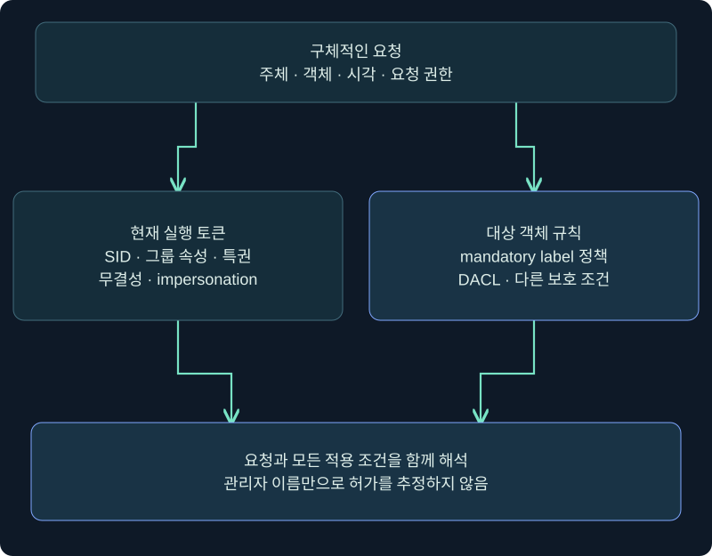
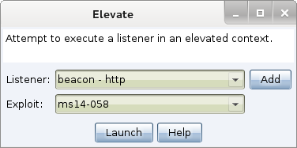
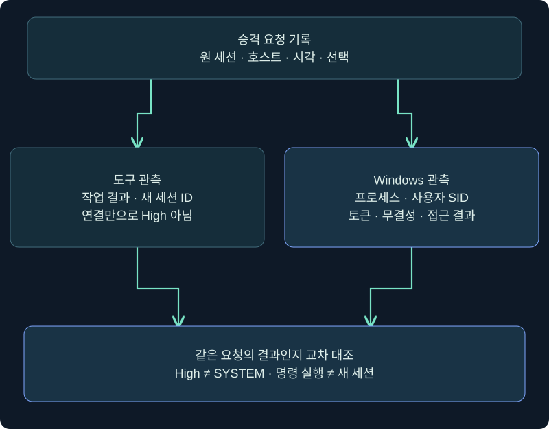
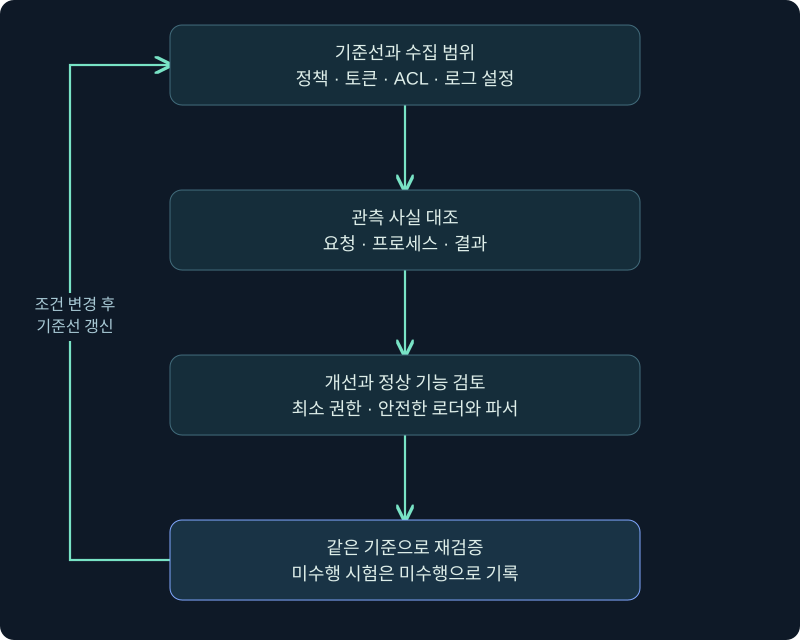

## 1. 관리자라는 이름과 지금 사용하는 권한은 다릅니다

관리자 그룹 소속 계정으로 로그인했는데 관리 작업에 접근 거부가 나오는 상황은 이상 현상만은 아닙니다. 출입증에 관리자 역할이 있어도 지금 창에서 사용하는 권한 묶음이 제한되어 있을 수 있습니다. Windows는 계정의 소속과 프로세스의 현재 토큰, 대상 객체의 접근 규칙을 나누어 판단합니다.

이번 강의는 UAC(User Account Control), MIC(Mandatory Integrity Control), 토큰을 구별하고 Cobalt Strike의 승격 기능 설명을 **요청·실행 문맥·세션·결과**의 증거로 읽습니다. 단순히 “관리자 표시가 붙었다”는 이유로 SYSTEM이나 모든 자원 접근을 선언하지 않습니다.

공식 제품 사진은 실제 공개 삽화이고 독립 예시의 실행 결과가 아닙니다. Windows·제품·승격·UAC 우회·자격 증명 입력·서비스 변경은 수행하지 않았습니다. 실제 실행하지 않은 절차와 공식 문서에 설명된 동작을 구별합니다.

## 2. UAC·MIC·DACL은 서로 다른 질문을 합니다

| 개념 | 핵심 질문 | 대신할 수 없는 정보 |
|---|---|---|
| 계정·그룹 | 어느 SID와 그룹에 연결되는가 | 현재 프로세스의 전체 토큰 상태 |
| UAC | 관리 토큰 사용을 어떤 정책과 승인 흐름으로 허용하는가 | 모든 객체의 접근 허가 |
| MIC | 무결성 레벨·mandatory policy가 요청을 제한하는가 | 사용자 신원·그룹·특권 전체 |
| DACL | 이 주체의 요청 권한을 객체가 허용하는가 | MIC 등 다른 보호 조건 |
| 특권 | 해당 작업에 필요한 권리가 토큰에 있고 활성 상태인가 | 다른 모든 자원 권한 |

MIC는 임의 접근 제어에 추가되는 검사입니다. 기본적인 no-write-up은 낮은 무결성 주체가 더 높은 무결성 객체를 수정하는 것을 제한합니다. 기본적으로 모든 상위 객체의 읽기까지 일괄 금지한다고 설명하면 틀립니다. 객체의 mandatory label 정책에 따라 읽기·실행 제한도 별도 표현될 수 있습니다.



그림은 계정 이름 하나에서 허가를 결론 내리지 말라는 조사 구조입니다. 실제 접근은 요청 종류·토큰·객체 규칙을 함께 검토합니다. 높은 무결성이라는 정보만으로 파일의 DACL이나 보호 프로세스 접근 제한을 생략하지 않습니다.

## 3. 분리 토큰과 프롬프트를 이해하기

일반적인 Admin Approval Mode의 관리자 로그인에서는 제한된 토큰과 관리 토큰을 구별합니다. 일상 앱은 제한된 문맥에서 시작하고 관리 작업은 승인 흐름을 통해 다른 문맥으로 실행될 수 있습니다. 기본 제공 Administrator, UAC 정책, 실행 방식에 따라 예외가 있으므로 “모든 관리자 프로세스는 항상 Medium”으로 쓰지 않습니다.

표준 사용자의 기본 승격 흐름에서는 관리자 자격 증명이 요구될 수 있고 관리자 계정은 동의 프롬프트를 받을 수 있습니다. 이는 정책으로 달라집니다. 본 강의는 프롬프트가 어떤 의미인지 설명하며 실제 비밀번호 입력을 요구하거나 수집하지 않습니다. Secure desktop의 역할과 정책 상태도 기록하되 보호 기능을 끄지 않습니다.

| 관측한 사실 | 가능한 설명 | 추가 확인 |
|---|---|---|
| Administrators SID가 보임 | 그룹 관계가 있음 | Enabled·Deny only와 현재 토큰 |
| Medium mandatory label | 현재 프로세스가 중간 무결성 | 사용자·특권·정책 |
| High mandatory label | 높은 무결성의 현재 문맥 | SYSTEM인지 여부·대상 허가 |
| UAC 프롬프트가 안 보임 | 정책·기존 문맥·실행 방식 차이 | 경로·부모·정책·로그 |

프롬프트 부재만으로 우회 성공을 판정하지 않습니다. 이미 높은 문맥에서 시작한 프로세스는 다른 설명이고, 다른 세션의 프롬프트를 관측하지 못했을 가능성도 있습니다. 원인과 결과를 분리해 기록합니다.

## 4. 실제 Beacon Console에서 현재 토큰 증거 읽기

### 실제 화면 67: 도움말과 읽기 전용 토큰 조회 입력


출처: [Fortra Beacon Console](https://hstechdocs.helpsystems.com/manuals/cobaltstrike/current/userguide/content/topics/post-exploitation_main.htm). 공식 삽화의 과거 UI와 현행 설치 버전은 다를 수 있습니다. 사진 속 출력은 아래 예시를 실행한 결과가 아닙니다. 확인일 2026-11-05, 미실행 안내입니다.

1. **Sessions → 승인된 VM의 행 → 우클릭 → Interact**를 엽니다. 호스트·사용자·PID와 시작 시각을 기록합니다. 새 에이전트를 배치하는 절차는 포함하지 않습니다.
2. 하단 입력 줄에서 `help run` → Enter로 현재 설치 버전의 프로그램 실행 계약을 읽습니다. 각 줄의 결과를 받은 뒤 다음 조회를 구분해 기록하는 상황을 가정합니다.
3. `run whoami.exe /user`는 조회 프로세스의 사용자 SID, `run whoami.exe /groups`는 그룹과 속성·mandatory label, `run whoami.exe /priv`는 특권 목록·상태를 읽기 위한 예시입니다. 수정 옵션·토큰 변경은 사용하지 않습니다.
4. 응답의 사용자·SID·그룹 속성·무결성·특권을 서로 다른 열로 기록합니다. 지역화된 이름보다 SID와 속성을 함께 보관하면 비교에 도움이 됩니다.
5. Save 버튼은 없고 Enter가 제출입니다. 결과 저장은 승인된 작업 기록에 시각·명령·출처를 연결합니다. 접근 거부와 빈 결과를 승격 실패·성공의 단일 원인으로 단정하지 않습니다.

```text
help run
run whoami.exe /user
run whoami.exe /groups
run whoami.exe /priv
```

이 출력은 실행된 whoami 프로세스의 토큰 증거입니다. 스레드 impersonation과 자식 프로세스 생성 규칙에 따라 Beacon의 모든 현재·미래 작업 문맥과 같다고 보장하지 않습니다. 의심이 있으면 도구의 사용자 표시·프로세스 토큰·실제 요청 로그를 대조하고 주 토큰과 스레드 토큰을 구별합니다. 이 조회의 실제 결과 사진은 확보하지 못했습니다.

## 5. elevate와 runasadmin은 성공 조건이 다릅니다

공식 안내는 elevate를 세션을 얻는 승격 기능, runasadmin을 높은 문맥에서 명령을 실행하는 기능으로 구별합니다. 이름만 보고 같은 출력과 같은 세션 생성을 기대하면 안 됩니다. 두 계열에 등록되는 구현은 버전·설치된 스크립트·확장에 따라 다르므로 과거 목록을 현행 내장 목록으로 복사하지 않습니다.

| 기능 계열 | 공식 문서의 역할 | 검증할 결과 | 목록만 보고 알 수 없는 것 |
|---|---|---|---|
| elevate | 특정 구현으로 승격을 시도하고 세션을 얻는 흐름 | 새 세션 관계·실제 토큰·대상 | 현 OS에서 성공 여부 |
| runasadmin | 선택한 구현으로 명령을 높은 문맥에서 실행 시도 | 생성 프로세스·명령 결과·토큰 | 새 Beacon 생성 여부 |
| runas·spawnas | 지정 계정의 자격 증명을 사용하는 별도 계열 | 신원과 무결성의 별도 확인 | 자격 증명 사용만으로 High 보장 |

목록에 표시되었다는 것은 해당 클라이언트에 구현이 등록됐다는 의미입니다. 패치 상태·정책·아키텍처·현재 토큰·환경 전제를 만족한다는 뜻은 아닙니다. 오래된 취약점 식별자와 역사적 우회 기법이 있다고 현재 Windows에서 재현 가능한 것으로 설명하지 않습니다.

UAC 우회와 표준 사용자에서 관리자로 넘어가는 권한 상승도 같은 전제가 아닙니다. 많은 UAC 관련 기법은 이미 관리자 계정의 제한된 문맥을 전제로 합니다. 낮은 권한 계정에 새로운 관리 권리를 만들어 주는 일반 기능으로 이해하지 않습니다. 이번 범위에서는 해당 기능을 실행하지 않습니다.

## 6. 실제 Elevate 창의 필드와 실행 경계를 읽기

### 실제 화면 68: Listener·Exploit·Launch의 의미



출처: [Fortra Privilege Escalation](https://hstechdocs.helpsystems.com/manuals/cobaltstrike/current/userguide/content/topics/post-exploitation_privilege-escalation.htm). 공식 원본 삽화이며 사진의 listener·기법 이름은 역사적 예시입니다. 현행 문서에 포함된 사진이라고 최신 UI·내장 지원·현 OS 성공을 보장하지 않습니다. 사진 자체를 변경하지 않았고 아래는 **창의 읽기·검토 안내이며 미실행**입니다.

1. 공식 경로는 **Sessions의 기존 Beacon 행 → 우클릭 → Access → Elevate**입니다. 해당 행이 승인된 VM인지 확인하는 것이 시작점입니다.
2. **Listener** 칸은 결과 세션의 통신 설정을 선택하는 곳입니다. 강의의 설명용 이름 `LAB_ONLY_REVIEW`는 승인된 기존 실습 설정을 가리키는 가정값이며 실제 리스너나 연결을 만들지 않습니다. 사진의 원래 이름과 이 가정값을 구별합니다.
3. **Exploit** 목록은 등록된 승격 구현을 선택하는 곳입니다. 이 읽기 연습의 선택값은 **미선택**입니다. OS·패치·아키텍처·토큰 전제가 확인되지 않았기 때문입니다. 원본에서 보이는 항목은 현재 환경의 권장 선택이 아닙니다.
4. **Launch**는 설정 저장 전용 버튼이 아니라 선택한 구현의 실행 요청입니다. 이번 연습에서는 누르지 않고 창을 닫습니다. 별도 Save 버튼이 있는 것처럼 설명하지 않습니다.
5. 공식 문서상 Launch 후에는 작업 기록과 결과 세션을 확인하는 흐름입니다. 이는 본 실행에서 수행한 결과가 아닙니다. 실제 검증 시에는 요청 성공 메시지·연결 수립·높은 토큰·승인된 작업 결과를 각각 기록해야 합니다.

창을 닫은 것과 서버 작업 취소는 다릅니다. 이미 요청이 제출된 상황이라면 단순히 탭을 닫아 중단됐다고 추정하지 않습니다. 본 강의에서는 실행 요청을 보내지 않았습니다. runasadmin 전용 설정창과 실제 승격 완료 사진은 확보하지 못했으며 이 Elevate 사진을 그 결과 사진처럼 제시하지 않습니다.

## 7. 화면의 사용자 표시와 실제 토큰을 교차 확인합니다

### 실제 화면 69: Sessions 행과 프로세스 목록의 연결


출처: [Fortra Session Management](https://hstechdocs.helpsystems.com/manuals/cobaltstrike/current/userguide/content/topics/ui_session-target-visualizations.htm). 공개 공식 사진 재사용입니다. 사진 속 대상·계정은 강의의 실행 대상이 아닙니다. 버전에 따라 열과 강조 표기가 다릅니다. 미실행 관측 절차로 **Sessions → 행 선택 → 표시된 호스트·사용자·PID를 작업 기록과 대조 → Interact에서 같은 세션 식별 확인**을 읽습니다.

사용자 이름 옆의 강조 표시는 좋은 단서지만 전체 토큰 덤프를 대신하지 않습니다. 새 행이 생겼어도 다른 호스트·계정·시각이라면 요청한 결과와 잘못 연결할 수 있습니다. 원 세션의 식별자, 새 세션의 식별자, 생성 프로세스의 PID·시각·토큰을 연결합니다. 프로세스의 Windows 세션 ID와 도구의 Beacon ID도 같은 번호가 아닙니다.



왼쪽은 도구의 작업·연결 증거, 오른쪽은 Windows의 실행 문맥 증거입니다. 세션이 없다고 명령 실행도 없었다고 단정할 수 없고 세션이 있다고 높은 권한도 입증된 것은 아닙니다. 낮은 권한으로 연결된 새 세션과 높은 문맥의 단발 프로세스를 따로 설명할 수 있어야 합니다.

## 8. 같은 계정으로 조건을 바꾸어 봅니다

가상 사례 A에서는 관리자 그룹 SID가 Deny only로 보이고 Medium label이 관측됩니다. 이것은 제한된 토큰의 가능성을 설명하지만 그룹 목록만으로 모든 접근 실패를 UAC 탓으로 돌리지는 않습니다. 대상 DACL과 요청 권한이 다른 원인일 수 있습니다.

사례 B는 같은 사용자 SID에 High label이 관측됩니다. 사용자 신원은 같아도 현재 실행 문맥이 달라졌다는 근거입니다. 그러나 SYSTEM SID로 바뀌었다는 결론은 아닙니다. 사례 C는 다른 사용자 SID로 프로세스가 생성됐지만 Medium label입니다. 계정 전환과 무결성 상승을 구별합니다.

| 가상 변화 | 말할 수 있는 결론 | 말할 수 없는 결론 |
|---|---|---|
| Medium → High, 같은 사용자 | 관측 프로세스의 무결성 변화 | 모든 프로세스가 High |
| 새 세션만 연결됨 | 연결된 세션이 있음 | 승격 성공 |
| 명령 출력만 수신됨 | 해당 출력과 작업의 관계 확인 필요 | 새 세션 생성 |
| High·관리자 SID 관측 | 해당 문맥의 증거가 있음 | SYSTEM·모든 보호 자원 허가 |

사례의 표는 합성 사실의 해석이며 실제 시스템 출력이 아닙니다. 변경 전·후를 비교할 때는 호스트·구성 버전·프로세스 시작 시각과 수집 경로도 동일한 기준으로 맞춥니다.

## 9. 방어 검증과 개선 결과를 기록하기

UAC는 관리 작업의 승인 흐름을 제공하지만 모든 공격을 막는 단일 경계로 평가하지 않습니다. 표준 사용자 운용, 관리 계정 분리, 안전한 서비스 ACL·DLL 로딩, 취약 소프트웨어 개선, 코드 실행 정책을 함께 검토합니다. UAC를 끄거나 보안 제품을 중단해 재현 성공을 만드는 방식은 이번 검증 범위에 없습니다.

가상 조사 보고서의 핵심 문장은 “누가 어느 문맥에서 무엇을 요청했고, 어떤 프로세스·토큰·접근 결과를 관측했는가”입니다. 보안 이벤트 4688은 관련 감사가 켜져 있을 때 프로세스 생성 증거로 활용할 수 있고, 명령줄 포함 여부도 정책에 달려 있습니다. Sysmon 1·EDR 텔레메트리와 함께 보더라도 수집 누락과 로그 보존 범위를 먼저 기록합니다. 이벤트 하나로 우회 기법과 성공 원인을 모두 확정하지 않습니다.



그림의 되돌아가는 화살표는 수정 후 같은 기준으로 재확인한다는 의미입니다. 정책 값만 바뀐 상태와 실제 정상 기능·토큰·접근 동작까지 확인한 상태는 다릅니다. 수행하지 않은 시험은 결과 칸에 미수행으로 남깁니다.

## 10. 복습과 바로 읽는 해설

### 복습 1. Administrators 그룹에 있으면 모든 프로세스가 High인가요?

**해설:** 아닙니다. Admin Approval Mode의 제한된 토큰과 현재 프로세스의 무결성·그룹 속성을 확인합니다.

### 복습 2. MIC는 기본적으로 상위 무결성의 모든 읽기를 막나요?

**해설:** 기본 정책은 no-write-up입니다. 읽기·실행 제한은 mandatory label 정책과 객체 조건을 따로 확인합니다.

### 복습 3. High label이면 SYSTEM인가요?

**해설:** High는 무결성 정보입니다. SYSTEM은 계정 신원이며 사용자 SID·특권·대상 권한과 구별합니다.

### 복습 4. whoami 결과가 Beacon의 모든 스레드 문맥과 같나요?

**해설:** 실행된 조회 프로세스의 토큰 결과입니다. impersonation과 프로세스 생성 규칙에 따라 추가 대조가 필요합니다.

### 복습 5. elevate와 runasadmin은 모두 반드시 새 세션을 만드나요?

**해설:** 공식 문서는 세션을 얻는 기능과 높은 문맥의 명령 실행 기능을 나눕니다. 명령 실행과 세션 생성은 다른 성공 조건입니다.

### 복습 6. 등록 목록의 기법이면 현 Windows에서 성공하나요?

**해설:** 등록 여부만 보여줍니다. OS·패치·아키텍처·현재 토큰과 구현의 전제를 별도 확인해야 합니다.

### 복습 7. 새 Sessions 행이 보이면 승격 완료인가요?

**해설:** 새 연결의 근거입니다. 같은 요청과 호스트·프로세스를 연결하고 실제 사용자·토큰·무결성을 대조합니다.

### 복습 8. UAC 프롬프트가 안 보이면 우회인가요?

**해설:** 기존 높은 문맥·정책·실행 방식·관측 누락이 다른 설명일 수 있습니다. 프롬프트 부재만으로 원인을 단정하지 않습니다.

## 11. 공식 근거와 8장 정리

확인일 **2026-11-05**. 8장은 계정·토큰, 서비스·경로·객체 권한, DLL·데이터 파서, UAC·승격 검증을 연결했습니다. 공통 질문은 낮은 권한의 입력 통제가 어떤 조건으로 높은 실행 문맥에 이어지는가입니다. 현재 페이지의 제품·Windows 절차는 미실행입니다. 다음 장은 원본 순서의 Elevated Persistence이며 1강부터 새 표시 번호로 이어집니다.

- [Microsoft How UAC works](https://learn.microsoft.com/en-us/windows/security/application-security/application-control/user-account-control/how-it-works)
- [Microsoft Mandatory Integrity Control](https://learn.microsoft.com/en-us/windows/win32/secauthz/mandatory-integrity-control)
- [Microsoft whoami](https://learn.microsoft.com/en-us/windows-server/administration/windows-commands/whoami)
- [Microsoft 4688](https://learn.microsoft.com/en-us/windows/security/threat-protection/auditing/event-4688)
- [Fortra Privilege Escalation](https://hstechdocs.helpsystems.com/manuals/cobaltstrike/current/userguide/content/topics/post-exploitation_privilege-escalation.htm)
- [Fortra Running Commands](https://hstechdocs.helpsystems.com/manuals/cobaltstrike/current/userguide/content/topics/post-exploitation_running-commands.htm)
