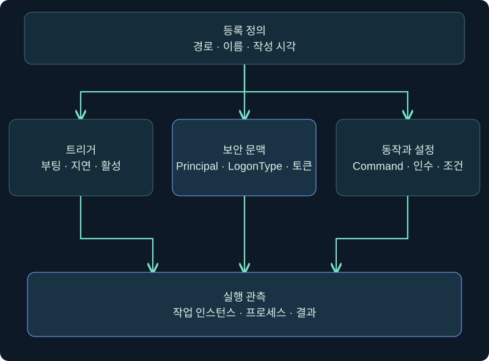
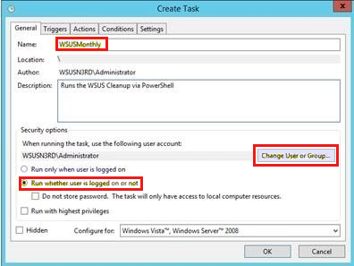
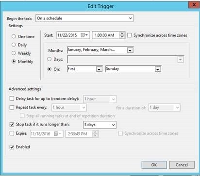
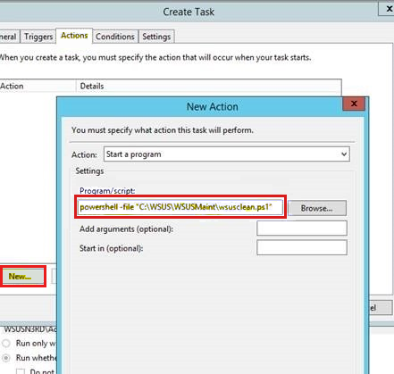
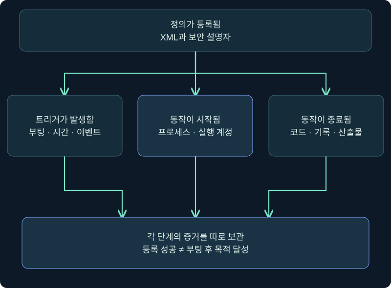
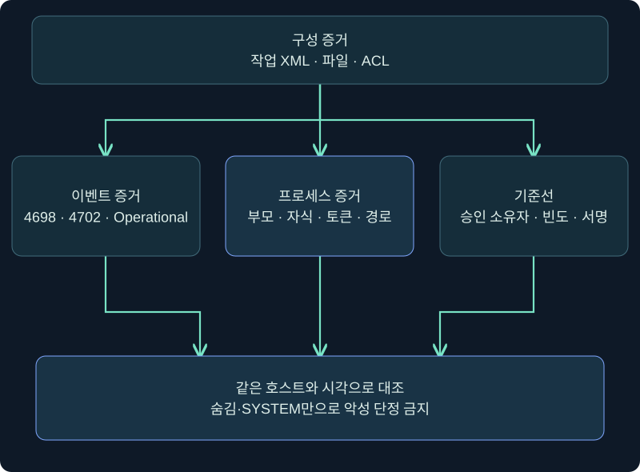

## 1. 같은 예약 작업도 실행 계정이 바뀌면 경계가 달라집니다

6장에서는 현재 사용자 범위의 자동 실행을 배웠습니다. 이번에는 이미 승인된 관리자 권한을 가진 운영자가 **부팅 때 SYSTEM으로 실행되도록 정의된 작업**을 조사하는 상황을 다룹니다. 작업 스케줄러 기능 자체는 업데이트·백업·장비 관리에 널리 쓰입니다. 따라서 SYSTEM, 부팅, Hidden 중 한 단어만으로 악성을 판정하지 않습니다.

핵심은 **누가 정의를 바꿀 수 있는가 → 어떤 트리거가 발생하는가 → 어떤 Principal과 토큰으로 → 어떤 Command가 실제 시작되는가**입니다. 등록 성공, 트리거 발생, 프로세스 시작, 목적 달성은 서로 다른 상태입니다.

이 강의의 `\Training\BootInventory`는 격리 VM을 설명하기 위한 가상 이름입니다. 작업 생성·XML 가져오기·부팅·SYSTEM 프로세스 실행은 수행하지 않았습니다. 공격용 실행 파일이나 실제 자격 증명도 만들지 않습니다.



## 2. XML은 네 묶음으로 읽습니다

| XML 영역 | 질문 | 주의할 점 |
|---|---|---|
| Triggers | 언제 시작되는가? | BootTrigger 등록과 실제 부팅 발생은 다름 |
| Principals | 어떤 보안 문맥인가? | UserId·LogonType·RunLevel을 함께 읽음 |
| Actions | 무엇을 실행하는가? | Command·Arguments·WorkingDirectory 분리 |
| Settings | 어떤 제한과 재시도인가? | Enabled·Hidden·중복·전원·시간 제한 구별 |

Microsoft 스키마에서 `BootTrigger`는 시스템이 부팅될 때 시작하는 트리거이며 선택적으로 지연을 둘 수 있습니다. `Principal`은 작업의 보안 자격을 정의합니다. LocalSystem으로 등록된 작업에서는 `RunLevel` 값만 보고 더 높은 권한이 추가된다고 해석하지 않습니다. Microsoft는 LocalSystem·LocalService 등에서는 그 속성이 무시된다고 설명합니다.

XML의 요소 순서와 네임스페이스도 스키마의 일부입니다. 일부 요소가 없으면 기본값이 적용될 수 있으므로 빈칸의 뜻을 임의로 만들지 않습니다. 이름이 같은 작업도 폴더 경로가 다르면 다른 객체입니다.

## 3. 실제 General 화면에서 실행 계정 위치 찾기

### 실제 화면 69: General의 이름·실행 계정·권한 위치



출처: [Microsoft WSUS 유지관리 안내](https://learn.microsoft.com/en-us/troubleshoot/mem/configmgr/update-management/wsus-maintenance-guide). 이 과거 Windows Server 화면은 정상 유지관리 작업 예이며 이번 가상 작업이나 SYSTEM 설정 결과가 아닙니다.

1. 승인된 VM에서 **Task Scheduler → Task Scheduler Library**를 엽니다. 기존 항목 조사는 선택 후 **Properties**로 읽고 저장하지 않습니다.
2. General에서 작업의 전체 폴더 경로·Name·Author를 기록합니다. Author는 문자열이므로 신뢰의 증명이 아닙니다.
3. Security options의 **When running the task, use the following user account**에서 실행 주체를 읽습니다. SYSTEM이라면 사용자 로그인과 독립적으로 동작할 수 있지만 구성 전체를 더 확인합니다.
4. **Run whether user is logged on or not**, **Run with highest privileges**, **Hidden** 상태를 각각 기록합니다. 세 항목은 같은 의미가 아닙니다.
5. 조사 목적이면 **Cancel**로 닫습니다. Change User or Group, OK, Apply를 누르거나 암호를 입력하지 않습니다.

실제 설치 버전에서 SYSTEM 작업을 새로 만드는 사진은 확보하지 못했습니다. 위 화면의 위치를 읽는 안내와 Microsoft 스키마 설명을 결합했으며, 가상값을 사진에 합성하지 않았습니다.

## 4. 실제 Trigger·Action 화면에서 부팅과 프로그램을 나눕니다

### 실제 화면 70: Trigger 입력 위치



이 사진의 실제 선택은 월간 일정입니다. **At startup/BootTrigger 사진이 아닙니다.** 조사자는 Begin the task가 **At startup**인지, Delay와 Enabled가 어떤지 같은 위치에서 읽습니다. 목록에 At startup이 보여도 부팅 시각과 작업 인스턴스 로그가 없으면 실제 발생을 단정하지 않습니다.

### 실제 화면 71: Action의 프로그램·인수·시작 폴더 위치



공식 사진에는 과거 유지관리용 PowerShell 문자열이 들어 있으며 강의 예시값이 아닙니다. **Actions → 항목 선택 → Edit**에서 Program/script, Add arguments, Start in을 별도 필드로 기록합니다. 실행 파일 경로의 따옴표, 인수의 경계, 상대 경로와 작업 폴더를 구별합니다. 기존 항목을 조사할 때는 값을 고치지 않고 Cancel로 닫습니다.

## 5. Cobalt Strike 실제 콘솔에서는 조회 위치부터 확인합니다

### 실제 화면 72: Beacon Console의 입력 줄과 반환 영역


출처: [Fortra Consoles](https://hstechdocs.helpsystems.com/manuals/cobaltstrike/current/userguide/content/topics/ui_consoles.htm). 사진 속 출력은 제작사 예시이며 아래 조회 결과가 아닙니다. 현행 4.13 문서와 설치 버전의 도움말이 다를 수 있습니다.

1. 승인된 격리 VM의 단일 세션을 선택 → 우클릭 → **Interact**를 엽니다.
2. 상태 표시에서 호스트·사용자·PID를 확인하고 하단 입력 칸에 `help run`을 입력합니다. Enter가 실행 버튼 역할을 하며 별도 저장 버튼은 없습니다.
3. 읽기 전용 조회를 설명하는 미실행 예시는 다음과 같습니다. 작업 전체 경로는 따옴표로 묶습니다.

```text
help run
run schtasks.exe /query /tn "\Training\BootInventory" /xml
run schtasks.exe /query /tn "\Training\BootInventory" /fo LIST /v
```

4. 위쪽에서 작업 요청과 반환 출력을 구별하고 시각을 기록합니다. `run`은 대상에 프로세스를 만들 수 있으므로 조회라고 영향이 0은 아닙니다.
5. 부재·접근 거부·시간 초과를 빈 성공으로 바꾸지 않습니다. 과거 자료의 확장 등록 명령이 보이지 않는다고 임의 확장을 로드하거나 등록을 시도하지 않습니다.

원본 범위의 등록 기능은 개념과 증거로 설명합니다. 공격용 XML 업로드·작업 생성·SYSTEM 실행은 교육 범위를 넘어 실제로 수행하지 않았고 실행 가능한 등록 명령도 제공하지 않습니다.

## 6. 등록·발생·시작·완료를 따로 검증합니다



| 상태 | 최소 증거 | 아직 보장하지 않는 것 |
|---|---|---|
| 정의 등록 | XML 조회·작업 경로·등록 시각 | 트리거 발생 |
| 트리거 발생 | Operational 이벤트·부팅 시각 | Action 시작 |
| Action 시작 | 프로세스 생성·계정·명령줄 | 정상 종료 |
| 종료 | 작업 결과·프로세스 종료 | 업무 목적·장기 지속성 |

`Ready`는 등록돼 대기 중인 상태일 수 있습니다. `Running`은 동작 인스턴스가 살아 있다는 뜻이지 성공이 아닙니다. Last Run Result의 `0x0`도 그 인스턴스가 반환한 코드이며 파일 생성·통신·업무 산출물까지 자동으로 검증하지 않습니다.

부팅 트리거는 수동 **Run**으로 대신 검증할 수 없습니다. 수동 실행은 Action 경로의 한 시험일 뿐입니다. 재부팅은 큰 상태 변경이므로 승인된 유지보수 창과 복구 계획 없이 조사 목적으로 수행하지 않습니다.

## 7. 구성 증거와 실행 증거를 결합합니다

Windows Security 4698은 감사가 구성된 환경에서 예약 작업 생성의 중요한 근거가 될 수 있고 4702는 변경을 나타냅니다. TaskScheduler Operational 로그와 프로세스 생성, 파일·레지스트리 관측을 같은 호스트·시각으로 연결합니다. 로그가 꺼져 있었거나 보존 기간 밖이면 부재를 미실행 증명으로 쓰지 않습니다.



정상 기준선에는 승인 소유자, 배포 도구, 서명된 프로그램 경로, 예상 빈도와 변경 창이 포함됩니다. SYSTEM·Hidden·부팅이라는 특성은 우선 검토 신호일 수 있지만 운영 제품도 사용할 수 있습니다. 반대로 친숙한 이름과 Microsoft 같은 Author 문자열도 안전을 보장하지 않습니다.

## 8. 조건을 바꾸어 판정합니다

| 가상 사례 | 확인한 사실 | 판정 |
|---|---|---|
| A | 승인 배포 기록, 보호된 서명 경로, 예상 부팅 후 실행 | 정상 후보, 실행·소유자 대조 유지 |
| B | SYSTEM·부팅, 사용자 쓰기 가능 경로, 최근 미승인 변경 | 높은 우선순위 조사 |
| C | XML 존재, Operational 로그 미수집 | 등록은 확인, 실행은 불명 |
| D | 수동 Run 성공, 부팅 후 기록 없음 | Action 일부만 확인, 부팅 지속성 미확인 |

B도 실제 파일을 교체하거나 작업을 실행해 입증하지 않습니다. 정의·ACL·해시·서명·배포 기록·프로세스 계보를 보존하고 승인된 대응 절차로 격리·비활성화 여부를 결정합니다. C에서는 “로그가 없으니 실행 안 됨”이 아니라 “관측 범위 밖”이라고 씁니다.

## 9. 보고와 안전한 정리

보고서에는 호스트, 작업 전체 경로, 등록·변경 시각, Principal, 트리거, Action 원문, Settings, ACL, 실행 이벤트, 프로세스와 해시, 수집 한계를 구분합니다. 스크린샷만 두지 말고 XML 원본의 해시와 수집 방법을 함께 보관합니다.

악성 또는 불필요한 작업으로 확인돼도 삭제가 첫 단계는 아닙니다. 증거 보존, 소유 팀 확인, 영향 분석, 승인된 비활성화, 관련 파일 처리, 재부팅 전후 검증 순서를 정합니다. 작업 정의 삭제와 이미 실행 중인 프로세스 종료는 별개입니다. 이 강의에서는 어느 것도 수행하지 않았습니다.

## 10. 복습과 즉시 해설

### 복습 1. SYSTEM과 Hidden이면 악성인가요?

**해설:** 아닙니다. 정상 관리 작업도 사용할 수 있습니다. 소유자·경로·변경 기록·실행 계보와 기준선을 결합합니다.

### 복습 2. BootTrigger가 있으면 부팅 후 실행됐나요?

**해설:** 정의된 조건입니다. 부팅 시각, 작업 이벤트와 프로세스 증거가 추가로 필요합니다.

### 복습 3. LocalSystem 작업에서 RunLevel만 보면 되나요?

**해설:** 아닙니다. Principal 전체와 실제 토큰을 확인합니다. Microsoft는 LocalSystem 등에서 RunLevel이 무시될 수 있음을 설명합니다.

### 복습 4. 수동 Run 성공은 부팅 지속성 검증인가요?

**해설:** Action 경로의 일부 시험일 뿐 BootTrigger 발생을 검증하지 않습니다.

### 복습 5. Ready는 실행 성공인가요?

**해설:** 등록돼 대기 중일 수 있습니다. 인스턴스·프로세스·결과를 별도로 봅니다.

### 복습 6. Beacon의 조회는 대상 영향이 전혀 없나요?

**해설:** `run`은 조회 프로그램을 대상에서 시작할 수 있습니다. 읽기 전용 목적과 시스템 영향은 다른 질문입니다.

### 복습 7. 로그가 비어 있으면 실행되지 않았나요?

**해설:** 수집 비활성·보존 만료·권한·잘못된 경로 가능성이 있어 부재를 단정하지 않습니다.

### 복습 8. 작업 삭제로 실행 중 프로세스도 끝나나요?

**해설:** 정의와 현재 프로세스의 생명주기는 별개입니다. 승인된 대응 계획에서 각각 처리합니다.

## 11. 공식 근거와 적용 범위

확인일: **2026-11-05**. 실제 제품 사진 4회를 배치했으며 부팅·SYSTEM으로 설정된 완성 화면과 실제 실행 결과 사진은 확보하지 못했습니다. Windows·Cobalt Strike·작업 생성·부팅·보호 기능 변경은 미수행입니다.

- [Microsoft Task Scheduler Schema](https://learn.microsoft.com/en-us/windows/desktop/taskschd/task-scheduler-schema)
- [Microsoft BootTrigger](https://learn.microsoft.com/en-us/windows/win32/taskschd/taskschedulerschema-boottrigger-triggergroup-element)
- [Microsoft Principal](https://learn.microsoft.com/en-us/windows/win32/taskschd/taskschedulerschema-principal-principaltype-element)
- [Microsoft RunLevel](https://learn.microsoft.com/en-us/windows/win32/taskschd/taskschedulerschema-runlevel-principaltype-element)
- [Microsoft schtasks query](https://learn.microsoft.com/en-us/windows-server/administration/windows-commands/schtasks-query)
- [MITRE ATT&CK T1053.005](https://attack.mitre.org/techniques/T1053/005/)
- [Fortra Consoles](https://hstechdocs.helpsystems.com/manuals/cobaltstrike/current/userguide/content/topics/ui_consoles.htm)
- [Fortra Running Commands](https://hstechdocs.helpsystems.com/manuals/cobaltstrike/current/userguide/content/topics/post-exploitation_running-commands.htm)
