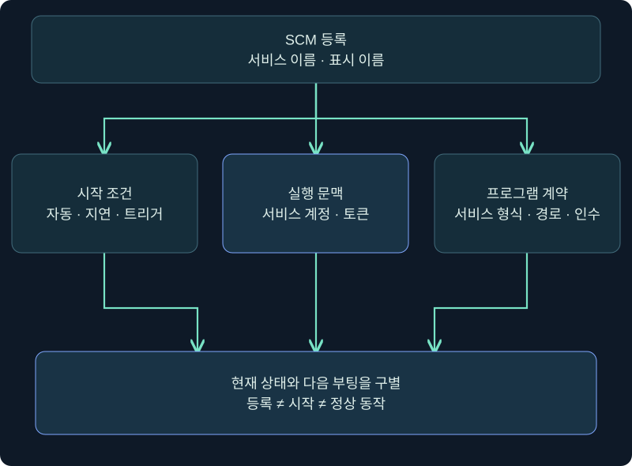
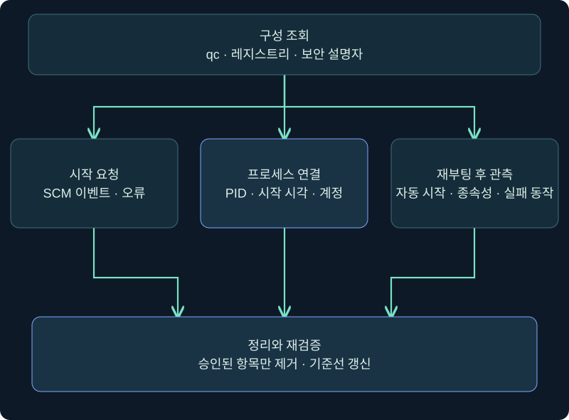
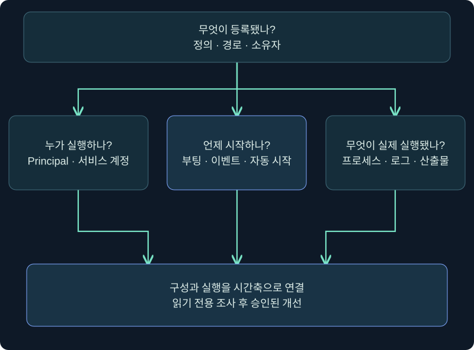

## 1. 서비스 등록과 서비스 실행은 같은 사건이 아닙니다

Windows 서비스는 Service Control Manager(SCM)가 관리하는 백그라운드 실행 단위입니다. 자동 시작과 LocalSystem 계정을 결합하면 부팅 뒤 높은 문맥을 유지할 수 있지만, 백업·보안·장치 관리 제품도 같은 구조를 사용합니다. 따라서 새 서비스라는 이유만으로 악성이라 하지 않고 **등록 구성, 시작 조건, 서비스 프로그램 계약, 실제 프로세스**를 연결합니다.

앞 장에서는 약한 서비스 권한이 상승 경로가 되는 조건을 다뤘습니다. 이번 강의는 이미 높은 권한이 확보된 뒤 새 서비스가 지속성에 악용될 수 있다는 방어 관점입니다. `TrainingTelemetry`는 가상의 조사 이름이며 서비스 생성·시작·재부팅·실행 파일 배치·보호 기능 변경은 수행하지 않습니다.



## 2. 서비스의 여섯 필드를 먼저 고정합니다

| 필드 | 가상값 | 해석 |
|---|---|---|
| Service name | TrainingTelemetry | SCM API와 조회의 식별 키 |
| Display name | Training Telemetry | 사람이 보는 표시 문자열 |
| Binary path | C:\Lab\TrainingOnly\telemetry-service.exe | 실행 파일과 인수를 분리해 읽음 |
| Start type | Automatic | 다음 시작 조건, 현재 실행 상태와 다름 |
| Service account | LocalSystem | 구성된 실행 문맥, 현재 토큰은 별도 확인 |
| State / PID | 조회 시점 값 | 현재 인스턴스, 다음 부팅을 보장하지 않음 |

표시 이름을 서비스 이름 대신 조회에 넣지 않습니다. `Automatic`이어도 종속성·지연·트리거·실패·정책 때문에 기대와 다를 수 있습니다. `STOPPED`는 현재 시점 상태이며 다음 부팅 동작이나 과거 실행을 모두 설명하지 않습니다.

실행 파일도 일반 콘솔 프로그램과 같은 계약이라고 가정하지 않습니다. 서비스는 SCM과 상태를 교환하는 서비스 프로그램 구조를 필요로 하며, 단순 실행 파일은 시작 뒤 즉시 종료되거나 시간 초과가 날 수 있습니다. 파일이 존재하거나 등록이 성공했다는 사실만으로 정상 서비스 실행을 주장하지 않습니다.

## 3. 실제 Cobalt Strike 콘솔에서 조회 경로를 확인합니다

### 실제 화면 73: 서비스 조사 명령의 입력 위치


출처: [Fortra Consoles](https://hstechdocs.helpsystems.com/manuals/cobaltstrike/current/userguide/content/topics/ui_consoles.htm). 사진의 출력은 본 강의 결과가 아니며, 설치 버전·확장에 따라 명령이 다를 수 있습니다.

1. Sessions에서 승인된 격리 VM 한 행 → 우클릭 → **Interact**를 선택합니다. 호스트·사용자·PID가 계획과 같은지 확인합니다.
2. 하단 입력 칸에 `help run`을 입력하고 Enter를 누릅니다. 서비스 전용 확장 명령이 있다면 먼저 해당 `help`를 읽되 미확인 인자를 추측하지 않습니다.
3. 다음은 Windows 기본 도구를 통한 **미실행 읽기 전용 예시**입니다.

```text
help run
run sc.exe query TrainingTelemetry
run sc.exe qc TrainingTelemetry
run sc.exe qdescription TrainingTelemetry
run sc.exe sdshow TrainingTelemetry
```

4. `query`는 현재 상태, `qc`는 구성, `qdescription`은 설명 문자열, `sdshow`는 서비스 객체 보안 설명자를 묻습니다. 각 요청의 반환과 오류 시각을 위쪽에서 기록합니다.
5. 결과가 없으면 `execute`처럼 출력 계약이 다른 명령인지, 서비스 이름인지, 권한과 응답 지연을 확인합니다. 입력 줄이 비워진 사실을 성공으로 쓰지 않습니다.

원본 범위의 서비스 생성 기능은 필드 의미와 탐지 증거로만 설명합니다. 공격용 서비스 바이너리 업로드, 이름 위장, 자동 시작 등록과 실행 명령은 제공하거나 수행하지 않습니다.

## 4. Services 관리 화면은 읽고 Cancel로 닫습니다

공개 공식 자료에서 이 강의 가상값이 들어간 최신 `services.msc` 속성 사진은 확보하지 못했습니다. 앞의 콘솔 사진을 Services 화면이라고 설명하거나 합성하지 않습니다. 다음은 승인된 로컬 VM에서의 **미실행 메뉴 안내**입니다.

1. 실행 창 → `services.msc` → 표시 이름을 선택 → **Properties**를 엽니다.
2. General에서 **Service name, Path to executable, Startup type, Service status**를 기록합니다. Start·Stop·Pause를 누르지 않습니다.
3. Log On에서 계정 종류만 읽습니다. 암호 칸을 클릭하거나 값을 입력하지 않습니다.
4. Recovery와 Dependencies에서 실패 후 동작과 종속성을 읽습니다. 재시작 프로그램이나 동작을 추가하지 않습니다.
5. 조사 목적이면 **Cancel**로 닫습니다. Apply와 OK로 변경을 저장하지 않습니다.

GUI 목록에 보이는 것, 속성을 조회할 수 있는 것, 구성을 변경할 수 있는 것은 서로 다른 권한입니다. GUI와 명령줄 결과의 수집 시각이 다르면 하나의 스냅샷으로 합치지 않습니다.

## 5. 등록·시작·프로세스·재부팅을 단계별로 검증합니다



| 단계 | 확인할 증거 | 흔한 오판 |
|---|---|---|
| SCM 등록 | 서비스 키·qc·보안 설명자 | 등록 성공을 실행 성공으로 표시 |
| 시작 요청 | SCM 이벤트·오류 코드 | 요청 수락을 정상 기능으로 표시 |
| 프로세스 실행 | PID·부모·토큰·경로·해시 | 같은 이름 프로세스를 연결 |
| 자동 시작 | 재부팅 시각·이벤트·새 PID | 수동 시작으로 자동 시작 검증 |
| 지속 동작 | 상태 변화·서비스 로그·산출물 | RUNNING을 업무 목적 성공으로 표시 |

`sc.exe qc`의 `START_TYPE`은 구성입니다. `query`의 `STATE`는 현재 상태입니다. START_PENDING이 오래 지속되거나 STOPPED로 돌아오면 Windows 이벤트와 서비스 자체 로그를 연결합니다. 오류 1053처럼 서비스 제어 요청에 적시에 응답하지 못하는 경우도 있어 단순 파일 실행 성공과 구별합니다.

실제 재부팅은 서비스 가용성에 영향을 주므로 읽기 전용 조사 단계에서 수행하지 않습니다. 조직이 승인한 유지보수 창에서 검증한다면 부팅 전 구성과 부팅 후 프로세스·토큰·시작 시각을 같은 사례 ID로 연결합니다.

## 6. 계정·자동 시작·경로를 함께 해석합니다

LocalSystem은 SCM이 사용하는 강한 로컬 계정이며 네트워크 접근 때 컴퓨터 계정 문맥이 관여할 수 있습니다. LocalService·NetworkService·가상 계정·관리 서비스 계정은 서로 다른 권한과 관리 모델입니다. “SYSTEM보다 낮으니 안전” 또는 “도메인 계정이니 더 강함”처럼 한 줄로 순위를 만들지 않습니다.

서비스 계정은 필요한 최소 권한과 자원 접근을 기준으로 선택합니다. 암호가 만료되거나 서비스 로그온 권한·자원 ACL이 바뀌면 시작이 실패할 수 있습니다. 반대로 불필요한 LocalSystem은 침해 시 영향 범위를 키웁니다. 구성상 계정과 실제 프로세스 토큰을 모두 확인합니다.

Binary path에 공백과 인수가 섞였으면 8장에서 배운 따옴표·호출 방식·파일 및 부모 폴더 ACL을 다시 적용합니다. 그러나 공백 하나만으로 악용 성공을 선언하지 않습니다. 실행 파일의 서명·해시·소유자·설치 기록과 SCM 설정의 변경 주체를 묶습니다.

## 7. 이벤트와 레지스트리·프로세스 증거를 연결합니다

Security 4697은 감사 구성과 OS 조건 아래 서비스 설치를 관찰하는 근거가 될 수 있습니다. System 로그의 Service Control Manager 이벤트, `HKLM\SYSTEM\CurrentControlSet\Services` 변경, 프로세스 생성과 이미지 로드를 같은 시각에 연결합니다. Sysmon이나 EDR이 수집되지 않았다면 부재를 프로세스 미실행으로 바꾸지 않습니다.

MITRE의 최신 Windows Service 탐지 전략은 서비스 생성·변경, 프로세스, 레지스트리 변경과 비정상 경로·계보의 상관을 강조합니다. 새 이름 자체보다 평소 승인된 배포 도구, 서명 경로, 변경 창, 서비스 계정과의 차이가 중요합니다.



등록 도구가 `sc.exe`가 아니어도 Windows API나 관리 제품을 통해 같은 결과가 생길 수 있습니다. 명령줄 한 종류만 찾지 말고 결과 객체와 이벤트를 조사합니다. 반대로 `sc.exe query` 실행은 조회일 수 있으므로 도구 이름만으로 생성이라고 판정하지 않습니다.

## 8. 예약 작업과 서비스를 비교합니다

| 비교 기준 | SYSTEM 예약 작업 | 자동 시작 서비스 |
|---|---|---|
| 관리자 객체 | Task Scheduler 작업 | SCM 서비스 |
| 시작 조건 | 부팅·로그온·시간·이벤트 등 | 자동·지연·트리거·요청 |
| 실행 계약 | Action 프로그램 | 서비스 프로그램과 SCM 통신 |
| 주요 구성 | XML·TaskCache·파일 | 서비스 DB·Services 키 |
| 현재 상태 | Ready·Running·Last Result | STOPPED·PENDING·RUNNING |
| 공통 검증 | 계정·경로·ACL·이벤트·프로세스 | 계정·경로·ACL·이벤트·프로세스 |

두 기법 모두 부팅 지속성을 만들 수 있지만 정의 형식과 실행 계약이 다릅니다. 일반 콘솔 프로그램이 예약 작업에서 실행될 수 있다고 서비스 프로그램으로도 정상 동작하는 것은 아닙니다. 하나의 기법을 제거해도 다른 등록 위치가 남을 수 있으므로 사건 범위에서 함께 확인합니다.

## 9. 조건 변경 사례와 대응 순서

사례 A는 승인된 보안 에이전트 서비스가 서명된 보호 경로에서 LocalSystem으로 자동 시작하고 변경 기록과 배포자가 일치합니다. 높은 계정만으로 경보를 닫지 말되 정상 기준선 후보입니다. 사례 B는 최근 생성된 자동 시작 서비스가 사용자 쓰기 가능 임시 경로를 가리키고 승인 소유자가 없습니다. 높은 우선순위로 보존·격리 판단을 진행합니다.

사례 C는 서비스가 등록됐지만 시작 시 1053 오류로 종료됩니다. 등록에 따른 지속성 **시도**는 조사할 수 있지만 성공적인 장기 실행은 입증되지 않았습니다. 사례 D는 현재 RUNNING이지만 Start type이 Manual입니다. 현재 프로세스와 다음 부팅 자동 시작은 별도 결론입니다.

대응은 증거 보존 → 소유 팀·배포 기록 확인 → 영향과 종속성 분석 → 승인된 중지·비활성화 또는 격리 → 관련 파일과 계정 처리 → 재부팅 전후 재검증 순서로 계획합니다. 중요한 서비스를 즉시 삭제하면 가용성과 증거가 모두 손상될 수 있습니다. 이 강의에서는 조치하지 않았습니다.

## 10. 복습과 즉시 해설

### 복습 1. 서비스 생성 성공 메시지는 실행 성공인가요?

**해설:** SCM 등록 성공입니다. 시작 요청, 프로세스, 계정, 지속 동작과 재부팅을 따로 확인합니다.

### 복습 2. AUTO_START인데 현재 STOPPED면 모순인가요?

**해설:** 아닙니다. 자동 시작은 구성이고 STOPPED는 현재 상태입니다. 실패·종속성·수동 중지 등 이유를 조사합니다.

### 복습 3. Display name으로 qc를 조회하면 되나요?

**해설:** 서비스 이름이라는 SCM 식별 키를 사용합니다. 표시 문자열과 다를 수 있습니다.

### 복습 4. 일반 EXE도 서비스로 등록하면 정상 실행되나요?

**해설:** 서비스 프로그램은 SCM과 통신하는 계약이 필요합니다. 파일 존재와 정상 서비스 실행은 다릅니다.

### 복습 5. LocalSystem이면 악성인가요?

**해설:** 많은 정상 핵심 서비스가 사용합니다. 필요성·소유자·경로·변경과 실행 증거를 대조합니다.

### 복습 6. sc.exe가 보이면 서비스 생성인가요?

**해설:** query·qc 같은 조회도 있습니다. 전체 인자와 결과 객체·이벤트를 확인합니다.

### 복습 7. 현재 RUNNING이면 다음 부팅도 실행되나요?

**해설:** 현재 인스턴스의 상태입니다. Start type, 부팅 이벤트와 새 인스턴스를 별도로 검증합니다.

### 복습 8. 서비스 삭제로 관련 프로세스와 파일도 모두 사라지나요?

**해설:** SCM 정의, 실행 중 프로세스와 디스크 파일은 별도 생명주기입니다. 승인된 정리에서 각각 확인합니다.

## 11. 공식 근거·실습 범위와 장 마무리

확인일: **2026-11-05**. 실제 Cobalt Strike 콘솔을 사용해 입력·반환 위치를 설명했으며 최신 Services 속성, 서비스 생성 대화상자와 실행 결과 사진은 확보하지 못했습니다. Windows·제품·서비스 생성·시작·재부팅·계정 변경은 미수행입니다.

- [Microsoft About Services](https://learn.microsoft.com/en-us/windows/win32/services/about-services)
- [Microsoft Service User Accounts](https://learn.microsoft.com/en-us/windows/win32/services/service-user-accounts)
- [Microsoft LocalSystem Account](https://learn.microsoft.com/en-us/windows/win32/services/localsystem-account)
- [Microsoft Configuring a Service Using SC](https://learn.microsoft.com/en-us/windows/win32/services/configuring-a-service-using-sc)
- [Microsoft sc.exe query](https://learn.microsoft.com/en-us/windows-server/administration/windows-commands/sc-query)
- [MITRE ATT&CK T1543.003](https://attack.mitre.org/techniques/T1543/003/)
- [MITRE DET0552](https://attack.mitre.org/detectionstrategies/DET0552/)
- [Fortra Consoles](https://hstechdocs.helpsystems.com/manuals/cobaltstrike/current/userguide/content/topics/ui_consoles.htm)
- [Fortra Running Commands](https://hstechdocs.helpsystems.com/manuals/cobaltstrike/current/userguide/content/topics/post-exploitation_running-commands.htm)

9장은 여기서 끝납니다. 두 강의 모두 높은 권한의 등록 수단을 실행 절차가 아니라 구성·이벤트·프로세스 증거의 연결로 다뤘습니다. 다음 장은 원본 전체 범위를 새로 읽고 상세 분할한 뒤 이어갑니다.
