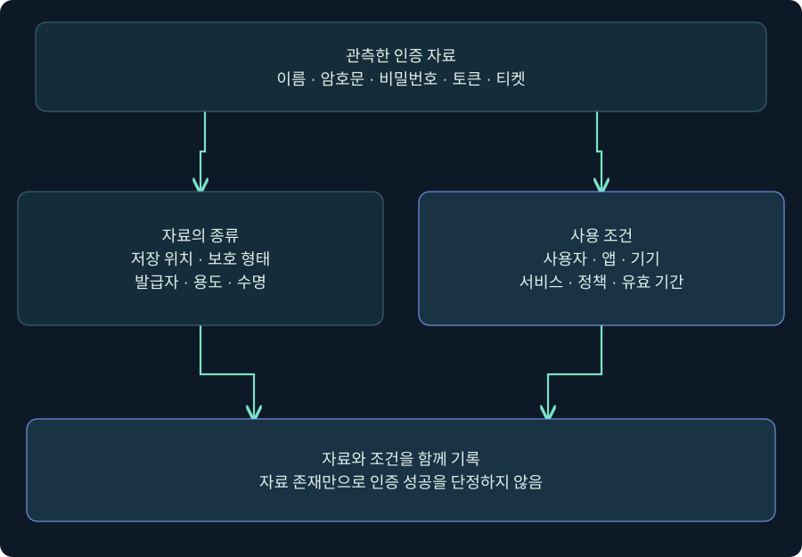
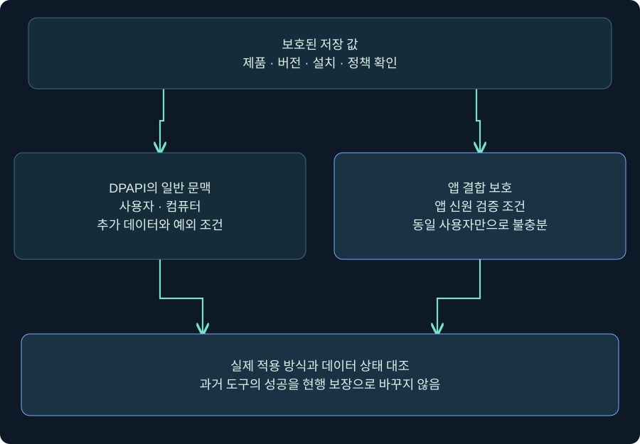
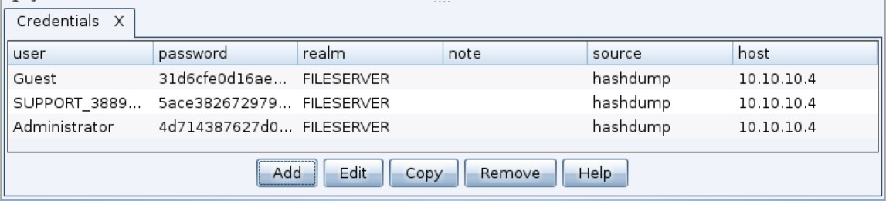
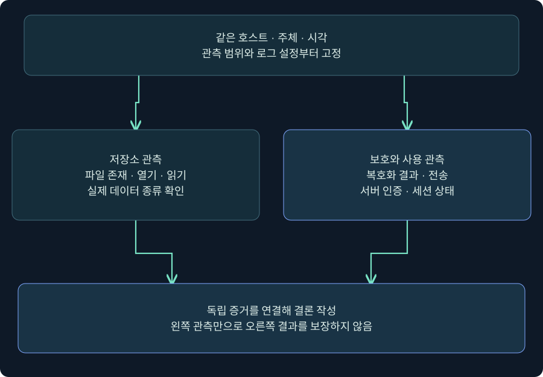
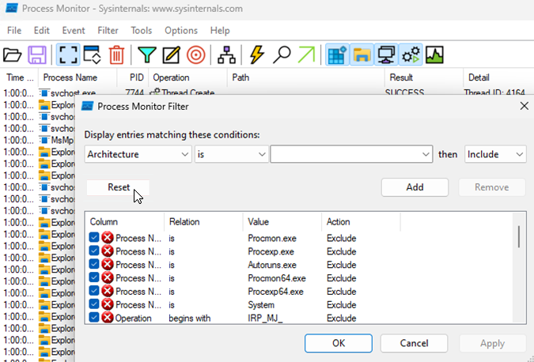

## 1. 로그인에 쓸 수 있는 자료는 모두 같은 비밀번호가 아닙니다

로그인 화면에 비밀번호를 입력하지 않았는데 웹사이트가 열렸다면 무엇이 사용됐을까요? 저장된 비밀번호의 자동 완성, 이미 발급된 세션 쿠키, 조직의 통합 인증, 패스키 등 여러 가능성이 있습니다. 겉으로 보이는 결과가 같아도 저장 위치·수명·보호 방법과 대응 방법은 다릅니다. Credential Access는 이런 인증 자료를 얻으려는 활동을 다루는 전술입니다. 이 장에서는 먼저 **자료의 종류 → 보호 경계 → 접근 행위 → 실제 사용**을 나눠 읽습니다.

이번 강의의 `LAB-WS01`, `student01`, `training.example`은 가상 이름입니다. 실제 브라우저 저장소·사용자 비밀번호·쿠키를 읽거나 복호화하지 않았습니다. 공식 사진은 제품의 입력 위치를 설명하기 위한 자료이며 본 강의 실행 결과가 아닙니다.



그림의 왼쪽은 무엇을 갖고 있는지, 오른쪽은 어디에서 어떤 조건으로 사용할 수 있는지를 묻습니다. 가운데 관계를 생략하면 해시를 비밀번호로, 쿠키를 영구 계정 권한으로 잘못 설명하게 됩니다. 맨 아래 결론에는 확인한 자료의 종류와 남아 있는 검증을 함께 적습니다.

## 2. 여섯 종류의 인증 자료를 구분합니다

| 종류 | 역할 | 보고서에서 조심할 점 |
|---|---|---|
| 사용자 이름·사이트 주소 | 계정과 서비스의 식별 정보 | 이름만으로 인증할 수 없음 |
| 비밀번호 | 서버가 확인하는 공유 비밀 | 저장 항목이 있다고 현재 유효한 것은 아님 |
| 암호화된 저장 값 | 보호된 비밀번호·토큰 등의 표현 | 복사와 복호화는 다른 사건 |
| 비밀번호 해시·파생 키 | 검증 또는 특정 인증 절차에 쓰이는 값 | 종류별 의미가 달라 서로 대체할 수 없음 |
| 세션 쿠키·토큰 | 발급된 세션이나 권한을 나타냄 | 비밀번호 변경과 세션 폐기는 별도일 수 있음 |
| Kerberos 티켓 | 특정 주체·서비스·기간의 인증 자료 | TGT와 서비스 티켓·수명·정책을 구별 |

패스키는 이 표의 비밀번호와 같은 공유 문자열이 아닙니다. 공개 키 인증과 사용자 확인, 기기 또는 동기화 제공자의 보호를 따로 봅니다. 이 강의에서 “비밀번호 저장 항목이 없다”는 관측을 “로그인 수단이 없다”로 바꾸지 않는 이유입니다.

이 장의 흐름은 1강 브라우저와 보호 경계, 2강 Windows Credential Manager, 이어서 LSASS·운영체제 저장소·Kerberos 요청·티켓 수명입니다. 각 저장소에서 얻는 결과를 동일한 재사용 자료로 취급하지 않습니다.

## 3. 프로필 경로는 조사 단서이며 복호화 보장이 아닙니다

Windows의 Chromium 계열에서는 사용자 데이터 아래 프로필별 데이터베이스가 중요한 단서가 될 수 있습니다. 설명용 Chrome 경로는 `%LOCALAPPDATA%\Google\Chrome\User Data\Default\Login Data`입니다. 그러나 `Default`만 있는 것은 아닙니다. 다른 프로필·사용자 지정 경로·브라우저 종류·동기화 상태·버전에 따라 실제 위치와 저장 방식이 달라집니다.

조사 시 브라우저 **도움말 → Chrome 정보**에서 버전을, `chrome://version`에서 Profile Path를 확인하는 절차를 먼저 기록합니다. 해당 페이지에는 개인 경로와 명령줄이 보일 수 있으므로 공개 보고서에는 필요한 부분만 남깁니다. 이 주소와 아래 메뉴는 미실행 절차이며 실제 버전 화면 사진은 확보하지 못했습니다.

SQLite 파일의 존재, 테이블 이름, 수정 시각만으로 평문 비밀번호의 존재나 탈취를 증명하지 않습니다. 실행 중인 앱은 잠금·저널·WAL을 사용할 수 있어 파일 하나만 복사한 사본의 일관성도 보장되지 않습니다. 수집이 필요하면 승인된 포렌식 절차와 도구로 일관성·시각·해시를 보존하고, 직접 원본을 편집하거나 보호 설정을 낮추지 않습니다.

## 4. DPAPI와 앱 결합 암호화를 나누어 이해합니다

DPAPI는 애플리케이션이 Windows의 보호 기능을 이용해 데이터를 암호화하고 복원하도록 돕는 API입니다. 일반적인 사용자 범위에서는 같은 로그온 자격과 컴퓨터가 중요한 조건입니다. 다만 컴퓨터 범위 플래그, 로밍과 복구, 선택적 추가 데이터 등 예외·추가 조건이 있으므로 “파일만 있으면 된다”거나 “같은 사용자면 모든 값이 열린다”고 단정하지 않습니다.



위 그림의 두 가지 보호는 단순히 암호 강도가 다른 상자가 아닙니다. 사용자·컴퓨터 문맥에 더해 요청 애플리케이션의 신원을 확인하는 보호가 존재한다는 뜻입니다. Chrome 127의 2024년 발표는 쿠키부터 앱 결합 암호화를 도입한다고 설명했습니다. **확인일 현재 Chromium 공식 FAQ는 Windows의 저장 비밀번호에도 App-Bound encryption을 설명합니다.** 따라서 과거의 DPAPI 도구 예시를 최신 Chrome 전체에 그대로 적용하지 않습니다.

이 설명도 모든 Chromium 계열 제품과 모든 설치에 대한 보장은 아닙니다. 제품·버전·설치 방식·기업 정책·데이터 마이그레이션 상태를 확인합니다. UI에서 비밀번호 표시 전 Windows Hello를 묻는 기능과 디스크 저장 값에 적용되는 앱 결합 암호화도 서로 다른 층입니다. 보호 실패를 재현하려고 정책을 끄거나 브라우저에 코드를 주입하는 절차는 이 강의에서 수행하지 않습니다.

## 5. 브라우저 설정에서 확인할 위치와 값을 연결합니다

Chrome 데스크톱의 공식 안내 경로는 **오른쪽 위 ⋮ → 비밀번호 및 자동 완성 → Google 비밀번호 관리자**입니다. 왼쪽의 **설정**을 열면 저장 제안·자동 로그인·지원되는 환경의 Windows Hello 관련 항목을 확인할 수 있습니다. 설치 버전·언어에 따라 표시가 다를 수 있으며 해당 설정창의 실제 사진은 확보하지 못했습니다. 다음 표는 입력 안내이며 캡처가 아닙니다.

| 확인 위치 | 실습에서 읽을 값 | 이유와 완료 확인 |
|---|---|---|
| 프로필 아이콘·Profile Path | 가상 `student01` 프로필과 일치하는지 | 다른 프로필의 빈 목록과 혼동 방지 |
| 비밀번호 관리자 목록 | 전용 실습 사이트의 항목 유무 | 항목 존재만 기록, 비밀번호 표시·복사 불필요 |
| 설정의 저장 제안 | 현재 켜짐/꺼짐과 정책 관리 표시 | 현재 제안 설정이 과거 저장 항목 삭제를 뜻하지 않음 |
| 자동 로그인 | 현재 상태 | 브라우저 자동 로그인 옵션과 사이트의 서버 세션을 구별 |
| Windows Hello 관련 항목 | 지원 여부와 현재 상태 | 표시·자동 완성 시 사용자 확인 조건을 별도 기록 |

이 강의는 상태 조회가 목적이므로 토글을 바꾸지 않습니다. 변경을 승인받은 별도 실습이라면 변경 전 상태를 먼저 기록하고, 해당 버전의 공식 안내에 따라 설정한 뒤 같은 화면의 표시와 실제 적용 정책을 다시 확인합니다. 메뉴를 닫은 사실이나 버튼을 누른 사실만으로 저장 데이터가 삭제됐다고 쓰지 않습니다.

## 6. Cobalt Strike 실제 화면에서 관측 문맥을 고정합니다

### 실제 화면 74: Beacon Console의 입력 줄과 결과 영역


출처: [Fortra Consoles](https://hstechdocs.helpsystems.com/manuals/cobaltstrike/current/userguide/content/topics/ui_consoles.htm). 공식 사진의 계정·작업은 제작사 예시입니다. 설치 버전의 Help를 우선 확인하며 아래 값은 별도의 가상 실습 안내입니다.

1. **Sessions → 승인된 격리 VM 한 행 → 우클릭 → Interact**를 엽니다. 호스트·사용자·PID·시각을 계획과 대조합니다.
2. 사진 하단 입력 줄에 `help run`을 입력하고 Enter를 누르는 위치를 확인합니다. 콘솔에는 별도의 저장 버튼이 없으며 Enter가 명령 제출 역할을 합니다.
3. 현재 실행 문맥을 읽는 미실행 예시는 다음과 같습니다. 이 명령은 브라우저 비밀을 읽지 않습니다.

```text
help run
run whoami.exe /user
run whoami.exe /groups
```

4. 위쪽 출력에서 SID·그룹 속성·무결성 레이블을 읽습니다. 제출 기록과 실제 반환을 구별하고, 결과가 없으면 지연·오류·출력 계약을 확인합니다.
5. 관리자 그룹 이름이나 Medium 레이블을 브라우저 복호화 성공의 증거로 쓰지 않습니다. 프로세스/스레드 토큰과 사용자 프로필의 관계도 추가 확인 항목입니다.

`run`은 조회용 프로그램이라도 대상에 프로세스를 만들 수 있습니다. 실제 제품·대상 명령은 실행하지 않았으며, 해당 콘솔에 저장소 추출 도구를 올리거나 실행하지 않았습니다.

### 실제 화면 75: Credentials 모델의 열과 관리 버튼



출처: [Fortra Credentials](https://hstechdocs.helpsystems.com/manuals/cobaltstrike/current/userguide/content/topics/data-mgmnt_credentials.htm). 현행 문서에 실린 과거 UI 예시이며 사진의 hashdump 행과 주소는 본 실습 결과가 아닙니다. 화면 아래에는 Add·Edit·Copy·Remove·Help가 보입니다. 현행 문서의 Export 설명과 사진에 보이는 버튼은 구별합니다.

**View → Credentials**를 열면 Team Server의 자격증명 모델을 봅니다. 이 표는 Windows Credential Manager 자체가 아닙니다. `password`라는 열 이름 아래 문자열이 있어도 출처와 자료형을 확인해야 합니다. 모델에 행을 추가하거나 저장한 일은 그 계정의 인증 성공 또는 브라우저 복호화 성공을 뜻하지 않습니다. 다음 강의에서는 이 화면의 가상 기록값과 보관 주의를 더 자세히 연결합니다.

## 7. 파일 접근·복호화·외부 사용은 별도 증거입니다



그림은 앞 단계가 다음 단계를 자동 보장하지 않는다는 관계입니다. 파일 열기 성공은 접근한 사실을, 실제 ReadFile은 읽은 범위를 지지합니다. 그러나 암호화 데이터 읽기만으로 평문 복구·외부 전송·로그인을 모두 증명하지 않습니다. 반대로 하나의 파일 읽기 로그가 없다고 다른 API·프로필·메모리 경로의 가능성이 사라지지도 않습니다.

| 관측 | 지지하는 사실 | 추가로 필요한 것 |
|---|---|---|
| 프로필 DB 존재 | 저장소 후보 존재 | 실제 항목·버전·보호 상태 |
| 비브라우저 프로세스의 읽기 | 해당 경로 접근·읽기 | 정당한 목적·호출 문맥·읽은 범위 |
| 앱 신원 확인 실패 기록 | 해당 보호 검증 실패 | 요청 주체·대상·시각, 다른 시도 여부 |
| 수상한 원격 로그인 | 인증 자료 사용 의심 | 사용자·서비스·기기·세션의 인과 연결 |

Google의 2024년 발표는 Chrome 소스의 Application 이벤트 257을 앱 결합 검증 실패의 단서로 설명합니다. 이것을 모든 버전의 모든 복호화 성공을 기록하는 이벤트로 바꾸지 않습니다. 로그의 채널·공급자·수집 여부·보존 범위를 먼저 확인합니다.

## 8. 실제 ProcMon 필터 화면과 판정을 연결합니다

### 실제 화면 76: ProcMon Filter에서 학습용 경로를 좁히기



출처: [Microsoft Process Monitor](https://learn.microsoft.com/en-us/sysinternals/downloads/procmon). 공식 삽화의 필터는 아래 가상값과 다릅니다. ProcMon은 파일·레지스트리·프로세스 활동을 관측하는 도구이며 이 사진은 비밀번호 획득 결과가 아닙니다.

1. 승인된 분석 VM에서 기존 캡처를 열고 **Filter → Filter**를 선택합니다. 새 캡처를 시작하는 경우에는 대상·시간·보존 위치를 먼저 정합니다.
2. 왼쪽 필드 **Path**, 비교 **contains**, 값 `\User Data\`, 동작 **Include**를 선택하고 **Add**를 누릅니다. 이 값은 프로필이 확인된 가상 Chrome 사례를 넓게 보는 출발점입니다.
3. **Apply/OK** 후 Process Name·PID·시각·Operation·Path·Result·Detail을 읽습니다. 필터 창의 실제 버튼 표기는 버전과 대조합니다. 기존 무관한 Include/Exclude 규칙이 결과를 바꾸는지도 확인합니다.
4. 특정 프로세스로 좁힐 때는 캡처에서 확인한 Process Name 또는 PID를 사용합니다. 브라우저 이름만 Include하면 조사 대상인 다른 프로세스를 놓칠 수 있습니다. 동일 필드의 여러 Include와 서로 다른 필드 조합의 효과를 결과 행에서 확인합니다.
5. 이벤트 속성에서 사용자·프로세스 경로·접근 종류를 확인합니다. `CreateFile SUCCESS`만으로 내용 읽기나 복호화가 확인됐다고 쓰지 않습니다. 필터 제거 후 원래 수집 범위도 대조합니다.

가상 사례 A는 서명된 백업 프로그램이 승인 창에 프로필을 읽은 경우입니다. B는 다운로드 폴더의 미승인 프로그램이 여러 프로필을 읽은 뒤 외부 연결을 만든 경우입니다. B가 더 높은 조사 우선순위지만, 연결의 존재만으로 어느 비밀번호가 유출됐는지는 알 수 없습니다. 수집 정책과 실제 증거 범위 안에서 판단을 유지합니다.

## 9. 대응은 저장소와 세션을 함께 다룹니다

보고서에는 브라우저·정확한 버전·프로필·보호 정책, 접근 프로세스·사용자·시각, 관측 데이터 종류, 서버 인증 기록, 수집 한계를 나눠 씁니다. 실제 비밀 대신 증거 식별자와 접근 통제된 보관 위치를 연결합니다. 화면에 비밀번호를 표시해 확인하는 방식은 필요 최소 수집 원칙에 맞는지 먼저 검토합니다.

침해가 확인되면 악성 프로세스와 단말의 대응, 관련 비밀번호 교체, 세션·토큰 폐기, 계정 로그인 검토를 서비스 특성에 맞춰 계획합니다. 브라우저 저장 항목 삭제만으로 서버 세션이 폐기되거나 복사본이 사라지는 것은 아닙니다. 저장 기능 전체를 무조건 끄는 결론 대신 강한 고유 비밀번호·패스키·MFA·최소 권한·제품 업데이트·기기 보호를 함께 검토합니다. 이 강의에서는 변경이나 폐기를 실행하지 않았습니다.

## 10. 복습과 즉시 해설

### 복습 1. 자동 로그인은 평문 비밀번호 사용의 증거인가요?

**해설:** 아닙니다. 쿠키·토큰·통합 인증·패스키 가능성이 있습니다. 사용한 자료와 서버의 인증 방식을 구별합니다.

### 복습 2. Login Data 파일이 있으면 비밀번호 탈취가 확인됐나요?

**해설:** 저장소 후보의 존재만 확인했습니다. 항목·보호 방식·접근·복호화·사용은 각각 다른 근거가 필요합니다.

### 복습 3. Medium 사용자 문맥이면 최신 Chrome도 항상 복호화되나요?

**해설:** 보장할 수 없습니다. 현재 공식 FAQ의 앱 결합 보호와 제품·버전·설치·정책·마이그레이션 조건을 확인합니다.

### 복습 4. Windows Hello 표시 요구와 앱 결합 암호화는 같은 설정인가요?

**해설:** UI의 사용자 확인과 디스크 자료의 보호 경계는 다른 층입니다. 한쪽 표시로 다른 쪽 적용을 추정하지 않습니다.

### 복습 5. Cobalt Strike Credentials에 행이 있으면 인증 성공인가요?

**해설:** 도구의 데이터 모델에 항목이 있다는 뜻입니다. 자료형·출처·유효성과 서버 인증 결과를 따로 확인합니다.

### 복습 6. ProcMon CreateFile SUCCESS는 내용 복호화 성공인가요?

**해설:** 아닙니다. 핸들 열기와 실제 읽기·복호화·외부 사용은 다릅니다. Operation과 Detail을 함께 읽습니다.

### 복습 7. Chrome 이벤트 257이 없으면 정상인가요?

**해설:** 수집·버전·보존 범위와 이벤트 의미를 먼저 봅니다. 특정 실패 이벤트의 부재는 모든 접근의 부재가 아닙니다.

### 복습 8. 저장 항목을 지우면 이미 발급된 세션도 끝나나요?

**해설:** 서비스별 세션·토큰 폐기를 따로 검토합니다. 로컬 목록 삭제와 서버의 인증 상태는 다른 수명입니다.

## 11. 공식 근거와 적용 범위

확인일: **2026-11-05**. 독립 개념도 3개와 실제 공식 화면 3회를 제공합니다. 실제 Chrome 버전·프로필·비밀번호 관리자 설정 사진은 미확보이며 절차표로 구별했습니다. Windows·Cobalt Strike·ProcMon·브라우저 조회·추출·복호화·인증 시험은 미실행입니다. 과거 제품 사진과 현행 설명, 가상값과 실제 결과를 구별합니다.

- [Microsoft CryptProtectData](https://learn.microsoft.com/en-us/windows/win32/api/dpapi/nf-dpapi-cryptprotectdata)
- [Microsoft CryptUnprotectData](https://learn.microsoft.com/en-us/windows/win32/api/dpapi/nf-dpapi-cryptunprotectdata)
- [Chromium Security FAQ: Passwords and Local Data](https://chromium.googlesource.com/chromium/src/+/HEAD/docs/security/faq.md)
- [Google 2024 App-Bound Encryption 발표](https://security.googleblog.com/2024/07/improving-security-of-chrome-cookies-on.html)
- [Google Chrome 비밀번호 관리 안내](https://support.google.com/chrome/answer/95606?hl=en)
- [Microsoft Process Monitor](https://learn.microsoft.com/en-us/sysinternals/downloads/procmon)
- [MITRE ATT&CK T1555.003](https://attack.mitre.org/techniques/T1555/003/)
- [Fortra Consoles](https://hstechdocs.helpsystems.com/manuals/cobaltstrike/current/userguide/content/topics/ui_consoles.htm)
- [Fortra Credentials](https://hstechdocs.helpsystems.com/manuals/cobaltstrike/current/userguide/content/topics/data-mgmnt_credentials.htm)
