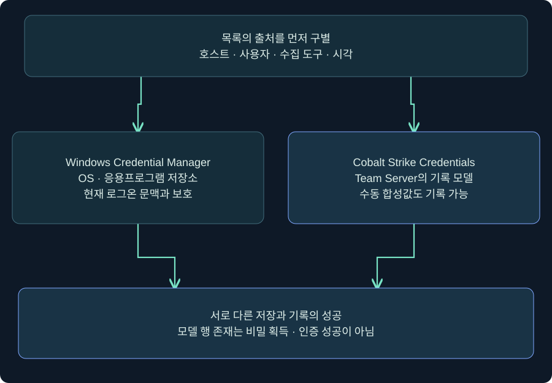
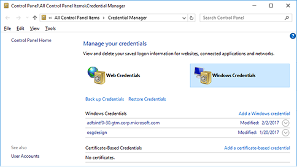
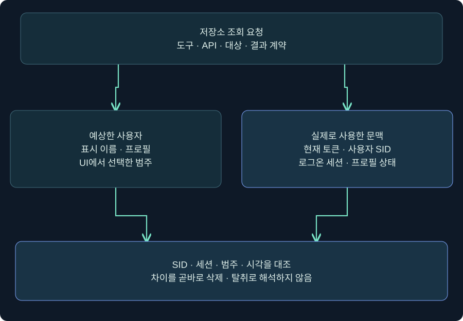
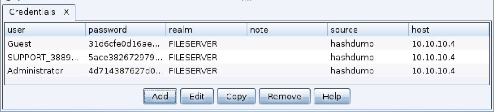
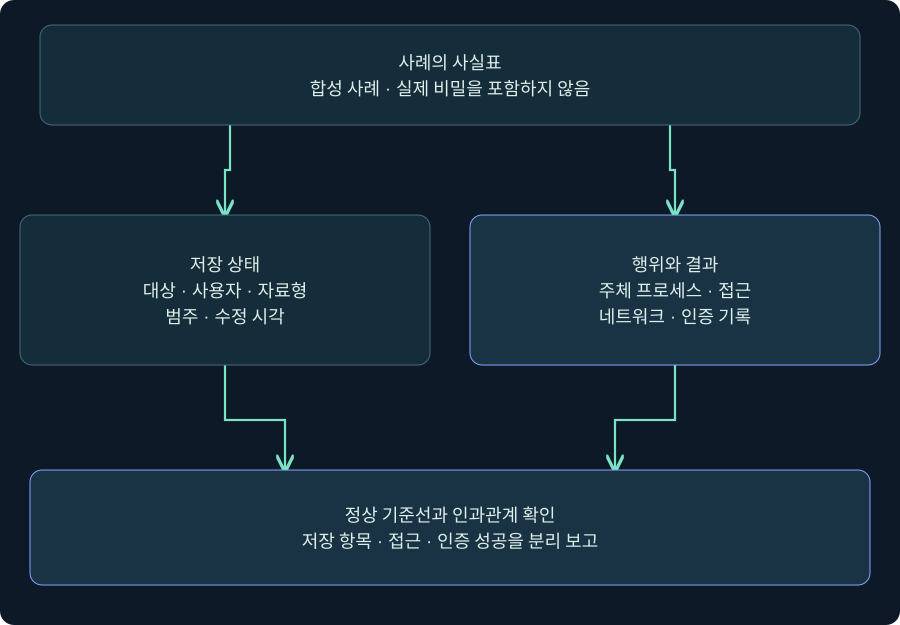

## 1. 저장된 계정 목록과 비밀번호 자체는 다릅니다

원격 데스크톱을 이용할 때마다 계정을 다시 입력하지 않도록 저장해 둔 경험이 있을 것입니다. Windows Credential Manager는 응용프로그램과 네트워크 등의 저장 자격증명을 관리하는 사용자 인터페이스를 제공합니다. 여기서 서버 이름과 계정 이름이 보인다는 사실은 중요한 조사 단서지만 **평문 비밀번호 확인, 현재 인증 유효성, 다른 사용자 저장소 접근**까지 한꺼번에 증명하지는 않습니다.

이번 강의는 UI의 저장 항목, 현재 토큰·로그온 세션, DPAPI와 복구 문맥, Cobalt Strike의 별도 기록 모델을 연결합니다. `LAB-WS01`, `LAB-FS01`, `student01`, `training.example`은 가상 이름입니다. 실제 사용자 비밀·키·블롭을 수집하거나 복호화하지 않았으며 원격 로그인을 시험하지 않았습니다.



그림의 두 상자는 같은 데이터베이스가 아닙니다. Windows 쪽은 운영체제와 앱의 저장·사용 문맥이고, Cobalt Strike 쪽은 작업자가 확인한 자료를 기록하는 도구 모델입니다. 어느 쪽의 목록에 행이 생겼다는 사실도 상대쪽 성공을 자동으로 보장하지 않습니다.

## 2. 실제 Windows 화면에서 어느 항목을 읽을까요?

### 실제 화면 77: Credential Manager의 Web·Windows 선택과 목록



출처: [Microsoft Credential Manager in Windows](https://support.microsoft.com/en-us/windows/security/credential-manager-in-windows). 공식 원본은 과거 Windows UI와 예시 항목을 보여 줍니다. 현재 Windows 10·11 지원 안내와 메뉴를 대조하며 그림 속 서버와 날짜는 이번 실습 값이 아닙니다.

1. Windows 작업 표시줄 검색에 **자격 증명 관리자 / Credential Manager**를 입력하고 **제어판** 항목을 선택합니다. 현재 로그인 사용자와 승인된 격리 VM인지 확인합니다.
2. 상단의 **Windows 자격 증명 / Windows Credentials**를 선택합니다. 그림에서는 오른쪽 파란 영역입니다. Web Credentials와 구별해 선택한 범주를 기록합니다.
3. 승인된 실습 항목 오른쪽의 펼침 화살표를 눌러 대상 주소·사용자 이름·형식·표시되는 지속성 정보를 읽습니다. 본문에 없는 필드가 표시된다고 가정하지 말고 실제 UI를 기준으로 기록합니다.
4. 이 조사에서는 **편집·제거·백업·복원**을 누르지 않습니다. 조회에는 저장 버튼이 필요하지 않습니다. 펼친 항목과 조회 시각, 선택 범주가 기록되면 이 단계의 확인이 끝납니다.

UI가 비어 있으면 우선 사용자·범주·프로필·제품 버전을 확인합니다. 브라우저의 모든 현재 비밀번호가 Web Credentials에 나타나는 것은 아닙니다. 특히 이전 Edge/Internet Explorer 저장 방식의 설명을 현재 Chromium 기반 Edge 전체에 그대로 적용하지 않습니다.

## 3. 대상·자료형·지속성·사용자를 분리해 읽습니다

| 항목 | 가상 관측 | 정확한 의미 |
|---|---|---|
| Target / Resource | `TERMSRV/LAB-WS01` | RDP 관련 대상 식별 단서, 연결 성공 기록은 아님 |
| User / Identity | `LAB\student01` | 저장 항목의 계정 표시, 현재 프로세스 사용자와 다를 수 있음 |
| Type | 실제 반환 형식 | Generic·Domain Password 등 구별, 일괄 해석 금지 |
| Persistence | UI·도구의 반환값 | 저장 수명과 범위, 조직 전체 접근 권한을 뜻하지 않음 |
| Last modified | 표시된 변경 시각 | 수정 단서, 마지막 로그인 시각과 같지 않음 |
| Credential 내용 | 수집하지 않음 | 빈 출력과 비밀 없음·실패를 구별 |

`Domain`이나 `Enterprise`라는 단어가 보이더라도 그것만으로 Domain Admin 권한이나 모든 기기에서의 사용을 뜻하지 않습니다. 값은 해당 API와 도구의 문맥에 따라 읽습니다. 계정 이름이 `Administrator`여도 로컬 계정인지 도메인 계정인지 확인해야 합니다.

같은 대상에도 과거의 비밀번호, 잘못된 사용자 이름, 사용하지 않는 항목이 남을 수 있습니다. 유효성을 확인한다며 실제 원격 서비스에 로그인하면 계정 잠금·감사·운영 영향을 만들 수 있습니다. 이 강의는 목록과 문맥을 읽는 단계에서 멈추고 인증 유효성은 미검증으로 기록합니다.

## 4. 실제 Beacon Console에서 읽기 전용 목록을 조회하는 위치

### 실제 화면 78: 입력 칸·요청 기록·반환 결과


출처: [Fortra Consoles](https://hstechdocs.helpsystems.com/manuals/cobaltstrike/current/userguide/content/topics/ui_consoles.htm). 사진 속 출력은 제작사 예시이며 다음 명령의 수행 결과가 아닙니다. 설치 버전의 Help와 실제 사용 가능한 명령을 먼저 확인합니다.

1. **Sessions → 승인된 실습 세션 선택 → 우클릭 → Interact**를 엽니다. 호스트·현재 사용자·PID를 확인하고 입력 줄을 찾습니다.
2. 하단 칸에 `help run`을 넣고 Enter로 제출합니다. 목록 목적의 미실행 예시는 다음과 같습니다.

```text
help run
run whoami.exe /user
run cmdkey.exe /list
```

3. `whoami`는 실행 사용자 SID, `cmdkey /list`는 현재 문맥에서 반환되는 저장 항목을 읽는 목적입니다. 별도의 비밀번호 입력이나 저장 버튼은 없습니다. `cmdkey`의 추가·삭제 옵션과 혼동하지 않습니다.
4. 위쪽 반환에서 Target·Type·User·Persistence와 오류를 구별합니다. 이 출력은 평문 비밀번호 목록이 아닙니다. 조회 시각과 토큰 문맥을 같은 기록에 남깁니다.
5. 빈 결과는 정상적으로 반환된 빈 목록인지, 오류인지, 출력 지연인지 확인합니다. 다른 사용자의 비밀을 찾으려고 토큰을 바꾸거나 복구 기능을 호출하지 않습니다.

`vaultcmd` 등 다른 도구도 저장소 목록을 표시할 수 있지만 OS 버전·언어·자격증명 종류에 따라 조회 범위와 표현이 다를 수 있습니다. 한 도구의 빈 목록을 전체 저장소의 부재로 일반화하지 않습니다. `run`은 대상에서 프로세스를 시작할 수 있으며 이번 강의에서는 해당 명령을 실제 실행하지 않았습니다.

## 5. 같은 계정 이름이어도 로그온 세션이 다를 수 있습니다

Microsoft의 CredEnumerate·CredRead 문서는 현재 토큰의 로그온 세션에 연결된 사용자 자격증명 집합을 설명합니다. 네트워크 로그온처럼 해당 집합을 사용할 수 없는 문맥도 있습니다. 따라서 **사용자 표시 이름 → 토큰 → 로그온 세션 → 접근하는 저장소**를 연결해야 합니다.



왼쪽은 대상 사용자라고 생각한 이름이고, 오른쪽은 API가 실제 사용한 토큰과 로그온 세션입니다. 이름이 같아도 이 연결이 다르면 결과가 달라질 수 있습니다. SYSTEM은 모든 사용자 비밀번호를 보여 주는 단일한 “전체 보기” 모드가 아닙니다. 프로필 로드, 주체·세션·API·보호 조건을 추가로 확인합니다.

가상 사례에서 Windows UI는 `student01`로 열었는데 Beacon이 다른 관리 계정의 문맥으로 동작한다면, 두 목록의 개수 차이는 즉시 이상 징후나 데이터 삭제를 뜻하지 않습니다. 먼저 호스트와 SID, 수집 시각·범주·도구를 맞춥니다. 실제 토큰 전환·사용자 가장은 수행하지 않았습니다.

## 6. DPAPI 마스터 키와 도메인 복구를 단순화하지 않습니다

암호화된 자격증명 자료를 자물쇠가 달린 서랍이라 생각해 보겠습니다. 서랍을 복사하는 것과 알맞은 보호 문맥으로 여는 것은 다릅니다. DPAPI에서는 보호 데이터와 사용자·컴퓨터 문맥, 마스터 키 자료와 복구 조건 등이 관계를 이룹니다. 앱이 별도 키·추가 데이터를 쓰면 그 층도 봐야 합니다. 모든 저장 형식이 같은 알고리즘·키 계층을 쓴다고 설명하지 않습니다.

도메인 DPAPI 복구에는 도메인의 백업 키와 사용자의 마스터 키 백업 자료가 관련될 수 있습니다. MS-BKRP는 비밀값 보호와 필요한 복구를 위한 프로토콜입니다. 이것은 **DC가 모든 사용자 평문 비밀번호나 복호화된 마스터 키를 누구에게나 주는 서비스**가 아닙니다. 인증·권한·정책·백업 자료·연결 상태 등 실제 조건이 중요합니다.

과거 도구의 `/rpc` 같은 옵션은 도구 구현과 복구 절차를 호출하는 방식까지 확인해야 해석할 수 있습니다. “캐시가 없으면 RPC 옵션 하나로 항상 성공”이라고 쓰지 않습니다. 이 강의에서는 복구 요청·키 추출·블롭 복호화를 수행하지 않았습니다. 조사 기록에는 시도 여부와 확인하지 않은 조건을 남깁니다.

## 7. Cobalt Strike의 별도 모델에는 무엇을 기록할까요?

### 실제 화면 79: Credentials 목록의 열과 Add·Edit·Copy·Remove



출처: [Fortra Credentials](https://hstechdocs.helpsystems.com/manuals/cobaltstrike/current/userguide/content/topics/data-mgmnt_credentials.htm). 공식 문서 4.13에 실린 과거 UI입니다. 사진의 기존 계정과 문자열은 제작사 자료이며 이 강의에서 얻은 정보가 아닙니다. Add 입력 대화상자 자체의 실제 사진은 확보하지 못했습니다. 다음 표는 **목록 열에 대응하는 가상 기록 계획**이며 보이지 않는 입력창의 필드 배치를 재현한 것이 아닙니다.

| 목록 열 | 전용 교육 모델의 예시 | 기록 이유 |
|---|---|---|
| user | `training-record` | 실제 계정과 혼동하지 않음 |
| password | `TRAINING_ONLY_NOT_VALID` | 인증에 쓸 수 없는 명백한 합성 값 |
| realm | `training.example` | 가상 범위를 명시 |
| note | `synthetic; not authenticated` | 자료 성격·미검증 상태 |
| source | `manual-training` | 실제 추출 결과로 오인하지 않음 |
| host | `192.0.2.40` | 문서용 주소, 실제 대상 주소가 아님 |

화면 순서는 **View → Credentials → 하단 Add**입니다. 공식 안내는 Add로 항목을 추가하고 Save로 저장하는 동작을 설명합니다. 실제 설치의 Add 창을 열었다면 현재 보이는 라벨과 Help를 대조하고, 지원하는 필드에만 위 합성값을 대응시킵니다. `source`·`host`·`note`의 직접 입력 가능 여부와 위치를 이 목록 사진만으로 보장하지 않습니다. 지원되지 않는 항목은 별도 실습 기록에 남깁니다.

교육용 모델에서 저장했다면 목록의 새 행과 note를 다시 읽는 것이 완료 확인입니다. **Save 성공은 모델 기록 성공**이며 Windows 저장소 생성이나 인증 성공이 아닙니다. 실제 자격증명과 합성값을 같은 운영 모델에 섞지 않습니다. 이번 강의에서는 Add·Save·Edit을 실행하지 않았습니다.

사진의 Copy는 선택 내용을 클립보드에 복사하며 Remove는 선택 모델 행의 제거 동작입니다. 문서는 Export도 설명하지만 위 사진에는 해당 버튼이 보이지 않습니다. 내보내기·클립보드·서버 로그·백업 사본에는 별도의 노출과 보관 문제가 있으므로, Remove를 모든 사본의 삭제나 Windows 자격증명 폐기로 설명하지 않습니다.

## 8. 합성 관측으로 세 가지 결론을 비교합니다



그림의 왼쪽은 저장소에 무엇이 보였는지, 오른쪽은 누가 어떤 동작을 했는지입니다. 아래 판단은 두 증거를 시간과 주체로 연결합니다. 둘을 합쳐도 없는 평문이나 인증 결과를 만들어 내지 않습니다.

| 가상 사례 | 확인한 사실 | 적절한 결론 |
|---|---|---|
| A | `cmdkey /list`에 RDP 대상 한 항목 | 해당 문맥에서 저장 항목 확인, 평문·원격 로그인 미확인 |
| B | UI 한 항목, 다른 세션의 도구는 빈 목록 | 문맥·도구 범위부터 대조, 삭제로 단정 금지 |
| C | 미승인 프로세스 접근과 직후 비정상 인증 | 관련성 우선 조사, 실제 자료·사용 주체의 연결 필요 |
| D | Cobalt Strike 모델에 합성 행만 추가 | 도구 기록 실습, 운영체제 비밀 획득과 무관 |

원시 관측에서 실제 비밀 값을 제거하고 Target·User의 필요한 일부, 주체 프로세스·로그온 ID·시각·접근 결과를 대조합니다. 정상 앱도 저장소를 사용할 수 있으므로 이벤트 하나나 도구 이름 하나만으로 탈취를 판정하지 않습니다. API 사용 흔적, 프로세스 계보·서명·배포 기록, 인증 서버 기록을 합칩니다.

## 9. 오류와 복구 후 검증을 기록합니다

빈 목록과 오류를 섞으면 대응 방향이 어긋납니다. CredRead의 `ERROR_NOT_FOUND`는 지정 대상과 형식에 맞는 항목이 없는 경우이고, `ERROR_NO_SUCH_LOGON_SESSION`은 해당 문맥의 집합을 사용할 수 없는 경우를 포함합니다. 이는 API 수준의 예시이며 `cmdkey` 출력이 숫자·문구를 동일하게 반환한다는 뜻은 아닙니다. 실제 도구의 오류 계약을 기록합니다.

침해가 확인되면 증거 보존 뒤 소유자와 영향 범위를 확인하고, 서버의 자격증명 교체·세션 폐기·단말 대응·필요한 저장 항목 정리를 계획합니다. Windows 항목 제거, Cobalt Strike 모델 Remove, 원격 계정 비밀번호 변경은 서로 다른 작업입니다. 각각 실행 주체·시각·결과를 기록하고 정상 업무와 재발 징후를 다시 봅니다. 이 강의에서는 삭제·복원·인증·보호 설정 변경을 수행하지 않았습니다.

## 10. 복습과 즉시 해설

### 복습 1. Credential Manager에 대상 주소가 있으면 로그인 성공인가요?

**해설:** 저장 항목의 존재입니다. 현재 비밀의 유효성이나 원격 연결 성공은 별도 증거가 필요합니다.

### 복습 2. cmdkey /list가 평문 비밀번호를 출력하나요?

**해설:** 목록과 관련 메타데이터를 읽는 목적입니다. 목록의 계정 이름을 평문 비밀번호 획득으로 쓰지 않습니다.

### 복습 3. Web Credentials가 비면 현재 Chrome·Edge에도 저장 정보가 없나요?

**해설:** 아닙니다. 브라우저별·버전별 저장소를 확인해야 합니다. 과거 Edge/IE 구조를 현재 Chromium 계열 전체로 일반화하지 않습니다.

### 복습 4. 같은 사용자 이름이면 UI와 API 목록이 항상 같나요?

**해설:** SID·현재 토큰·로그온 세션·프로필·조회 범주와 시각을 대조해야 합니다.

### 복습 5. SYSTEM이면 모든 사용자 비밀번호가 자동 표시되나요?

**해설:** 아닙니다. API와 저장소의 문맥·프로필·보호 및 접근 조건을 나누어 봅니다.

### 복습 6. DC는 모든 사용자 평문 비밀번호를 복구 API로 제공하나요?

**해설:** 그런 의미가 아닙니다. DPAPI 백업 키·보호 자료와 인증된 복구 조건을 구별해야 합니다.

### 복습 7. Cobalt Strike Save는 어떤 성공인가요?

**해설:** 해당 모델에 기록한 성공입니다. Windows 저장이나 비밀 복호화, 서버 인증 성공과 별개입니다.

### 복습 8. Credentials의 Remove가 원격 계정을 폐기하나요?

**해설:** 선택한 모델 항목 제거입니다. Windows 항목·원격 비밀번호·세션·클립보드·백업 사본은 별도입니다.

## 11. 공식 근거와 적용 범위

확인일: **2026-11-05**. 독립 개념도 3개와 실제 공식 화면 3회를 제공합니다. Credentials의 Add 대화상자·실제 합성값 저장 후 목록·현행 Windows 항목 펼침 사진은 미확보로 구별했습니다. 실제 Windows·제품·조회·비밀 수집·DPAPI 복구·복호화·모델 변경·원격 인증은 수행하지 않았습니다. 실습값은 합성이고 공식 원본 사진은 수정하지 않았습니다.

- [Microsoft Credential Manager 안내](https://support.microsoft.com/en-us/windows/security/credential-manager-in-windows)
- [Microsoft cmdkey](https://learn.microsoft.com/en-us/windows-server/administration/windows-commands/cmdkey)
- [Microsoft CredEnumerateW](https://learn.microsoft.com/en-us/windows/win32/api/wincred/nf-wincred-credenumeratew)
- [Microsoft CredReadW](https://learn.microsoft.com/en-us/windows/win32/api/wincred/nf-wincred-credreadw)
- [Microsoft CryptProtectData](https://learn.microsoft.com/en-us/windows/win32/api/dpapi/nf-dpapi-cryptprotectdata)
- [Microsoft MS-BKRP](https://learn.microsoft.com/en-us/openspecs/windows_protocols/ms-bkrp/)
- [MITRE ATT&CK T1555.004](https://attack.mitre.org/techniques/T1555/004/)
- [Fortra Consoles](https://hstechdocs.helpsystems.com/manuals/cobaltstrike/current/userguide/content/topics/ui_consoles.htm)
- [Fortra Credentials](https://hstechdocs.helpsystems.com/manuals/cobaltstrike/current/userguide/content/topics/data-mgmnt_credentials.htm)
