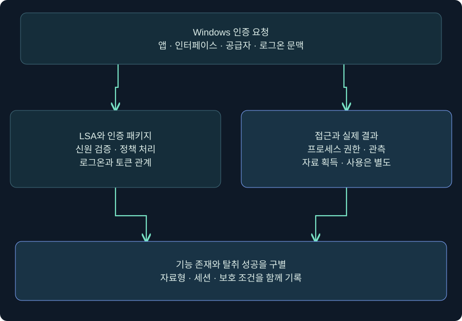
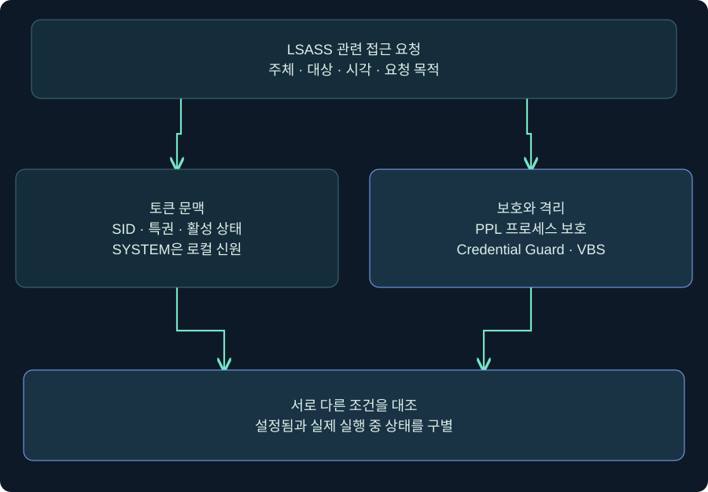
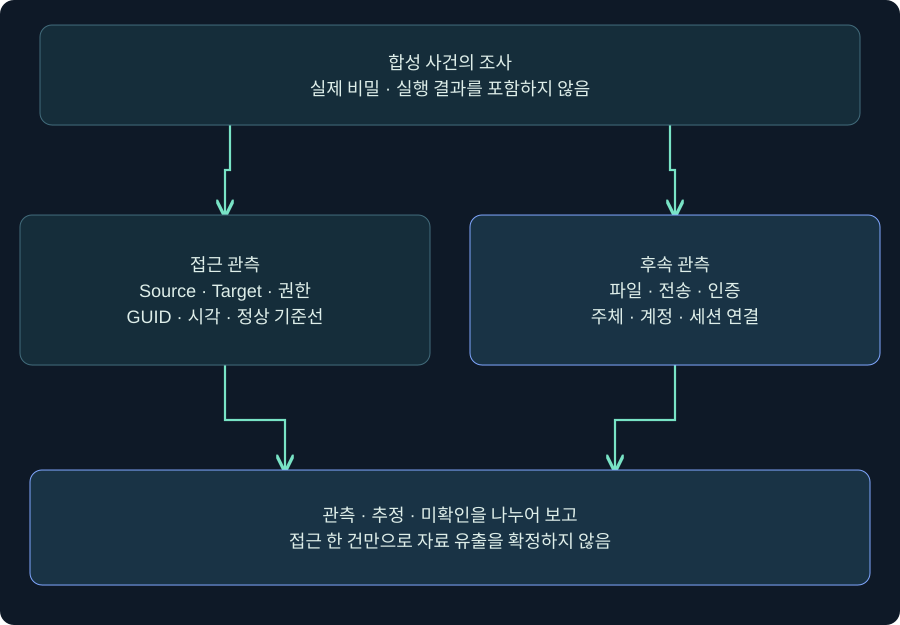

## 1. LSASS가 보인다는 사실과 비밀을 읽었다는 결론 사이

SOC에서 “어떤 프로세스가 lsass.exe에 접근했다”는 경보를 받았다고 가정하겠습니다. 바로 비밀번호 유출로 보고하면 정상 진단 도구를 침해로 오판할 수 있고, SYSTEM 계정의 동작이라는 이유로 무시하면 중요한 초기 단서를 놓칠 수 있습니다. 먼저 **인증 기능·프로세스 접근·실제 자료 획득·자료 사용**을 분리해야 합니다.

LSA는 인증과 로컬 보안 정책을 담당하는 Windows 보안 구성 요소이며 LSASS는 그 기능을 수행하는 핵심 프로세스입니다. 로그인 처리에 참여한다고 해서 모든 사용자의 평문 비밀번호가 언제나 같은 형식으로 남는 것은 아닙니다. OS 빌드, 로그온 방식, 인증 패키지, 보호 상태와 세션 수명이 결과를 바꿉니다. 이번 강의는 그 조건과 증거를 읽는 방법을 설명합니다.

`LAB-WS01`, `student01`, `training.example`은 합성 이름입니다. 실제 메모리·키·비밀번호·티켓을 수집하지 않았고 보호 기능을 변경하지 않았습니다. 아래 Windows·Cobalt Strike 절차는 **미실행 조회 안내**이며 사진 속 공식 출력은 이번 작업 결과가 아닙니다.

그림은 위의 인증 요청을 두 관점으로 나눕니다. 왼쪽의 정상 인증 역할을 이해한 뒤 오른쪽의 접근 증거를 대조합니다. 정상 기능이 존재한다는 사실에서 탈취 성공으로 건너뛰지 않습니다.

## 2. SSPI·SSP·인증 패키지는 어떤 관계일까요?

앱마다 Kerberos와 NTLM을 직접 구현한다면 설정과 오류 처리가 복잡해질 것입니다. SSPI는 앱이 보안 공급자 기능을 이용하도록 제공하는 인터페이스입니다. 공급자는 프로토콜의 실제 처리를 맡고, 인증 패키지는 LSA의 로그온 검증에 참여합니다. 일부 구성 요소는 양쪽 역할을 함께 제공하지만 세 용어를 모두 같은 것으로 쓰지는 않습니다.

| 용어·구성 요소 | 중심 역할 | 조사할 때의 질문 |
|---|---|---|
| SSPI | 앱과 보안 공급자 사이 호출 계약 | 어느 앱이 어떤 인증 문맥을 요청했나? |
| Negotiate | 조건에 맞는 인증 방식 협상 | 협상 결과가 Kerberos인가 NTLM인가? |
| Kerberos | 티켓 기반 인증 | 사용자·서비스·도메인·수명이 무엇인가? |
| NTLM | 질의·응답 기반 인증 | 로컬·도메인 계정과 실제 검증 주체는 누구인가? |
| Schannel | TLS 등의 보안 통신 | 인증서와 연결 조건이 무엇인가? |
| CredSSP | 자격증명 위임을 포함하는 인증 구조 | 위임과 원격 세션 조건이 무엇인가? |

공급자 이름이 로그에 나타났다는 사실은 평문 저장의 증거가 아닙니다. DLL이 적재된 위치와 해당 기능 호출, 실제 로그온 결과도 구별합니다. 과거 도구가 특정 패키지 이름 아래 값을 출력했다는 사례를 현재 모든 시스템의 메모리 배치로 일반화하지 않습니다.

## 3. NT 해시·Kerberos 키·티켓·평문을 혼동하지 않습니다

같은 계정과 관련돼 있어도 자료형과 사용 조건이 다릅니다. NT 해시는 NTLM 관련 비밀번호 유도 값이고, Kerberos 장기 키는 암호 유형·계정 조건에 따라 구분됩니다. 티켓은 발급 주체·대상·기간을 가진 별도 자료입니다. 해시나 키를 단순히 “암호화한 비밀번호”라 부르면 역방향 복호화가 가능한 값처럼 오해하기 쉽습니다.

| 관측 표현 | 뜻할 수 있는 것 | 단독으로 보장하지 않는 것 |
|---|---|---|
| 사용자·SID·로그온 ID | 세션과 신원 단서 | 평문 또는 키 획득 |
| NT 해시 형식 값 | 해당 형식으로 해석된 자료 | 현행 인증 허용·계정 활성 |
| Kerberos 키 표시 | 특정 암호 유형의 키 후보 | 글자 수만으로 유형 확정 |
| 티켓 | 특정 서비스·수명과 연결된 발급 자료 | 모든 서비스 무기한 접근 |
| Password가 null | 해당 출력에서 평문을 제시하지 않음 | 호스트 전체에 비밀이 전혀 없음 |

표시 라벨이 잘못되거나 도구 버전이 오래되면 문자열 길이만으로 알고리즘을 확정해서는 안 됩니다. 파서·암호 유형 메타데이터·자료 출처를 대조합니다. 보고서에는 원시 비밀을 붙이는 대신 종류·관련 계정·수집 여부·보호 상태와 검증 범위를 적습니다. 비밀을 획득한 적이 없다면 “탈취됨”이라는 표현을 쓰지 않습니다.

## 4. SYSTEM·PPL·Credential Guard는 서로 다른 경계입니다

SYSTEM은 로컬 보안 문맥이고, PPL은 보호 프로세스에 대한 접근 및 코드 적재 조건과 관련됩니다. Credential Guard는 VBS를 이용해 지원되는 비밀을 일반 OS에서 분리합니다. 서로 보완하지만 같은 스위치가 아닙니다. 따라서 SYSTEM 이름 한 줄로 LSASS 메모리와 격리된 모든 비밀에 접근할 수 있다고 설명하지 않습니다.

위에서 내려오는 요청은 토큰만 보는 경로와 보호·격리 상태를 보는 경로로 갈라집니다. 아래 결론은 두 조건을 함께 확인한 뒤 작성합니다. 화살표는 우회 절차가 아니라 확인해야 할 관계입니다.

보호가 켜진 환경에서는 과거 예제가 실패할 수 있습니다. 실패를 해결하려고 보안을 끄는 대신 실제 빌드·보호 실행 상태·요청 권한·제품 오류를 기록합니다. Credential Guard가 보호하지 않는 자료도 있으므로 “켜져 있으니 모든 인증 자료는 안전”이라는 결론 역시 성립하지 않습니다. 로컬 계정 자료, 서비스 티켓과 별도 앱 저장소 등은 해당 보호 범위를 다시 확인해야 합니다.

## 5. 보호 상태는 설정과 실행 증거를 함께 읽습니다

Windows의 **이벤트 뷰어 → Windows 로그 → 시스템 → 현재 로그 필터링**에서 공급자와 이벤트 ID를 선택해 부팅 시점의 WinInit 기록을 읽을 수 있습니다. Microsoft 문서는 LSA 보호 확인에 WinInit 이벤트 12를 안내합니다. ID가 같아도 공급자가 다르면 의미가 다르므로 공급자·시각·메시지를 함께 확인합니다.

Credential Guard는 **시스템 정보 / msinfo32 → 시스템 요약 → 가상화 기반 보안 서비스 실행 중** 등의 실제 상태와 관리 기록을 대조합니다. “구성됨”과 “실행 중”은 다른 상태입니다. 부팅 시점·기능 요건·적용 정책을 맞추고, 원격 관리 기록이 오래된 상태인지도 확인합니다. 이 절차는 조회만 가정하며 저장·적용·재부팅은 수행하지 않았습니다.

LSA 플러그인 문제는 **응용 프로그램 및 서비스 로그 → Microsoft → Windows → CodeIntegrity → Operational**에서 볼 수 있습니다. 감사 이벤트와 실제 차단 이벤트의 의미를 섞지 않습니다. 감사에서 허용된 적재가 곧 보호 모드 차단 성공은 아닙니다. UI와 로그의 실제 사진은 이번 강의에서 확보하지 못했으므로 이 문단은 메뉴 안내이며 캡처 재현이 아닙니다.

## 6. 실제 Cobalt Strike 화면에서 조회 명령을 입력하는 위치

### 실제 화면 80: Beacon Console의 입력 줄과 반환 영역

출처: [Fortra Consoles](https://hstechdocs.helpsystems.com/manuals/cobaltstrike/current/userguide/content/topics/ui_consoles.htm), 확인일 2026-11-05. 현행 안내서 표시는 4.13이지만 삽화에는 과거 UI가 포함될 수 있습니다. 공식 사진의 명령과 출력은 다음 조회의 실행 결과가 아닙니다.

1. **Sessions → 승인된 교육 세션 선택 → 우클릭 → Interact**로 엽니다. 호스트·사용자·PID를 확인합니다. 이번 작업에서는 실제 연결을 하지 않았습니다.
2. 하단 입력 칸에서 `help run`을 확인합니다. 입력 예시 `run whoami.exe /user`는 현재 사용자 SID를 읽기 위한 값입니다. `run whoami.exe /priv`는 현재 토큰의 특권과 활성 상태를 읽는 예시입니다.
3. Enter로 제출하면 위 반환 영역에서 결과·오류·전달 지연을 구별합니다. 별도 Save 버튼은 필요 없습니다. 명령 접수와 반환 완료를 같은 상태로 기록하지 않습니다.
4. SID·특권·조회 시각을 교육 기록에 적습니다. 특권 이름이 보이더라도 Enabled와 Disabled를 구별하고, 그 결과를 PPL·VBS 상태 확인으로 대신하지 않습니다.

`run`은 대상 프로세스를 실행할 수 있습니다. 위 예시는 미실행이며 메모리 접근·덤프·비밀 수집 명령은 포함하지 않습니다. 현재 토큰의 사실을 확인하는 절차이지, 토큰을 바꾸거나 보호를 해제하는 절차가 아닙니다. 조회 결과가 없으면 Help와 세션 상태·실제 오류를 확인하고 출력 없는 상태를 성공으로 기록하지 않습니다.

## 7. Sysmon ProcessAccess에서 무엇을 읽을까요?

Sysmon 이벤트 10은 다른 프로세스를 여는 동작의 조사 단서입니다. 수집 설정과 필터에 따라 관측 범위가 달라지고 정상 보안·진단 도구도 이벤트를 만들 수 있습니다. 이벤트가 있다는 사실과 메모리 내용 추출을 분리합니다.

| 필드 | 읽는 이유 | 피할 오해 |
|---|---|---|
| SourceImage·SourceProcessGUID | 요청한 프로세스·실행 인스턴스 연결 | 이름이 정상 파일이면 항상 안전 |
| TargetImage·TargetProcessGUID | 실제 접근 대상 연결 | lsass라는 문자열만으로 대상 확정 |
| GrantedAccess | 부여된 프로세스 접근 권한 해석 | 권한 보유를 실제 모든 바이트 읽기로 해석 |
| CallTrace | 호출 경로의 추가 조사 단서 | UNKNOWN이면 무조건 악성 |
| UtcTime·호스트 | 시간·시스템 범위 연결 | 현지 시각과 UTC를 그대로 비교 |

가상 값 `0x1010`에는 `0x1000`과 `0x0010` 비트가 포함됩니다. Windows 정의로 각각 제한된 정보 질의와 프로세스 메모리 읽기 권한을 나타냅니다. 이것은 **해당 권한 조합의 해석**이며 덤프 파일 생성·평문 복구·외부 인증 성공을 증명하지 않습니다. 모든 도구가 이 값만 사용한다거나 이것이 유일한 최소 조합이라고 쓰지 않습니다.

## 8. 합성 사건에서 경보와 결론을 연결합니다

왼쪽의 접근 이벤트와 오른쪽의 후속 기록은 같은 사건인지 연결해야 합니다. 프로세스 ID는 재사용될 수 있으므로 GUID·시작 시각·부모 프로세스·호스트를 함께 맞춥니다. 연결선이 있다는 이유만으로 인과관계가 자동 확정되는 것은 아닙니다.

| 합성 사건 | 지금 확인한 사실 | 다음 확인 |
|---|---|---|
| 승인된 진단 앱이 LSASS 접근 | 접근 관측 존재 | 배포 기록·서명·정상 작업과 비교 |
| 사용자 임시 경로의 낯선 앱 접근 | 위험도가 높은 단서 | 실행 계보·EDR 경보·관련 출력 조사 |
| 접근 후 새로운 파일 생성 | 시간적 연관 | 생성 주체·파일 종류·승인된 분석 결과 |
| 직후 다른 호스트 인증 | 인증 기록 존재 | 주체·세션·계정과 접근 사건의 연결 |
| 이벤트 10이 없음 | 해당 검색에서 미관측 | 필터·서비스 상태·보존·전송 범위 |

파일 내용에 실제 비밀이 있는지 확인하려고 임의로 열거나 공유하지 않습니다. 승인된 사고 대응 절차에서 필요한 최소 메타데이터와 분석 결과만 활용합니다. 이 강의의 합성 표에는 실제 비밀이나 실행 출력이 없습니다.

## 9. 조건이 바뀌면 결론도 바뀝니다

같은 도구 이름이라도 A 단말은 보호가 실행 중이고 B 단말은 구성만 되어 있을 수 있습니다. 같은 접근 마스크라도 A는 승인된 진단 시간에, B는 낯선 부모 프로세스에서 발생할 수 있습니다. 서로 다른 조건을 지운 채 성공률이나 위험도를 비교하면 안 됩니다.

보고는 “무엇을 확인했나 → 어떤 조건이었나 → 무엇이 미확인인가 → 다음 증거는 무엇인가” 순서로 작성합니다. 예를 들어 “LAB-WS01에서 미승인 프로세스의 LSASS 접근이 관측되었고 메모리 읽기 권한 비트가 포함됐다. 자료 추출·전송·인증 사용은 미확인”은 관측과 결론의 범위가 맞습니다.

침해가 확인되면 계정·호스트 범위와 업무 영향을 정해 격리·비밀 교체·세션 대응을 조율합니다. 프로세스 하나 종료나 비밀번호 한 번 변경으로 모든 이미 발급된 자료와 사본이 없어졌다고 단정하지 않습니다. 이번 강의에서는 이러한 대응 작업도 실행하지 않았습니다.

## 10. 복습과 즉시 해설

### 복습 1. LSASS는 모든 비밀번호의 평문 보관함인가요?

**해설:** 아닙니다. 인증 기능과 저장 형태를 구별해야 합니다. 패키지·로그온 방식·버전·보호 상태·세션에 따라 존재하는 자료가 다릅니다.

### 복습 2. SSPI와 SSP는 같은 것인가요?

**해설:** SSPI는 호출 인터페이스이고 SSP는 보안 공급자입니다. 인증 패키지와 역할이 겹칠 수 있어도 용어를 모두 같은 대상으로 쓰지 않습니다.

### 복습 3. SYSTEM이면 PPL과 VBS도 자동 통과하나요?

**해설:** 아닙니다. 토큰 문맥·보호 프로세스·격리 경계는 별도 조건입니다. 실제 실행 상태까지 대조합니다.

### 복습 4. Credential Guard 구성됨이면 실행 중인가요?

**해설:** 같은 상태가 아닙니다. 실제 시스템 상태와 부팅 기록·요건·정책을 함께 확인해야 합니다.

### 복습 5. 0x1010은 비밀번호 유출 확정인가요?

**해설:** 특정 프로세스 접근 권한 비트를 뜻합니다. 실제 읽기·자료 해석·전송·사용 성공은 추가 증거가 필요합니다.

### 복습 6. CallTrace의 UNKNOWN은 악성 확정인가요?

**해설:** 아닙니다. 기호 해석과 메모리 위치 등의 추가 맥락이 필요합니다. 정상 기준선과 실행 계보를 대조합니다.

### 복습 7. 이벤트 10이 없으면 접근이 없었나요?

**해설:** 관측 범위부터 확인합니다. 필터 제외·보존 만료·수집 중단·다른 접근 방식 등이 결론에 영향을 줍니다.

### 복습 8. 공식 콘솔 사진이 이번 실행 결과인가요?

**해설:** 제작사 예시입니다. 본문의 조회 절차는 미실행이며 실제 토큰·보호 상태·비밀 획득을 확인한 결과가 아닙니다.

## 11. 공식 근거와 적용 범위

확인일 **2026-11-05**. 독립 SVG 3개와 공개 공식 콘솔 사진 1회를 제공합니다. Windows 보호 상태·이벤트 뷰어 필터·조회 후 실제 출력 사진은 미확보입니다. 실제 Windows·Cobalt Strike·메모리·비밀 수집·보호 변경·인증·대응은 수행하지 않았습니다.

- [Microsoft Windows 인증 아키텍처](https://learn.microsoft.com/en-us/windows-server/security/windows-authentication/windows-authentication-architecture)
- [Microsoft LSA 인증 모델](https://learn.microsoft.com/en-us/windows/win32/secauthn/lsa-authentication-model)
- [Microsoft 프로세스 접근 권한](https://learn.microsoft.com/en-us/windows/win32/procthread/process-security-and-access-rights)
- [Microsoft 추가 LSA 보호와 실행 확인](https://learn.microsoft.com/en-us/windows-server/security/credentials-protection-and-management/configuring-additional-lsa-protection)
- [Microsoft Credential Guard 구조와 한계](https://learn.microsoft.com/en-us/windows/security/identity-protection/credential-guard/how-it-works)
- [Microsoft Credential Guard 실행 확인](https://learn.microsoft.com/en-us/windows/security/identity-protection/credential-guard/configure)
- [Microsoft Sysmon 이벤트 정의](https://learn.microsoft.com/en-us/sysinternals/downloads/sysmon)
- [Fortra Consoles](https://hstechdocs.helpsystems.com/manuals/cobaltstrike/current/userguide/content/topics/ui_consoles.htm)
