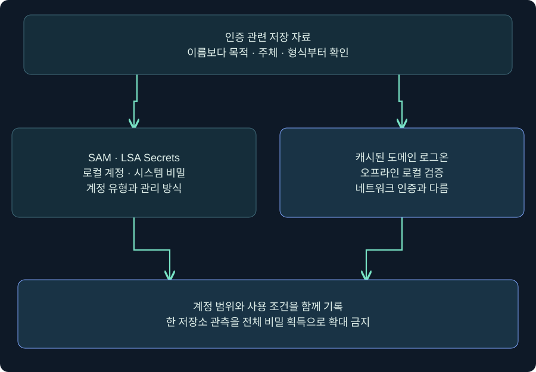
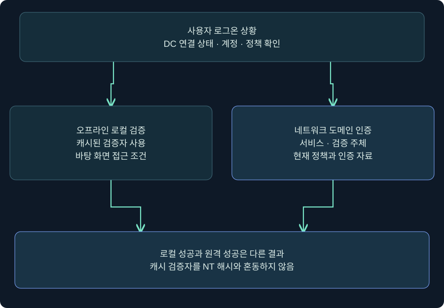
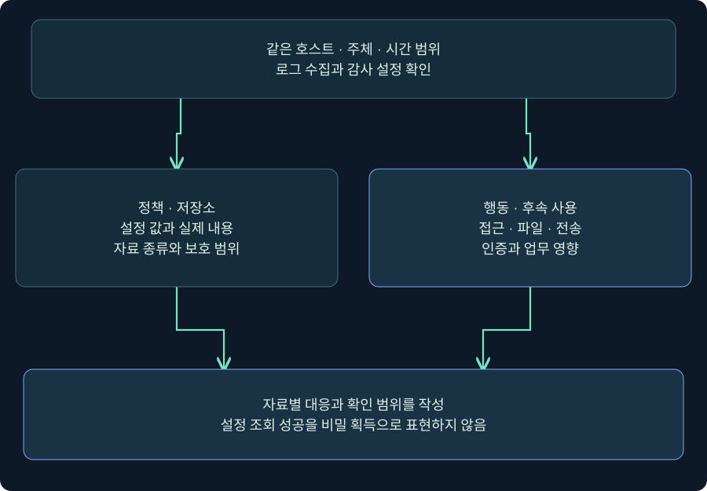

## 1. 저장 위치보다 먼저 자료의 목적을 묻습니다

한 단말에서 로컬 계정, 서비스 계정, 과거 도메인 로그온 정보가 모두 보인다고 가정하겠습니다. 세 종류를 모두 “비밀번호 캐시”로 부르면 어떤 계정이 영향을 받았는지와 어떤 대응이 필요한지 설명할 수 없습니다. 이번 강의에서는 **SAM·LSA Secrets·캐시된 도메인 로그온 검증자**를 목적·주체·사용 가능성으로 나눕니다.

SAM은 주로 해당 호스트의 로컬 계정 정보를 관리합니다. LSA Secrets는 시스템의 여러 보안 기능에 필요한 비밀을 저장하는 영역입니다. 캐시된 도메인 로그온 검증자는 DC에 연결하지 못할 때 이전 사용자의 로컬 로그온을 검증하기 위한 자료입니다. 어느 하나를 관측했다고 나머지 전체를 확보했다고 쓰지 않습니다.

`LAB-WS01`, `LAB-WS02`, `training.example`, `student01`은 합성 이름입니다. 본문은 비밀 추출·레지스트리 하이브 내보내기·복호화·암호 추측·원격 인증을 수행하지 않습니다. 실제 Windows·Cobalt Strike 조회 역시 **미실행 절차**입니다.



그림의 두 갈래는 서로 다른 자료의 목적을 비교합니다. 아래 판단에서는 계정 범위와 사용할 수 있는 상황을 함께 적습니다. “저장돼 있다”는 공통점만으로 동일한 비밀이나 같은 인증 능력으로 취급하지 않습니다.

## 2. SAM은 로컬 계정 범위에서 읽습니다

일반 워크스테이션의 SAM을 생각할 때 중심 질문은 “이 호스트의 어떤 로컬 계정인가?”입니다. 로컬 계정과 도메인 계정은 표시 이름이 같아도 다른 보안 주체입니다. SAM 관련 보호 자료와 SYSTEM 하이브가 함께 언급되는 기술 설명도 두 하이브에 모든 도메인 비밀번호가 저장된다는 의미가 아닙니다.

| 관측 | 알 수 있는 것 | 추가로 필요한 조건 |
|---|---|---|
| `LAB-WS01\Administrator` | 호스트 로컬 계정 이름 | 전체 SID·활성 상태·실제 권한 |
| RID 500 | 해당 계정 영역의 기본 관리자 식별 단서 | SID 앞부분과 로컬·도메인 범위 |
| 같은 계정 이름 두 개 | 표시 이름이 같음 | 실제 동일 주체인지 SID 대조 |
| 로컬 계정 관련 해시 자료 | 특정 자료형 후보 | 현재 비밀·계정 상태·인증 정책 |

RID는 SID의 마지막 부분입니다. 로컬 기본 관리자와 도메인 기본 관리자는 모두 끝 번호가 500일 수 있으므로 마지막 숫자만으로 동일 계정이라고 판단하면 안 됩니다. 기본 관리자 이름이 바뀌어도 RID의 의미가 사라지는 것은 아닙니다. 반대로 이름만 Administrator라고 해서 반드시 기본 관리자 계정은 아닙니다.

## 3. 다른 단말로의 영향은 조건을 연결해야 합니다

A와 B 단말에 같은 로컬 이름이 있다는 사실만으로 A의 침해가 B의 로그인 성공으로 이어지지는 않습니다. 비밀번호 재사용, 계정 활성·잠금, 네트워크 로그온 권한, 원격 접근 정책과 서비스 조건 등 여러 요소가 필요합니다. 권한 상승과 원격 인증도 서로 다른 사건입니다.

가상 사례에서 LAB-WS01은 로컬 관리자의 비밀번호를 장기간 공유하고 LAB-WS02는 장치마다 고유한 비밀번호를 관리한다고 합시다. 위험도는 달라지지만 이를 검증하려고 실제 비밀번호를 비교하거나 로그인을 시도할 필요는 없습니다. 승인된 관리 시스템의 적용 상태·교체 이력·장치 범위와 정책 증거로 검토할 수 있습니다.

Windows LAPS 같은 관리 기능을 논의할 때도 “정책 배포됨”과 “대상 계정에 실제 적용·교체됨”을 나눕니다. 계정의 실제 비밀값을 보고서에 붙이는 대신 대상 장치·정책 적용·변경 시각과 미확인 범위를 기록합니다. 이 강의에서는 LAPS 비밀번호 조회나 정책 변경을 하지 않았습니다.

## 4. LSA Secrets는 하나의 동일한 비밀번호 목록이 아닙니다

LSA Secrets는 여러 종류의 비밀이 관계되는 보호 저장 영역입니다. 서비스용 계정 자료나 컴퓨터 계정 관련 자료 등이 포함될 수 있지만 모든 단말에 같은 항목이 있고 같은 형식으로 출력된다고 보장하지 않습니다. 서비스의 로그온 방식과 계정 유형이 바뀌면 필요한 자료와 관리 책임도 바뀝니다.

| 구분 | 의미 | 잘못된 일반화 |
|---|---|---|
| 로컬 서비스 계정 | 해당 호스트 범위의 계정 | 같은 이름이면 도메인 계정 |
| 일반 도메인 서비스 계정 | 도메인이 관리하는 신원 | 모든 서비스가 같은 비밀 사용 |
| 가상 계정·관리 서비스 계정 | OS·도메인의 관리 모델과 연결 | 서비스는 항상 수동 평문 비밀번호 필요 |
| 컴퓨터 계정 | 도메인에 가입한 장치의 신원 | 사람이 로그인하는 관리자와 동일 |
| LSA Secrets 영역 | 기능별 비밀 저장 | 한 항목 존재가 전체 사용자 비밀번호 획득 |

`HKLM\SECURITY\Policy\Secrets`는 저장 위치를 설명하는 식별 정보입니다. 여기서 값을 내보내거나 보호 자료를 모으는 절차는 제공하지 않습니다. 암호화돼 있다는 사실만으로 단말 관리자 침해에도 안전하다고 단정할 수 없고, SYSTEM 권한이라는 사실만으로 모든 도구·자료·보호 조건에서 성공한다고 단정할 수도 없습니다.

## 5. 캐시된 도메인 로그온은 오프라인 사용성을 위한 기능입니다

출장 중 노트북이 DC에 연결하지 못해도 이전 사용자가 바탕 화면에 들어갈 수 있는 이유 중 하나가 캐시된 도메인 로그온입니다. 로컬에 남는 검증자를 이용해 입력을 확인하는 구조이며 DC가 그 순간 새 인증을 해 준 것과 다릅니다.



왼쪽은 로컬 검증의 결과이고 오른쪽은 별도 네트워크 인증입니다. 아래에서 “바탕 화면 접근 성공”과 “도메인 서비스 접근 성공”을 다른 결과로 기록합니다. 네트워크 자원이 익명 접근 등 다른 조건을 허용하는 예외도 있으므로 모든 네트워크 통신이 불가능하다는 의미는 아닙니다.

현대 Windows의 DCC2 / MS-Cache v2는 NT 해시와 같은 용도로 직접 제출하는 네트워크 인증 자료가 아닙니다. 캐시 검증자가 있다고 즉시 pass-the-hash가 가능하다고 설명하지 않습니다. 오프라인 추측 위험은 별도로 존재하지만 계산 비용과 실제 성공은 비밀번호·형식·조건에 따라 다르며 고정된 시간이나 성능을 보장하지 않습니다.

## 6. 실제 콘솔에서 정책 값을 읽는 위치와 이유

### 실제 화면 81: Beacon Console의 입력·반환을 정책 조회에 연결


출처: [Fortra Consoles](https://hstechdocs.helpsystems.com/manuals/cobaltstrike/current/userguide/content/topics/ui_consoles.htm), 확인일 2026-11-05. 문서 표시는 4.13이며 공식 삽화는 과거 UI일 수 있습니다. 사진 속 결과는 아래 조회를 수행한 출력이 아닙니다. 이 사진은 레지스트리 편집 창도 아닙니다.

1. **Sessions → 승인된 실습 세션 → 우클릭 → Interact**를 엽니다. 호스트와 현재 사용자가 계획과 맞는지 확인합니다.
2. 하단 입력 칸에서 `help run`을 먼저 확인합니다. 다음 명령은 비밀 내용이 아닌 캐시 정책 값 하나를 읽는 미실행 예시입니다.

```text
run reg.exe query "HKLM\SOFTWARE\Microsoft\Windows NT\CurrentVersion\Winlogon" /v CachedLogonsCount
```

3. `/v CachedLogonsCount`를 지정하는 이유는 해당 값으로 조회 범위를 제한하기 위해서입니다. 값 이름은 복수형 **Logons**입니다. 비슷한 단수형으로 입력해 값이 없다고 결론 내리지 않습니다.
4. Enter로 제출한 뒤 반환 영역의 값 이름·형식·데이터·오류를 읽습니다. 예를 들어 `REG_SZ`와 `10`은 설명용 가정이며 현재 호스트의 실제 출력이 아닙니다.
5. 조회에는 저장 버튼이 없습니다. `add`, `delete`, `save` 같은 변경·내보내기 동작을 수행하지 않습니다. 빈 출력·값 없음·접근 거부·반환 지연을 구별하고 시각·호스트·토큰·조회 결과를 기록합니다.

설정값 조회 성공은 실제 캐시 항목 수·사용자 명단·비밀 획득 성공이 아닙니다. 레지스트리 편집 화면과 실제 조회 반환 사진은 확보하지 못했습니다. 설명표를 실제 Windows 설정창으로 재구성하지 않았습니다.

## 7. 정책 값·실제 캐시·실제 로그온을 분리합니다

`CachedLogonsCount`는 캐시 동작의 정책을 이해하기 위한 단서입니다. Microsoft 지원 문서의 허용 범위는 0~50이며 0은 캐시 비활성 의미입니다. 기본값 안내에는 OS 예외가 있으므로 실제 적용 정책을 우선합니다. `10`을 “현재 캐시 파일 열 개” 또는 “오늘 로그인 시도 열 번”으로 읽지 않습니다.

정책 UI를 조회하려면 **로컬 보안 정책 → 로컬 정책 → 보안 옵션 → 대화형 로그온: 도메인 컨트롤러를 사용할 수 없는 경우 캐시할 이전 로그온 수**를 찾아 현재 설명과 값을 읽습니다. 관리 방식·에디션·언어에 따라 표시가 다를 수 있습니다. 창을 열었다면 변경·적용하지 않고 닫는 조회를 가정합니다. 적용 정책은 도메인 관리 기록과도 대조해야 합니다.

클라우드·도메인에서 비밀번호가 바뀌어도 오프라인 로컬 검증자가 즉시 갱신됐다고 가정하지 않습니다. 네트워크 상태, 최근 온라인 로그온과 동기화 조건을 확인합니다. 이 동작을 시험하려고 네트워크를 끊거나 실제 사용자 비밀번호를 바꾸는 작업은 수행하지 않았습니다. 정책 설명·실제 동작 검증·교체 확인을 각각 미실행 또는 확인 상태로 구분합니다.

## 8. 저장소 접근 경보는 어떤 증거와 연결할까요?



그림의 왼쪽은 설정과 저장소이고 오른쪽은 접근 행동과 후속 사용입니다. 아래 결론을 쓸 때 두 경로가 같은 호스트·시각·주체를 가리키는지 확인합니다. 정책 조회 한 번과 비밀 저장소 추출을 같은 사건으로 분류하지 않습니다.

| 관측 유형 | 조사 의미 | 한계와 다음 증거 |
|---|---|---|
| 승인된 정책 값 조회 | 관리·진단 행위일 수 있음 | 작업 승인·부모 프로세스·조회 대상 확인 |
| 민감 저장소에 대한 비정상 접근 | 비밀 노출 가능성 조사 | 감사 설정·주체·실제 접근 종류 확인 |
| 관련 파일 생성·외부 전송 | 후속 행위 연계 | 파일 생성 주체·종류·목적지·시간 확인 |
| 다른 기기의 인증 이상 | 계정 영향 가능성 | 동일 이름·시간만으로 인과관계 확정 금지 |
| 접근 로그 없음 | 해당 수집에서 미관측 | 감사·필터·전송·보존 범위 검토 |

Sysmon의 레지스트리 이벤트 12~14는 생성·삭제·값 설정·이름 변경 등을 설명합니다. 모든 레지스트리 읽기를 기록하는 로그가 아닙니다. 민감 키 읽기를 조사할 때 이벤트 13만 검색해 미관측을 안전으로 판정하지 않습니다. 보안 감사 이벤트 역시 정책·객체 감사·권한 조건을 확인한 뒤 사용해야 합니다. 로그를 만들기 위해 실제 비밀을 읽지 않고 승인된 기존 자료로 관측 범위를 평가합니다.

## 9. 조건별 대응과 보고 문장을 연습합니다

사례 A는 로컬 관리자 관련 자료 노출 가능성입니다. 장치별 비밀번호 관리 여부와 같은 비밀 재사용 범위가 중요합니다. 사례 B는 서비스 계정 관련 자료입니다. 서비스 의존성과 계정 권한·교체 절차를 함께 검토해야 합니다. 사례 C는 오프라인 검증자입니다. 네트워크 인증에 직접 제출 가능한 자료와 구별하면서 추측 위험과 로컬 로그온 정책을 평가합니다.

Credential Guard가 실행 중이라는 사실도 SAM·AD 데이터베이스나 모든 별도 저장소를 보호한다는 보장은 아닙니다. 반대로 오프라인 검증자가 있다는 이유로 Credential Guard가 고장 났다고 판단하지 않습니다. 보호 목적과 자료 종류를 맞춰야 합니다.

보고 예시는 “LAB-WS01의 캐시 정책 조회에서 설정값을 확인했다. 실제 캐시 사용자·검증자 내용·비밀번호·원격 사용은 확인하지 않았다”입니다. 침해 대응에서는 원시 비밀을 공유하지 않고 계정 범위·증거 보존·교체와 업무 검증을 조율합니다. 파일 삭제만으로 계정 비밀이 폐기되거나 모든 사본이 사라지는 것은 아닙니다. 이번 강의에서는 교체·삭제·격리도 수행하지 않았습니다.

## 10. 복습과 즉시 해설

### 복습 1. SAM에 모든 도메인 계정의 비밀번호가 있나요?

**해설:** 일반 워크스테이션의 SAM은 로컬 계정 범위로 이해합니다. 도메인 계정 데이터베이스와 구별해야 합니다.

### 복습 2. RID 500 두 개면 같은 계정인가요?

**해설:** SID의 계정 영역이 다를 수 있습니다. 전체 SID와 로컬·도메인 범위를 대조합니다.

### 복습 3. 같은 로컬 이름이면 다른 단말 로그인도 성공하나요?

**해설:** 이름만으로는 알 수 없습니다. 비밀 재사용·활성 상태·권한·인증 정책과 서비스 조건이 필요합니다.

### 복습 4. 모든 서비스는 LSA Secrets에 수동 비밀번호를 저장하나요?

**해설:** 아닙니다. 서비스 계정 유형과 관리 방식이 다릅니다. 실제 서비스 로그온 문맥을 확인합니다.

### 복습 5. DCC2를 NT 해시처럼 원격 인증에 바로 쓰나요?

**해설:** 캐시된 로컬 로그온 검증자입니다. 직접 네트워크 인증에 제출 가능한 NT 해시와 구별합니다.

### 복습 6. CachedLogonsCount가 10이면 실제 캐시가 열 개인가요?

**해설:** 정책 값이지 현재 내용의 직접 관측이 아닙니다. 값의 존재·실제 캐시·사용 결과는 별도입니다.

### 복습 7. Sysmon 이벤트 13이 없으면 비밀 키 읽기도 없었나요?

**해설:** 이벤트 13은 값 설정 기록입니다. 모든 읽기를 기록하지 않으므로 감사 범위와 다른 증거가 필요합니다.

### 복습 8. Credential Guard가 실행되면 SAM도 자동 보호되나요?

**해설:** 보호 범위가 다릅니다. 자료 종류별로 기능의 적용 범위를 확인하고 보호 상태와 노출 결론을 분리합니다.

## 11. 공식 근거와 적용 범위

확인일 **2026-11-05**. 독립 SVG 3개와 공식 실제 콘솔 사진 1회를 제공합니다. 실제 정책창·레지스트리 조회 결과·캐시 동작 사진은 미확보입니다. Windows·제품·비밀 읽기·내보내기·추출·암호 추측·보호 변경·로그인·대응은 실행하지 않았습니다. 합성 사례는 실제 결과가 아닙니다.

- [MITRE SAM: T1003.002](https://attack.mitre.org/techniques/T1003/002/)
- [MITRE LSA Secrets: T1003.004](https://attack.mitre.org/techniques/T1003/004/)
- [MITRE Cached Domain Credentials: T1003.005](https://attack.mitre.org/techniques/T1003/005/)
- [Microsoft 캐시된 도메인 로그온 정보](https://learn.microsoft.com/en-us/troubleshoot/windows-server/user-profiles-and-logon/cached-domain-logon-information)
- [Microsoft Credential Guard 구조와 보호 한계](https://learn.microsoft.com/en-us/windows/security/identity-protection/credential-guard/how-it-works)
- [Microsoft Credential Guard와 SAM 보호 범위](https://learn.microsoft.com/en-us/windows/security/identity-protection/credential-guard/)
- [Microsoft reg query](https://learn.microsoft.com/en-us/windows-server/administration/windows-commands/reg-query)
- [Microsoft Windows LAPS](https://learn.microsoft.com/en-us/windows-server/identity/laps/laps-overview)
- [Microsoft Sysmon](https://learn.microsoft.com/en-us/sysinternals/downloads/sysmon)
- [Fortra Consoles](https://hstechdocs.helpsystems.com/manuals/cobaltstrike/current/userguide/content/topics/ui_consoles.htm)
