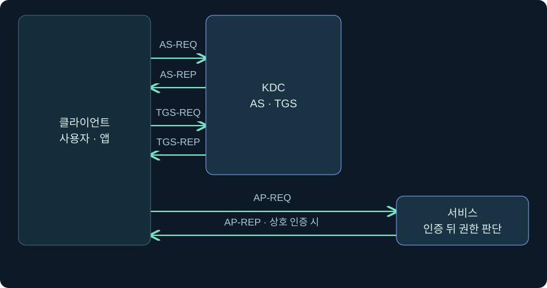
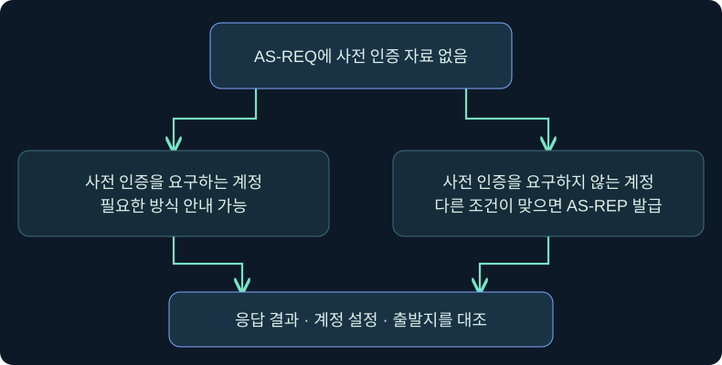
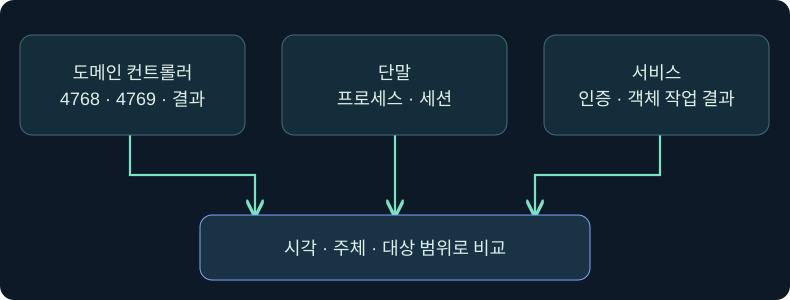

## 1. 발급·제시·접근은 서로 다른 사건입니다

사용자가 파일 서버를 열기 전에 도메인 컨트롤러(DC)에 표를 요청할 수 있습니다. 출입증을 발급받은 기록이 있다고 해서 실제로 방에 들어갔거나 특정 서류를 읽었다고 말할 수 없는 것처럼, Kerberos의 **티켓 발급**, **서비스에 티켓 제시**, **애플리케이션 권한 판단**에는 각각 다른 증거가 필요합니다.

이 강의에서는 Key Distribution Center(KDC)를 티켓을 발급하는 도메인 측 기관으로 보고, AS·TGS·AP 세 교환을 따라갑니다. 한 영역의 일반적인 Active Directory 흐름을 먼저 다룹니다. 이름과 주소는 합성이며 콘솔 조회와 필터 적용은 미실행 절차입니다. 요청 생성, 응답 수집, 오프라인 추측, 실제 인증은 수행하지 않았습니다.

## 2. AS 교환의 응답을 두 부분으로 읽습니다

AS는 Authentication Service입니다. 클라이언트가 **AS-REQ**로 초기 인증을 시작합니다. 암호 기반의 대표적 사전 인증에서는 클라이언트가 자신의 장기 키로 타임스탬프를 보호해 비밀을 직접 보내지 않고 키를 사용할 수 있음을 보여줍니다. 스마트 카드 등 다른 사전 인증 방식도 있으므로 모든 요청을 같은 형식으로 해석하면 안 됩니다. 첫 요청에 사전 인증 자료가 없어 KDC가 필요한 방법을 안내하는 것은 정상 협상에서도 가능합니다.

성공한 **AS-REP**에는 TGT(Ticket-Granting Ticket)와 클라이언트가 읽을 수 있는 별도 암호화 응답 부분이 들어갑니다. 일반적인 암호 기반 교환에서 후자는 클라이언트 키로 보호되며 TGT를 사용할 때 필요한 세션 키 정보를 전달합니다. TGT 내부는 KDC의 티켓 발급 서비스 키로 보호됩니다. 사용자가 TGT를 소지한다는 사실과 사용자가 TGT 본문을 해독할 수 있다는 주장은 서로 다릅니다.

## 3. AS-REP Roasting은 어떤 계정 조건을 이용할까요?

계정에서 Kerberos 사전 인증을 요구하지 않으면 KDC가 사전 인증 증명 없이 AS-REP를 반환할 수 있습니다. AS-REP Roasting(T1558.004)은 이 상황에서 **암호 기반 클라이언트 응답 부분**을 대상으로 비밀번호 후보를 오프라인에서 검증할 수 있는 위험을 뜻합니다. AS-REP 자체는 암호나 평문 비밀번호가 아니며, 공격의 관심 대상은 TGT 본체가 보호되는 키와 구별됩니다. 비밀번호 복구 가능성은 비밀번호 강도·암호 방식·구현에 따라 달라집니다.

같은 계정에 대해 사전 인증을 요구하도록 가정을 바꿔 보세요. 초기 요청에 사전 인증 자료가 없더라도 서버가 응답할 수는 있습니다. 필요한 인증 방식을 안내하는 오류 응답과 사전 인증 없이 성공한 AS-REP는 서로 다릅니다. Windows에서 분석할 때는 4768의 결과와 사전 인증 형식, 계정 설정, 출발지와 시간대가 맞는지 확인합니다. 사전 인증 실패 4771 한 건은 오프라인 추측이나 비밀 복구의 증거로 쓸 수 없습니다.

## 4. TGS 교환은 서비스 이름을 계정에 연결합니다

TGS는 Ticket-Granting Service입니다. 클라이언트는 일반적인 **TGS-REQ**에서 TGT와 세션 키로 만든 인증자, 요청하는 서비스의 이름을 제시합니다. SPN(Service Principal Name)은 Kerberos가 서비스 인스턴스를 식별하는 이름입니다. 가상 예제의 `cifs/files01.training.example`에서 `cifs`는 서비스 클래스이고 나머지는 대상 이름입니다. DNS 이름이 맞더라도 SPN 등록과 실제 서비스가 사용하는 계정이 어긋나면 실패할 수 있습니다.

**TGS-REP**의 일반적인 서비스 티켓은 서비스 주체가 가진 키로 내부를 보호합니다. 클라이언트에는 별도로 그 서비스와 사용할 세션 키 정보가 전달됩니다. 이후 서비스에 **AP-REQ**를 보내고 상호 인증을 요청한 경우 서비스가 **AP-REP**로 응답할 수 있습니다. DC의 4769는 TGS 요청에 대한 감사이며 서비스의 AP-REP나 파일 읽기 이벤트가 아닙니다. DC 이벤트의 서비스 이름 필드가 대상 계정 이름으로 보일 수 있으므로 패킷의 전체 SPN 문자열과 일치한다고 가정하지 않습니다.

## 5. Kerberoasting은 서비스 쪽 키에 부담을 줍니다

Kerberoasting(T1558.003)의 관심 대상은 일반적으로 서비스 주체 키로 암호화된 티켓 부분입니다. 유효한 도메인 로그온 문맥이 특정 SPN의 티켓을 발급받을 수 있어도 해당 서비스의 관리자나 사용 권한을 얻는 것은 아닙니다. 서비스 계정이 사람이 정한 짧고 오래된 암호에 의존하는지, gMSA 등 관리형 계정을 사용하고 있는지에 따라 오프라인 추측 위험이 달라집니다.

| 비교 항목 | AS-REP Roasting | Kerberoasting |
|---|---|---|
| 주된 교환 | 초기 AS 교환 | 서비스 티켓 TGS 교환 |
| 취약 조건 | 대상 계정의 사전 인증 예외와 추측 가능한 비밀 | SPN과 연결된 서비스 주체의 추측 가능한 비밀 |
| 관심 있는 암호문 | 암호 기반 클라이언트 응답 부분 | 일반 서비스 티켓 내부 |
| DC의 첫 확인 | 4768의 성공·사전 인증 형식·계정 설정 | 4769의 성공·서비스·발급 암호 형식 |
| 후속 증거 | 계정 사용과 단말 활동 | 서비스 계정 사용 및 서비스 측 기록 |

AES 티켓도 약한 비밀번호의 위험을 없애지 못합니다. 반대로 RC4 한 건은 구형 서비스 의존성에서도 나올 수 있습니다. Microsoft KB5073381의 2026년 적용 단계는 **서비스 계정 티켓 발급의 기본 가정**을 변경합니다. 실제 판단에는 발급한 DC의 패치, 명시적으로 설정된 암호 형식과 서비스 키를 함께 봅니다. 티켓 암호 형식 `0x17`(RC4-HMAC), 정책 비트마스크 값, 세션 키 암호 형식은 서로 다른 필드입니다.

## 6. 공식 화면에서 DC의 4768 필드를 확인합니다

### 실제 화면 82: Event Viewer의 4768 상세와 암호 형식

출처는 [Microsoft의 Kerberos RC4 조사 안내](https://learn.microsoft.com/en-us/windows-server/security/kerberos/detect-remediate-rc4-kerberos)이며 2026-11-05에 확인했습니다. 화면은 Microsoft의 4768 예시입니다. 스크린샷의 이름과 값은 아래 가상 사건의 출력과 별개입니다. Microsoft는 Windows Server 2016 이상에서 2025-01-14 이후 보안 누적 업데이트를 적용한 경우 4768·4769 형식이 갱신된다고 설명합니다.

1. 승인된 감사 뷰어나 저장된 감사 자료의 **Event Viewer → Windows Logs → Security**에서 발생 컴퓨터가 DC인지 확인합니다.
2. **Actions → Filter Current Log**의 이벤트 ID 칸에 `4768,4769,4771`을 입력하고 **OK**를 누르는 것을 가정합니다. 세 ID를 함께 보는 이유는 초기 요청, 서비스 요청, 사전 인증 실패를 분리하기 위해서입니다. 필터를 적용하는 조회이며 감사 정책은 변경하지 않습니다.
3. 결과에서 4768 행을 눌러 **General**의 계정·결과·클라이언트 주소를 확인하고 **Details → XML View**에서 필드 이름과 이벤트 버전을 확인합니다. 필드가 비어 있는 것과 값이 0인 것을 다르게 기록합니다.
4. 같은 시간대의 4769는 **Service Information**과 **Additional Information**을 따로 비교합니다. 4769 상세와 필터 대화상자의 사진은 확보하지 못했습니다. 위 사진은 4768에서 항목 위치를 읽기 위한 공식 참조입니다.

## 7. 실제 콘솔에서 요청 출발지 가설을 검토합니다

### 실제 화면 83: Beacon Console의 입력 줄과 Windows 계정 반환 위치

출처는 [Fortra Consoles](https://hstechdocs.helpsystems.com/manuals/cobaltstrike/current/userguide/content/topics/ui_consoles.htm)이며 2026-11-05에 확인했습니다. 4.13 문서의 공식 삽화에 이전 UI가 보일 수 있습니다. 화면의 기존 출력은 아래 명령의 실행 결과가 아닙니다.

1. **Sessions → 승인된 실습 세션 → 우클릭 → Interact**에서 호스트와 세션 행을 먼저 확인합니다.
2. 하단 입력 칸에서 `help run`으로 설치 버전의 설명을 읽고, 같은 칸에 `run whoami.exe /user`를 넣는 것을 가정합니다. `/user`는 해당 명령 프로세스의 사용자 이름과 SID 확인에 범위를 좁힙니다. SID는 같은 표시 이름의 서로 다른 계정을 구별하는 단서입니다.
3. **Enter**가 조회 제출 동작입니다. 저장 버튼은 없습니다. 체크인 및 결과 반환을 기다린 뒤 위쪽 반환 영역의 사용자·SID·오류를 확인합니다. `TRAINING\student07`은 실습 가정값이며 실제 출력 사진은 확보하지 못했습니다.
4. 콘솔 결과는 그 명령이 실행된 문맥의 단서입니다. 당시 네트워크 요청을 보낸 계정이나 티켓 캐시의 LUID를 확인하려면 DC·단말·다음 강의의 캐시 메타데이터를 별도로 대조합니다. 대기 중인지 실패했는지 모르면 제출 표시와 반환 기록부터 구별합니다.

## 8. 탐지는 필드 조합과 정상 업무 기준선을 함께 씁니다

아래 표는 합성 사건입니다. 요청 수는 실습 환경마다 기준선이 달라지는 예를 보여주기 위한 값입니다. 운영 임계값을 뜻하지 않습니다.

| 합성 관측 | 가능한 설명 | 다음 비교 |
|---|---|---|
| 09:00 UTC, 4768 성공, PreAuthType 0, 새 관리 단말 | 의도된 계정 예외 또는 의심 요청 | 실제 계정 설정·승인 예외·요청 원천 |
| 09:02 UTC, 4769 성공 18건, 처음 보는 여러 서비스 계정 | 앱 초기화 또는 서비스 티켓 이상 요청 | 서비스 다양성·평소 접속 패턴·단말 프로세스 |
| 09:02 UTC, 4769 RC4 한 건, 매일 같은 배치 호스트 | 구형 서비스 암호 의존 가능성 | DC 패치·사용 가능 키·평소 암호 형식 |
| 09:05 UTC, 파일 서버 인증 성공, 파일 열기 실패 | 서비스 인증은 통과했으나 ACL 또는 앱 정책에서 거부 | 서버 세션·객체 접근 로그·결과 코드 |

새 DC가 추가됐거나 수집기가 이벤트 버전을 다르게 파싱하면 평소 없던 값이 갑자기 늘어날 수 있습니다. 시간은 UTC로 정규화하고 원본 레코드 식별자와 DC 이름을 함께 보관합니다. IPv4-mapped IPv6 주소 등 표기 차이도 비교 전에 정규화합니다. 이미 캐시한 서비스 티켓을 제시하면 해당 접근 시점에 새 4769가 없을 수 있으므로, 수집 공백과 캐시 재사용을 별도 가설로 둡니다.

## 9. 정책 검증은 발급 위험과 업무 영향으로 나눕니다

사전 인증 예외는 승인 사유·소유자·만료 여부를 확인합니다. 서비스 계정은 SPN 매핑, 강한 관리형 비밀과 권한 범위, RC4 의존성을 각각 검토합니다. 예를 들어 일반 사용자 권한 서비스라도 같은 계정이 여러 서버에서 사용된다면 교체 범위는 넓어집니다. AES 전환 여부를 볼 때는 새 정책만 확인하면 부족합니다. 변경 전후의 실제 발급 암호 형식과 서비스 쪽 정상 인증 여부가 함께 필요합니다.

보안 검증 보고서에는 **발급 관측**, **요청의 정상성 판단**, **계정 비밀 노출 확인**, **후속 인증·자원 접근 확인**을 서로 다른 줄에 적습니다. 관측이 없는 항목은 필요한 추가 자료와 수집 범위를 명시합니다.

## 10. 복습과 즉시 해설

### 복습 1. AS-REP에서 TGT와 클라이언트 응답 부분은 누가 읽나요?
**해설:** 일반적인 암호 기반 교환에서 TGT 내부는 티켓 발급 서비스 키로, 클라이언트 응답 부분은 클라이언트 키로 보호됩니다. 클라이언트는 읽지 못하는 TGT 내부 대신 응답으로 받은 세션 키를 사용해 후속 요청을 준비합니다.

### 복습 2. 처음 AS-REQ에 사전 인증이 없었습니다. 예외 계정인가요?
**해설:** 정상 협상에서도 첫 요청에 자료가 없을 수 있습니다. KDC의 사전 인증 요구와 실제 AS-REP 성공 여부를 구별하고 계정 설정을 대조합니다.

### 복습 3. AS-REP와 서비스 티켓에서 추측의 대상이 되는 비밀은 무엇인가요?
**해설:** 전자는 암호 기반 클라이언트 응답을 보호한 계정 비밀이고 후자는 일반 서비스 티켓 내부를 보호한 서비스 주체의 비밀입니다.

### 복습 4. 4769의 결과가 성공이면 파일 열기도 성공했나요?
**해설:** 발급 측 성공을 확인한 상태입니다. 파일 서버 인증과 실제 파일 작업의 결과는 서버 기록으로 확인합니다.

### 복습 5. RC4 티켓 암호 형식과 세션 키 형식이 다르면 오류인가요?
**해설:** 두 필드는 서로 다른 자료를 설명합니다. 티켓을 보호한 암호 형식과 연결에 사용할 세션 키 형식은 다를 수 있습니다.

### 복습 6. 여러 서비스 요청이 한꺼번에 보이면 무엇부터 확인하나요?
**해설:** 계정·호스트·서비스의 평소 사용과 비교하고 배치 작업 여부, 서비스 다양성, 해당 시간의 단말 프로세스를 대조합니다.

### 복습 7. 서비스 이벤트가 있는데 같은 시각의 4769가 없을 수 있나요?
**해설:** 기존 서비스 티켓 재사용, 다른 DC에 기록, 전달 지연 또는 수집 누락 가능성이 있습니다. 해당 서비스 로그의 인증 방식도 확인합니다.

### 복습 8. Beacon 반환에 사용자 SID가 보입니다. 무엇을 알 수 있나요?
**해설:** 해당 명령 프로세스에서 읽은 사용자 단서입니다. 그 SID만으로 특정 KDC 요청의 생성 프로세스나 다른 로그온 세션의 티켓 사용까지 결론 낼 수 없습니다.

## 11. 공식 출처와 범위

2026-11-05에 대조했습니다. AS·TGS·AP의 일반적인 한 영역 흐름을 중심으로 설명했으며 교차 영역, 위임, PKINIT 세부 구현은 별도 범위입니다. 그림과 사건 표는 독립 작성했습니다.

- [RFC 4120 §3과 §5](https://www.rfc-editor.org/rfc/rfc4120.html)
- [MITRE ATT&CK T1558.004](https://attack.mitre.org/techniques/T1558/004/)
- [MITRE ATT&CK T1558.003](https://attack.mitre.org/techniques/T1558/003/)
- [Microsoft 4768](https://learn.microsoft.com/en-us/previous-versions/windows/it-pro/windows-10/security/threat-protection/auditing/event-4768)
- [Microsoft 4769](https://learn.microsoft.com/en-us/previous-versions/windows/it-pro/windows-10/security/threat-protection/auditing/event-4769)
- [Microsoft 4771](https://learn.microsoft.com/en-us/previous-versions/windows/it-pro/windows-10/security/threat-protection/auditing/event-4771)
- [Microsoft KB5073381](https://support.microsoft.com/en-gb/servicing/os/windows/2025/11/how-to-manage-kerberos-kdc-usage-of-rc4-for-service-account-ticket-issuance-changes-related-to-cve-2)
- [Fortra Running Commands](https://hstechdocs.helpsystems.com/manuals/cobaltstrike/current/userguide/content/topics/post-exploitation_running-commands.htm)
