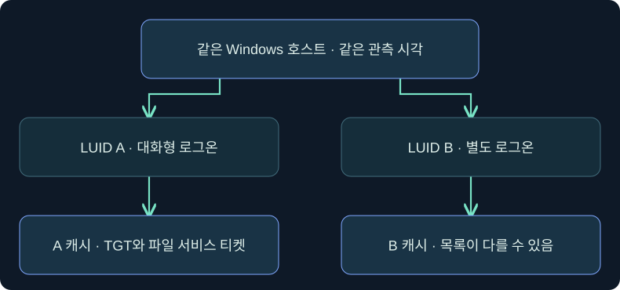
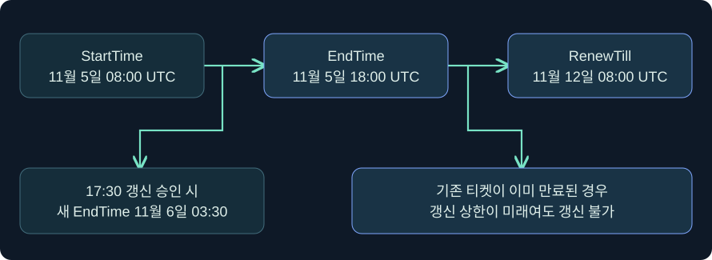
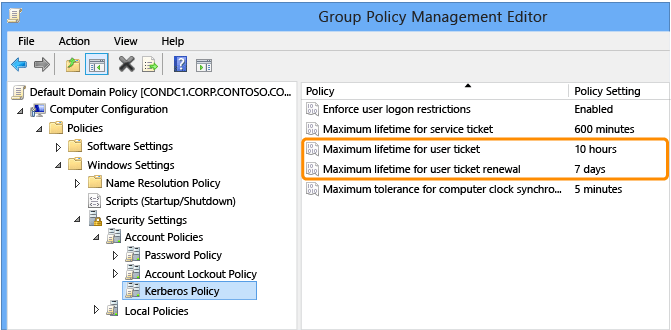
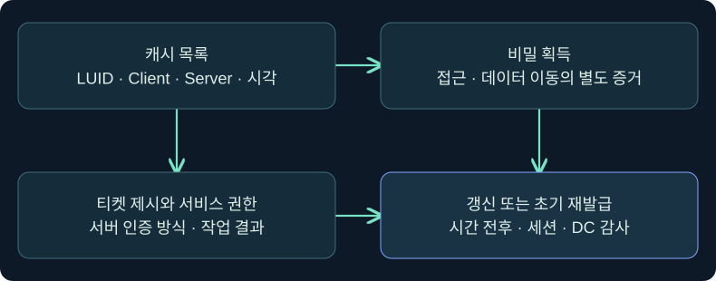

## 1. 캐시에 보인다는 말의 범위를 정합니다

같은 Windows 컴퓨터에 대화형 사용자, 서비스, 별도의 네트워크 자격 증명을 쓰는 작업이 함께 존재할 수 있습니다. 한 창에서 티켓이 보인다고 해서 모든 프로세스가 그 티켓을 쓸 수 있는 것은 아닙니다. 다른 창에서 목록이 비어도 컴퓨터 전체에 티켓이 없다는 뜻은 아닙니다. **누가, 어떤 로그온 세션에서, 어떤 서버 이름에 대해, 어느 시각에 관측했는지**부터 적습니다.

이 강의에서는 Windows의 로그온 세션과 티켓 캐시, TGT의 현재 유효 구간과 갱신 상한을 연결합니다. 캐시 목록 조회는 승인된 실습 문맥을 가정한 미실행 절차입니다. 티켓 본체·키 수집, 반출, 가져오기, 만료 실험, 정책 변경 및 실제 인증을 수행하지 않았습니다.



## 2. 로그온 세션 ID와 관측의 범위를 구별합니다

LUID(Locally Unique Identifier)는 여기서 Windows 로그온 세션을 구분하는 로컬 식별자입니다. 같은 사용자가 다른 방식으로 두 번 로그인하면 별개 로그온 세션이 있을 수 있습니다. PID는 프로세스, 데스크톱 세션 ID는 사용자 인터페이스 세션, Beacon 세션 ID는 도구의 연결을 가리킵니다. LUID로 다른 호스트를 비교할 때는 반드시 호스트와 관측 시간, 필요하면 부팅 구간을 붙입니다.

| 캐시 메타데이터 | 해석할 내용 | 관측 한계 |
|---|---|---|
| LogonID | 어느 로컬 로그온 세션에서 보았는가 | 호스트 간 공통 조인 키로 사용할 수 없음 |
| Client 및 Server | 어느 주체와 서버 이름에 대응하는가 | 리소스 사용 결과는 서비스 로그에서 확인 |
| krbtgt 서비스 이름 | TGT 계열인지 확인하는 단서 | 교차 영역에서는 조회 대상 영역도 확인 |
| cifs 등 서비스 클래스 | 서비스 티켓의 대상 유형 | 실제 대상 객체 권한은 별도 |
| Flags·End Time·Renew Time | 표시된 유효 및 갱신 조건 | 관측 시점·정책·KDC 응답 확인 필요 |

목록에서 서비스 티켓을 본 것과 티켓 본체를 다른 곳에서 사용할 수 있다는 결론 사이에는 여러 단계가 있습니다. 정상적인 티켓 제시에는 대상과 시간 조건 외에 적절한 세션 키로 만든 인증자도 필요합니다. 조사 기록에는 키나 티켓 본체 대신 위의 메타데이터만 남깁니다.

## 3. 캐시 API와 LSASS 메모리 읽기는 관측 경로가 다릅니다

Windows에는 인증 패키지와 통신하는 LSA API가 있습니다. Microsoft의 `KERB_QUERY_TKT_CACHE_REQUEST`에서 0인 LogonId는 현재 세션을 뜻합니다. 이 구조로 0이 아닌 LogonId를 명시하면 문서상 `SeTcbPrivilege`가 필요합니다. 높은 무결성이나 Administrators 그룹 소속만으로 이 API의 특정 권한이 활성화됐다고 추론할 수 없습니다. 조회 메시지와 티켓 자체를 요청하는 메시지도 문서에서 별도로 정의합니다.

이 경로는 다른 프로세스가 LSASS 주소 공간을 직접 읽는 방식과 다릅니다. Sysmon 10 같은 프로세스 접근 이벤트가 없더라도 인증 패키지 호출이나 다른 티켓 관련 행위가 없었다는 근거가 되지 않습니다. 감시 범위, 단말 프로세스·명령줄, 로그온 세션 및 DC·서비스 기록을 대조합니다. Microsoft에 따르면 Credential Guard는 Kerberos TGT를 보호하는 반면 서비스 티켓에는 동일한 보호를 적용하지 않습니다. 표시 가능한 메타데이터와 비밀 본체의 노출 여부도 분리해서 기록합니다.

## 4. 실제 콘솔에서 현재 문맥의 목록을 읽는 위치

### 실제 화면 84: Beacon Console의 읽기 전용 목록 조회 위치


출처는 [Fortra Consoles](https://hstechdocs.helpsystems.com/manuals/cobaltstrike/current/userguide/content/topics/ui_consoles.htm)이며 2026-11-05에 확인했습니다. 4.13 안내서의 공식 삽화는 과거 UI일 수 있습니다. 그림의 기존 결과는 아래 미실행 조회에서 얻은 결과와 관계없습니다. 실제 `klist` 반환 화면 및 별도 Kerberos 설정창 사진은 확보하지 못했습니다.

1. **Sessions → 승인된 실습 세션 → 우클릭 → Interact**를 엽니다. 호스트와 사용자, 조사 대상이 현재 실습 세션인지 확인합니다.
2. 하단 입력 줄에서 `help run`의 설명을 확인합니다. 같은 입력 줄에 아래 값을 넣는 것을 가정합니다. `tickets`는 지정된 범위의 캐시 목록을 읽고, LUID를 생략한 이유는 명령의 현재 로그온 문맥으로 범위를 한정하기 위해서입니다.

```text
run klist.exe tickets
```

3. **Enter**로 제출합니다. 저장할 설정은 없습니다. 체크인과 결과 반환을 기다린 다음 **Current LogonId**, **Client**, **Server**, **End Time**, **Renew Time**을 확인합니다. 관측 노트에는 필요한 필드만 남깁니다. 아래 표의 시간은 화면에서 수집한 값이 아닙니다.
4. 빈 목록과 접근 오류, 명령 미반환을 나눕니다. 세션이 다른 로그온 문맥에서 실행됐다면 같은 계정 표시 이름을 보더라도 다른 결과가 가능합니다. 승인된 사용자의 로컬 비교가 필요하면 해당 사용자의 Windows 터미널에서 `klist tickets`를 조회하는 별도 미실행 절차를 가정합니다.
5. `klist get`은 티켓을 요청하고 `purge`는 캐시를 지웁니다. 이 실습의 조회 단계에서 두 동작을 사용하지 않습니다. 새 DC 이벤트로 조회의 성공 여부를 판단하는 대신 해당 콘솔의 반환과 조회 문맥을 확인합니다.

## 5. 시작·현재 만료·갱신 상한을 한 시간축에 놓습니다

**StartTime**은 티켓 사용이 유효해지는 시각입니다. **EndTime**은 현재 티켓의 사용 기한입니다. **RenewTill**은 갱신이 허용된 티켓의 최종 상한으로, 출력 형식에 따라 **Renew Time** 또는 **RenewUntil**로 보일 수 있습니다. RFC의 초기 인증 시각 `authtime`과 현재 티켓의 `starttime`도 구분합니다. 예를 들어 갱신 후 새 티켓의 시작 시각이 바뀌어도 그 시각에 사용자가 암호를 다시 입력했다는 뜻은 아닙니다.



`RENEWABLE` 플래그는 갱신 가능성을 나타냅니다. **현재 티켓이 아직 유효하고**, 플래그와 상한 조건을 충족하며, KDC가 요청을 받아들이는 경우에 새 티켓으로 바뀝니다. 현재 티켓을 만료 전에 갱신하지 못했다면 상한이 미래라도 그 티켓은 갱신할 수 없습니다. 새 초기 인증이 필요할 수 있습니다. 시간대·시계 오차·유효성 판정은 KDC와 정책에 영향을 받으므로 화면의 시간만 보고 경계 시점의 실제 성공을 단정하지 않습니다.

## 6. 가상 시간표로 갱신 가능성을 계산합니다

가상 TGT의 시작은 11월 5일 08:00 UTC, 현재 만료는 18:00 UTC, 갱신 상한은 11월 12일 08:00 UTC라고 가정합니다. 정상 연결, 일정한 시각, `RENEWABLE` 플래그를 전제로 합니다. 17:30에 갱신이 승인되면 RFC 4120의 일반 갱신 규칙에서 새 만료는 **새 시작 시각 + 기존 유효 길이**와 **기존 갱신 상한** 중 이른 시각입니다. 이 경우 새 만료는 11월 6일 03:30 UTC입니다.

| 바꾼 조건 | 가상 판단 | 이유 |
|---|---|---|
| 11월 5일 17:30, 플래그 있음, KDC 승인 | 11월 6일 03:30까지 새 티켓 | 상한 이전이고 기존 유효 길이는 10시간 |
| 이전 갱신 없이 11월 5일 18:30에 첫 요청 | 기존 티켓 갱신 불가 | 현재 EndTime 경과 |
| 17:30이지만 플래그 없음 | 갱신 불가 | 현재 유효 시간과 갱신 자격은 별개 |
| 별도 갱신 가능한 티켓이 11월 12일 07:00에 여전히 유효 | 승인돼도 새 만료는 최대 08:00 | 기존 RenewTill이 10시간보다 가까움 |
| 17:30, 네트워크 단절 | 갱신 성공 확인 불가 | 캐시 표시는 KDC의 승인 응답이 아님 |

예제의 10시간·7일은 Windows 도메인 정책의 대표값을 설명하는 데 사용했습니다. 실제 계정의 적용 정책, Protected Users나 인증 정책, DC·클라이언트 환경에 따라 더 짧거나 갱신이 제한될 수 있습니다. Windows가 정상적으로 자동 갱신할 수 있어도 항상 같은 시각에 성공한다고 가정하지 않습니다.

### 실제 화면 85: 그룹 정책 편집기의 Kerberos 수명과 갱신 상한



출처는 [Microsoft Protected Accounts 안내](https://learn.microsoft.com/en-us/windows-server/security/windows-authentication/how-to-configure-protected-accounts)이며 2026-11-05에 확인했습니다. 공식 사진의 도메인 이름과 기본 예시 값은 이 강의에서 조회한 결과와 별개입니다. Windows Server 버전과 언어에 따라 메뉴 번역이 달라질 수 있습니다.

1. 권한이 있는 정책 검토 환경에서 **Group Policy Management → 해당 도메인에 적용되는 정책 → Edit**를 열고 **Computer Configuration → Policies → Windows Settings → Security Settings → Account Policies → Kerberos Policy**로 이동합니다.
2. 오른쪽 **Maximum lifetime for user ticket**과 **Maximum lifetime for user ticket renewal**을 차례로 엽니다. 첫 값은 시간 단위의 현재 TGT 최대 수명이고, 둘째는 일 단위의 갱신 범위입니다. 사진의 10시간과 7일은 두 단위를 비교하는 예입니다.
3. 조회만 가정하므로 입력값을 바꾸지 않고 **Cancel**로 닫습니다. 편집기에 표시된 GPO 값과 실제 계정에 적용된 정책 및 관측 티켓의 EndTime·Renew Time을 비교합니다. 개별 값 편집 대화상자와 정책 적용 결과 사진은 확보하지 못했습니다.


## 7. 갱신과 재발급, 캐시 재사용을 나눠 검토합니다

같은 클라이언트와 `krbtgt` 이름이 다시 보이고 EndTime이 뒤로 이동했습니다. 이 사실은 새 티켓이 캐시에 있다는 가설을 지지합니다. 다만 KDC 갱신과 새 초기 인증은 서로 다른 경로입니다. StartTime과 RenewTill의 전후, 로그온 세션 변화, DC 감사 기록이 함께 있어야 경로를 더 좁힐 수 있습니다. 서비스 티켓을 캐시에서 사용했다면 새 발급 이벤트가 같은 시각에 없어도 서비스 요청이 성립할 수 있습니다.

| 관측 위치 | 읽을 자료 | 구별해야 하는 결과 |
|---|---|---|
| 클라이언트 | LUID·StartTime·EndTime·Renew Time | 표시된 캐시의 관측 시각과 범위 |
| DC Security | 4768 초기 TGT 요청·4769 서비스 티켓 요청·4770 티켓 갱신 관련 감사 | DC 감사 범위와 요청 또는 갱신의 실제 대상 |
| 서비스 호스트 | 해당 서비스의 인증 및 자원 접근 기록 | 인증 성공, 권한 거부, 실제 작업 성공 |
| 단말 보안 로그 | 프로세스·로그온·제품 텔레메트리 | 직접 메모리 접근과 캐시 API 경로의 차이 |

Microsoft의 4770 설명은 TGS 티켓 갱신을 대상으로 합니다. 같은 ID의 한 건을 모든 TGT 자동 갱신의 보편적인 지표로 쓰지 않고, 서비스 이름과 발급 DC·이벤트 의미를 확인합니다. DC 수집이 불완전하면 기록이 없다는 사실의 범위도 함께 표시합니다.

## 8. 조사 연습에서 네 가지 관측을 분리합니다

가상 기록에서 08:00에 A 단말의 사용자 세션이 TGT를 받았습니다. 14:00에 조사 도구에서 같은 이름의 세션 두 개를 봤고 현재 세션 목록에는 파일 서비스 티켓이 하나 있었습니다. 14:02에 서버는 접근 거부를 남겼습니다. 17:30에는 기존 세션의 티켓 EndTime이 달라졌습니다.



1. **목록**에는 현재 명령의 LUID와 티켓 메타데이터를 적습니다. 다른 LUID는 별도 범위로 남깁니다.
2. **비밀 획득**에는 이를 지지하는 증거가 있는지 확인합니다. 티켓 목록만으로 본체나 세션 키가 반출됐다고 쓰지 않습니다.
3. **제시·인증**에는 서버 이벤트가 어떤 계정과 인증 패키지를 가리키는지 확인합니다. 접근 거부만 있다면 인증 성공 여부는 로그 내용에 따라 미확인일 수 있습니다.
4. **갱신**에는 변경된 시간 필드와 DC 응답을 연결합니다. 로그온 세션이 바뀌었다면 새 초기 인증도 설명 후보로 남깁니다.

## 9. 대응 후에는 어떤 결과가 달라졌는지 확인합니다

계정 비밀 변경, 티켓 만료, 캐시 상태, 기존 연결 종료는 같은 시간에 일어난다고 가정할 수 없습니다. 조사 기록에서는 정책 적용 시각과 새 요청 결과, 이미 성립된 애플리케이션 세션의 상태를 별도로 기록합니다. 네트워크가 끊긴 단말의 캐시와 중앙 로그의 가시성도 따로 평가합니다. 어떤 조사 구간에서 권한상 확인할 수 없는 자료가 있으면 관측 공백을 남깁니다.

학습 검증을 할 때는 동일한 시각대와 호스트 식별자를 기준으로 합성 캐시 표와 감사 기록을 비교하세요. 티켓과 키 본체를 저장하지 않고도 **요청이 발급됐는지**, **어떤 문맥에서 관측했는지**, **접근이 실제 성립했는지**를 별도 항목으로 설명할 수 있습니다.

## 10. 복습과 즉시 해설

### 복습 1. 같은 사용자 이름인데 캐시 목록이 다른 이유는 무엇인가요?
**해설:** Windows 로그온 세션이 다를 수 있습니다. 호스트·시각·LUID를 함께 비교합니다.

### 복습 2. krbtgt가 보이면 지금 파일을 읽을 수 있나요?
**해설:** TGT 계열 항목의 관측입니다. 대상 서비스 티켓과 서버의 인증·권한 판단까지 확인해야 파일 접근 여부를 알 수 있습니다.

### 복습 3. 높은 무결성이면 명시적 다른 LUID 조회가 허용되나요?
**해설:** 이 강의의 API 구조에서 0이 아닌 LogonId에는 `SeTcbPrivilege`가 필요합니다. 무결성 등급만으로 그 권한이 충족됐다고 볼 수 없습니다.

### 복습 4. Credential Guard가 켜졌는데 목록에 TGT가 보입니다. 보호 실패인가요?
**해설:** 목록의 메타데이터와 보호된 티켓 및 키의 접근성은 별개입니다. 목록을 확인한 사실만으로 보호의 성공이나 실패를 판단할 수 없습니다.

### 복습 5. EndTime이 지났지만 RenewTill이 내일입니다. 갱신할 수 있나요?
**해설:** RFC에 따르면 기존 티켓을 만료 전에 갱신해야 합니다. 갱신 상한이 남아 있어도 만료된 티켓을 되살릴 수 없습니다.

### 복습 6. 새 만료 계산에서 왜 두 값을 비교하나요?
**해설:** 현재 갱신으로 부여할 수 있는 수명과 처음부터 설정된 최종 상한을 함께 지켜야 합니다. 둘 중 더 이른 시각이 새 EndTime의 기준입니다.

### 복습 7. 4770 한 건이면 TGT 갱신이 확인됐나요?
**해설:** Microsoft의 이벤트 의미와 대상 이름을 확인해야 합니다. 시간·클라이언트 캐시·DC 관측을 함께 비교합니다.

### 복습 8. LSASS 프로세스 접근 이벤트가 없으면 티켓 조사도 끝인가요?
**해설:** 프로세스 접근 이벤트는 특정 관측 경로를 보여줍니다. 인증 패키지 호출, 로그온 세션, 단말·DC·서비스의 다른 증거를 확인합니다.

## 11. 공식 출처와 범위

2026-11-05에 대조했습니다. 시간 계산은 RFC 규칙을 이해하기 위한 합성 예제이고 운영체제나 KDC를 실행해 얻은 결과가 아닙니다. 실제 비밀을 표시하거나 수집하지 않습니다.

- [RFC 4120 §2.3과 §3.3.3](https://www.rfc-editor.org/rfc/rfc4120.html)
- [Microsoft klist](https://learn.microsoft.com/en-us/windows-server/administration/windows-commands/klist)
- [Microsoft KERB_QUERY_TKT_CACHE_REQUEST](https://learn.microsoft.com/en-us/windows/win32/api/ntsecapi/ns-ntsecapi-kerb_query_tkt_cache_request)
- [Microsoft Credential Guard 보호 범위](https://learn.microsoft.com/en-us/windows/security/identity-protection/credential-guard/credential-guard-how-it-works)
- [Microsoft 사용자 티켓 수명 정책](https://learn.microsoft.com/en-us/previous-versions/windows/it-pro/windows-10/security/threat-protection/security-policy-settings/maximum-lifetime-for-user-ticket)
- [Microsoft 사용자 티켓 갱신 정책](https://learn.microsoft.com/en-us/previous-versions/windows/it-pro/windows-10/security/threat-protection/security-policy-settings/maximum-lifetime-for-user-ticket-renewal)
- [Microsoft 4770](https://learn.microsoft.com/en-us/previous-versions/windows/it-pro/windows-10/security/threat-protection/auditing/event-4770)
- [Fortra Running Commands](https://hstechdocs.helpsystems.com/manuals/cobaltstrike/current/userguide/content/topics/post-exploitation_running-commands.htm)
