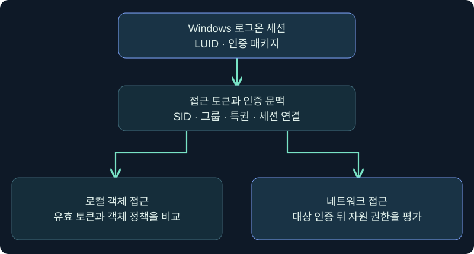
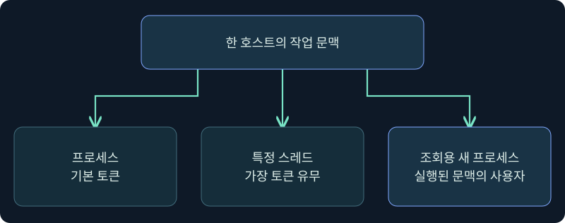
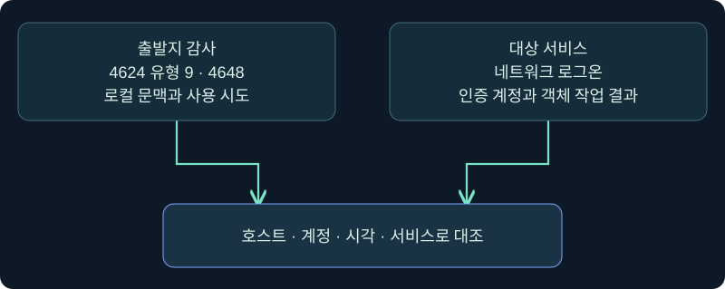

## 1. 같은 컴퓨터에서 서로 다른 사용자 이름이 보이는 이유

지원 도구가 로컬 파일을 열 때는 `student04`로 기록됐는데, 몇 초 뒤 파일 서버에는 `backup-review`라는 계정으로 접속이 남았다고 가정해 보겠습니다. 이름이 다르다는 사실만으로 도구가 로컬 관리자 권한을 얻었다거나 다른 사용자의 토큰을 빼냈다고 판단할 수는 없습니다. 한 작업에서 **로컬 실행 주체**, **아웃바운드 인증에 제공한 신원**, **원격 서비스가 승인한 신원**을 각각 확인해야 합니다.

이번 강의는 10장의 티켓 캐시와 3장의 Windows 토큰 설명을 이어 갑니다. 실습 이름·ID·시각은 모두 합성이며, Beacon과 Windows의 메뉴 및 조회 단계는 미실행입니다. 실제 로그인, 자격 증명 입력·수집, 원격 연결, 보호 설정 변경은 수행하지 않았습니다.

그림의 두 갈래는 권한을 평가하는 위치가 다름을 보여 줍니다. 로컬 운영체제가 파일 핸들을 허용했어도 원격 서버는 자신이 받은 인증과 ACL을 별도로 평가합니다.

## 2. 로그온 세션은 인증 문맥을 묶는 단위입니다

Windows의 LSA(Local Security Authority)는 로그온을 처리하면서 인증 패키지와 협력합니다. 로그온 세션에는 로그온 시각, 유형, 사용한 인증 패키지와 계정 식별 정보 등 운영체제가 제공할 수 있는 메타데이터가 연결됩니다. 세션마다 로컬에서 식별하는 **Authentication ID**가 있으며 형식은 LUID입니다. 동일 계정이라도 대화형 로그인과 서비스 실행 등 별개의 로그온을 만들 수 있습니다.

LUID는 전역 식별자가 아닙니다. 조사 기록에는 호스트와 시간 범위를 함께 붙입니다. 사용자 SID는 계정의 보안 식별자이므로 같은 표시 이름을 가진 로컬 계정과 도메인 계정을 구별하는 데 씁니다. SID가 같아도 로그온 세션까지 같다고 결론 내리지 않습니다. 반대로 표시 이름이 바뀌었다고 기존 SID가 자동으로 바뀌는 것도 아닙니다.

| 식별자 | 무엇을 가리키나요? | 보고서에서 함께 적을 값 |
|---|---|---|
| 사용자 SID | 로컬 또는 도메인 보안 주체 | 계정 영역, 해당 호스트 |
| Authentication ID | 토큰이 연결된 Windows 로그온 세션 | 호스트, 부팅·관측 범위 |
| Token ID | 해당 토큰 개체의 식별자 | 토큰 유형, 조회 시각 |
| PID 및 생성 시각 | 해당 호스트의 프로세스 인스턴스 | 이미지 경로, 호스트, 생성 시각 |
| Windows Session ID | 데스크톱·터미널 세션 구분 | 프로세스, 로그온 유형 |
| Beacon 세션 표시 | Cobalt Strike의 연결 문맥 | 팀 서버·호스트·관측 시각 |

가령 PID가 같아도 오전에 종료된 프로세스와 오후에 새로 생긴 프로세스일 수 있습니다. 같은 프로그램 이름과 PID를 보더라도 생성 시각이 없으면 인과관계를 단정하기 어렵습니다.

## 3. 접근 토큰은 권한 검사의 입력입니다

접근 토큰에는 사용자 SID, 그룹 SID 및 속성, 특권, 무결성 수준, 토큰 유형 등이 들어 있습니다. 그룹이 토큰에 들어 있는 사실과 그룹을 허용 검사에 사용할 수 있는 상태는 다를 수 있습니다. 특권도 보유 여부와 활성 여부를 나눠 봅니다. 무결성 수준은 별도의 정책 판단에 쓰이므로 High라는 표시만으로 파일 ACL이나 프로세스 개체의 접근 제한을 모두 통과한다고 보지 않습니다.

프로세스의 **primary token**은 기본 실행 문맥입니다. 스레드가 별도의 **impersonation token**을 갖고 있다면 해당 스레드의 일부 권한 판단에는 그 문맥이 사용됩니다. 같은 프로세스 안에서 두 요청을 처리하더라도 스레드가 다르면 평가 주체가 다를 수 있습니다. 어떤 자식 프로세스가 어떤 토큰으로 시작하는지는 호출 방식과 프로그램 구현을 확인합니다. 부모 스레드가 가장 중이라는 사실만으로 자식의 기본 토큰을 확정하지 않습니다.

## 4. 캐시와 로컬 토큰의 역할을 구별합니다

Windows 인증 패키지는 해당 로그온 문맥의 네트워크 인증 상태나 티켓을 사용할 수 있습니다. 접근 토큰은 로컬 보안 속성과 관련 로그온 세션을 찾는 단서를 제공하는 객체입니다. 토큰을 열람했다고 그 안에서 비밀번호, NT 해시 또는 티켓 본체가 그대로 나온다고 설명하면 자료의 위치와 의미를 혼동하게 됩니다.

실제 아웃바운드 인증에서는 응용프로그램이 명시적으로 준 자격 증명, 사용한 프로토콜, 기존 연결 재사용, 인증 정책 등이 결과를 바꿀 수 있습니다. 예를 들어 연결이 이미 열린 상태에서 같은 파일을 다시 읽으면 새로운 인증 이벤트가 생기지 않을 수 있습니다. 반대로 DNS 이름을 바꾸면 서비스 이름과 프로토콜 선택이 달라질 수 있습니다. 실습에서는 실제 연결을 새로 만들지 않고 이 조건을 합성 기록에서 비교합니다.

## 5. NewCredentials는 로컬 이름과 아웃바운드 신원을 분리합니다

Microsoft는 `LOGON32_LOGON_NEW_CREDENTIALS`를 현재 토큰의 로컬 신원을 유지하면서 새 로그온 세션에 아웃바운드 자격 증명을 연결하는 형태로 설명합니다. 보안 감사의 로그온 유형 9인 **NewCredentials**가 이 구분을 보여 주는 사례입니다. 새 LUID가 생겨도 로컬 사용자 SID가 그대로일 수 있고, 원격 서비스에서 어떤 신원이 인증됐는지는 실제 연결 결과를 봐야 합니다.

| 합성 변경 | 로컬 접근 | 원격에서 확인할 것 |
|---|---|---|
| 새 네트워크 문맥만 설정 | 원래 로컬 SID와 권한이 유지되는 상황 가능 | 아직 연결이 없으면 성공 미확인 |
| 대상 서버가 다른 계정을 허용 | 로컬 표시는 그대로일 수 있음 | 대상의 인증 계정과 자원 권한 |
| 원격 인증이 거부됨 | 기존 로컬 작업은 계속 가능할 수 있음 | 대상 기록의 계정·실패 코드·프로토콜 |
| 열린 연결을 재사용 | 현재 로컬 이름만으로는 판별 어려움 | 이전에 성립한 서비스 세션의 신원 |

Fortra의 4.13 안내서도 Beacon의 `make_token`이 로컬 작업에 영향을 주지 않으며 입력한 자격 증명을 검증하지 않는다고 설명합니다. 따라서 제품의 문맥 설정 메시지를 도메인 암호 확인이나 서비스 접근 성공으로 번역하지 않습니다. 명령·자격 증명 입력은 이 강의에서 수행하지 않았습니다.

## 6. 실제 Sessions 화면에서 관측 대상을 고릅니다

### 실제 화면 86: 공식 세션 목록에서 호스트와 사용자 열 대조

출처는 [Fortra Session and Target Visualizations](https://hstechdocs.helpsystems.com/manuals/cobaltstrike/current/userguide/content/topics/ui_session-target-visualizations.htm)이며 2026-11-05에 확인했습니다. 공식 삽화의 값과 메뉴 배치는 현재 설치의 표시와 다를 수 있습니다. 사진 속 세션은 이 강의의 가상 사례가 아닙니다.

1. **Cobalt Strike → Visualization → Session Table**에서 승인된 실습 연결만 확인하는 것을 가정합니다. 세션 탭이 이미 열린 경우 그 탭을 사용합니다. 화면의 컴퓨터·사용자·PID 등 표시 가능한 열을 확인합니다.
2. 예시 선택 기준은 `LAB-CLIENT04`와 현재 실습 기록의 연결입니다. 같은 사용자 이름으로 여러 호스트가 뜨는 경우 이름 하나로 고르지 않기 위해서입니다.
3. 해당 행을 우클릭해 **Interact**를 선택하면 연결에 해당하는 콘솔이 열립니다. 세션 행 선택에는 입력 값이나 저장 버튼이 없습니다. 열린 콘솔이 의도한 호스트인지 탭과 목록에서 다시 확인합니다.

세션 행의 사용자 열은 제품이 기록한 상태 표시입니다. 대상 서버의 인증 로그와 동일한 신원을 뜻하지 않습니다. 최신 UI에서 문맥 전환 후 사용자 열이 어떻게 갱신되는지 보여 주는 별도 사진은 확보하지 못했습니다.

## 7. 실제 콘솔에서 사용자 SID와 LUID의 관측을 구분합니다

### 실제 화면 87: Beacon Console의 입력 줄과 반환 영역

출처는 [Fortra Post Exploitation](https://hstechdocs.helpsystems.com/manuals/cobaltstrike/current/userguide/content/topics/post-exploitation_main.htm)입니다. 2026-11-05 기준 문서 버전은 4.13이고 공식 캡처에는 이전 UI가 보일 수 있습니다. 사진 속 반환은 아래 예시를 실행한 결과가 아닙니다.

1. 하단 명령 줄에 `help run`을 입력하여 설치 버전의 명령 설명을 보는 것을 가정합니다.
2. 같은 줄에 `run whoami.exe /user`를 넣고 **Enter**를 누르는 조회를 가정합니다. `/user`를 선택한 이유는 명령 프로세스에서 읽은 사용자 이름과 SID에 범위를 좁히기 위해서입니다. 저장할 값은 없습니다.
3. 콘솔의 작업 제출, 체크인, 반환 시각을 구별합니다. 위쪽 반환 영역의 이름·SID·오류 여부를 기록합니다. 이름의 가정값은 `student04`입니다. 실제 반환 사진은 확보하지 못했습니다.
4. 필요하면 별도 로컬 진단에서 LUID를 확인하도록 조사 범위를 기록합니다. 예를 들어 10장 6강의 `klist tickets`가 제공하는 LogonID는 실행한 문맥의 값입니다. 두 명령에서 읽은 관측값이 같은 스레드의 토큰을 뜻한다고 가정하지 않습니다.

## 8. 로그를 읽을 때 발생 호스트와 성공 범위를 확인합니다

`4624`의 Subject는 로그온 작업을 시작했거나 보고한 주체이고, New Logon은 새 세션의 주체를 설명합니다. Version 2의 Network Account Name과 Domain은 유형 9에서 아웃바운드에 사용할 계정을 해석하는 단서입니다. Linked Logon ID가 0이면 문서상 연결된 로그온 세션이 표시되지 않은 경우입니다. `4648`은 명시 자격 증명을 사용하려 한 시도이며 파일 서버가 인증을 받아들였다는 기록이 아닙니다.

| 시각과 위치 | 가상 관측 | 해석 |
|---|---|---|
| 10:00 UTC, 출발지 | 4624 유형 9, 로컬 `student04`, 네트워크 계정 `backup-review` | 로컬 새 로그온 문맥 확인 |
| 10:01 UTC, 출발지 | 4648, 실습 작업과 일치하는 프로세스 | 명시 자격 증명 사용 시도 관측 |
| 10:02 UTC, 파일 서버 | 4624 유형 3, `backup-review` | 서버의 네트워크 로그온 확인 |
| 10:03 UTC, 서비스 | 승인된 테스트 문서 접근 거부 | 인증과 객체 접근 결과가 다름 |

위 시간표의 사건은 호스트·계정·출발지·서비스가 맞는지 함께 비교해야 연결할 수 있습니다. 출발지 LUID와 서버 LUID를 숫자가 같다는 이유로 조인하지 않습니다. 서비스 기록이 없으면 실제 인증 성공·실패는 보류하며, 감사 설정과 수집 범위도 확인합니다.

## 9. 조사 결론의 범위를 문장으로 씁니다

좋은 기록은 주어와 관측 지점을 드러냅니다. 예를 들어 “출발지 로그에 로컬 신원이 유지된 NewCredentials 세션이 생겼다. 원격 파일 서버에는 다른 네트워크 계정의 로그온이 기록됐다. 이 계정은 테스트 문서 접근에서 거부됐다.”라고 쓰면 어떤 결과가 확인됐는지 알 수 있습니다.

운영 도구가 평소 같은 기능을 쓴다면 승인된 작업 계정, 프로세스 경로, 예정된 시간, 대상 서비스가 모두 맞는지 비교합니다. 익숙한 이름 하나만으로 정상으로 분류하기 어렵습니다. 반대로 유형 9 한 건이나 사용자 표시 불일치만으로 토큰 탈취를 확정할 수도 없습니다.

## 10. 복습과 즉시 해설

### 복습 1. SID가 같으면 LUID도 같은가요?
**해설:** 같은 보안 주체가 여러 로그온 세션을 가질 수 있습니다. SID는 계정을, Authentication ID는 해당 로그온 세션을 가리킵니다.

### 복습 2. Token ID와 Authentication ID는 어떻게 다른가요?
**해설:** 하나는 토큰 개체의 식별자이고 다른 하나는 토큰과 연결된 로그온 세션의 식별자입니다. 여러 토큰이 한 로그온 세션에 연결될 수 있습니다.

### 복습 3. 프로세스 기본 토큰을 읽으면 모든 스레드의 신원도 알 수 있나요?
**해설:** 스레드가 별도 가장 토큰을 쓰는지 확인해야 합니다. 기본 토큰과 실제 작업을 처리한 스레드의 문맥을 구분합니다.

### 복습 4. 로그온 유형 9인데 로컬 이름이 그대로인 이유는 무엇인가요?
**해설:** NewCredentials는 현재 로컬 신원을 유지하고 아웃바운드에 별도 자격 증명을 연결할 수 있습니다. 원격 결과는 대상의 기록을 확인합니다.

### 복습 5. 4648이 보이면 파일 서버에 들어갔다는 뜻인가요?
**해설:** 명시 자격 증명을 사용하려 한 기록입니다. 파일 서버의 인증 로그와 객체 접근 결과가 각각 필요합니다.

### 복습 6. 서로 다른 호스트에서 LUID 값이 같습니다. 같은 세션인가요?
**해설:** LUID는 로컬 범위에서 해석합니다. 호스트·시간·사용자·출발지와 대상 서비스 같은 별도 관측을 사용합니다.

### 복습 7. 서버 유형 3 로그온이 성공했는데 파일 접근은 거부될 수 있나요?
**해설:** 서버 인증과 객체에 대한 권한 검사는 별개입니다. 공유·파일 ACL 및 애플리케이션의 접근 정책을 확인합니다.

### 복습 8. 콘솔의 whoami가 보여 주는 신원은 누구인가요?
**해설:** 조회 명령이 실행된 보안 문맥의 사용자 단서입니다. 부모의 특정 스레드나 원격 서비스가 받아들인 신원을 별도 증거 없이 확정할 수 없습니다.

## 11. 공식 출처와 검증 범위

2026-11-05에 Windows 및 Fortra 공식 자료와 대조했습니다. 그림은 독립 제작했고, 예제의 사건과 계정·시간은 설명용 가정입니다. 실제 콘솔 조회와 인증은 미실행입니다.

- [Microsoft Access Tokens](https://learn.microsoft.com/en-us/windows/win32/secauthz/access-tokens)
- [Microsoft TOKEN_STATISTICS](https://learn.microsoft.com/en-us/windows/win32/api/winnt/ns-winnt-token_statistics)
- [Microsoft LogonUserA](https://learn.microsoft.com/en-us/windows/win32/api/winbase/nf-winbase-logonusera)
- [Microsoft 4624](https://learn.microsoft.com/en-us/windows/security/threat-protection/auditing/event-4624)
- [Microsoft 4648](https://learn.microsoft.com/en-us/windows/security/threat-protection/auditing/event-4648)
- [Fortra Trust Relationships](https://hstechdocs.helpsystems.com/manuals/cobaltstrike/current/userguide/content/topics/post-exploitation_trust-relationships.htm)
- [Fortra Running Commands](https://hstechdocs.helpsystems.com/manuals/cobaltstrike/current/userguide/content/topics/post-exploitation_running-commands.htm)
