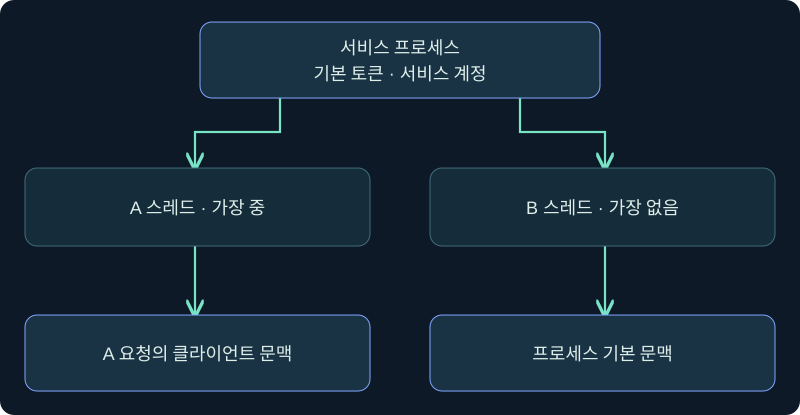
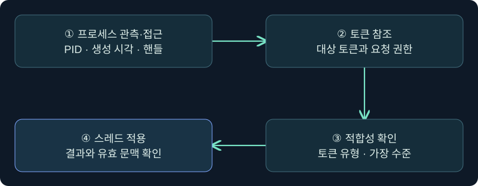
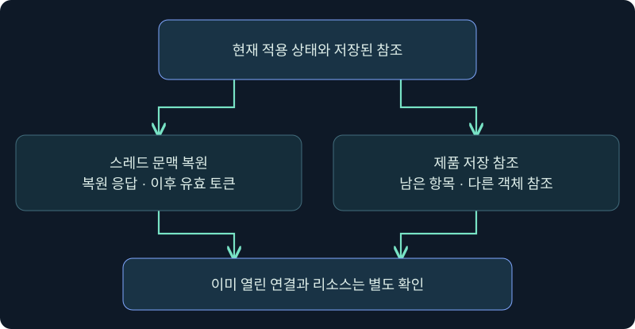

## 1. 서비스가 잠시 다른 사용자로 일하는 이유

문서 서버에 두 사람이 동시에 접근했다고 가정하겠습니다. 서버 프로세스는 서비스 계정으로 실행됩니다. 요청을 처리하는 스레드는 각 사용자의 권한으로 문서를 열 수 있는지 확인할 수 있습니다. Windows의 **가장(impersonation)**은 이처럼 스레드가 특정 작업 동안 다른 보안 문맥으로 동작하는 데 쓰입니다. 이 기능이 악용된 사건을 조사할 때도 먼저 정상적인 사용 목적과 실제 문맥 변화를 구별해야 합니다.

이 강의의 목적은 **토큰을 참조할 수 있는 상태**, **스레드에 적용된 상태**, **원래 문맥을 되찾은 상태**에 어떤 증거가 필요한지 이해하는 것입니다. 아래 예시는 합성이며 제품과 Windows에서 실제 토큰 생성·복제·적용·복원, 비밀 수집, 원격 인증, 보호 설정 변경은 수행하지 않았습니다.

그림은 같은 프로세스에서 A 스레드만 다른 문맥을 사용하고 B 스레드는 기본 문맥에 남을 수 있음을 보여 줍니다. 토큰을 가진 프로세스 이름과 실제 작업을 한 스레드의 신원이 다를 수 있는 이유입니다.

## 2. 가장 수준과 무결성 등급은 다른 정보입니다

Microsoft는 가장 수준을 Anonymous, Identification, Impersonation, Delegation으로 구분합니다. 이 수준은 서버가 클라이언트 문맥에서 무엇을 할 수 있는지의 경계를 표현합니다. 무결성 수준인 Low·Medium·High·System은 별도의 Windows 보안 판단에 쓰입니다. 두 종류의 값이 모두 “수준”으로 불리므로 로그 열을 혼동하기 쉽습니다.

| 가장 수준 | 무엇을 허용하나요? | 단독으로 증명할 수 없는 것 |
|---|---|---|
| Anonymous | 호출자의 신원을 얻거나 그 신원으로 가장할 수 없음 | 작업 성공이나 실제 주체 |
| Identification | 신원과 일부 보안 정보를 확인할 수 있음 | 해당 신원으로 스레드에서 작업 가능 |
| Impersonation | 로컬에서 클라이언트 문맥으로 작업할 수 있음 | 다른 서버로 그 문맥을 위임할 수 있음 |
| Delegation | 원격에서도 그 문맥을 사용할 수 있는 수준 | 실제 네트워크 정책·서비스 인증 성공 |

예를 들어 High 무결성의 서비스가 Identification 토큰을 받았다고 가정하겠습니다. API가 요구하는 가장 수준을 충족하지 않으면 그 토큰으로 가장할 수 없습니다. 반대로 Delegation 표시가 보여도 인증 방식이나 정책, 서비스 구성이 허용하는지 따로 확인합니다.

## 3. 토큰 접근·복제·적용의 경계를 구분합니다

프로세스 객체를 열 수 있는 것과 그 프로세스의 기본 토큰을 열 수 있는 것은 서로 다른 검사입니다. API 이름으로 보면 `OpenProcessToken`은 프로세스의 기본 토큰을, `OpenThreadToken`은 스레드의 가장 토큰을 조회하는 인터페이스입니다. `DuplicateTokenEx`는 권한이 허용될 때 새 토큰 개체를 만들며 유형에 따라 사용할 수 있는 곳이 달라집니다. 조사에서는 접근 시도나 열린 핸들과 실제 복제 또는 적용 증거를 나눕니다.

`ImpersonateLoggedOnUser` 문서에는 필요한 토큰 핸들 권한, 가장 수준, 호출자 조건이 각각 명시돼 있습니다. 예를 들어 호출자의 `SeImpersonatePrivilege`, 명시 자격 증명으로 생성한 토큰, 동일한 인증 신원 등 서로 다른 허용 조건이 있습니다. 이 조건과 토큰의 적합성을 함께 봅니다. 도구가 높은 무결성으로 실행됐다는 사실만으로 접근 가능한 대상 또는 가장 성공을 일반화하지 않습니다.

## 4. 새 네트워크 문맥과 기존 토큰 참조를 비교합니다

제품 문서에서 `make_token`은 원래 로컬 신원을 유지하는 아웃바운드 문맥을 생성하는 기능으로, `steal_token`은 다른 프로세스의 접근 토큰을 사용하려는 기능으로 설명됩니다. 첫 방식은 대상 계정의 자격 증명을 이미 알고 있다는 전제를 다루며, 둘째는 다른 프로세스와 토큰에 대한 접근 및 적절한 적용 권한이 관건입니다. 이 차이는 조사 우선순위를 바꿉니다.

| 관측 질문 | 새 아웃바운드 문맥 | 기존 토큰 참조 |
|---|---|---|
| 어떤 변경을 찾나요? | 동일 로컬 신원과 별도 네트워크 문맥 | 기존 토큰 참조와 실제 적용 여부 |
| 처음 보는 근거 | 로그온 유형·LUID·명시 자격 증명 시도 | 프로세스·토큰 접근 및 단말 제품 관측 |
| 다른 이름이 보이면? | 로컬 이름과 네트워크 계정을 구분 | 조회 대상 토큰 유형 및 실행 스레드 확인 |
| 원격 성공을 어떻게 판단하나요? | 대상 서버의 신원과 인증 결과 | 대상 정책, 인증 결과와 자원 작업 결과 |

기존 토큰을 사용하려는 요청은 토큰 접근 제한이나 프로세스 보호로 실패할 수 있습니다. 새 문맥을 만들었다는 메시지가 보이더라도 네트워크 쪽 자격 증명이 서버에서 검증됐는지와 로컬 권한이 달라졌는지는 별개입니다.

## 5. 실제 Process Browser에서 관측 범위를 정합니다

### 실제 화면 88: Process Browser의 프로세스 트리와 상세 영역

출처는 [Fortra Process Browser](https://hstechdocs.helpsystems.com/manuals/cobaltstrike/current/userguide/content/topics/post-exploitation_process-browser.htm)이며 2026-11-05에 확인했습니다. 4.13 설명과 공식 사진의 UI 시점이 다를 수 있습니다. 사진의 프로세스와 사용자는 출처의 시연에 해당합니다.

1. **Sessions → 승인된 실습 세션 → 우클릭 → Explore → Show Processes**를 엽니다. 이 메뉴는 목록을 조회하는 요청입니다. 조회 범위는 현재 실습 호스트 하나로 제한합니다.
2. 예시 선택값은 가상 PID `3480`의 `TrainingViewer.exe`입니다. 왼쪽 트리에서 행을 선택한 뒤 오른쪽에서 PID와 경로·사용자 등 설치 버전에서 표시하는 정보를 대조합니다. PID와 이름을 함께 보는 이유는 대상 프로세스가 의도와 맞는지 확인하기 위해서입니다.
3. 행 선택에는 입력 칸과 저장 버튼이 없습니다. 이 강의는 목록과 세부 정보까지만 확인하는 미실행 절차입니다. 하단의 상태 변경·수집 버튼은 위치만 식별합니다. 조회 반환이 늦거나 프로세스가 종료됐다면 체크인 시각과 목록의 최신성을 먼저 비교합니다.

목록의 사용자 열은 프로세스 관측값입니다. 특정 스레드의 가장 적용 여부는 별도 증거가 필요합니다. 강의 예시의 목록 반환, 토큰 접근 실패 또는 적용 완료를 담은 공식 실제 사진은 확보하지 못했습니다.

## 6. Token Store는 참조와 적용을 따로 기록합니다

토큰은 Windows 커널이 관리하는 객체입니다. 원래 프로세스가 종료돼도 다른 참조가 유지되는 동안 객체가 남을 수 있습니다. 참조가 남았다는 사실만으로 계정이 계속 활성 상태이거나 이미 성립한 네트워크 연결이 살아 있다고 결론 내릴 수는 없습니다. 제품의 Token Store 항목도 저장소와 Beacon의 문맥에서 해석하며 영구 보존을 가정하지 않습니다.

### 실제 화면 89: Beacon Console에서 현재 문맥과 저장 목록을 따로 조회

출처는 [Fortra Post Exploitation](https://hstechdocs.helpsystems.com/manuals/cobaltstrike/current/userguide/content/topics/post-exploitation_main.htm)입니다. 2026-11-05 확인 기준 안내서 버전은 4.13이며 그림은 이전 UI일 수 있습니다. 사진에 보이는 결과는 아래 조회를 수행한 출력과 별개입니다.

1. **Sessions → 승인된 실습 세션 → 우클릭 → Interact**로 콘솔을 엽니다. 하단 입력 줄에서 `help token-store`를 확인하고 현재 버전에서 조회 동작의 이름을 확인합니다.
2. 같은 칸에 `token-store show`를 넣어 **Enter**로 제출하는 것을 가정합니다. `show`는 저장된 참조 목록만 읽는 값입니다. 사용·삭제·생성 동작은 이 절차에 포함하지 않습니다. 목록에는 가상 항목 `3`이 있을 수 있다고 가정하고 반환 영역에서 항목의 표시 ID와 오류·반환 시각을 구별합니다.
3. 동일한 하단 입력 줄에서 `getuid`로 현재 토큰의 사용자 표시를 읽는 별도 조회를 가정합니다. 선택 인수와 저장 버튼은 없습니다. 목록의 계정과 현재 표시가 같아도 해당 항목이 실제 적용됐는지 확인하려면 작업 전후 기록을 대조합니다.
4. 빈 저장소, 반환 대기, 실패를 서로 다른 상태로 적습니다. Token Store 전용 화면이나 이 명령의 공식 반환 캡처는 확보하지 못했습니다. 위 사진으로 확인할 수 있는 것은 공통 콘솔의 입력·반환 위치입니다.

## 7. 복원 확인은 저장소 정리와 별도입니다

Microsoft의 `RevertToSelf`는 호출 스레드가 클라이언트 가장을 끝내는 API입니다. 복원에 실패하면 그 스레드가 여전히 클라이언트 문맥에서 동작할 수 있으므로 호출 결과를 확인해야 합니다. 서비스 구현에서는 실패한 스레드가 계속 권한 작업을 수행하지 않도록 처리해야 합니다. Fortra의 `rev2self` 문서도 제품에서 원래 토큰으로 돌아오는 동작으로 설명합니다.

토큰 저장 목록에서 항목을 제거하는 것과 현재 가장 상태를 복원하는 것은 다른 기능입니다. 이미 열린 리소스 핸들이나 성립된 네트워크 연결의 상태도 별도 확인 대상입니다. 복원 메시지를 보고 저장소가 비워졌거나 원격 연결이 즉시 종료됐다고 추정하지 않습니다.

## 8. 반환 메시지의 증명 범위를 표로 남깁니다

다음 표는 미실행 가상 사례입니다. 출발지·대상의 가시성이 다를 수 있으므로 관측 장소를 함께 적습니다.

| 합성 관측 | 입증되는 범위 | 추가로 확인할 것 |
|---|---|---|
| Process Browser의 PID 3480 행 표시 | 조회 시점의 프로세스 인벤토리 | 생성 시각, 토큰 접근 성공 여부 |
| 저장소 ID 3이 표시됨 | 해당 제품 문맥에서 참조 항목 존재 | 실제 스레드 적용 및 지속 여부 |
| 현재 사용자 표시가 바뀜 | 제품이 보고한 현재 토큰 사용자 | 토큰 유형, LUID, 원격 인증 결과 |
| 동일 사용자 표시로 돌아옴 | 관측한 사용자 표시가 이전과 같음 | 복원 응답, 실제 스레드, 남은 참조 |
| 대상 서버에서 접근 거부 | 대상의 특정 작업이 허용되지 않음 | 인증과 권한 거부 구별, 로그 범위 |

콘솔의 `getuid`는 현행 문서에서 현재 토큰의 사용자 ID를 보여 주는 명령입니다. 이 결과를 늘 프로세스 기본 토큰에서 읽는다고 일반화하지 않습니다. 로컬 사용자 표시와 네트워크에 제시된 신원이 달라질 수 있다는 점은 앞 강의의 NewCredentials 사례와 연결됩니다.

## 9. 탐지에서는 정상 서비스 동작과 적용 결과를 비교합니다

서비스가 정상적으로 클라이언트 요청을 처리할 때도 가장 기능을 쓸 수 있습니다. 평소 어떤 프로그램이 누구를 대신해 어느 리소스에 접근하는지 기준선을 두고, 예상하지 못한 프로세스·사용자·시각에 나타난 문맥 변화부터 확인합니다. 단말 센서에서 프로세스 접근이 보이면 같은 프로세스 인스턴스인지와 실제 접근 권한, 이후 작업이나 네트워크 로그를 비교합니다.

토큰 적용만으로 새로운 로그인이나 원격 인증 기록이 반드시 생긴다고 가정하지 않습니다. 이미 존재하던 토큰을 사용했을 수 있고 원격 연결이 없을 수도 있습니다. 새 로그온 세션, 기존 토큰의 적용, 대상 서비스의 권한 판단을 따로 남기면 단서가 일부만 있어도 결론의 범위를 설명할 수 있습니다.

## 10. 복습과 즉시 해설

### 복습 1. 정상 서비스가 가장 토큰을 사용하는 이유는 무엇인가요?
**해설:** 서비스 계정의 넓은 권한으로 모든 요청을 처리하는 대신 호출자 문맥에서 특정 요청의 권한을 확인하거나 작업할 수 있습니다.

### 복습 2. SecurityIdentification 토큰이 있고 호출자는 High입니다. 가장에 충분한가요?
**해설:** 가장 수준과 무결성은 별개입니다. 이 API가 요구하는 가장 수준과 토큰 핸들 권한, 호출자 조건을 확인합니다.

### 복습 3. 프로세스 접근이 성공하면 그 토큰이 적용됐나요?
**해설:** 프로세스 핸들 접근, 토큰 핸들 접근, 복제, 적용은 다른 단계입니다. 성공을 주장할 단계의 증거가 필요합니다.

### 복습 4. 원래 프로세스가 종료됐는데 저장 항목이 남을 수 있나요?
**해설:** 유효한 참조가 남으면 토큰 객체가 더 유지될 수 있습니다. 저장소의 수명이나 원격 접속 성공은 별도로 확인합니다.

### 복습 5. 목록에서 토큰을 제거하면 현재 가장도 자동 해제되나요?
**해설:** 저장 참조 관리와 현재 스레드의 문맥 복원은 각각 확인할 상태입니다.

### 복습 6. getuid의 사용자와 원격 서비스 사용자는 언제 다를 수 있나요?
**해설:** 로컬 신원이 유지된 채 아웃바운드용 문맥을 별도로 사용하는 경우가 있습니다. 원격 신원은 대상 서비스나 인증 로그에서 확인합니다.

### 복습 7. RevertToSelf가 실패한 뒤 일반 작업을 계속해도 되나요?
**해설:** 이전 클라이언트 문맥이 계속 적용될 수 있습니다. 실패를 검출하고 해당 문맥에서 추가 작업이 진행되지 않도록 처리해야 합니다.

### 복습 8. 원격 기록이 없으면 가장이 전혀 없었다고 볼 수 있나요?
**해설:** 로컬에서만 작업했거나 원격 수집 범위가 부족할 수 있습니다. 단말의 문맥과 서비스 로그의 범위를 함께 확인합니다.

## 11. 공식 출처와 검증 범위

2026-11-05에 대조했습니다. 화면은 공식 자료에 있는 실제 제품 모습이며, 예제 값과 사건 표는 독립 작성한 가정입니다. Windows·제품·대상 연결·토큰과 자격 증명 작업은 미실행입니다.

- [Microsoft Impersonation Tokens](https://learn.microsoft.com/en-us/windows/win32/secauthz/impersonation-tokens)
- [Microsoft ImpersonateLoggedOnUser](https://learn.microsoft.com/en-us/windows/win32/api/securitybaseapi/nf-securitybaseapi-impersonateloggedonuser)
- [Microsoft DuplicateTokenEx](https://learn.microsoft.com/en-us/windows/win32/api/securitybaseapi/nf-securitybaseapi-duplicatetokenex)
- [Microsoft RevertToSelf](https://learn.microsoft.com/en-us/windows/win32/api/securitybaseapi/nf-securitybaseapi-reverttoself)
- [Fortra Trust Relationships](https://hstechdocs.helpsystems.com/manuals/cobaltstrike/current/userguide/content/topics/post-exploitation_trust-relationships.htm)
- [Fortra Running Commands](https://hstechdocs.helpsystems.com/manuals/cobaltstrike/current/userguide/content/topics/post-exploitation_running-commands.htm)
