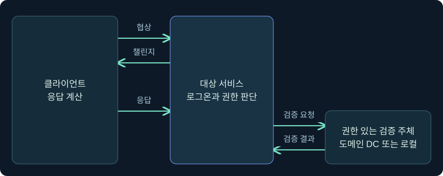
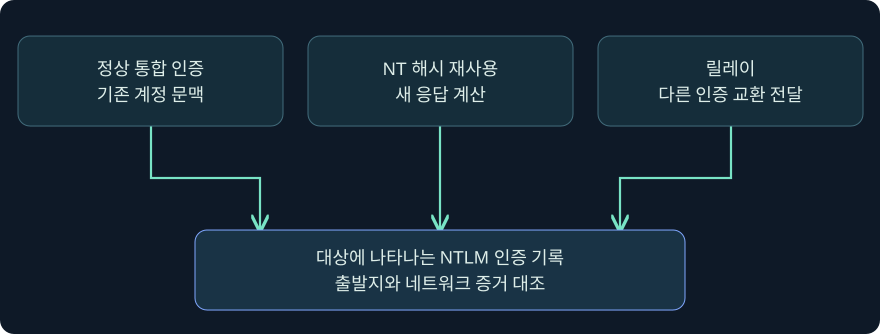
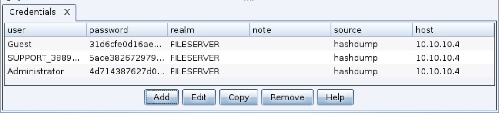
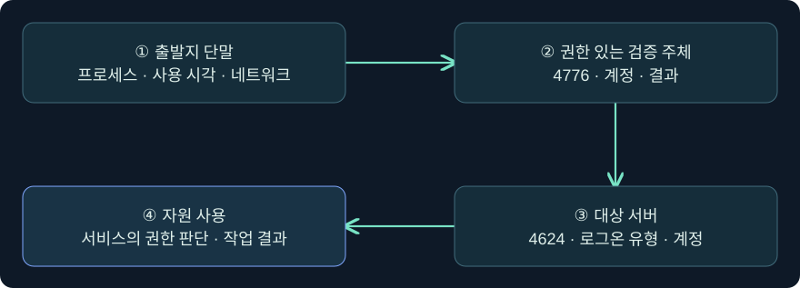

## 1. 인증은 성공했는데 비밀번호를 입력한 흔적이 없습니다

파일 서버에 NTLM 네트워크 로그온이 기록됐다고 가정하겠습니다. 운영자가 비밀번호 입력 창을 보지 못했다는 사실만으로 Pass the Hash(PtH)를 확정할 수는 없습니다. 기존 Windows 세션의 통합 인증도 입력 창 없이 동작할 수 있습니다. 조사에서는 **어떤 인증 방식이 선택됐는지**, **어느 계정이 검증됐는지**, **어떤 프로세스가 요청했는지**, **대상에서 무엇을 할 수 있었는지**를 나눠 봅니다.

이번 강의의 계정·주소·시간표는 합성입니다. Windows와 Cobalt Strike의 화면 조회는 미실행 절차입니다. 실제 암호·해시 입력이나 수집, 인증 요청, 원격 실행, 보호 설정 변경은 수행하지 않았습니다.

## 2. NT 해시와 네트워크 응답의 역할이 다릅니다

NTLM은 챌린지-응답 방식입니다. 일반적인 흐름에서는 클라이언트와 서버가 인증 옵션을 협상하고 서버가 챌린지를 보냅니다. 클라이언트는 계정 비밀에서 파생된 키를 사용해 그 인증 교환에 맞는 응답을 계산합니다. 로컬 계정은 해당 컴퓨터가, 도메인 계정은 일반적으로 도메인 컨트롤러가 권한 있는 검증 주체입니다.

NT 해시는 비밀번호로부터 파생된 장기 비밀에 해당합니다. **NTLMv2 응답은 그 비밀을 사용해 특정 인증 교환에 맞춰 계산한 자료**입니다. 둘은 서로 대체할 수 없습니다. 패킷에서 챌린지와 응답을 봤다고 그 안에 NT 해시가 전송됐거나 응답을 다른 챌린지에 그대로 쓸 수 있다는 뜻은 아닙니다.

PtH에서는 재사용 가능한 NT 해시를 확보한 주체가 평문 비밀번호를 알지 못해도 해당 비밀로 새 응답을 계산할 수 있다는 점이 중요합니다. 10장 4강의 DCC2 캐시 로그온 검증자는 목적과 형식이 다릅니다. 이를 NTLM 네트워크 인증의 NT 해시로 대입할 수 없습니다.

## 3. 같은 NTLM 성공도 출발지 흔적은 다를 수 있습니다

직접 NTLM을 구현하는 클라이언트는 Windows에 새로운 로컬 로그온 세션을 만들지 않고 대상에 인증을 시도할 수 있습니다. 다른 방식은 Windows 쪽 로그온·토큰 문맥을 이용해 운영체제의 아웃바운드 인증 경로에 영향을 줍니다. 두 접근은 대상 서버에서 비슷한 NTLM 로그를 남길 수 있지만, 출발지의 프로세스·로그온·메모리 접근 증거는 다를 수 있습니다.

| 방식 | 인증에 관련된 자료 | 확인할 차이 |
|---|---|---|
| 정상 통합 인증 | 기존 계정 문맥과 인증 패키지 | 평소 앱·계정·접속 패턴과 일치하는가 |
| Pass the Hash | 재사용 가능한 NT 해시 | 비밀 접근 증거와 후속 인증이 연결되는가 |
| NTLM 릴레이 | 다른 클라이언트의 진행 중인 인증 교환 | 연결 경로 및 대상의 서명·바인딩 요구 |
| 오프라인 추측 | 포착한 응답 또는 검증 자료 | 네트워크 로그만으로 추측이나 성공을 입증할 수 없음 |
| 키를 사용한 Kerberos 초기 인증 | 계정의 Kerberos 장기 키 | DC의 AS 교환과 발급 결과를 별도 관측 |

그림에서 세 갈래가 대상의 NTLM 인증 관측으로 모입니다. 대상 이벤트에서 입력 비밀의 형태까지 구별할 수 없으므로 출발지와 네트워크 증거가 중요합니다. SMB 서명 요구는 릴레이 방어와 관련됩니다. 올바른 비밀을 가진 주체의 인증을 차단하는 정책과 같은 효과라고 가정하지 않습니다.

## 4. 계정 범위·인증 정책·작업 권한이 각각 결과를 바꿉니다

가상 실습의 두 장비에 같은 이름의 로컬 운영 계정이 있다고 가정해 보겠습니다. 이름이 같아도 같은 비밀을 쓰는지는 별개입니다. Windows LAPS로 호스트별 비밀을 관리하면 한 장비의 비밀이 다른 장비에서도 맞을 가능성을 낮춥니다. 반면 실제로 공유된 비밀을 사용하고 NTLM이 허용되면 위험 범위가 넓어집니다.

대상이 NTLM을 허용하지 않거나 계정이 잠겼다면 인증 결과가 달라집니다. 인증을 통과했더라도 원격 UAC 제한이나 공유·파일·서비스 ACL이 이후 작업을 거부할 수 있습니다. 예를 들어 대상에 로그인한 계정이 관리 공유 접근을 거부당하면 **검증 성공**, **로그온 성공**, **관리 작업 거부**를 각각 기록합니다.

## 5. NTLM 사용 여부는 버전과 적용 정책으로 확인합니다

Microsoft는 Windows 11 24H2 및 Windows Server 2025에서 NTLMv1을 제거했다고 설명합니다. NTLMv2의 사용 중단 계획과 앞으로의 기본 비활성화는 제품의 기존 설치가 당장 모든 NTLM을 거부한다는 뜻으로 해석할 수 없습니다. 이 내용은 2026-11-05에 공식 자료와 대조했습니다. 조사 대상에서는 **빌드·서비스 종류·실제 정책·검증 로그**를 확인합니다.

Kerberos를 예상한 환경에서 NTLM이 나타나면 서비스 이름 등록, 대상 주소 형태, DC 도달성, 애플리케이션의 인증 설정 등 정상적인 원인도 후보에 둡니다. Negotiate는 협상 패키지이므로 로그에 그 이름만 있으면 최종 방식이 NTLM이었는지 Kerberos였는지 별도 근거를 확인합니다.

## 6. 실제 Credentials 화면에서 목록과 사용 결과를 나눕니다

### 실제 화면 90: Cobalt Strike Credentials의 저장 항목 표시

출처는 [Fortra Credentials](https://hstechdocs.helpsystems.com/manuals/cobaltstrike/current/userguide/content/topics/data-mgmnt_credentials.htm)입니다. 2026-11-05에 4.13 문서를 대조했습니다. 공식 예시의 UI와 설치 버전은 다를 수 있고 화면의 값은 아래 가상 사례와 별개입니다.

1. 승인된 실습에서 **View → Credentials**를 열어 목록을 보는 것을 가정합니다. 조사 대상 예시값은 `TRAINING\review-only`입니다. 이름과 영역을 함께 고르는 이유는 같은 이름의 로컬 계정과 도메인 계정을 구별하기 위해서입니다.
2. 해당 행을 선택하더라도 별도의 입력·저장이 필요하지 않습니다. 열의 항목 유형·계정 영역과 기록 출처가 구별되는지 확인합니다. 실제 비밀 필드는 기록하거나 복사하지 않습니다.
3. Fortra 문서는 별도의 **세션 우클릭 → Access → Make Token** 대화상자가 Credential 모델의 항목을 사용한다고 설명합니다. 이 강의의 목록 사진은 그 대화상자가 아닙니다. 대화상자와 실제 인증 결과의 공식 캡처는 확보하지 못했습니다. 항목 선택·적용을 통한 자격 증명 사용은 수행하지 않았습니다.

Credentials 행은 도구에 기록된 자료입니다. 도구가 행을 수동으로 추가할 수도 있으므로 행이 존재한다고 비밀 획득 경로나 유효성·원격 성공이 증명되지는 않습니다.

## 7. 실제 콘솔에서 명령 도움말과 현재 문맥을 읽습니다

### 실제 화면 91: Beacon Console의 입력 줄과 반환 영역

출처는 [Fortra Post Exploitation](https://hstechdocs.helpsystems.com/manuals/cobaltstrike/current/userguide/content/topics/post-exploitation_main.htm)입니다. 2026-11-05 확인 기준 4.13 문서에 수록된 공식 화면이며 캡처의 UI 시점은 다를 수 있습니다.

1. **Sessions → 승인된 실습 세션 → 우클릭 → Interact**에서 콘솔을 열고 호스트·세션을 확인하는 것을 가정합니다.
2. 아래쪽 칸에 `help pth`를 입력하고 **Enter**를 누르는 미실행 조회입니다. `help`를 붙이는 이유는 현재 버전의 도움말만 읽기 위해서입니다. 사용자·해시·PID를 입력하지 않고 저장할 항목도 없습니다.
3. 위쪽 반환 영역에 도움말이 표시되는지 확인합니다. 가상 사례에서는 상태 표시줄의 `LAB-WS14`와 세션 기록을 맞춰 봅니다. 필요하면 `getuid`를 같은 칸에 넣어 현재 토큰의 사용자 표시를 읽는 조회를 가정합니다. 원격 서버가 어떤 계정을 인정했는지는 이 출력으로 알 수 없습니다.
4. 사진의 출력은 이 절차의 결과가 아닙니다. 해당 명령 도움말·성공·실패의 공식 캡처는 확보하지 못했습니다. 실습 문서에는 조회 여부, 반환 여부, 원격 로그 확인 여부를 별개로 적습니다.

## 8. 4776과 4624를 같은 사건인지 대조합니다

**4776**은 NTLM 자격 증명 검증을 수행한 권한 있는 컴퓨터의 이벤트입니다. 도메인 계정은 DC에서, 로컬 계정은 그 로컬 계정의 권한 있는 컴퓨터에서 찾아봅니다. Source Workstation은 출발지 단서이며 이 이벤트는 목적지 서버를 알려 주지 않습니다. Error Code가 0이면 그 검증이 성공했음을 뜻합니다.

| 합성 기록 | 우선 판정 | 추가 확인 |
|---|---|---|
| DC 09:01, 4776 성공, `review-only` | 도메인 자격 증명 검증 | 대상 서버·동일 시간의 후보 연결 |
| 파일 서버 09:01, 4624 유형 3, NTLM | 대상의 네트워크 로그온 | 출발지 주소·계정·서버의 Logon ID |
| 파일 서버 09:02, 5145 요청 | 공유 객체의 접근 검사 관측 | 요청 권한·결과·실제 파일 작업 |
| 단말 08:59, 민감 프로세스 접근 경보 | 출발지의 별도 의심 신호 | 소스 프로세스·요청 권한·후속 연결 |

대상 4624의 Logon ID는 같은 서버에서 공유 객체 등의 기록을 연결하는 데 쓸 수 있습니다. 출발지나 DC의 같은 숫자를 연결 키로 쓰지 않습니다. 반복되는 정상 백업 흐름과 비교해 출발지·시간·계정·대상 조합이 벗어나는지 확인합니다.

## 9. 방어 검증에서 인증과 권한 통제를 따로 평가합니다

보고서에는 관측된 사실과 아직 필요한 증거를 분리합니다. 예를 들어 “예정에 없던 단말에서 서비스 계정의 NTLM 인증이 관측됐고 서버는 파일 접근을 거부했다. 출발지에서 비밀 사용 방식은 확인되지 않았다.”라고 기록할 수 있습니다. NTLM 정상 인증, 비밀 재사용, 릴레이 가설을 동일한 증거 기준으로 비교합니다.

운영 환경의 NTLM 감사와 제한 정책은 계정 비밀 분리, 최소 권한, 서명 정책과 다른 통제입니다. 검증에서는 어떤 통제가 어느 단계에서 작동하는지 기록합니다. 가상 시나리오의 비교는 정책을 바꾸거나 실제 원격 접속을 생성하지 않고 수행할 수 있습니다.

## 10. 복습과 즉시 해설

### 복습 1. 패킷의 NTLMv2 응답이 곧 NT 해시인가요?
**해설:** 응답은 해당 교환을 위해 비밀에서 파생해 계산한 값입니다. 패킷에 NT 해시가 그대로 실리는 것은 아닙니다.

### 복습 2. DCC2 캐시 검증자로 NTLM 네트워크 인증을 할 수 있나요?
**해설:** DCC2는 오프라인 캐시 로그온 검증용입니다. NTLM 응답을 계산하는 NT 해시와 목적과 형식이 다릅니다.

### 복습 3. DC의 4776에 목적지 서버가 기록되나요?
**해설:** Source Workstation은 출발지 단서입니다. 목적지는 대상 서버의 로그와 네트워크 관측으로 찾습니다.

### 복습 4. NTLM 유형 3 로그온이면 PtH가 증명되나요?
**해설:** 대상의 네트워크 로그온과 프로토콜을 보여 줍니다. 사용한 비밀 형태는 출발지 증거와 대조해야 합니다.

### 복습 5. 서명을 요구하면 올바른 계정 비밀을 가진 주체의 인증도 막히나요?
**해설:** SMB 서명은 메시지 무결성과 릴레이 방어에 기여합니다. 인증 비밀의 재사용이나 계정의 자원 권한은 다른 통제에서 다룹니다.

### 복습 6. 서버 로그인은 성공했는데 파일을 읽지 못하는 이유는 무엇인가요?
**해설:** 계정 인증 이후에도 공유·파일 ACL과 대상 정책을 통과해야 합니다. 인증 성공과 파일 작업 성공을 따로 기록합니다.

### 복습 7. Windows Server 2025의 NTLMv1 제거는 NTLMv2 제거를 뜻하나요?
**해설:** 버전별 제거 범위와 적용 정책이 다릅니다. NTLMv2의 현재 사용 여부는 설치된 빌드와 정책, 실제 로그로 확인합니다.

### 복습 8. 도구 Credentials에 행이 표시되면 무엇을 알 수 있나요?
**해설:** 해당 도구에 기록이 있다는 사실입니다. 비밀 획득·유효성·원격 인증·서비스 접근에는 각각 별도 증거가 필요합니다.

## 11. 공식 출처와 검증 범위

2026-11-05에 대조했습니다. 공격 절차를 재현하지 않고 인증 구조와 방어 증거를 설명했습니다. 그림과 계정·기록·시간은 독립 작성한 합성 예시입니다.

- [Microsoft MS-NLMP 프로토콜 명세](https://learn.microsoft.com/en-us/openspecs/windows_protocols/ms-nlmp/)
- [Microsoft 4776](https://learn.microsoft.com/en-us/previous-versions/windows/it-pro/windows-10/security/threat-protection/auditing/event-4776)
- [Microsoft 4624](https://learn.microsoft.com/en-us/windows/security/threat-protection/auditing/event-4624)
- [Microsoft 5145](https://learn.microsoft.com/en-us/previous-versions/windows/it-pro/windows-10/security/threat-protection/auditing/event-5145)
- [Microsoft Windows LAPS](https://learn.microsoft.com/en-us/windows-server/identity/laps/laps-overview)
- [Microsoft SMB 서명](https://learn.microsoft.com/en-us/windows-server/storage/file-server/smb-signing-overview)
- [Microsoft Windows Server 2025 제거 및 사용 중단 기능](https://learn.microsoft.com/en-us/windows-server/get-started/removed-deprecated-features-windows-server-2025)
- [Microsoft NTLM 기본 비활성화 로드맵](https://techcommunity.microsoft.com/blog/windows-itpro-blog/advancing-windows-security-disabling-ntlm-by-default/4489526)
- [MITRE ATT&CK T1550.002](https://attack.mitre.org/techniques/T1550/002/)
- [Fortra Trust Relationships](https://hstechdocs.helpsystems.com/manuals/cobaltstrike/current/userguide/content/topics/post-exploitation_trust-relationships.htm)
