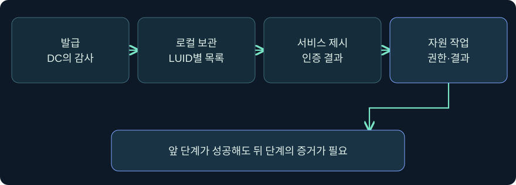
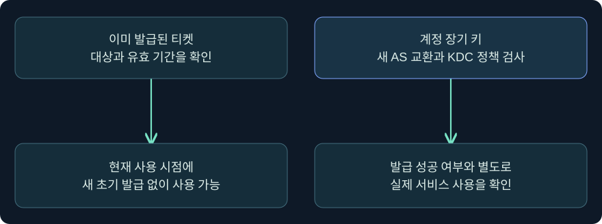
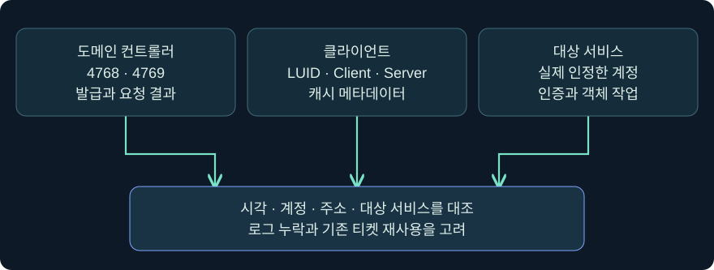

## 1. 티켓이 캐시에 보일 때 무엇이 확인됐을까요?

한 워크스테이션에서 로컬 사용자 이름은 그대로인데 티켓 목록의 Client 열에 다른 계정이 보였다고 가정해 보겠습니다. 이때 먼저 확인할 것은 목록을 조회한 호스트와 LUID, 티켓의 대상 서비스, 시작·만료 시각입니다. 다른 Client 값은 문맥 차이를 조사할 단서입니다. 티켓이 실제 서버에 제시됐거나 서비스 권한을 얻었다는 증거는 서비스 측에 따로 있습니다.

Pass the Ticket(PtT)은 Kerberos 티켓을 인증 자료로 재사용하는 행위를 가리킵니다. 10장에서 배운 **발급 → 로컬 보관 → 서비스에 제시 → 자원 권한 판단**을 이번에는 서로 다른 관측 지점으로 연결합니다. 계정·호스트·시간은 합성입니다. Windows·Cobalt Strike 조회는 미실행이고 실제 티켓·키 수집, 발급, 캐시 반입·삭제, 원격 인증 및 정책 변경을 수행하지 않았습니다.

## 2. TGT와 서비스 티켓은 사용처가 다릅니다

TGT는 일반적으로 서비스 티켓을 얻기 위해 KDC의 TGS에 제시합니다. 서비스 티켓은 특정 서버 주체와 서비스의 인증에 쓰입니다. 예를 들어 가상 파일 서비스 `cifs/files02.training.example`와 다른 서비스의 티켓은 사용 범위가 다릅니다. TGT가 캐시에 있다는 사실만으로 가상 파일 서버의 권한을 받았다고 볼 수 없습니다.

클라이언트는 티켓만 전송하는 방식으로 인증하지 않습니다. 일반적인 AP 교환에서는 티켓과 함께 해당 세션 키로 보호한 인증자가 필요합니다. 티켓의 대상, 시간과 정책이 맞아야 하며, 정상 인증 후에도 객체 접근 제어가 별도로 적용됩니다. 목록에서 티켓 이름을 봤다는 사실은 티켓 본체나 세션 키를 확보했다는 뜻이 아닙니다.

| 항목 | 일반 사용처 | 증거로 확인할 한계 |
|---|---|---|
| TGT | KDC에 서비스 티켓 요청 | 특정 서비스가 받아들였는지 미확인 |
| 서비스 티켓 | 티켓이 지목하는 서비스에 제시 | 파일·객체 접근 권한은 별도 |
| 세션 키 | 해당 교환의 인증자 등 보호 | 화면의 암호 형식이 키 자체를 뜻하지 않음 |
| 티켓 메타데이터 | 이름·시각·플래그 확인 | 재사용 가능한 자료를 확보했다고 입증하지 않음 |

## 3. 기존 티켓 재사용과 키를 사용한 신규 발급을 구별합니다

기존 TGT 또는 서비스 티켓을 사용한 경우와, 계정 장기 키를 이용해 KDC에 새 TGT를 요청한 경우를 같은 사건으로 뭉뚱그리면 잘못된 증거를 찾게 됩니다. 장기 키를 쓰는 신규 요청은 AS 교환과 정책 검증이 선행됩니다. 이미 발급된 서비스 티켓을 재사용하면 사용 시점에 별도의 초기 발급이 보이지 않을 수 있습니다.

과거 도구에서 NT 해시를 Kerberos RC4 계정 키로 이용한 사례는 **암호 형식이 허용되고 계정 및 KDC 조건이 맞는 경우**로 이해합니다. 이때도 장기 키를 사용한 응답, TGT를 보호한 암호 방식, 세션 키의 유형은 각각 다른 정보입니다. 2026년 Microsoft RC4 변경의 주요 범위는 서비스 계정 티켓 발급 기본값입니다. 이를 모든 환경의 AS 발급과 모든 RC4 사용에 동일하게 적용한다고 추정하지 않습니다.

## 4. 현재 로그인 이름과 티켓의 Client 값은 함께 기록합니다

앞 강의의 NewCredentials처럼 로컬 사용자 SID가 유지되면서 아웃바운드 문맥이나 LUID가 달라질 수 있습니다. 특정 Windows 로그온 세션의 티켓 캐시를 읽으면 같은 장비에 있는 다른 세션의 캐시까지 자동으로 확인되는 것은 아닙니다. 목록이 비었다면 우선 **현재 명령의 문맥**과 조회 범위를 확인합니다.

Fortra의 4.13 문서에서 `getuid`는 현재 토큰에 연결된 사용자 표시를 반환합니다. 이 결과를 “항상 부모 프로세스의 기본 토큰 이름”으로 일반화하지 않습니다. 목록의 Client, 조회한 LUID, 표시한 계정 이름, 원격 서버가 인정한 계정은 각각 다른 근거입니다. 계정 이름이 다른 것만으로 자료 반입이나 권한 상승을 확정하기 어렵습니다.

## 5. 캐시 변경과 기존 연결의 영향 범위를 구별합니다

Microsoft의 Kerberos 인증 패키지 메시지에는 캐시 조회와 제출, 삭제에 해당하는 별도 기능이 있습니다. 캐시에 티켓을 제출하는 구현은 직접 프로세스 메모리를 쓰는 구현과 관측 경로가 다를 수 있습니다. 특정 센서에서 LSASS 쓰기 이벤트가 없다고 캐시 관련 동작이 없었다고 단정할 수 없습니다. 반대로 API를 사용한다는 이유로 권한 확인이나 보호 설정에 관계없이 동작한다고 가정하지 않습니다.

Fortra 4.13 명령 목록에는 현재 세션의 티켓 적용·삭제 외에 별도의 ccache 적용 기능도 나옵니다. 공개 문서의 일반적인 기능 설명만으로 과거 교재의 티켓 종류·파일 형식·경로 제약을 현행 제품 전체에 적용하지 않습니다. 로컬 클라이언트의 파일 존재, 대상 Windows 세션의 캐시 상태, 실제 서버 인증을 각각 검증하는 이유입니다.

같은 세션의 캐시 변경은 기존 상태에 영향을 줄 수 있습니다. 동일한 이름의 티켓이 보이더라도 티켓 종류·대상·시간과 버전별 동작을 확인합니다. 새 로그온 세션을 사용하면 관측 범위를 분리할 수 있지만, 그것만으로 계정이나 서버 접근이 검증되지는 않습니다. 캐시 항목이 바뀌거나 삭제되어도 이미 성립된 애플리케이션 연결은 별도로 판단합니다.

## 6. 실제 콘솔에서 현재 문맥의 티켓 목록만 읽습니다

### 실제 화면 92: Beacon Console에서 조회 입력과 LUID·티켓 열 확인

출처는 [Fortra Post Exploitation](https://hstechdocs.helpsystems.com/manuals/cobaltstrike/current/userguide/content/topics/post-exploitation_main.htm)입니다. 2026-11-05에 4.13 문서를 확인했습니다. 공식 캡처의 UI 시점은 다를 수 있습니다. 그림의 출력은 이 실습의 조회를 실행한 결과와 별개입니다.

1. **Sessions → 승인된 실습 세션 → 우클릭 → Interact**에서 호스트와 연결을 확인하는 것을 가정합니다.
2. 아래 입력 줄에 `help run`으로 설명을 확인한 다음 `run klist.exe tickets`를 입력하고 **Enter**를 누르는 미실행 조회입니다. `tickets`는 현재 로그온 문맥의 캐시 목록을 읽는 용도입니다. 다른 세션을 지정하거나 새 발급 요청을 만들지 않습니다. 저장 버튼도 없습니다.
3. 위쪽 반환 영역에서 **Current LogonId**, **Client**, **Server**, **End Time**을 구별합니다. 가상 기록의 `0x1421`은 목록을 본 로그온 세션의 식별자 예시이며 Beacon 세션 ID가 아닙니다. 빈 목록, 요청 대기, 실행 오류를 따로 적습니다.
4. 공식 안내서의 티켓 사용·캐시 삭제 기능은 조회와 별개입니다. 입력 파일 선택·티켓 적용·삭제는 수행하지 않습니다. 일반 콘솔 사진만 확보했으며 이 조회의 실제 출력, 전용 티켓 반입 화면, 서비스 인증 성공 캡처는 확보하지 못했습니다.

## 7. 실제 Event Viewer 화면에서 발급 감사의 위치를 찾습니다

### 실제 화면 93: Microsoft Event Viewer의 Kerberos 4768 상세

출처는 [Microsoft Kerberos RC4 조사 안내](https://learn.microsoft.com/en-us/windows-server/security/kerberos/detect-remediate-rc4-kerberos)이며 2026-11-05에 확인했습니다. 공식 4768의 표시 값은 가상 조사와 별개입니다. DC 빌드·누적 업데이트에 따라 세부 필드가 다릅니다.

1. 읽기 권한이 있는 감사 자료에서 **Event Viewer → Windows Logs → Security → Filter Current Log**를 선택하는 것을 가정합니다.
2. 이벤트 ID 칸에 `4768,4769`를 입력하고 **OK**로 표시 필터를 적용하는 미실행 절차입니다. 초기 TGT 요청과 서비스 티켓 요청을 같은 기간에 비교하되, 각각의 행은 별도 증거로 읽습니다. 감사 정책 자체는 변경하지 않습니다.
3. 발생 DC와 Event Record ID, 계정·클라이언트 주소·결과 코드를 확인합니다. 4769에서는 실제 티켓 대상과 결과를 봅니다. 업데이트된 레코드에서 티켓 해시 필드가 수집된다면 Microsoft가 설명한 필드 의미와 스키마를 확인한 후 비교에 사용합니다.
4. 4769 결과창과 필터 대화상자의 실제 공식 캡처는 확보하지 못했습니다. 사진은 4768 상세의 위치를 보여 줍니다.

## 8. 발급 기록과 서비스 로그를 조건별로 연결합니다

| 합성 관측 | 가능한 해석 | 추가 확인 |
|---|---|---|
| 09:00 DC의 4768 성공, 09:02 4769 성공 | 새 TGT와 서비스 티켓 요청 후보 | 같은 계정·주소·DC 관측 범위인지 |
| 09:10 4769는 있으나 근처에 4768이 없음 | 기존 TGT 사용, 다른 DC 발급, 수집 공백 | TGT 수명과 더 넓은 DC 수집 범위 |
| 09:15 서비스에서 Kerberos 로그온, 새 4769 없음 | 캐시된 서비스 티켓 또는 기존 연결 등 | 대상 서비스·정확한 시각·연결 상태 |
| 동일 LUID의 목록에 티켓 표시, 서버 기록 없음 | 로컬 목록만 확인 | 서비스에 티켓을 제시했는지 미확인 |
| 인증 성공 뒤 테스트 문서 접근 거부 | 인증과 객체 권한의 결과가 다름 | 서버의 정책과 작업 결과 |

4768·4769가 없다는 사실의 해석은 수집 위치에 따라 달라집니다. 실제 분석에서는 여러 DC, 수집 지연, 신뢰 경로, 시간대, 출발지 주소 표현을 먼저 정리합니다. 캐시가 있다는 이유만으로 부재를 설명하거나, 근처의 4768이 없다는 이유만으로 PtT를 확정하지 않습니다.

## 9. 조사 결과는 입증한 수준까지만 적습니다

예를 들어 “09:10에 예상하지 못한 단말에서 서비스 티켓 요청이 관측됐고, 파일 서버는 해당 계정의 네트워크 로그온을 기록했다. 출발지 캐시 반입이나 자원 작업은 확인되지 않았다.”라고 쓸 수 있습니다. 이런 표현은 경보를 축소하지 않으면서 후속 확인에 필요한 범위를 드러냅니다.

출발지의 프로세스·로그온 문맥, DC의 발급 및 서비스 측 신원과 실제 작업을 시간순으로 비교합니다. Kerberos가 평소 정상적으로 사용되는 곳에서도 평소와 다른 계정·호스트·서비스 조합은 유의미합니다. 그 차이가 운영 작업인지 비인가 사용인지 판단하려면 변경 이력과 세션 범위가 함께 필요합니다.

## 10. 복습과 즉시 해설

### 복습 1. TGT가 보이면 파일 서버에 바로 제시할 수 있나요?
**해설:** 일반적인 흐름에서 TGT는 KDC에 서비스 티켓을 요청할 때 사용합니다. 파일 서버 인증에는 해당 서비스의 티켓과 관련 인증자가 필요합니다.

### 복습 2. 티켓 목록이 보이면 세션 키를 획득한 것인가요?
**해설:** 목록은 메타데이터 관측입니다. 키와 티켓 본체의 접근 여부는 별도 증거가 필요합니다.

### 복습 3. 장기 키로 새 TGT를 받는 것과 기존 티켓을 재사용하는 차이는 무엇인가요?
**해설:** 새 발급에서는 KDC 초기 교환과 정책 검증이 선행됩니다. 기존 티켓 사용 시점에는 새 AS 교환이 필요하지 않을 수 있습니다.

### 복습 4. 4769 근처에 4768이 없으면 티켓 재사용 공격인가요?
**해설:** 정상적인 기존 TGT 사용, 다른 DC 발급, 수집 공백도 가능합니다. 계정·주소·시간·정상 기준선을 비교합니다.

### 복습 5. getuid 결과와 서비스에 인증된 계정이 같아야 하나요?
**해설:** getuid는 현재 토큰의 사용자 표시입니다. 실제 아웃바운드 인증은 관련 문맥과 서비스 쪽 증거를 확인합니다.

### 복습 6. LSASS 메모리 쓰기 경보가 없으면 캐시 변경도 없었나요?
**해설:** 센서는 특정 경로를 관측합니다. 인증 패키지 경로와 메모리 직접 접근은 다를 수 있으므로 추가 증거를 확인합니다.

### 복습 7. 캐시를 비우면 연결도 즉시 끊기나요?
**해설:** 캐시의 티켓과 이미 성립한 앱·서비스 세션은 별개입니다. 연결 상태와 종료 여부를 따로 검증합니다.

### 복습 8. 4769 성공이 테스트 문서 읽기 성공을 입증하나요?
**해설:** DC의 서비스 티켓 요청 결과입니다. 대상 서비스의 인증과 객체 권한 및 작업 결과를 따로 확인합니다.

## 11. 공식 출처와 검증 범위

2026-11-05에 대조했습니다. 제품·Windows·인증 동작은 미실행입니다. 사례와 개념도는 독립 작성했으며 그림 속 공식 제품 데이터와 가상 조사 자료를 분리했습니다.

- [RFC 4120](https://www.rfc-editor.org/rfc/rfc4120.html)
- [Microsoft klist](https://learn.microsoft.com/en-us/windows-server/administration/windows-commands/klist)
- [Microsoft Kerberos 인증 패키지 메시지 유형](https://learn.microsoft.com/en-us/windows/win32/api/ntsecapi/ne-ntsecapi-kerb_protocol_message_type)
- [Microsoft 4768](https://learn.microsoft.com/en-us/previous-versions/windows/it-pro/windows-10/security/threat-protection/auditing/event-4768)
- [Microsoft 4769](https://learn.microsoft.com/en-us/previous-versions/windows/it-pro/windows-10/security/threat-protection/auditing/event-4769)
- [Microsoft Kerberos RC4 기본 사용 변경 KB5073381](https://support.microsoft.com/en-gb/servicing/os/windows/2025/11/how-to-manage-kerberos-kdc-usage-of-rc4-for-service-account-ticket-issuance-changes-related-to-cve-2)
- [MITRE ATT&CK T1550.003](https://attack.mitre.org/techniques/T1550/003/)
- [Fortra Running Commands](https://hstechdocs.helpsystems.com/manuals/cobaltstrike/current/userguide/content/topics/post-exploitation_running-commands.htm)
- [Fortra Trust Relationships](https://hstechdocs.helpsystems.com/manuals/cobaltstrike/current/userguide/content/topics/post-exploitation_trust-relationships.htm)
