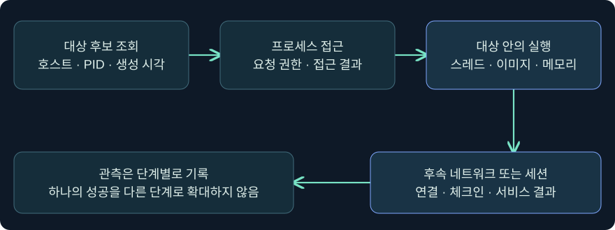
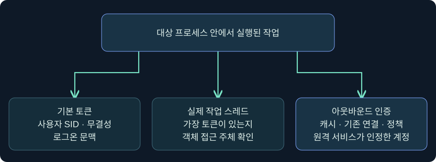
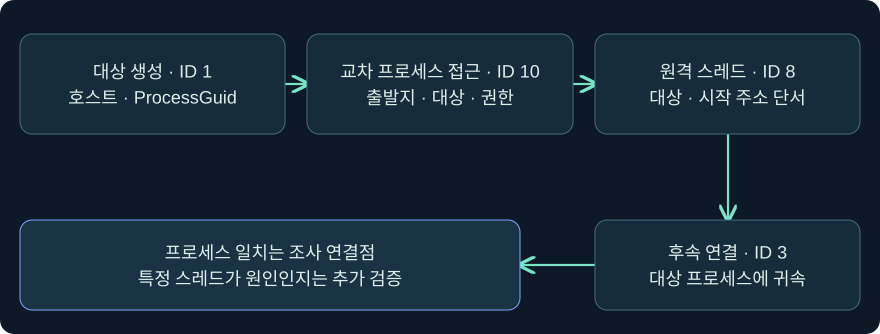

## 1. 같은 프로세스에서 낯선 연결이 나갔다면

문서 미리보기 프로그램이 새 외부 연결을 열었다는 경보를 받았다고 가정하겠습니다. 그 프로그램의 자체 기능이나 플러그인이 통신했을 수도 있고, 다른 프로세스가 관여했을 수도 있습니다. 조사에서는 **누가 접근했는지**, **어느 프로세스에서 코드가 실제로 실행됐는지**, **어떤 보안 문맥이 사용됐는지**, **외부 서비스가 무엇을 받아들였는지**를 구별합니다.

이 강의는 3장의 Windows 실행 구조와 7장의 세션 상태를 이어 11장의 토큰·NTLM·Kerberos를 한 사례로 종합합니다. 예시 이름·PID·시간·주소는 합성입니다. 제품 화면의 조회 단계는 미실행입니다. 실제 프로세스 주입, 메모리 접근·변경, 새 세션 생성, 외부 접속, 비밀 수집과 보호 설정 변경은 수행하지 않았습니다.

## 2. 프로세스 주입이 바꾸는 것과 그대로인 것

프로세스는 주소 공간과 기본 접근 토큰을 갖는 실행 단위입니다. 스레드는 그 주소 공간 안에서 명령을 실행합니다. MITRE ATT&CK T1055가 분류하는 프로세스 주입은 다른 프로세스의 주소 공간에서 코드가 실행되도록 하는 기법군입니다. 실행이 기존 프로세스에서 일어나면 새 실행 파일이나 새 프로세스가 생성되지 않을 수 있습니다. 한편 새로 시작한 프로세스를 대상으로 사용하는 변형도 있습니다.

조사에서 주소 공간에 코드가 존재하는 것과 스레드가 해당 코드를 실제로 실행한 것은 서로 다른 단계입니다. 기존 모듈 로드, 프로세스 이미지 변조, 원격 스레드 생성 등 서로 다른 단서가 관측될 수 있습니다. 모든 변형을 하나의 API나 Sysmon 이벤트로 찾는다고 가정하지 않습니다.

| 관측된 사실 | 말할 수 있는 것 | 이 관측만으로 결론 내리기 어려운 것 |
|---|---|---|
| 목록에서 PID를 확인 | 조회 시점의 대상 후보 | 이후 동일 인스턴스 존재 |
| 다른 프로세스에 대한 접근 기록 | 출발지·대상 및 관측된 권한 | 실제 바이트 쓰기·실행 |
| 모듈 로드 또는 이미지 변경 | 일부 메모리·이미지 상태 변화 | 의도와 실제 후속 실행 |
| 원격 스레드 생성 | 스레드 생성과 시작 위치 단서 | 시작 루틴이 끝까지 실행됨 |
| 대상 프로세스의 네트워크 이벤트 | 해당 프로세스에 귀속된 연결 관측 | 특정 스레드의 원인·원격 작업 성공 |

## 3. 권한은 무결성 표시 하나로 결정되지 않습니다

Microsoft 문서에서 Windows는 프로세스 객체를 열 때 요청 권한과 보안 설명자를 비교합니다. 조회, 메모리 읽기, 메모리 쓰기·주소 공간 조작, 스레드 생성은 다른 권한입니다. 교육용 인벤토리 조회가 가능하다는 사실을 해당 프로세스의 상태를 바꿀 수 있다는 증거로 쓰지 않습니다.

호출 토큰의 특권과 활성 상태, 무결성, 대상의 보호 수준, OS 및 도구의 아키텍처 지원, 대상의 현재 생존 여부가 결과에 영향을 줄 수 있습니다. 높은 무결성은 이런 조건 중 하나를 설명하는 단서입니다. 계정이 같아도 대상이 보호되는 경우에는 권한에 제한이 걸릴 수 있습니다. 호스트가 x64여도 모든 프로세스가 x64인 것은 아니므로 대상 행의 아키텍처를 별도로 확인합니다.

## 4. 실행 위치와 신원을 각각 검증합니다

다른 프로세스 안에서 실행된 코드의 기본 보안 문맥은 그 프로세스의 기본 토큰을 출발점으로 이해할 수 있습니다. 다만 스레드에 가장 토큰이 적용되면 특정 객체 접근에는 그 문맥이 쓰일 수 있습니다. 네트워크 인증에서는 아웃바운드 자격 증명, Kerberos 캐시, 프로토콜 선택, 기존 서비스 연결도 결과에 영향을 줍니다.

| 비교 대상 | 읽을 증거 | 사례에서 던질 질문 |
|---|---|---|
| 기본 토큰 | 사용자 SID·무결성·Authentication ID | 어떤 프로세스의 어느 시점 값인가 |
| 스레드 문맥 | 가장 토큰 관측·작업의 스레드 | 해당 리소스 작업에 사용됐는가 |
| 네트워크 문맥 | LUID·프로토콜·캐시·서비스 로그 | 대상에서 실제로 어떤 계정을 인정했는가 |
| 제품 세션 | Beacon 연결·호스트·PID·체크인 | 새 행인가, 기존 행의 갱신인가 |

프로세스 주입, 스레드 가장, NT 해시나 Kerberos 티켓을 이용한 인증은 관측해야 할 층이 다릅니다. 프로세스의 기본 사용자 표시가 그대로여도 다른 층의 변화가 가능하며, 표시 변화 하나로 세 가지 중 어떤 행위가 일어났는지 단정할 수 없습니다.

## 5. 실제 Process Browser에서 조사할 프로세스를 고릅니다

### 실제 화면 94: Cobalt Strike Process Browser의 트리와 상세 항목

출처는 [Fortra Process Browser](https://hstechdocs.helpsystems.com/manuals/cobaltstrike/current/userguide/content/topics/post-exploitation_process-browser.htm)입니다. 2026-11-05 기준 4.13 문서와 대조했습니다. 공식 삽화의 화면과 실제 설치 버전의 표시 항목은 다를 수 있습니다.

1. **Sessions → 승인된 실습 연결 → 우클릭 → Explore → Show Processes**를 여는 미실행 절차입니다. 다중 호스트 결과와 섞이지 않도록 한 실습 호스트만 고릅니다.
2. 왼쪽 목록에서 가상 호스트 `LAB-EDIT08`의 `PreviewStudy.exe`, PID `6216` 행을 클릭한다고 가정합니다. 이름만 같거나 PID만 같은 다른 인스턴스를 피하려고 호스트·이미지·PID를 함께 봅니다.
3. 오른쪽 표의 **PID·PPID·Name·Arch·Session·User**를 읽고 조회 시각을 적습니다. 공식 사진의 노란색 행은 현재 Beacon 프로세스이고 파란색 행은 선택된 항목입니다. 사진의 표에 없는 전체 경로와 생성 시각은 단말의 프로세스 생성 기록에서 확인합니다. 행 선택에는 입력 칸과 저장이 필요하지 않습니다.
4. Fortra 문서가 설명하는 하단 **Inject**는 조회와 별개의 실행 동작입니다. 사진은 프로세스 목록과 버튼 위치를 보여 줍니다. 주입 옵션 창, 실행 버튼을 누른 직후 화면, 이 강의 사례의 결과 화면은 공식 캡처를 확보하지 못했습니다.

## 6. 실제 콘솔에서 읽기 전용 인벤토리의 반환을 확인합니다

### 실제 화면 95: Beacon Console의 입력 위치와 작업 반환

출처는 [Fortra Post Exploitation](https://hstechdocs.helpsystems.com/manuals/cobaltstrike/current/userguide/content/topics/post-exploitation_main.htm)입니다. 2026-11-05 기준 4.13 문서에 실린 공식 이미지이며 오래된 UI일 수 있습니다. 사진의 출력은 아래 절차를 실행한 결과와 별개입니다.

1. **Sessions → 승인된 연결 → 우클릭 → Interact**에서 선택한 호스트와 PID를 확인합니다.
2. 아래쪽 입력 줄에 `help ps`를 넣어 조회 명령 설명을 보는 것을 가정합니다. 같은 칸에 인수 없이 `ps`를 넣고 **Enter**를 누르면 프로세스 목록을 요청합니다. `ps`를 선택한 이유는 특정 메모리 조작 없이 프로세스 인벤토리를 보기 위해서입니다. 별도 저장 단계는 없습니다.
3. 입력 줄 위의 상태 표시줄과 반환 영역을 확인합니다. 가상 기록에서는 `PreviewStudy.exe`의 PID `6216`과 x64 표시를 목록에서 찾아 봅니다. 요청 기록, Beacon 체크인, 실제 목록 반환을 각각 구별합니다. 목록이 늦게 오거나 대상 행이 사라졌다면 수신 시각과 프로세스 생성·종료 기록을 비교합니다.
4. `ps`의 본문 가상값을 담은 공식 반환 화면은 확보하지 못했습니다. 조회 성공은 프로세스 목록을 받았다는 의미입니다. 해당 프로세스에 대한 메모리 변경이나 코드 실행 성공을 보여 주지 않습니다.

## 7. 실제 Sessions 화면에서 체크인과 프로세스 실행을 구별합니다

### 실제 화면 96: Cobalt Strike Sessions Table의 호스트·PID·체크인

출처는 [Fortra Session and Target Visualizations](https://hstechdocs.helpsystems.com/manuals/cobaltstrike/current/userguide/content/topics/ui_session-target-visualizations.htm)입니다. 2026-11-05 기준 공식 문서의 그림이며 가상 시나리오의 체크인 결과가 아닙니다.

1. **Cobalt Strike → Visualization → Session Table** 또는 도구 모음의 세션 표를 엽니다. 실제 사진에서 행과 열의 위치를 확인합니다.
2. 승인된 기록을 검토할 때 가상 호스트 `LAB-EDIT08`과 PID `6216`에 해당하는 행이 있는지 비교합니다. 표시 순서가 바뀌어도 같은 행을 찾기 위해 호스트·PID·시각을 함께 사용합니다. 새 행인지, 기존 행의 체크인 갱신인지 세션 기록을 확인합니다. 입력 칸이나 저장 버튼은 없습니다.
3. Fortra의 세션 전달 문서는 대상에서 단계가 실행되더라도 통신 경로가 성립하지 않으면 새 세션이 표시되지 않을 수 있음을 설명합니다. 이 강의는 화면의 기존 연결을 읽는 가정이며, 새 연결 생성·대상 조작은 수행하지 않았습니다.

## 8. 단말 증거를 단계별로 조합합니다

Sysmon ID 10은 한 프로세스가 다른 프로세스를 연 관측입니다. ID 8은 다른 프로세스의 스레드 생성 관측입니다. ID 8의 StartModule과 StartFunction은 추론된 필드이므로 값이 비어 있을 수 있습니다. 비어 있다고 악성으로 판정하거나, 익숙한 모듈 이름이 있다고 정상으로 결론 내리지 않습니다. Sysmon ID 25는 일부 이미지 변조를 관측하며, 모든 주입이 ID 8 또는 ID 25로 나타나는 것은 아닙니다.

| 합성 기록 | 관측 범위 | 다음 대조 |
|---|---|---|
| 09:00:00, ID 1에서 대상 생성 | 대상의 ProcessGuid·이미지·계정 | 생성 시각과 호스트를 기준점으로 삼기 |
| 09:00:05, ID 10에서 출발지→대상 접근 | 관측된 접근 권한과 두 프로세스 | 정상 진단 프로그램 여부·센서 필터 |
| 09:00:06, ID 8에서 같은 대상의 스레드 | 새 스레드와 시작 주소 단서 | 해당 인스턴스와 코드 실행의 후속 증거 |
| 09:00:09, ID 3에서 대상의 연결 | 프로세스에 귀속된 네트워크 연결 | 다른 스레드·정상 플러그인 가설과 목적지 |
| 09:00:10, 서비스에 접근 거부 | 해당 서비스의 결과 | 인증을 인정했는지, 권한 단계에서 거부됐는지 |

이벤트가 모두 존재할 필요는 없습니다. ID 3처럼 기본 설정에서 수집되지 않을 수 있는 이벤트가 있고, 필터·수집 지연·시간 동기화 문제로 일부 로그가 없을 수 있습니다. 같은 PID가 재사용될 수 있으므로 호스트·ProcessGuid·생성 시각을 우선 대조합니다.

## 9. 조건을 바꿔 보고 판단 문장을 작성합니다

첫 번째 경우에 ID 10만 있고 출발지가 정상 서명된 진단 도구라고 가정합니다. 접근 자체는 조사할 수 있지만 서명과 접근 기록만으로 실행 여부나 정당성을 확정하지 않습니다. 평소 진단 시각과 조회 권한을 비교합니다.

두 번째 경우에 ID 8까지 있고 대상이 즉시 종료됐다면 원격 스레드 생성은 관측됐지만 해당 스레드가 완료됐는지와 체크인 여부는 남습니다. 세 번째 경우에 새 연결이 관측되고 대상 서비스가 다른 계정을 인정했다면, 실행 위치와 인증 신원을 별도 기록합니다. 프로세스 기본 토큰, 스레드 가장, 아웃바운드 문맥 중 무엇이 실제로 쓰였는지는 해당 작업의 추가 증거가 필요합니다.

보고 예시는 “동일 인스턴스를 대상으로 프로세스 접근과 원격 스레드 생성이 관측됐다. 후속 외부 연결은 대상 프로세스에 귀속됐다. 그 스레드가 연결을 만들었는지와 원격 서비스가 어떤 계정을 인정했는지는 미확인이다.”입니다. 단서와 입증 범위를 문장 안에서 구별하면 다음 조사자가 동일한 가설을 검증할 수 있습니다.

## 10. 복습과 즉시 해설

### 복습 1. 프로세스 목록에서 PID가 보이면 어떤 것을 입증하나요?
**해설:** 조회 시점에 해당 PID를 가진 항목을 봤다는 뜻입니다. 실행 이후 같은 인스턴스인지 생성 시각·ProcessGuid를 대조합니다.

### 복습 2. 높은 무결성이면 다른 모든 프로세스를 열 수 있나요?
**해설:** 객체의 접근 권한과 보호 수준이 따로 적용됩니다. 요청 권한, 호출 문맥과 대상 보호 조건을 확인합니다.

### 복습 3. Sysmon ID 10에서 쓰기 권한이 보이면 실제 메모리 쓰기도 입증되나요?
**해설:** 부여된 접근 권한과 실제 사용한 작업은 별개입니다. 쓰기 또는 후속 실행을 관측한 증거를 찾습니다.

### 복습 4. StartModule 값이 비어 있으면 악성으로 확정할 수 있나요?
**해설:** Sysmon이 그 필드를 추론하지 못한 경우일 수 있습니다. 시작 주소와 메모리·모듈 상태, 행위 문맥을 함께 확인합니다.

### 복습 5. ID 8이 없으면 프로세스 주입을 배제할 수 있나요?
**해설:** 기법과 수집 범위에 따라 ID 8이 없을 수 있습니다. 사용한 센서 설정과 관련 메모리·모듈·스레드 증거를 확인합니다.

### 복습 6. 대상 프로세스의 기본 토큰과 원격 서버가 인증한 계정은 항상 같은가요?
**해설:** 스레드 가장, 아웃바운드 자격 증명, 티켓 캐시나 기존 연결에 따라 달라질 수 있습니다. 실제 대상 서비스 기록을 확인합니다.

### 복습 7. 콘솔에 요청이 기록됐는데 새 세션이 안 보이면 무엇을 알 수 있나요?
**해설:** 요청과 체크인 사이의 상태가 미확인입니다. 작업 전달, 대상 실행, 연결 경로와 새 세션 생성의 증거를 단계별로 구별합니다.

### 복습 8. ID 8 뒤 같은 프로세스의 네트워크 연결이 보였습니다. 새 스레드가 만들었나요?
**해설:** 시간과 프로세스 인스턴스가 맞으면 관련성을 검토할 수 있습니다. 특정 스레드가 연결을 만들었다고 결론 내리려면 더 세밀한 관측이 필요합니다.

## 11. 공식 출처와 검증 범위

2026-11-05에 Microsoft, MITRE와 Fortra 자료를 대조했습니다. 화면은 공식 실제 캡처이며 계정·호스트·시간표는 독립 작성한 가상 사례입니다. 제품·Windows 조회와 주입·네트워크 실행은 미실행입니다.

- [MITRE ATT&CK T1055 Process Injection](https://attack.mitre.org/techniques/T1055/)
- [MITRE DET0508 관측 지점](https://attack.mitre.org/detectionstrategies/DET0508/)
- [Microsoft Sysmon 이벤트](https://learn.microsoft.com/en-us/sysinternals/downloads/sysmon)
- [Microsoft Process Security and Access Rights](https://learn.microsoft.com/en-us/windows/win32/procthread/process-security-and-access-rights)
- [Microsoft Access Tokens](https://learn.microsoft.com/en-us/windows/win32/secauthz/access-tokens)
- [Fortra Process Browser](https://hstechdocs.helpsystems.com/manuals/cobaltstrike/current/userguide/content/topics/post-exploitation_process-browser.htm)
- [Fortra Session Passing](https://hstechdocs.helpsystems.com/manuals/cobaltstrike/current/userguide/content/topics/post-exploitation_session-passing.htm)
- [Fortra Hooks의 Process Browser 동작 표](https://hstechdocs.helpsystems.com/manuals/cobaltstrike/current/userguide/content/topics_aggressor-scripts/as-resources_hooks.htm)
