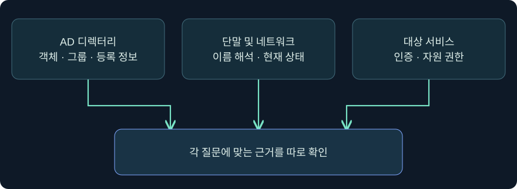
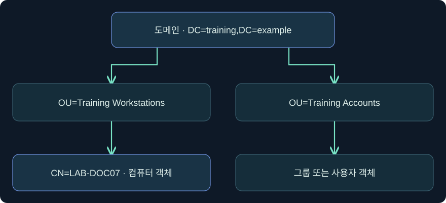
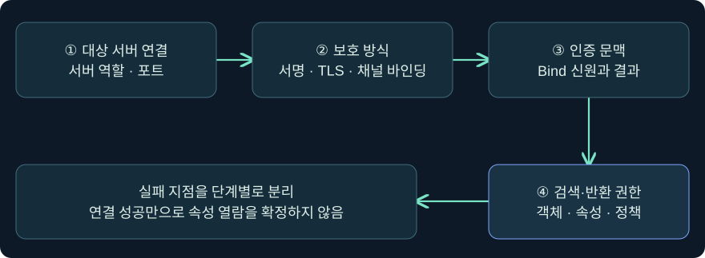

## 1. 디렉터리에서 이름을 찾으면 무엇을 알 수 있을까요?

가상의 조직에서 `LAB-DOC07`이라는 컴퓨터 계정과 `Archive Readers`라는 그룹을 찾았습니다. 그 이름을 알게 됐다고 컴퓨터가 현재 켜져 있거나 해당 그룹이 문서 서버의 파일을 읽을 수 있다는 결론을 내릴 수는 없습니다. **Discovery**는 운영 환경에 대한 단서를 모으는 단계입니다. 디렉터리의 등록 정보, 현재 단말의 상태, 서비스가 실제로 인정하는 접근 권한을 각각 확인합니다.

11장에서는 같은 호스트의 로컬 실행 신원과 네트워크 인증 신원이 달라질 수 있음을 봤습니다. 이번 장은 그 신원으로 어느 디렉터리에서 어떤 객체를 볼 수 있는지부터 시작합니다. 예시의 호스트·계정·주소는 합성이며 Windows와 Cobalt Strike 조회는 미실행입니다. 실제 디렉터리 접속, 수집기 실행, 자격 증명 수집과 설정 변경은 수행하지 않았습니다.

## 2. Active Directory의 구조를 범위 지도처럼 읽습니다

Active Directory Domain Services(AD DS)는 계정, 컴퓨터, 그룹, 정책 같은 정보를 객체와 속성으로 관리합니다. 포리스트 안에는 하나 이상의 도메인이 있을 수 있고, 도메인 컨트롤러(DC)는 디렉터리 파티션을 제공하며 복제합니다. 도메인 데이터, 포리스트의 구성과 스키마, 별도 응용 프로그램 파티션은 범위와 목적이 다릅니다. 같은 논리적 디렉터리라도 복제 시점과 질의한 서버 역할에 따라 반환 내용이 달라질 수 있습니다.

DN(Distinguished Name)은 디렉터리 트리의 위치를 표현합니다. 가상 예시 `CN=LAB-DOC07,OU=Training Workstations,DC=training,DC=example`에서 왼쪽은 객체 이름, 가운데는 상위 조직 구성 단위, 오른쪽은 도메인 이름을 이루는 구성요소입니다. OU는 조직 구성 단위이며 정책 연결이나 관리 위임의 범위로 사용할 수 있습니다. OU에 들어 있다는 사실과 해당 장비에 정책이 실제 적용됐다는 사실은 다릅니다.

## 3. 객체의 종류와 관측 가능한 속성을 나눕니다

AD 스키마는 어떤 클래스와 속성이 존재하고 어떤 객체에 들어갈 수 있는지 정의합니다. 아래 값은 객체를 분류하는 데 쓰는 대표 클래스입니다. 실제 결과는 서버가 반환한 값과 검색 조건을 함께 해석합니다.

| 객체 예시 | 분류 또는 속성 단서 | 다른 증거로 확인할 것 |
|---|---|---|
| 컴퓨터 계정 | `computer`, `dNSHostName` | 현재 접속 가능 여부와 실제 실행 서비스 |
| 사람 관련 객체 | `person`, `user`, `contact`의 관계 | 실제 보안 주체와 로그온 가능 상태 |
| 보안 그룹 | `group`, 직접 구성원 및 그룹 유형 | 중첩 관계, 토큰에 적용된 SID, 서비스 ACL |
| 도메인 | `domainDNS` 등 도메인 객체의 클래스 | 다른 도메인·파티션과 서버 복제 범위 |
| 조직 구성 단위 | `organizationalUnit` | 위임된 권한과 장비의 유효 정책 |
| GPO의 디렉터리 부분 | `groupPolicyContainer` | SYSVOL 파일 내용, 적용 대상과 필터 |
| 도메인 신뢰 객체 | `trustedDomain` | 신뢰 방향·조건 및 대상 자원 권한 |

AD의 클래스 계층 때문에 컴퓨터도 `objectClass=user`를 포함할 수 있습니다. “user 클래스가 보인다”와 “사람용 사용자 계정이다”를 구별합니다. 다음 강의에서 여러 클래스를 구별하는 필터와 결과의 해석을 살펴봅니다.

## 4. DN, GUID, SID, 표시 이름은 서로 다른 질문에 답합니다

DN은 현재 트리에서 객체를 가리키는 경로입니다. 객체를 다른 OU로 이동하거나 이름을 바꾸면 DN이 달라질 수 있습니다. 동일 객체를 다시 찾는 데는 `objectGUID`가 도움이 됩니다. SID는 보안 주체를 식별하며 모든 종류의 디렉터리 객체가 같은 방식으로 SID를 갖는 것은 아닙니다. 삭제 후 새로 만든 객체는 표시 이름이 같아도 같은 객체로 볼 수 없습니다.

가령 `LAB-DOC07`이 다른 OU로 이동했다고 가정해 보겠습니다. 이름이 같아도 DN은 바뀝니다. 같은 GUID를 확인하면 객체 이동 가설을 뒷받침합니다. 반대로 서로 다른 도메인에 같은 이름이 있는 경우에는 서버·파티션·GUID를 확인합니다. 그룹 이름이 사람이 읽기 쉽게 표시돼도 실제 자원 권한에서는 SID와 ACL이 중요합니다.

## 5. LDAP와 ADWS는 같은 자료를 다른 통신 경로로 볼 수 있습니다

LDAP는 디렉터리 검색과 변경을 지원하는 표준 프로토콜입니다. 이번 강의는 읽기 관점에 집중합니다. LDAP 연결에서는 접속할 서버와 서비스, 인증하는 신원, 보호 방식이 별개입니다. TLS를 시작한 연결이 곧 검색 권한을 갖는 것은 아니며, 인증이 성립했다고 모든 속성을 읽을 수 있는 것도 아닙니다.

| 접근 경로 | 대표 TCP 포트 | 증거를 읽는 기준 |
|---|---|---|
| LDAP | 389 | StartTLS 또는 SASL 보호 가능. 포트만으로 평문 여부 확정 불가 |
| LDAPS | 636 | 처음부터 TLS를 쓰는 연결. 인증서 신뢰·서버 이름·실제 인증은 별도 |
| Global Catalog | 3268 / 3269 | 포리스트 검색에 유용. 다른 도메인의 속성 일부가 빠질 수 있음 |
| Active Directory Web Services | 9389 | ADWS를 사용하는 관리 도구의 경로. LDAP 패킷을 HTTP로 감싼다고 일반화할 수 없음 |

ADWS는 Microsoft가 정의한 SOAP 기반 웹 서비스 프로토콜 집합을 사용합니다. Windows 통합 인증 엔드포인트의 명세 예시는 `net.tcp`를 사용합니다. 관리 도구의 화면에 AD 객체가 보여도 그 도구가 직접 LDAP로 통신했는지 ADWS를 사용했는지는 도구·버전과 네트워크 증거를 확인합니다.

## 6. 보호 방식과 검색 허용 여부를 구별합니다

LDAP 서명은 메시지 무결성에, TLS는 기밀성과 무결성 및 인증서 검증에 기여합니다. 채널 바인딩은 적용되는 조건에서 인증을 해당 TLS 채널에 연결합니다. 세 제어를 같은 설정으로 보지 않습니다. 보안 협상이 실패하면 검색 권한을 판단하기 전에 인증서·프로토콜·정책의 실패 지점을 확인합니다.

일반 도메인 사용자도 조직에서 허용한 기본 디렉터리 정보를 볼 수 있는 경우가 많습니다. 그러나 객체별 ACL과 속성 권한, 서버의 검색 범위, 요청 방식은 반환을 제한할 수 있습니다. 가령 그룹은 검색되지만 속성이 비어 보이면 실제 값이 없는지, 반환 요청에 포함됐는지, 현재 서버·신원에서 보이는지 구분합니다.

## 7. 실제 Cobalt Strike 화면에서 조회 주체를 확인합니다

### 실제 화면 97: 세션 목록의 호스트와 사용자 표시

출처는 [Fortra Session and Target Visualizations](https://hstechdocs.helpsystems.com/manuals/cobaltstrike/current/userguide/content/topics/ui_session-target-visualizations.htm)입니다. 2026-11-05에 4.13 문서를 대조했습니다. 사진 속 값은 공식 시연 자료이며 가상 강의 값과 별개입니다.

1. **Cobalt Strike → Visualization → Session Table**을 열고, 승인된 실습 기록의 가상 호스트 `LAB-DOC07`에 해당하는 행만 고릅니다. 호스트 이름과 연결 시각을 함께 대조하는 이유는 같은 사용자가 여러 세션으로 표시될 수 있기 때문입니다.
2. 해당 행을 우클릭해 **Interact**를 선택하면 콘솔이 열립니다. 행 선택에는 입력값이나 저장 버튼이 없습니다. 콘솔 상태 표시줄의 호스트와 선택한 행이 일치하는지 확인합니다.

### 실제 화면 98: 콘솔 입력 줄과 실행 신원 조회

출처는 [Fortra Post Exploitation](https://hstechdocs.helpsystems.com/manuals/cobaltstrike/current/userguide/content/topics/post-exploitation_main.htm)입니다. 현재 문서에 수록된 삽화의 UI 시점은 설치 버전과 다를 수 있습니다.

1. 하단 입력 칸에 `help run`을 입력해 설치 버전의 도움말을 확인한 뒤 `run whoami.exe /user`를 같은 칸에 넣고 **Enter**를 누르는 미실행 조회입니다. `/user`는 해당 명령 프로세스의 사용자와 SID만 확인하기 위한 값입니다.
2. 저장할 항목은 없습니다. 작업 제출과 실제 반환을 구별하고 위쪽 출력에서 사용자·SID 또는 오류를 확인합니다. 가상 사용자 이름은 `reviewer08`입니다. 해당 반환 화면이나 이 신원으로 실제 LDAP Bind를 수행한 화면은 확보하지 못했습니다.
3. 콘솔이 보여 주는 명령 프로세스의 신원은 디렉터리 서버가 실제로 인정한 Bind 신원과 같다고 가정하지 않습니다. 그 일치는 별도 서버 관측이 필요합니다.

## 8. 같은 질문에서 서버와 관측 범위를 바꿔 봅니다

가상의 도메인 DC에서 컴퓨터 객체가 조회됐는데 GC에서는 그 객체의 일부 속성이 보이지 않았다고 가정하겠습니다. 먼저 검색 시작점과 대상 파티션, 요청 속성, 현재 신원, GC에 복제되는 속성 범위를 대조합니다. 대상 컴퓨터가 실제로 없어졌다고 결론 내리기 전에 어느 서버에서 어떤 조건으로 물었는지 확인합니다.

다른 경우에는 자산 목록에 등록된 DNS 이름이 보이지만 단말에서 주소가 해석되지 않습니다. 이때 디렉터리 등록 사실과 DNS 상태, 컴퓨터의 온라인 상태를 따로 기록합니다. 출력이 비거나 화면에 오류가 없더라도 관측 범위를 벗어난 결과까지 확장할 수는 없습니다.

## 9. 그래프는 관측된 관계를 정리하는 도구입니다

BloodHound는 수집한 객체와 관계를 노드와 간선으로 보여 줍니다. 수집기, 파서, 저장·분석 단계의 입력과 범위는 다릅니다. 어떤 관계가 그려져도 실제 접근이 성공했는지 확인해야 합니다. 반대로 간선이 없다면 수집하지 않았거나 필드가 누락됐을 가능성도 있습니다. 이 장 후반에서 자료 출처와 누락, GPO·SYSVOL·WMI 적용을 연결합니다.

조사 노트는 **조회 주체·대상 서버·검색 범위·관측 시각·객체 식별자·결과**를 적는 것으로 시작합니다. 권한이나 서비스 접근을 입증하려면 어떤 자료가 필요한지도 옆에 남깁니다.

## 10. 복습과 즉시 해설

### 복습 1. AD의 컴퓨터 계정이 있으면 장비가 지금 온라인인가요?
**해설:** 디렉터리에 등록된 계정을 확인한 것입니다. 장비의 현재 연결 상태는 단말 또는 네트워크 증거가 필요합니다.

### 복습 2. OU를 옮기면 DN과 GUID가 모두 달라지나요?
**해설:** 동일 객체의 이동이라면 DN이 바뀔 수 있고 GUID로 그 객체를 다시 대조할 수 있습니다.

### 복습 3. objectClass에 user가 보이면 모두 사람 계정인가요?
**해설:** 컴퓨터 객체도 클래스 계층에 user가 포함될 수 있습니다. 객체 범주나 계정 유형 등 다른 조건을 함께 봅니다.

### 복습 4. TCP 389가 보이면 연결 내용이 모두 평문인가요?
**해설:** 389에서도 StartTLS 또는 SASL 보호가 적용될 수 있습니다. 연결 협상과 적용 정책을 확인해야 합니다.

### 복습 5. TCP 9389는 어떤 가능성을 보여 주나요?
**해설:** 일반적인 ADWS 경로의 단서입니다. 도구의 실제 연결과 서비스 로그를 함께 확인합니다.

### 복습 6. GC에서 속성이 빠져 있으면 객체에 값이 없는 건가요?
**해설:** GC의 복제 속성 범위, 반환 목록, 권한과 시점이 영향을 줄 수 있습니다. 해당 객체의 권한 있는 DC 결과와 비교합니다.

### 복습 7. whoami로 본 사용자와 LDAP 서버의 인증 신원은 같은가요?
**해설:** 해당 프로세스 문맥만 확인한 것입니다. 아웃바운드 자격 증명과 서버의 인증 증거를 별도로 봅니다.

### 복습 8. 그래프에 관계가 없으면 접근 경로도 없다고 볼 수 있나요?
**해설:** 수집 범위와 자료 누락을 먼저 확인합니다. 실제 서비스의 권한과 적용 상태에는 별도 증거가 필요합니다.

## 11. 공식 출처와 검증 범위

2026-11-05에 공식 자료와 대조했습니다. 개념도와 사례는 독립 작성했으며 Windows 및 제품 조회는 미실행입니다.

- [MITRE ATT&CK Discovery TA0007](https://attack.mitre.org/tactics/TA0007/)
- [Microsoft Active Directory 객체 클래스 검색](https://learn.microsoft.com/en-us/windows/win32/ad/finding-objects-by-class)
- [Microsoft LDAP Distinguished Names](https://learn.microsoft.com/en-us/previous-versions/windows/desktop/ldap/distinguished-names)
- [Microsoft Windows Server 서비스 포트](https://learn.microsoft.com/en-us/troubleshoot/windows-server/networking/service-overview-and-network-port-requirements)
- [Microsoft LDAP 서명 및 보호 방식](https://learn.microsoft.com/en-us/windows-server/identity/ad-ds/ldap-signing)
- [Microsoft MS-ADDM ADWS 개요](https://learn.microsoft.com/en-us/openspecs/windows_protocols/ms-addm/b510d35c-27e3-4811-acff-a59d29c33a71)
- [Microsoft MS-ADDM 엔드포인트](https://learn.microsoft.com/en-us/openspecs/windows_protocols/ms-addm/59205cf6-aa8e-4f7e-be57-8b63640bf9a4)
- [SpecterOps BloodHound 공식 문서](https://bloodhound.specterops.io/)
