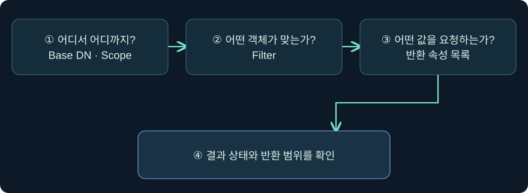
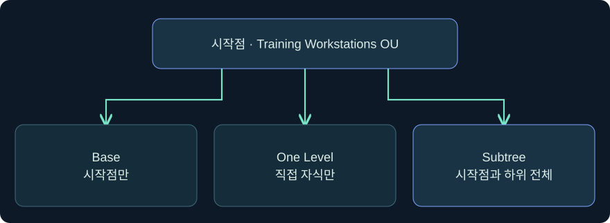
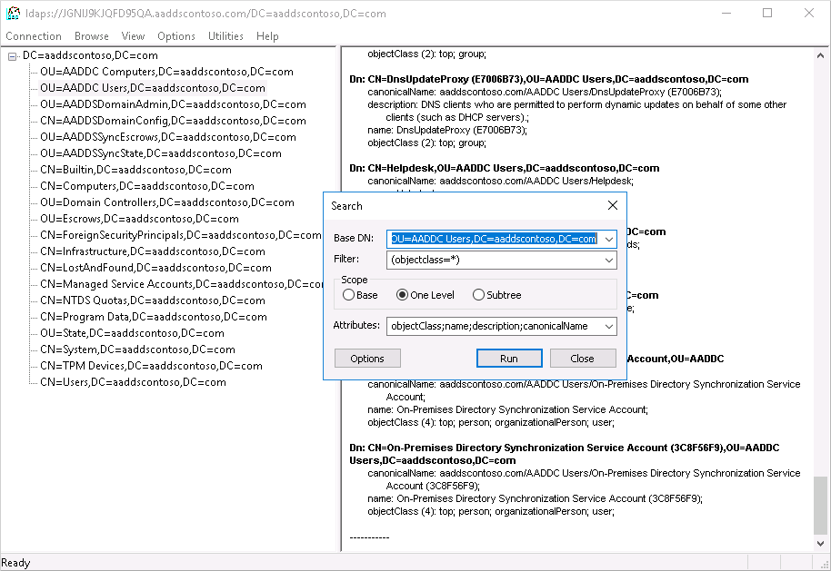
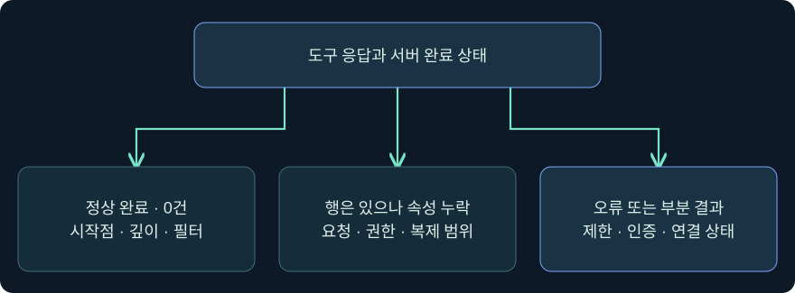

## 1. “객체가 없다”는 말에는 검색 범위가 필요합니다

가상의 `LAB-DOC07`을 찾는 쿼리가 0건을 반환했습니다. 검색이 정상 완료됐는지, 다른 OU에 있는지, 필터가 너무 좁은지, 현재 신원이 읽을 수 있는지에 따라 의미가 다릅니다. 이번 강의에서는 **검색 시작점과 범위**, **객체를 고르는 조건**, **반환을 요청한 속성**, **서버의 최종 결과**를 분리합니다.

모든 호스트·DN·자료는 합성이며, 예시 쿼리는 단일 실습 객체를 읽는 미실행 절차입니다. 실제 도메인에 연결하거나 BOF를 로드하지 않았고, 실제 객체 열람·반출, 자격 증명 수집, 정책 변경도 수행하지 않았습니다.



## 2. 시작점과 검색 깊이는 서로 다른 값입니다

검색의 **Base DN**은 디렉터리 트리에서 출발할 위치입니다. **Scope**는 그 위치에서 어디까지 평가할지 지정합니다. Base DN이 가상 OU라면 Base 범위는 OU 객체 자신만 검사합니다. One Level은 그 OU의 직접 자식만 검사하며, Subtree는 그 OU와 하위 계층을 검사합니다. 필터가 동일해도 검색 깊이를 바꾸면 후보 집합이 달라집니다.



| 가상의 시작점 | Scope | 검색 후보 |
|---|---|---|
| `OU=Training Workstations,DC=training,DC=example` | Base | OU 객체 자체 |
| 같은 OU | One Level | 직접 등록된 컴퓨터·하위 OU |
| 같은 OU | Subtree | OU 자체와 하위 OU 아래의 컴퓨터까지 |
| `CN=LAB-DOC07,OU=Training Workstations,DC=training,DC=example` | Base | 지정한 한 객체 |

검색 시작점이 존재하지 않거나 다른 파티션으로 이어지면 서버가 오류 또는 referral을 반환할 수 있습니다. 정상 완료한 빈 목록과 실패나 불완전한 결과를 따로 적습니다. 도메인 전체를 조회할 필요가 없는 사례에서는 알려진 단일 객체부터 시작합니다.

## 3. 필터는 객체를 고르고 반환 속성은 열을 고릅니다

필터 `(cn=LAB-DOC07)`는 후보 중 일치하는 객체를 고릅니다. 반환 속성 목록 `cn,dNSHostName`은 일치한 객체에서 어떤 값을 요청할지 지정합니다. 검색 조건에 사용한 속성을 반드시 출력해야 하는 것은 아니며, 출력할 속성을 추가해도 그 자체로 매칭 조건이 바뀌지는 않습니다.

LDAP 필터는 괄호 안에 비교를 넣으며 논리 연산자를 먼저 씁니다. 다음 표는 합성 이름을 사용한 문법 예시입니다. 실제 도메인에서 실행한 결과가 아닙니다.

| 논리 | 합성 필터 | 읽는 방법 |
|---|---|---|
| AND | `(&(objectCategory=computer)(cn=LAB-DOC07))` | 컴퓨터 범주와 이름 모두 일치 |
| OR | 아래 필터 예시 참조 | 두 이름 중 하나 일치 |
| NOT | `(!(cn=LAB-DOC08))` | 내부 조건이 참이 아닌 항목. 바깥 조건으로 후보 범위를 제한 |
| 존재 | `(dNSHostName=*)` | 해당 속성의 값 존재 여부 |
| 부분 문자열 | `(cn=LAB-DOC*)` | 이름이 해당 접두어와 일치 |

OR의 전체 예시는 `(|(cn=LAB-DOC07)(cn=LAB-DOC08))`입니다. 필터의 왼쪽 속성명, 비교값, 논리 그룹의 괄호를 순서대로 읽으면 오류를 찾기 쉽습니다. `|`와 `&`의 위치를 바꾸거나 NOT을 바깥에 놓으면 결과 집합이 달라질 수 있습니다. 상위 시스템의 입력을 문자열로 결합하는 구현에서는 LDAP 필터의 값 이스케이프가 필요합니다.

## 4. 클래스 계층, 범주와 검색 비용을 구별합니다

AD의 `objectClass`는 객체가 속한 클래스 계층을 보여 줄 수 있습니다. 컴퓨터가 `user` 클래스를 포함할 수 있으므로 사람용 계정을 보려는 질문에서는 범주나 계정 유형 등 추가 조건이 필요합니다. 예를 들어 Microsoft가 설명하는 `objectCategory=person`과 `objectClass=user`의 결합은 연락처·컴퓨터를 함께 조회하는 혼동을 줄이는 방법입니다. 해당 조건에 일치하는 객체가 모두 사람이 사용 중이라고 단정할 수는 없습니다.

인덱스는 서버가 후보를 찾는 비용을 줄이는 데 도움을 줍니다. 다만 인덱스 속성이 포함됐다는 사실만으로 쿼리가 항상 빠르다고 보장할 수는 없습니다. 시작점, 실제 후보 수, 데이터 분포, 반환 속성, 서버의 질의 계획이 영향을 줍니다. 결과가 두 건이라도 서버가 많은 객체를 방문했을 수 있습니다. **방문 수, 반환 수, 처리 시간**을 나누는 방법은 4강에서 자세히 다룹니다.

## 5. 특수문자와 비어 있는 결과를 해석합니다

RFC 4515의 필터 문자열에서 리터럴 별표를 찾을 때는 `\2a`, 여는 괄호와 닫는 괄호는 `\28`, `\29`로 표시합니다. 예를 들어 실제 이름이 가상의 `Lab*Tag`라면 필터의 값 부분에 `Lab\2aTag`를 써야 별표를 문자로 비교합니다. DN에서 쉼표를 표현하는 규칙과 필터 값의 규칙은 별개입니다. 명령 셸이나 도구가 인용 부호를 처리하는 층도 따로 확인합니다.

결과 행에 속성이 빠졌다면 미설정, 요청 목록에 없음, 해당 서버에 복제되지 않음, 읽기 권한 제한을 가설로 둡니다. 서버나 도구의 결과 제한, 시간 초과, 페이지 처리 누락도 확인합니다. `nTSecurityDescriptor` 같은 속성은 객체 보안 설명자와 관련되며 조회 가능한 부분과 필요한 접근 권한이 다를 수 있습니다. 이번 사례는 이름 두 개만 요청하므로 이를 수집하지 않습니다.

## 6. 실제 Beacon Console에서 단일 객체 조회의 입력 위치를 확인합니다

### 실제 화면 99: 콘솔의 확장 도움말과 검색 인수 입력


출처는 [Fortra Post Exploitation](https://hstechdocs.helpsystems.com/manuals/cobaltstrike/current/userguide/content/topics/post-exploitation_main.htm)입니다. 2026-11-05에 4.13 문서를 대조했습니다. 공식 그림의 UI는 이전 시점일 수 있으며 LDAP 질의 출력은 보이지 않습니다. 아래 `ldapsearch`는 TrustedSec의 공개 BOF 확장으로, Cobalt Strike가 모든 설치에 기본 제공하는 명령으로 가정하지 않습니다.

1. **Sessions → 승인된 가상 실습 연결 → 우클릭 → Interact**를 열고 호스트·문맥을 확인합니다. 아래 입력 줄에 `help ldapsearch`를 넣어 관리자가 이미 승인한 확장의 도움말을 읽는 것을 가정합니다. 명령이 없으면 내장 기능으로 추정하지 않고 조회를 중단합니다.
2. 같은 칸에서 아래 한 줄을 입력하고 **Enter**로 제출하는 미실행 예시입니다. 별도 저장 단계는 없습니다. 도메인 전체가 아닌 알려진 실습 객체 하나를 대상으로 삼습니다.

```text
ldapsearch "(cn=LAB-DOC07)" --attributes cn,dNSHostName --count 1 --scope 1 --hostname dc01.training.example --dn "CN=LAB-DOC07,OU=Training Workstations,DC=training,DC=example"
```

3. `--dn`은 조회 시작점, `--scope 1`은 Base 범위, `--count 1`은 확장의 반환 제한입니다. 두 속성만 지정한 이유는 호스트 이름을 비교할 수 있는 최소 목록이기 때문입니다. `--hostname`은 승인된 가상 DC를 명시합니다. 검토한 소스에서 기본 연결은 389에 서명·봉인을 요청하지만, 설정 실패 시 경고를 남기고 계속 진행할 수 있습니다. `--ldaps` 경로의 인증서 콜백도 검증 없이 수락을 반환하므로 그 플래그만으로 서버 신원을 확인했다고 판단할 수 없습니다. 따라서 이 예시는 격리된 가상 입력을 읽는 용도입니다. 실제 환경의 보안 요구는 승인된 클라이언트와 서버 정책에서 확인합니다.
4. 위쪽 반환 영역에서 연결 대상, 시작점, 필터, 반환 속성과 오류 여부를 확인합니다. 명령 등록·작업 제출·응답 수신을 구별합니다. 확장 전용 GUI와 이 예제의 실제 LDAP 결과 캡처는 확보하지 못했습니다.

## 7. 실제 LDP 화면에서 검색 결과가 보이는 위치를 비교합니다

### 실제 화면 100: Microsoft LDP의 트리와 검색 결과 창



출처는 [Microsoft Entra Domain Services의 LDAPS 안내](https://learn.microsoft.com/en-us/entra/identity/domain-services/tutorial-configure-ldaps)입니다. 2026-11-05에 확인했습니다. 공식 사진은 관리형 도메인 예시이고 설치된 Windows 도구의 언어·메뉴가 다를 수 있습니다. 사진은 검색 결과 화면이며 검색 입력창은 표시하지 않습니다.

1. 권한과 보호 방식이 이미 확인된 연결에서 **View → Tree**를 열어 가상 실습 객체가 있는 컨테이너를 선택한다고 가정합니다. 해당 트리 항목을 우클릭해 **Search**를 엽니다.
2. Search의 **Base DN**에 가상 단일 객체 DN을 넣고 **Scope**에 Base, **Filter**에 `(cn=LAB-DOC07)`을 넣습니다. **Search Options → Attributes**에 `cn;dNSHostName`을 지정하고 확인을 누릅니다. LDP의 속성 구분자와 위 BOF의 쉼표는 도구별 입력 형식입니다.
3. **Run**을 누른 뒤 오른쪽에서 검색 경로·결과 DN·요청 속성·완료 또는 오류를 대조합니다. 입력 대화상자와 이 예제의 출력은 실제 캡처를 확보하지 못했으며 조회도 미실행입니다.

## 8. 0건, 누락, 제한을 서로 다른 결과로 기록합니다



| 합성 조건 변경 | 기대할 관측 | 먼저 확인할 것 |
|---|---|---|
| 시작점을 정확한 객체 DN에서 상위 OU로 변경하고 Base 유지 | 대상 객체가 빠짐 | Base는 시작점 자체만 검사 |
| 필터 유지, `dNSHostName`을 반환 목록에서 제외 | 같은 객체가 보이고 해당 열이 빠짐 | 반환 요청 목록 |
| `(cn=LAB-DOC08)`로 변경 | 가상 객체에서 정상 완료 0건 가능 | 완료 상태와 필터 값 |
| 반환 제한·시간 초과가 보고됨 | 일부 행만 보일 수 있음 | 도구 제한, 서버 결과 코드 |
| TLS 또는 인증 오류 | 검색 성공으로 해석할 수 없음 | 연결·인증·검색 단계 구분 |

표에서 “0건”은 같은 입력에 같은 결과가 보장된다는 뜻이 아닙니다. 예를 들어 서버에서 가상 DN을 찾을 수 없으면 단순한 빈 목록 대신 별도 오류가 나올 수 있습니다. 검색의 목표, 도구가 실제 전달한 인수, 서버 상태를 함께 기록합니다.

## 9. 조사 노트에 다른 사람이 검증할 수 있는 정보를 남깁니다

예를 들어 “승인된 자료에서 DC와 Base DN을 확인했다. Base 검색에 이름 조건을 적용했고 이름 두 속성을 요청했다. 0건의 원인은 아직 확인되지 않았다.”라고 적습니다. 실제 조사에서는 제출 시각과 도구 버전, 사용 신원, 결과 코드와 반환 범위도 남깁니다. 반환값으로 객체의 권한을 주장하려면 별도의 그룹·ACL·실제 서비스 증거가 필요합니다.

다음 강의에서는 사용자 제어 플래그와 중첩 그룹에 쓰는 LDAP 일치 규칙을 다룹니다. 이번 강의의 논리 조건과 다음 강의의 비트 마스크·연결 관계를 별도로 이해하면 결과가 왜 포함됐는지 설명하기 쉽습니다.

## 10. 복습과 즉시 해설

### 복습 1. OU를 시작점으로 Base 검색을 하면 직접 자식도 포함되나요?
**해설:** Base는 시작점 자체만 평가합니다. 직접 자식은 One Level, 하위 전체를 포함하려면 Subtree 범위를 봅니다.

### 복습 2. 필터에 쓴 속성이 반환 목록에도 반드시 있어야 하나요?
**해설:** 필터는 객체 선택, 반환 목록은 출력 값 선택입니다. 목적에 따라 다른 속성을 지정할 수 있습니다.

### 복습 3. 리터럴 별표와 값 존재 조건은 어떻게 구별하나요?
**해설:** 리터럴 별표는 필터 값에서 `\2a`로 이스케이프합니다. `(attribute=*)`는 값 존재를 검사합니다.

### 복습 4. 이름 필터가 0건이면 계정이 삭제됐나요?
**해설:** 정상 완료 여부와 시작점, 깊이, 서버, 필터 값 및 접근 범위를 확인해야 합니다.

### 복습 5. 반환 1건이면 DC도 객체를 한 건만 읽었나요?
**해설:** 방문한 후보와 반환한 행은 다를 수 있습니다. 비용과 효율은 서버 측 관측을 확인합니다.

### 복습 6. 컴퓨터와 사람용 계정의 objectClass에 user가 함께 보일 수 있나요?
**해설:** AD 클래스 계층 때문에 가능합니다. 범주 또는 계정 유형을 추가해 검색 의도를 명확히 합니다.

### 복습 7. Beacon에서 ldapsearch가 보이지 않으면 무슨 뜻인가요?
**해설:** 해당 확장이 설치·로드되지 않았거나 버전이 다를 수 있습니다. 항상 내장이라고 가정하지 않습니다.

### 복습 8. 객체의 DN은 보이는데 DNS 속성은 비어 있으면 무엇을 확인하나요?
**해설:** 요청 속성 목록, 실제 설정값, 권한, 조회한 서버의 복제 범위를 구별해 확인합니다.

## 11. 공식 출처와 검증 범위

2026-11-05에 표준과 Microsoft·Fortra·TrustedSec 자료를 대조했습니다. 다이어그램과 사례는 독립 작성했으며 제품·Windows·LDAP 검색은 미실행입니다.

- [IETF RFC 4511 LDAP 프로토콜](https://www.rfc-editor.org/rfc/rfc4511)
- [IETF RFC 4515 검색 필터 문자열](https://www.rfc-editor.org/rfc/rfc4515)
- [Microsoft 검색 깊이](https://learn.microsoft.com/en-us/windows/win32/ad/search-scope)
- [Microsoft 클래스별 객체 검색](https://learn.microsoft.com/en-us/windows/win32/ad/finding-objects-by-class)
- [Microsoft LDP](https://learn.microsoft.com/en-us/previous-versions/windows/it-pro/windows-server-2012-r2-and-2012/cc771022%28v%3Dws.11%29)
- [TrustedSec BOF 원본 저장소](https://github.com/trustedsec/CS-Situational-Awareness-BOF)
- [TrustedSec 검색 범위 매핑](https://github.com/trustedsec/CS-Situational-Awareness-BOF/blob/master/src/SA/ldapsearch/entry.c)
- [TrustedSec 명령 인수 정의](https://github.com/trustedsec/CS-Situational-Awareness-BOF/blob/master/SA/SA.cna)
