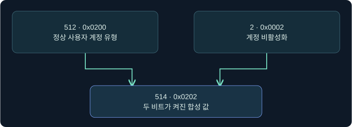
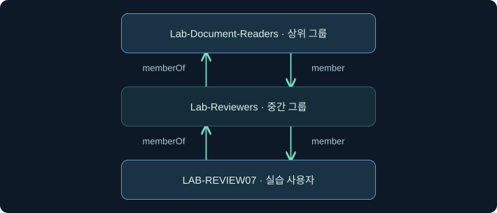
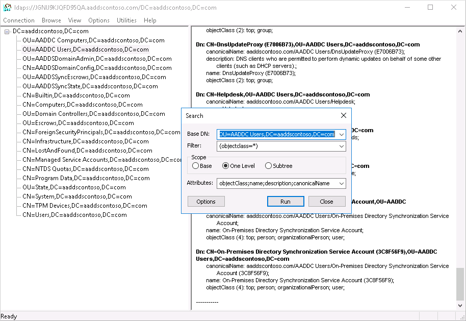
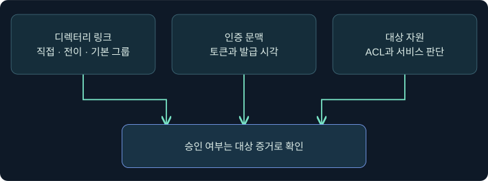

## 1. 계정의 상태와 그룹의 경로는 다른 질문입니다

점검자가 합성 계정 LAB-REVIEW07의 계정 플래그와 실습 그룹 연결을 확인합니다. 첫 질문은 정수 속성에서 어떤 비트가 켜져 있는가입니다. 둘째 질문은 디렉터리의 그룹 링크를 따라 지정 그룹에 닿는가입니다. 마지막 질문인 특정 서비스의 접근 승인에는 대상 리소스의 권한과 해당 인증 시점의 문맥이 추가로 필요합니다.

이 강의의 이름과 DN은 가상입니다. 조건식은 합성 데이터로 읽는 예시이며, 실제 디렉터리 조회·BOF 로드·설정 변경은 미실행입니다.

## 2. userAccountControl의 십진수 값을 비트로 풉니다

AD의 `userAccountControl`은 여러 계정 플래그를 담는 정수입니다. 정상 사용자 계정 유형의 플래그 `NORMAL_ACCOUNT`는 512(0x0200), 계정 비활성화 플래그 `ACCOUNTDISABLE`은 2(0x0002)입니다. 다른 플래그 없이 이 둘이 설정돼 있으면 값은 514(0x0202)입니다. 다른 플래그를 함께 켜면 값이 바뀌어도 비활성화 비트는 유지될 수 있습니다. 반대로 512에 해당하는 값만 보고 계정이 현재 로그인할 수 있다고 판정하면 잠금·만료·로그온 제한을 놓칩니다.



| 관측한 정수 | 512 비트 | 2 비트 | 해석할 수 있는 범위 |
|---|---|---|---|
| 512 | 켜짐 | 꺼짐 | 정상 사용자 계정 유형, 비활성화 비트 미설정 |
| 514 | 켜짐 | 켜짐 | 두 플래그 모두 설정 |
| 66050 | 켜짐 | 켜짐 | 위 두 플래그와 65536 비트가 함께 설정 |

512, 2, 65536은 서로 다른 자리의 비트이므로 합으로 설명할 수 있습니다. 같은 비트를 두 번 더해서 마스크를 만들면 올림으로 다른 비트가 켜질 수 있습니다.

## 3. 전체 값, 모든 비트, 하나 이상의 비트를 구분합니다

AD의 확장 일치 문법은 `(속성:규칙OID:=값)`입니다. OID는 서버에서 적용할 일치 규칙의 식별자입니다. 일반 등식 `(userAccountControl=514)`는 정수 전체가 같은지를 비교합니다. 아래 세 조건은 같은 마스크라도 서로 다른 질문을 던집니다.

| 조건 | 512 | 514 | 66050 | 검사 방식 |
|---|---|---|---|---|
| 정확히 514 | 거짓 | 참 | 거짓 | 정수 전체 비교 |
| 514 마스크의 모든 비트 | 거짓 | 참 | 참 | AND 결과가 마스크와 같은가 |
| 514 마스크 중 하나 이상 | 참 | 참 | 참 | AND 결과가 0보다 큰가 |

```text
(userAccountControl=514)
(userAccountControl:1.2.840.113556.1.4.803:=514)
(userAccountControl:1.2.840.113556.1.4.804:=514)
```

`.803`은 BIT_AND, `.804`는 BIT_OR입니다. 두 규칙의 차이는 마스크에 두 개 이상의 비트가 들어갈 때 드러납니다. 예를 들어 2만 마스크로 쓰면 두 규칙 모두 같은 한 비트의 존재를 검사합니다. 이름 조건과 비트 조건을 함께 쓰려면 `(&(cn=LAB-REVIEW07)(userAccountControl:1.2.840.113556.1.4.803:=2))`처럼 LDAP 논리 그룹 안에 넣습니다. 바깥의 `&`는 두 필터의 참·거짓을 결합하며 OID의 비트 연산과 층이 다릅니다.

## 4. 그룹의 방향을 정한 뒤 연결을 따라갑니다

가상 계정 LAB-REVIEW07은 Lab-Reviewers의 직접 구성원이며, Lab-Reviewers는 Lab-Document-Readers에 들어 있습니다. 사용자 객체의 `memberOf`는 직접 상위 그룹을 가리킵니다. 그룹 객체의 `member`는 직접 하위 구성원을 가리킵니다. 어떤 객체들을 평가할지에 따라 연결 방향과 비교할 DN이 바뀝니다.



| 확인 대상 | 연결 속성 | 비교할 값 | 해석 |
|---|---|---|---|
| 알려진 사용자 객체 한 개 | `memberOf` | 상위 실습 그룹의 DN | 사용자에서 그룹 방향으로 판정 |
| 알려진 그룹 객체 한 개 | `member` | 실습 사용자 DN | 그룹에서 구성원 방향으로 판정 |
| 사용자의 기본 그룹 | `primaryGroupID` | 사용자 도메인 내 해당 그룹 RID | 기본 그룹의 별도 표현 |

AD의 `1.2.840.113556.1.4.1941`(TRANSITIVE_EVAL)은 링크 속성에 대해 지정한 DN에 도달하는지를 검사합니다. 링크가 있는 대상에 쓰는 규칙이며, 모든 문자열 속성의 계층 검색을 의미하지 않습니다. 다음 두 필터를 각각 **사용자 한 개**에 적용한다고 가정합니다.

```text
(memberOf=CN=Lab-Document-Readers,OU=Training Groups,DC=training,DC=example)
(memberOf:1.2.840.113556.1.4.1941:=CN=Lab-Document-Readers,OU=Training Groups,DC=training,DC=example)
```

이 표본에서 사용자의 직접 상위 그룹은 Lab-Reviewers입니다. 첫 조건의 비교값은 Lab-Document-Readers이므로 거짓이며, 두 번째 조건은 Lab-Reviewers를 거쳐 상위 그룹에 닿으므로 참입니다. TRANSITIVE_EVAL은 평가 대상 객체를 고르는 필터입니다. 반환 속성으로 `memberOf`를 요청해도 중간 경로가 자동으로 반환되는 것은 아닙니다.

## 5. 기본 그룹과 조회 서버 때문에 생기는 빈칸을 다룹니다

사용자의 기본 그룹은 `primaryGroupID`로 표현됩니다. 그 관계는 사용자 `memberOf`와 그룹 `member`에 나타나지 않으므로 두 링크 속성만으로 모든 구성원 관계를 복구할 수 없습니다. RID만 비교할 때는 어떤 도메인의 RID인지 확인합니다. 이름이 같은 그룹이나 다른 도메인에서 우연히 같은 RID를 가진 그룹을 합치면 잘못된 경로를 만듭니다.

실무 메모에는 조회 DC의 이름과 역할, 대상 도메인, 검색 시작점, 조회 시각, 검색 성공 여부를 함께 남깁니다. GC의 부분 속성 집합, 복제 시차, 그룹 범위와 다른 도메인의 객체 참조, 읽기 권한에 따라 증거가 달라질 수 있습니다. RFC 4514의 DN 문자 표현과 RFC 4515의 필터 값 이스케이프는 별도 단계입니다. DN에 이름의 리터럴 쉼표를 표현하는 역슬래시가 있다면 필터 값으로 넘길 때 그 역슬래시도 적절히 인코딩해야 합니다.

## 6. 실제 Beacon Console에서 확장 도움말 위치를 확인합니다

### 실제 화면 101: Beacon Console의 입력 줄과 반환 영역


출처는 [Fortra Post Exploitation](https://hstechdocs.helpsystems.com/manuals/cobaltstrike/current/userguide/content/topics/post-exploitation_main.htm)입니다. 2026-11-05에 4.13 문서를 대조했습니다. 공식 화면은 이전 UI일 수 있고 이 강의의 명령 실행 결과를 보여 주지 않습니다.

1. **Sessions → 승인된 가상 세션의 행 → 우클릭 → Interact**로 콘솔을 여는 미실행 절차입니다. 먼저 세션의 호스트와 문맥을 확인합니다.
2. 하단 입력 줄에 `help ldapsearch`를 넣고 **Enter**를 누릅니다. 알려진 실습 객체를 대상으로 하는 경우에도 확장이 등록됐는지, 필터와 범위가 별도 인수인지 먼저 확인하기 위한 값입니다. 설정 저장 단계는 없습니다.
3. 상단 출력 영역에서 해당 명령의 도움말 또는 미등록 응답을 확인합니다. `ldapsearch`는 [TrustedSec 공개 BOF 확장](https://github.com/trustedsec/CS-Situational-Awareness-BOF)입니다. 확장 도움말과 이번 필터의 실제 출력 화면은 확보하지 못했으며 이 절차에서 LDAP 쿼리는 보내지 않습니다.

## 7. 실제 LDP 화면에서 단일 객체를 판정하는 위치를 찾습니다

### 실제 화면 102: Microsoft LDP의 트리와 반환 영역



출처는 [Microsoft Entra Domain Services LDAPS 안내](https://learn.microsoft.com/en-us/entra/identity/domain-services/tutorial-configure-ldaps)입니다. Used with permission from Microsoft. 2026-11-05에 대조했습니다. 관리형 도메인의 공식 예시이며 Windows 버전과 표시 언어에 따라 이름이나 위치가 달라질 수 있습니다.

1. 보호 방식과 조회 신원이 이미 확인된 가상 실습 연결에서 **View → Tree → 객체 우클릭 → Search**를 선택한다고 가정합니다. **Base DN**은 `CN=LAB-REVIEW07,OU=Training Accounts,DC=training,DC=example`, **Scope**는 **Base**를 넣어 한 계정의 조건 판정으로 제한합니다.
2. **Filter**에 `(userAccountControl:1.2.840.113556.1.4.803:=2)`를 넣습니다. **Search Options → Attributes**에 `cn;userAccountControl`을 넣고 확인합니다. 반환된 정수를 비트 판정과 대조할 수 있는 최소 목록입니다.
3. **Run**으로 검색을 제출하는 미실행 절차입니다. 별도 저장은 필요하지 않습니다. 오른쪽 창에서 검색 완료 상태와 반환 DN·정수를 대조합니다. 결과가 없으면 필터 불일치, 시작점 오류, 접근 제한을 구분합니다. 이 검색 대화상자와 가상 예제의 출력 사진은 확보하지 못했습니다.

## 8. 가정 하나를 바꿔 어떤 증거가 움직이는지 확인합니다



| 바꾼 가정 | 예상 변화 | 추가로 확인할 증거 |
|---|---|---|
| 합성 값 514를 66050으로 바꿈 | 정확히 514 비교만 거짓으로 바뀜 | 실제 정수와 마스크 의미 |
| 상위 그룹과 중간 그룹 사이 링크를 제거 | 해당 링크만 유일한 경로였다면 전이 판정이 거짓으로 바뀜 | 양쪽 DN과 다른 링크 유무 |
| 상위 그룹이 기본 그룹으로만 연결됨 | `memberOf` 체인만으로 판정할 수 없음 | `primaryGroupID`, 도메인 및 그룹 SID |
| 상위 그룹이 배포용으로 설정됨 | 디렉터리 링크는 유지될 수 있음 | 보안 사용 여부와 대상 서비스의 권한 판단 |
| 리소스의 ACL 또는 세션 문맥이 바뀜 | 같은 그룹 경로에서 서비스 결과가 달라질 수 있음 | 대상 ACL, 인증 시점, 실제 접근 기록 |

이 비교는 가상 조건에서 기대하는 변화입니다. 접근 증거를 작성할 때는 사용자의 토큰이나 인증 결과, 대상 자원의 권한 적용을 별도로 대조합니다.

## 9. 조사 기록에는 필터, 관측, 추론을 나눠 적습니다

예를 들어 “합성 모형에서 비활성화 비트가 설정됐다. 설정된 두 직접 링크로 지정 그룹에 닿는다. 그 서비스에서 사용 가능한 로그인과 데이터 권한은 미확인이다.”처럼 씁니다. 실제 조사에서는 일치 규칙, 시작 DN, 검색 범위와 응답 상태를 기록하면 다른 담당자가 결론의 범위를 검토할 수 있습니다. 다음 강의에서는 이런 검색을 DC가 어떤 비용으로 처리했는지 읽습니다.

## 10. 복습과 즉시 해설

### 복습 1. 66050에 비활성화 비트가 설정됐는지는 어떻게 판정하나요?
**해설:** 마스크 2로 해당 자리만 검사합니다. 66050은 65536과 512, 2의 합입니다.

### 복습 2. 전체 값이 514인 조건과 마스크 514의 BIT_AND 조건의 차이는 무엇인가요?
**해설:** 전체 값 비교는 다른 비트가 켜지면 실패합니다. BIT_AND는 마스크에 필요한 두 비트가 모두 있으면 다른 비트가 있어도 참입니다.

### 복습 3. 마스크 514에서 값 512는 BIT_OR와 BIT_AND 중 어디에 일치하나요?
**해설:** 512는 필요한 두 비트 중 하나만 포함하므로 BIT_OR에만 일치합니다.

### 복습 4. 사용자에서 상위 그룹으로 올라갈 때 어느 링크를 읽나요?
**해설:** 사용자 객체의 `memberOf` 방향입니다. 그룹에서 하위 구성원으로 내려갈 때는 `member`를 읽습니다.

### 복습 5. 전이 규칙이 참이면 반환 속성에 경로의 모든 중간 그룹이 표시되나요?
**해설:** 일치 판정은 참입니다. 각 중간 링크를 증거로 남기려면 관계 자료를 따로 검증합니다.

### 복습 6. 기본 그룹이 보이지 않을 때 확인할 별도 값은 무엇인가요?
**해설:** 사용자 도메인의 `primaryGroupID`와 해당 RID를 갖는 그룹 SID를 대조합니다.

### 복습 7. 같은 그룹 링크를 가진 두 계정의 파일 접근 결과가 달라질 수 있나요?
**해설:** 대상 ACL, 인증 시점, 세션 문맥 등이 다르면 접근 결과도 달라질 수 있습니다.

### 복습 8. 필터가 빈 목록을 반환하면 무엇을 먼저 적나요?
**해설:** 검색의 완료 상태와 DC, Base DN, 범위를 기록합니다. 링크 부재는 검색 조건과 관측 범위를 확인한 뒤 판단합니다.

## 11. 공식 자료와 확인 범위

- LDAP 필터 문법과 확장 일치 규칙을 대조했습니다. [Microsoft Search Filter Syntax](https://learn.microsoft.com/en-us/windows/win32/adsi/search-filter-syntax) · [Microsoft MS-ADTS LDAP Matching Rules](https://learn.microsoft.com/en-us/openspecs/windows_protocols/ms-adts/4e638665-f466-4597-93c4-12f2ebfabab5)
- 계정 플래그와 기본 그룹의 별도 표현을 대조했습니다. [Microsoft userAccountControl Bits](https://learn.microsoft.com/en-us/openspecs/windows_protocols/ms-adts/dd302fd1-0aa7-406b-ad91-2a6b35738557) · [Microsoft primaryGroupID](https://learn.microsoft.com/en-us/openspecs/windows_protocols/ms-ada3/e12954a4-6865-4432-94e6-00c310ca87c0)
- DN과 검색 필터의 문자열 표현을 확인했습니다. [RFC 4514](https://www.rfc-editor.org/rfc/rfc4514) · [RFC 4515](https://www.rfc-editor.org/rfc/rfc4515)
