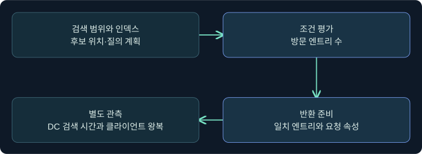
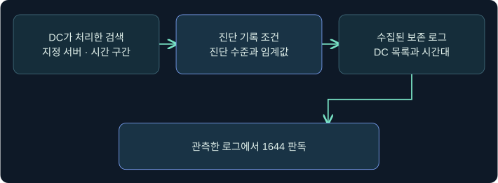
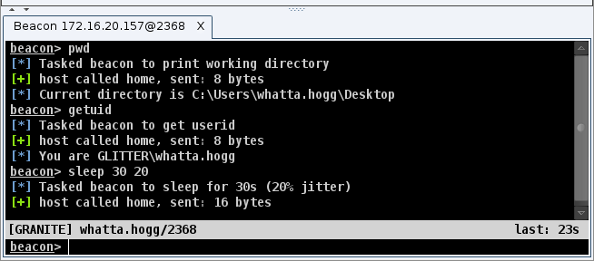
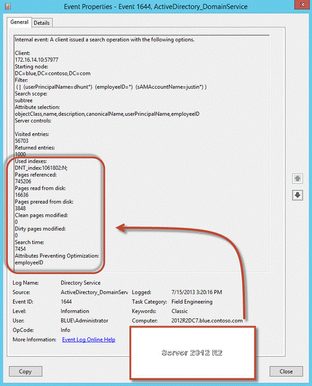
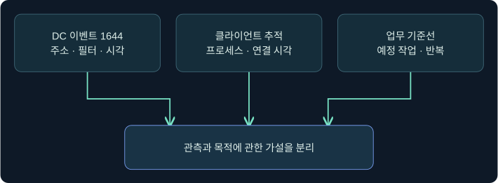

## 1. 같은 결과 수라도 DC가 한 일은 다릅니다

도메인 컨트롤러(DC)가 LDAP 검색에 객체 두 개를 반환했습니다. 한 경우에는 인덱스에서 두 후보만 찾았고, 다른 경우에는 수천 후보를 검사한 뒤 같은 두 객체를 보냈습니다. 반환 행만 보면 이 차이를 알 수 없습니다. 이번 강의에서는 **방문 수**, **반환 수**, **DC 처리 시간**, **반복 횟수**를 분리하고, 이벤트 1644가 어떤 조건에서 관측되는지 살펴봅니다.

표와 비교는 독립적으로 만든 합성 사례입니다. 실제 DC에 질의하거나 감사 설정·보호 기능을 변경하지 않았습니다. 제품 화면은 공식 문서의 예시입니다.

## 2. 후보 검색, 필터 평가, 반환 데이터 준비를 구분합니다

시작 DN과 검색 깊이는 후보의 위치를 정합니다. DC는 사용 가능한 인덱스와 질의 계획을 바탕으로 후보를 찾고, 필터와 접근 조건을 평가합니다. 일치 항목에서 요청한 값을 읽어 반환합니다. 인덱스의 존재와 실제 사용은 구별해야 합니다. 후보가 넓게 걸리는 인덱스, 비교 형태, 다른 조건과의 결합, 서버 버전 등에 따라 실제 비용은 달라집니다.

반환 속성을 줄이면 일부 응답 크기와 값 준비 비용을 줄일 수 있습니다. 필터와 후보 경로가 같으면 방문 수는 비슷할 수도 있습니다. 반대로 승인된 업무 질문을 하위 OU로 좁힐 수 있다면 후보 수가 달라집니다. 조회 목적을 보존하며 한 조건씩 비교해야 어떤 변경이 비용 차이를 만들었는지 알 수 있습니다.

## 3. 방문 수, 반환 비율, 시간은 각기 다른 관측입니다

| 진단 관점 | 주된 관측값 | 해석할 때 유의할 점 |
|---|---|---|
| 방문 비용 | DC가 검사한 엔트리 수 | 반환 행 수만으로 비싼 검색인지 알 수 없음 |
| 낮은 반환 비율 | 반환 수 ÷ 방문 수와 방문 수의 하한 | 표본이 작거나 방문 수가 0이면 비율만으로 판정하기 어려움 |
| 긴 처리 시간 | DC의 검색 시간(ms) | 클라이언트에서 본 전체 왕복 시간과 구별 |
| 누적 부하 | 같은 구간의 횟수와 처리 시간 합 | 한 번 빠른 질의도 자주 반복되면 부담이 될 수 있음 |

비효율을 해석할 때는 낮은 반환 비율에 더해 방문 규모를 확인합니다. 소수의 후보에서 결과가 적었던 경우와 수천 후보 중 일부만 반환한 경우의 작업량은 다릅니다. 확장 1644는 별도의 시간 기반 기록 조건도 지원합니다. 로그 해석에는 해당 DC의 빌드, 진단 수준, 실제 구성과 수집 기간을 연결해야 합니다.

## 4. 1644 이벤트가 남기는 증거와 남기지 않는 증거를 확인합니다

AD DS의 **Directory Service** 로그에 남는 이벤트 1644는 특정 진단 조건에 해당하는 LDAP 검색의 서버 측 기록입니다. 기본 정보에는 클라이언트 주소·포트, 시작 노드, 필터, 검색 범위, 요청 속성, 서버 제어, 방문·반환 수가 포함될 수 있습니다. Microsoft가 설명하는 확장 이벤트에는 검색 시간, 사용한 인덱스와 일부 페이지 통계, 최적화를 방해한 속성 등의 항목이 추가됩니다. Windows Server 2012 R2에서 확장 필드가 추가됐고 일부 이전 서버 버전에는 업데이트로 제공됐습니다.

기록 범위는 Field Engineering 진단 수준과 비용·비율·시간 조건, 수집한 DC, 시간 구간 및 로그 보존에 따라 달라집니다. 이벤트가 없으면 어떤 DC와 시간대를 수집했는지부터 확인합니다. 서버 쪽 주소는 공유 호스트나 중계 경로를 나타낼 수 있으므로 주소 한 개로 작업 프로세스나 사용자를 확정하지 않습니다.

## 5. 수치와 반복 패턴을 함께 읽습니다

아래 숫자는 계산 연습용입니다. 실제 로깅 결과나 서버에 적용할 임계값이 아닙니다. 마지막 열은 검증할 가설입니다.

| 합성 사례 | 방문 | 반환 | 비율 | DC 시간 | 5분간 횟수 | 다음 확인 |
|---|---:|---:|---:|---:|---:|---|
| A. 소수 결과의 넓은 검색 | 4000 | 20 | 0.5% | 210ms | 2 | 시작점, 인덱스, 예정된 인벤토리인지 |
| B. 행이 많은 검색 | 12000 | 10800 | 90% | 600ms | 1 | 대량 동기화, 반환 속성·범위 |
| C. 반복되는 작은 검색 | 30 | 25 | 약 83.3% | 9ms | 300 | 호출 프로세스, 캐시, 예약 주기 |
| D. 방문 수가 비슷한 느린 검색 | 30 | 25 | 약 83.3% | 220ms | 3 | 반환 값 크기, 당시 DC 부하, 디스크 통계 |

A와 B는 각각 낮은 비율과 많은 방문 수가 두드러집니다. C의 한 번은 빠르지만 300건의 DC 검색 시간 합은 2700ms입니다. 합계는 동시 실행을 포함할 수 있으므로 사용자 대기 시간이나 CPU 사용률과 동일시하지 않습니다. C와 D는 행 수가 같아도 시간이 달라질 수 있음을 보여 줍니다.

## 6. 실제 Beacon Console에서 도구 등록 확인 위치를 찾습니다

### 실제 화면 103: Beacon Console에서 도움말을 제출하는 위치

출처는 [Fortra Post Exploitation](https://hstechdocs.helpsystems.com/manuals/cobaltstrike/current/userguide/content/topics/post-exploitation_main.htm)입니다. 2026-11-05에 4.13 문서를 대조했습니다. 공개 화면의 UI는 이전 버전일 수 있으며 이벤트 1644나 이번 확장의 결과를 표시하지 않습니다.

1. **Sessions → 승인된 가상 세션 행 → 우클릭 → Interact**를 선택합니다. 세션과 호스트를 확인하는 미실행 절차입니다.
2. 콘솔 하단에 `help ldapsearch`를 넣고 **Enter**를 누릅니다. 클라이언트 확장이 등록됐는지, 기능의 이름과 입력 항목을 확인하기 위한 값입니다. 설정을 저장할 필요가 없습니다.
3. 상단 응답에서 등록된 도움말 또는 미등록 메시지를 확인합니다. 이 답변으로 확인되는 범위는 도구 등록 여부입니다. 이 절차에서는 실제 검색을 제출하지 않으며 DC 기록 생성을 기대하지 않습니다. 도움말 응답과 이번 합성 사례의 제품 실행 화면은 확보하지 못했습니다.

## 7. 실제 이벤트 뷰어 화면에서 1644 필드를 읽습니다

### 실제 화면 104: Microsoft의 확장 1644 이벤트 예시

출처는 [Microsoft Directory Services component updates](https://learn.microsoft.com/en-us/windows-server/identity/ad-ds/manage/component-updates/directory-services-component-updates)입니다. Used with permission from Microsoft. 2026-11-05에 대조했습니다. 공식 GIF를 화소 변경 없이 PNG로 옮겼습니다. Windows Server 2012 R2의 예시이며 현재 설치의 표시 언어, 필드 순서, 이벤트 세부 창과 다를 수 있습니다. 공식 사진의 데이터는 위 합성 사례의 실행 결과와 별개입니다.

1. 조사 담당자가 제공한 읽기 전용 복사본이 있다고 가정하고 **Event Viewer → Action → Open Saved Log**를 선택합니다. 예시 파일명 `training-directory-service.evtx`는 이미 내보낸 Directory Service 로그를 뜻합니다. 대화상자의 파일 이름 칸에서 그 복사본을 선택하고 **Open**을 누릅니다.
2. 저장 로그를 선택하고 **Filter Current Log**를 클릭합니다. 이벤트 ID 칸에 `1644`를 넣고 **OK**로 적용합니다. 관심 있는 서버 측 검색 진단 기록만 표시하기 위한 보기 필터입니다. 진단 설정이나 원본 파일을 바꾸는 저장 단계는 없습니다.
3. 이벤트 행을 열고 **General**과 **Details**에서 기록한 DC·시각·클라이언트, 시작 DN, 범위, 필터, 방문·반환 수, 시간·인덱스 등 제공되는 필드를 비교합니다. 0건이면 필터 기간과 로그 출처를 확인합니다. 이 절차의 파일 열기·필터 입력 창이나 합성 사례 자체의 실제 캡처는 확보하지 못했으며 Windows에서 절차를 실행하지 않았습니다.

## 8. 서버 로그와 클라이언트 관측을 시간으로 연결합니다

조사는 보통 **DC 이름과 시각 → 클라이언트 주소·포트 → 해당 시간의 클라이언트 추적 → 업무 소유자와 예정 작업** 순으로 근거를 모읍니다. Windows LDAP 클라이언트 ETW(이벤트 추적)는 이미 승인된 추적이 있다면 어느 프로세스가 LDAP 동작을 수행했는지 검토하는 데 도움이 됩니다. 수집 조건, 시계 차이, 재시도나 중계 장비가 있으면 하나의 서버 이벤트를 한 프로세스와 바로 대응시키기 어렵습니다.

같은 필터를 쓴 정상 동기화와 모의 점검은 서버 이벤트의 형태가 비슷할 수 있습니다. 승인된 작업 시간, 기대한 시작점과 속성, 비정상적인 반복, 관련 단말 기록을 함께 비교합니다. 기저 부하가 높은 DC와 한가한 DC의 시간 값을 직접 비교할 때도 서버 및 시간대를 기록합니다.

## 9. 탐지 결과의 증거 수준을 기록합니다

예를 들어 “DC A의 수집 구간에서 1644가 기록됐고 클라이언트 주소와 조건식이 반복됐다. 방문 수 대비 반환 비율이 낮다. 호출 앱과 목적은 확인 중이다.”처럼 작성합니다. 수치에서 성능 가설을 세우고, 탐지 판단에는 업무 맥락과 단말 증거를 붙입니다. 여러 DC의 보존 로그를 합칠 때는 기록이 없는 DC와 시간 구간도 표시합니다. 이후 강의에서는 수집한 객체와 관계를 그래프로 옮길 때 생기는 추가 누락을 봅니다.

## 10. 복습과 즉시 해설

### 복습 1. 반환 수가 두 건인 검색도 비용이 클 수 있나요?
**해설:** 많은 후보를 방문한 뒤 두 건만 반환했을 수 있습니다. 방문 수와 DC 시간을 확인합니다.

### 복습 2. 방문 4000, 반환 20의 반환 비율은 얼마인가요?
**해설:** 20을 4000으로 나누면 0.005, 백분율로 0.5%입니다.

### 복습 3. 반환 속성을 줄이면 방문 수도 반드시 줄어드나요?
**해설:** 후보 선택이 같다면 방문 수는 비슷할 수 있습니다. 반환 준비 비용과 응답 크기를 별도 관측합니다.

### 복습 4. 9ms가 300회 반복되면 어떤 지표를 추가로 보나요?
**해설:** 총 DC 처리 시간, 횟수, 반복 시간대와 호출 프로세스를 봅니다. 합계는 2700ms입니다.

### 복습 5. 모든 1644 이벤트에 검색 시간과 인덱스가 있나요?
**해설:** 해당 항목은 확장 이벤트에서 제공됩니다. 서버 버전, 업데이트와 기록 형식을 확인합니다.

### 복습 6. 1644가 0건이면 그 시간대에 LDAP 사용이 없었나요?
**해설:** 진단 기록 조건, DC, 로그 보존과 수집 구간을 먼저 확인해야 검색 부재를 검토할 수 있습니다.

### 복습 7. 이벤트의 클라이언트 IP로 호출 프로그램을 확정할 수 있나요?
**해설:** 주소와 포트는 연결 단서입니다. 승인된 단말의 LDAP 추적과 시간 정보를 교차 확인합니다.

### 복습 8. 높은 방문 수가 관측되면 공격으로 분류하나요?
**해설:** 높은 방문 수는 서버 작업량의 근거입니다. 행위 판단에는 업무 기준선, 시각, 출처, 반복 패턴을 더 확인합니다.

## 11. 공식 자료와 확인 범위

- 확장 1644 필드와 로깅 조건, 공식 이벤트 사진을 대조했습니다. [Microsoft Directory Services component updates](https://learn.microsoft.com/en-us/windows-server/identity/ad-ds/manage/component-updates/directory-services-component-updates)
- 검색 성능, 여러 DC에서 수집한 로그의 집계와 예전 진단 기준을 확인했습니다. [Microsoft Event1644Reader](https://learn.microsoft.com/en-us/troubleshoot/windows-server/active-directory/event1644reader-analyze-ldap-query-performance) · [Microsoft AD·LDS 진단 로깅](https://learn.microsoft.com/en-us/troubleshoot/windows-server/active-directory/configure-ad-and-lds-event-logging)
- 승인된 클라이언트 추적의 성격을 확인했습니다. [Microsoft LDAP client ETW tracing](https://learn.microsoft.com/en-us/windows-server/identity/ad-ds/manage/troubleshoot/troubleshoot-ldap-using-etw)
