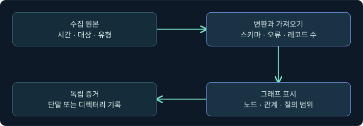
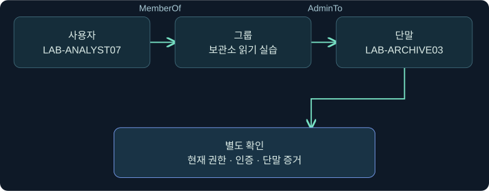
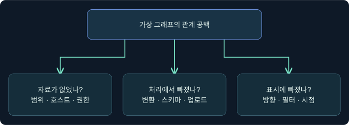
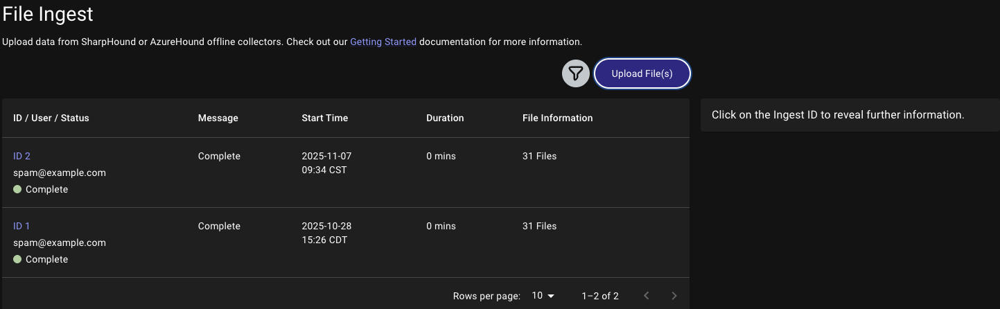
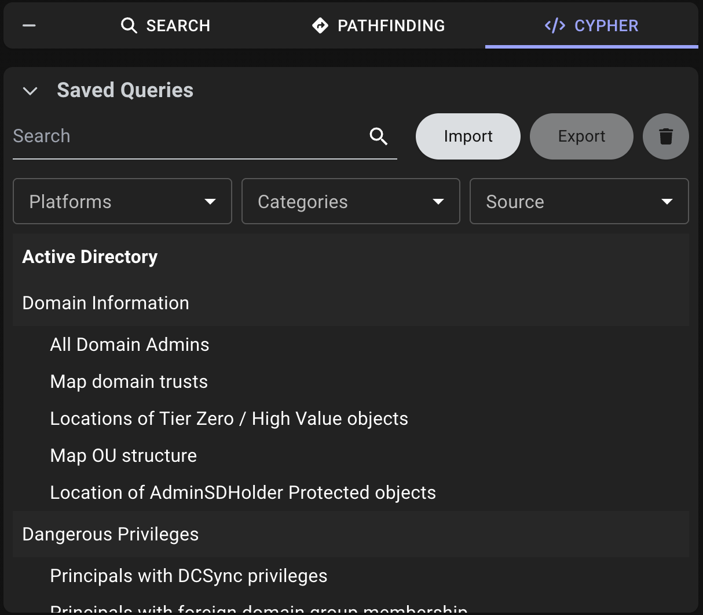

## 1. 그래프의 한 줄에는 관측 범위와 시각이 있습니다

가상 조직에서 LAB-ANALYST07을 검색하자 Lab-Archive-Readers 그룹으로 이어지는 화살표가 보입니다. LAB-ARCHIVE03의 로컬 그룹 연결은 비어 있습니다. 첫 화살표는 어떤 자료에서 생겼고, 빈칸은 조사 결과인지 아직 확인하지 않은 곳인지가 이번 질문입니다. 관계 그래프를 조사에 쓰려면 객체와 관계, 수집 당시 상태와 현재 상태, 경로 탐색과 실제 접근을 따로 읽어야 합니다.

예시 이름과 관측 값은 모두 합성입니다. 실제 도메인 수집, 콘솔 명령 제출, BOFHound 변환, BloodHound 가져오기·조회는 미실행입니다. 제품의 공식 예시는 출처와 함께 따로 표시합니다.



## 2. 노드와 관계의 방향을 읽습니다

노드는 사용자·그룹·컴퓨터·GPO 같은 대상을 표현합니다. 관계는 출발 노드, 도착 노드, 유형을 가진 방향 있는 연결입니다. 예를 들어 `MemberOf`는 사용자 또는 그룹에서 상위 그룹을 가리킵니다. `AdminTo`는 출발 주체가 대상 컴퓨터에 대한 로컬 관리자 권한을 가진 것으로 모델링한 관계입니다. 두 관계가 이어지면 로컬 관리 가능성을 조사할 이유가 생깁니다. 실제 자격 증명 상태, 정책, 네트워크 도달성, 인증 문맥, 리소스 결과는 별도 근거에서 확인합니다.



| 그래프에서 본 것 | 뒷받침할 자료 | 따로 확인할 항목 |
|---|---|---|
| 사용자의 그룹 연결 | 디렉터리 멤버십 또는 신뢰할 수 있는 관계 내보내기 | 기본 그룹 표현, 조회 범위와 시점 |
| 컴퓨터로 향하는 관리자 관계 | 로컬 그룹 자료 또는 해당 도구가 명시한 추론의 근거 | 단말의 현재 권한과 조사 시점 |
| 세션 관계 | 지원하는 수집 방법의 호스트 관측 | 같은 시각의 실제 로그인·접근 여부 |
| ACL에서 유래한 연결 | 원본 보안 설명자와 ACE의 권한·대상 | 상속·개체 유형·거부 규칙 및 후속 증거 |

그래프에 표시된 이름은 읽기 편한 표지입니다. 같은 이름이 여러 도메인이나 시스템에 있을 수 있으므로 유형과 도메인, 원본 SID 또는 해당 수집기가 사용하는 고유 식별자를 함께 비교합니다. 미해결 SID는 이름으로 해석할 증거가 부족하다는 뜻일 수 있습니다. 그 값이 삭제된 객체인지, 다른 도메인인지, 제한된 자료에서 빠졌는지는 따로 확인합니다.

## 3. SharpHound, BOFHound, BloodHound의 역할을 분리합니다

**SharpHound CE**는 Active Directory 자료를 수집하는 도구입니다. 수집 방법에 따라 디렉터리에서 보이는 관계와 단말 쪽 관측이 달라지고 접근 조건도 달라집니다. **BOFHound**는 지원하는 형식의 기존 LDAP 출력과 일부 세션·로컬 그룹 로그를 읽어 BloodHound 호환 JSON으로 옮기는 Python 프로젝트입니다. 이름에 BOF가 있지만 변환기는 Beacon 안에서 실행하는 BOF와 별개입니다. **BloodHound CE**는 받은 자료를 처리하고 노드·관계와 질의 결과를 보여 줍니다.

| 단계 | 입력 | 확인할 출력 | 흔한 누락 |
|---|---|---|---|
| 수집 | 승인 범위와 자료 원천 | 시간·범위·성공 상태가 기록된 원본 | 권한 부족, 호스트 미응답, 제외 대상 |
| 변환 | 지원 형식의 정제된 로그 | 형식·버전이 확인된 JSON, 객체·관계 수 | 잘린 레코드, 미지원 출력, 식별자 해석 실패 |
| 가져오기 | 맞는 스키마의 파일 또는 압축 묶음 | 가져오기 상태와 처리 결과 | 버전 차이, 오류 또는 일부 파일 미제출 |
| 탐색 | 처리된 그래프와 조회 조건 | 해당 조건에서 나타난 노드·관계 | 필터·방향·표시 한도·자료 시점 |

변환기가 지원하는 출력은 버전에 따라 바뀝니다. 2026-11-06에 공개 BOFHound 0.5.1 문서와 프로젝트를 대조했습니다. 일부 세션·로컬 그룹 입력을 처리할 수 있다는 설명은 해당 유형의 원본이 실제로 포함됐을 때 적용됩니다. LDAP 결과만 넘겼다면 변환기가 단말의 세션이나 로컬 그룹을 새로 관측하지 않습니다. BloodHound CE의 그래프 백엔드나 지원 Cypher 구문도 배포별로 확인합니다.

## 4. 가져오기를 판단하기 전에 자료의 계보를 기록합니다

예를 들어 분석자가 이미 제공받은 합성 자료를 가져온다고 가정합니다. 파일마다 출처·수집 시각·대상 범위·도구 및 변환기 버전·해시를 기록합니다. 운영 원본에서 비밀이나 개인 데이터가 섞이지 않았는지 검토하며, 실습은 제공된 합성 자료를 씁니다. 변환 이후에는 입력 레코드 수와 출력된 객체·관계 수를 유형별로 비교합니다. 중복 제거와 참조 해석 때문에 수가 항상 같지는 않습니다. 불일치는 어떤 유형과 레코드에서 생겼는지 설명합니다.

예를 들어 합성 그룹 하나와 사용자 두 개가 입력됐지만 그룹 멤버십 한 줄의 식별자가 잘렸다고 가정합니다. 가져오기 완료 상태만 봐서는 누락된 줄의 존재를 알기 어렵습니다. 정제 로그와 JSON을 대조하면 한 관계의 양쪽 식별자를 추적할 수 있습니다. 가져오기는 파일을 받은 상태와 백엔드 처리 결과를 구별하고, 분석할 표본 객체를 화면에서 다시 확인합니다.

## 5. 그래프 검색 전에 수집 범위를 좁혀 읽습니다



| 가상 조건 변경 | 보이는 현상 | 먼저 확인할 것 |
|---|---|---|
| 디렉터리만 수집 | 그룹 연결은 있고 단말 세션이 비어 있음 | 수집 방법에 세션이 포함됐는지 |
| 대상 컴퓨터만 오프라인 | 같은 OU의 다른 컴퓨터에는 자료가 있음 | 해당 호스트의 성공·실패 기록과 시각 |
| 변환에서 그룹 식별자 해석 실패 | 참조만 남거나 예상 관계가 빠짐 | 원본 식별자와 출력 파일 |
| 업로드는 성공했으나 한 파일의 처리 오류 | 화면에 일부 객체만 보임 | 파일별 처리 상태 및 입력 버전 |
| 검색 탭의 방향 또는 유형 필터 변경 | 동일한 자료에서도 결과가 다름 | 출발점·도착점과 검색 조건 |
| 과거 자료 이후 실제 권한 변경 | 경로가 남아 있을 수 있음 | 최신 단말·디렉터리와 자료 시각 |

일반적인 진단 순서는 **범위와 시점 → 원본에 자료 존재 → 변환 결과에 객체와 연결 존재 → 가져오기 처리 → 그래프 질의**입니다. 오류를 재현하기 위해 운영 도메인을 다시 훑을 필요 없이 기존 승인 자료에서 누락 층위를 먼저 확인할 수 있습니다.

## 6. 실제 Beacon Console에서 확장 도움말의 위치를 확인합니다

### 실제 화면 105: Fortra Beacon Console 입력 줄과 출력 영역


출처는 [Fortra Post Exploitation](https://hstechdocs.helpsystems.com/manuals/cobaltstrike/current/userguide/content/topics/post-exploitation_main.htm)입니다. 2026-11-06에 4.13 문서를 대조했습니다. 그림은 이전 UI일 수 있고 BOFHound나 LDAP 파싱 결과를 보여 주지 않습니다.

1. 이미 승인된 가상 실습 연결을 가정합니다. **Sessions → 대상 행 우클릭 → Interact**를 누른 뒤 호스트·문맥을 대조합니다.
2. 하단 입력 줄에 `help ldapsearch`를 넣고 **Enter**를 누르는 미실행 절차입니다. 이 값은 TrustedSec 확장이 등록됐는지 도움말로 확인하기 위한 예입니다. 설정을 저장하거나 실제 LDAP 검색을 제출하는 단계는 없습니다.
3. 상단에서 도움말 또는 미등록 응답을 확인합니다. 도움말로 로그 수집·변환 성공을 판단할 수 없습니다. 해당 응답과 실제 수집·변환 화면은 확보하지 못했습니다.

## 7. BloodHound CE에서 가져오기와 검색 결과를 따로 확인합니다

### 실제 화면 106: SpecterOps 공식 File Ingest 목록



출처는 [SpecterOps BloodHound CE Quickstart](https://bloodhound.specterops.io/get-started/quickstart/community-edition-quickstart)와 [공식 화면 원본](https://github.com/SpecterOps/bloodhound-docs/blob/c5746c90fa9d5fa32c7ce583eed59eb3c9458cc2/docs/images/data_collectors/file-ingest-page.png)입니다. 아래 두 화면은 원본 이미지를 그대로 사용했습니다. [Apache 2.0 라이선스](../../assets/red-team-foundations/bloodhound-docs-license.txt)

### 실제 화면 107: SpecterOps 공식 Cypher Saved Queries 예시



[BloodHound 공식 Cypher 화면](https://bloodhound.specterops.io/analyze-data/explore/cypher-search)은 **Quickstart → Open the Saved Queries section** 아래의 실제 캡처입니다. 두 공식 문서를 2026-11-06에 대조했으며 CE·Enterprise 버전과 권한에 따라 메뉴 구성이 다를 수 있습니다. 공식 화면은 제공자가 보여 준 예입니다. 아래 가상 노드의 결과와 File Ingest 파일 선택 창 및 이 예제의 질의 입력 화면은 확보하지 못했습니다.

1. 격리된 분석용 CE에 권한이 있고 이미 정제된 호환 합성 파일이 있다고 가정합니다. **Administration → Data Collection → File Ingest → Upload File(s)**를 누릅니다. 파일 선택 칸에서 예시 `training-graph.json`을 고르고 **Open**으로 제출합니다. 이 이름은 한 합성 배치를 식별하는 예시입니다. 이미 준비된 파일만 사용합니다.
2. 같은 화면에서 해당 행의 Ingest ID를 눌러 처리 상태와 파일별 세부 오류를 확인합니다. 완료를 확인한 뒤 **Explore → Search** 입력란에서 `user:LAB-ANALYST07`을 검색하고 일치하는 노드를 클릭합니다. 이름만 같으면 도메인과 식별자를 대조합니다.
3. 공식 화면의 **Explore → Cypher → Saved Queries**는 그래프 조회의 별도 진입점입니다. 한 합성 노드를 읽는 아래 조건을 편집 칸에 입력하고 실행 버튼을 누르는 예입니다. **Save**는 재사용할 쿼리를 저장하는 기능입니다. 일회성 확인에는 필요하지 않습니다.

```cypher
MATCH (n:User {name: 'LAB-ANALYST07@TRAINING.EXAMPLE'})
RETURN n
LIMIT 5
```

`User`는 대상 유형, 전체 이름은 두 도메인의 동명이인을 구별하는 조건이며 `LIMIT 5`는 반환 표시 상한입니다. 위 예시는 이미 적재된 합성 그래프만 읽습니다. 결과가 비면 데이터의 이름 표현, 버전별 지원 구문, 수집과 변환 단계를 먼저 확인합니다. 실제 제품에서 업로드·질의를 수행하지 않았습니다.

## 8. 관계를 운영 권한으로 주장할 때 별도 근거를 붙입니다

예를 들어 “승인된 10시 자료에서 가상 사용자가 그룹의 직접 구성원임이 확인됐다. 단말의 로컬 그룹 자료는 이 배치에 없다.”라고 쓰면 다음 사람이 그래프와 원본을 대조할 수 있습니다. 의도한 정책에서 추론한 관계는 **예상**, 단말이 처리한 정책이 확인된 경우는 **적용 보고**, 단말 그룹 자료가 확인된 경우는 **관측**으로 기록합니다. 현재 시점의 직접 증거가 있으면 원본과 시간을 함께 표시합니다.

그래프를 편집해 빈 관계를 추정으로 채우면 이후 분석에 사실처럼 섞일 수 있습니다. 확인 전에는 가설과 출처를 조사 메모에 두고, 다음 강의에서 다루는 정책 파일과 단말 결과를 연결합니다.

## 9. 수집 실패와 탐지 신호도 범위가 필요합니다

디렉터리 조회와 단말 자료 수집은 서로 다른 인증·네트워크·로그 조건을 가집니다. 지원되는 수집 기능이라도 서비스에 닿지 못하거나 접근이 거부되면 데이터가 비어 있을 수 있습니다. 실제 조사에서는 승인 기록과 수집한 서버·단말 범위, 실패 이유를 대조합니다. DC의 1644만으로 단말 쪽 세션 관측을 증명할 수 없고, 반대로 이벤트가 없다는 이유만으로 조회가 없었다고 볼 수 없습니다. 4강의 시간·범위·진단 설정 조건을 그래프 출처에도 적용합니다.

## 10. 복습과 즉시 해설

### 복습 1. BOFHound는 BloodHound와 같은 제품인가요?
**해설:** BOFHound는 지원 로그를 JSON으로 바꾸는 프로젝트입니다. BloodHound는 자료를 처리하고 그래프를 보여 줍니다.

### 복습 2. 사용자와 그룹이 그래프에 보이면 멤버십도 적재된 건가요?
**해설:** 노드와 관계는 별도 자료입니다. 해당 관계 유형과 방향을 확인합니다.

### 복습 3. LDAP만 수집했을 때 세션 관계가 비면 무엇을 먼저 봐야 하나요?
**해설:** 원본에 해당 세션 관측이 포함됐는지 봅니다. 수집 범위 밖이면 빈칸은 미확인입니다.

### 복습 4. 두 파일 중 하나의 가져오기 작업이 실패했는데 가상 사용자가 보입니다. 조사가 끝났나요?
**해설:** 일부 자료가 적재됐을 수 있습니다. 파일별 처리와 누락된 객체·관계를 확인합니다.

### 복습 5. 그래프에 SID만 표시되면 계정 삭제가 입증되나요?
**해설:** 이름을 해석할 자료가 부족할 수 있습니다. 원본 범위, 도메인, 시점과 디렉터리 자료를 대조합니다.

### 복습 6. 같은 이름의 그룹이 두 개면 어떤 값으로 비교하나요?
**해설:** 유형·도메인과 원본 고유 식별자를 함께 비교합니다.

### 복습 7. AdminTo 화살표가 있으면 현재 원격 접근이 성공한 건가요?
**해설:** 그래프는 권한 관계의 모델입니다. 현재 인증·네트워크·자원에서의 결과는 별도 근거가 필요합니다.

### 복습 8. 권한의 근거가 정책 링크 한 줄뿐일 때 어떻게 기록하나요?
**해설:** 적용 후보로 기록하고 정책 설정·대상 조건·단말의 적용과 상태를 따로 확인합니다.

## 11. 공식 자료와 확인 범위

- 그래프 수집 범위와 도구별 역할을 대조했습니다. [SpecterOps BloodHound CE Quickstart](https://bloodhound.specterops.io/get-started/quickstart/community-edition-quickstart) · [SpecterOps 데이터 품질](https://bloodhound.specterops.io/collect-data/data-quality)
- BOFHound의 입력·변환·버전과 세션 자료의 별도 조건을 확인했습니다. [BOFHound 프로젝트](https://github.com/coffeegist/bofhound) · [BOFHound 0.5.1 배포](https://pypi.org/project/bofhound/0.5.1/) · [BOFHound 작성자의 세션 통합 설명](https://specterops.io/blog/2024/01/30/bofhound-session-integration/)
- Cobalt Strike의 확장 이름은 공개 프로젝트에 따릅니다. [TrustedSec Situational Awareness BOF](https://github.com/trustedsec/CS-Situational-Awareness-BOF)
