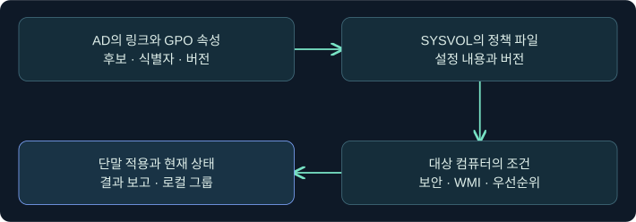
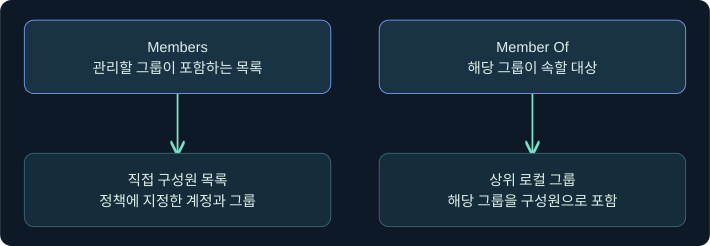
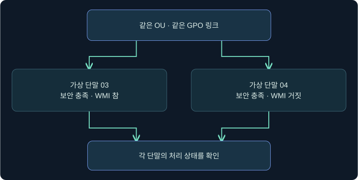
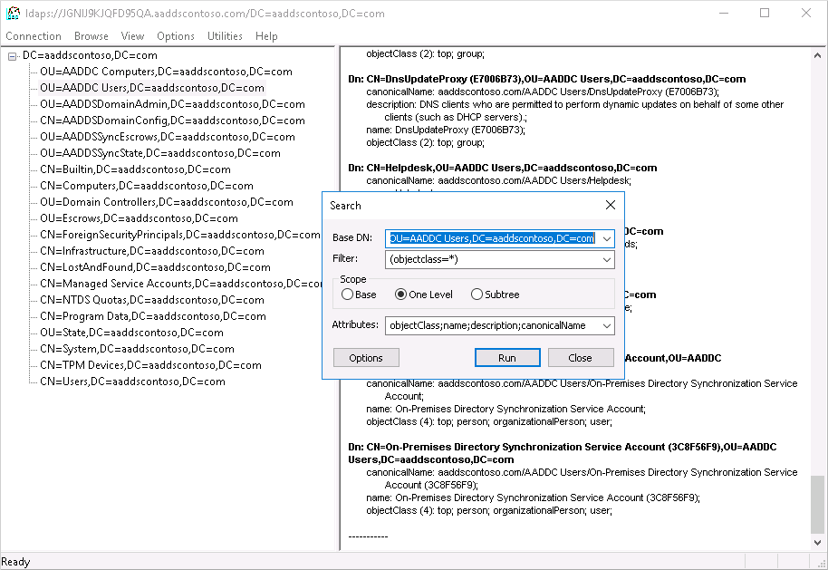
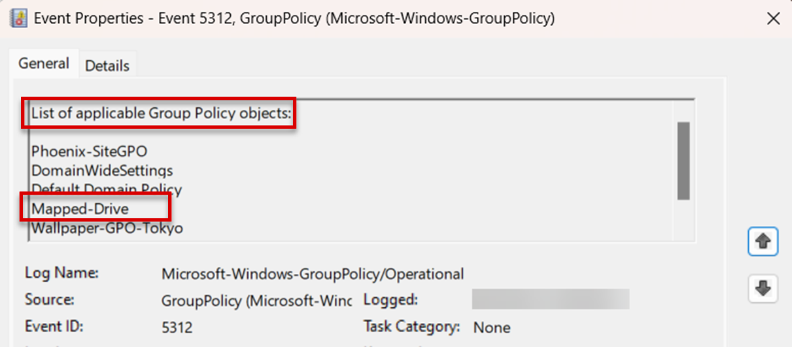

## 1. 정책이 연결됐다는 사실과 적용됐다는 사실을 구별합니다

가상 도메인의 보관 단말 OU에 “Lab Archive Baseline” 정책이 연결돼 있습니다. 같은 OU의 LAB-ARCHIVE03에서는 정책이 적용됐다는 보고가 있지만 LAB-ARCHIVE04에서는 빠졌습니다. 링크는 조사 출발점입니다. 어느 파일이 무엇을 지시했는지, 컴퓨터가 적용 조건을 충족했는지, 언제 어떤 설정이 처리됐는지, 로컬 그룹에 현재 무엇이 있는지를 따로 확인합니다.

모든 이름과 사례는 합성입니다. 실제 AD·SYSVOL·단말·Cobalt Strike에 접속하거나 GPO를 편집·새로 고침하지 않았습니다. 메뉴는 이미 승인된 실습 자료를 확인하는 미실행 절차입니다.

## 2. 디렉터리의 GPO 컨테이너와 SYSVOL의 파일을 연결합니다

AD의 **Group Policy Container(GPC)**는 GPO의 객체와 속성을 담습니다. **Group Policy Template(GPT)**은 SYSVOL에 저장되는 파일 부분입니다. 사이트·도메인·OU에 붙은 링크는 적용 후보를 지정합니다. GPO의 `gPCFileSysPath`는 정책 파일 위치를 가리키며 `gPCWQLFilter`는 연결된 WMI 필터 참조의 단서입니다. LDAP에서 참조를 볼 수 있어도 파일 내용이나 단말의 처리 결과까지 관측되는 것은 아닙니다.

| 자료 | 확인할 항목 | 남는 질문 |
|---|---|---|
| AD 링크와 GPO 컨테이너 | 링크 활성 상태, GUID, 파일 경로, 버전·필터 참조 | 정책 파일의 실제 내용 |
| SYSVOL 정책 폴더 | 동일 GUID의 `GPT.ini`와 해당 컴퓨터 정책 파일 | 단말이 이 버전을 읽었는지 |
| GPMC Results 또는 단말 보고 | 대상·범위·적용 또는 제외된 GPO와 처리 시각 | 현재 로컬 그룹 구성 |
| 단말 로컬 그룹의 승인된 증거 | 로컬 그룹과 직접 구성원의 식별자·시각 | 어떤 정책이나 변경이 이 상태를 만들었는지 |

AD와 SYSVOL은 서로 다른 복제 경로를 사용합니다. 동일한 이름의 정책을 비교하기보다 GUID와 AD·SYSVOL 버전, 읽은 DC, 시각을 함께 기록합니다. AD에서 읽은 링크와 다른 DC의 파일이 잠시 서로 다른 시점의 자료일 수 있습니다. 표시 이름이 같은 두 GPO를 하나로 합치지 않습니다.

## 3. Restricted Groups에서 두 설정의 방향을 분리합니다

보안 확장 정책 파일의 위치는 GPT를 기준으로 `Machine\Microsoft\Windows NT\SecEdit\GptTmpl.inf`입니다. Microsoft 프로토콜 규격의 `[Group Membership]` 섹션에는 그룹 이름 또는 SID에 연결되는 `__Members`와 `__Memberof` 키가 정의되어 있습니다. 읽기 전용 사본에서 정책 파일 경로와 인코딩을 보존합니다. 여기서는 정책을 만들거나 수정하지 않습니다.

| 정책의 필드 | 합성 설명 | 결과를 검증할 지점 |
|---|---|---|
| **Members of this group** | 관리할 로컬 그룹의 직접 구성원 목록을 정의 | 제외된 구성원의 처리와 실제 목록 |
| **This group is a member of** | 지정 그룹을 나열한 대상 그룹의 구성원으로 포함 | 대상 그룹에 그 그룹이 있는지 |
| 설정이 보이지 않거나 빈 값이 있음 | 키 존재·값·적용 여부를 구분해야 함 | 원본 구문, 보고서, 단말 결과 |

Microsoft 문서의 Members 동작은 목록 밖 구성원 제거를 포함하며, 기본 Administrator에 대한 예외가 문서에 있습니다. Member Of는 지정된 대상 그룹에 해당 그룹이 포함되도록 하는 방향입니다. 대상 그룹의 다른 모든 구성원까지 대체한다는 뜻은 아닙니다. 이 강의는 컴퓨터의 로컬 그룹을 대상으로 해석하며, AD 도메인 그룹 자체의 멤버십 관리로 확장하지 않습니다. 기본 제공 로컬 Administrators의 식별자는 표시 언어가 달라도 잘 알려진 SID를 기준으로 대조할 수 있습니다. 예를 들어 합성 정책에서 로컬 그룹 Archive-Operators의 Members가 두 실습 그룹을 지정한다면, 그 두 그룹이 Archive-Operators 안에 있는지 확인합니다. 반대로 Archive-Operators의 Member Of가 Archive-Maintenance를 지정하면 Archive-Maintenance 목록에서 Archive-Operators를 찾습니다. 두 방향을 뒤집으면 조사 대상 목록이 달라집니다.

## 4. OU 소속에서 단말의 적용 조건으로 넘어갑니다

일반적인 그룹 정책 처리에서는 로컬·사이트·도메인·OU 순서와 상속이 관여합니다. 실제 설정을 읽을 때 링크 순서, Enforced 및 Block Inheritance, 사용자/컴퓨터 쪽 비활성화 여부를 확인합니다. 보안 필터링의 읽기 및 Apply Group Policy 권한도 확인합니다. 설정 유형에 따라 여러 정책의 효과가 결합되거나 우선순위에 따라 달라지므로 한 줄의 링크만으로 계산하지 않습니다.

WMI 필터는 GPO당 하나를 연결할 수 있고, 같은 필터를 여러 GPO에서 참조할 수 있습니다. 클라이언트가 처리 시점에 대상 컴퓨터에서 평가합니다. `gPCWQLFilter`는 연결 참조를 확인하는 데 쓰고, WMI 필터 개체의 `msWMI-Parm2` 등은 정의를 대조하는 단서입니다. 이름만 보고 조건을 판단하지 않습니다. 네임스페이스·질의 조건과 실제 컴퓨터의 속성, 처리 오류를 확인합니다. 운영체제의 버전 문자열 한 항목만으로 제품 세대를 단정하기 어렵습니다. 표준은 LDAP에서 필터를 읽지 못한 경우와 단말에서 필터 평가에 실패한 경우를 별도 분기로 다룹니다. 로그를 읽을 때 필터 결과가 거짓인 경우와 오류를 구분합니다. 가령 승인된 실습 정책이 Windows의 `Win32_OperatingSystem` 클래스에서 `ProductType=1`인 워크스테이션을 찾는다고 가정합니다. 조회 성공과 한 건 이상 반환은 이 필터의 참을 뒷받침하고, 성공했으나 반환값이 없으면 거짓입니다. 단말 A가 워크스테이션, 단말 B가 멤버 서버라면 같은 OU라도 결과가 달라질 수 있습니다. 다른 적용 조건이 같다는 가정이 필요합니다.

## 5. 같은 링크에서 다른 결과가 나오는 조건을 비교합니다

| 조건이 달라진 경우 | 기대할 조사 상태 | 확인할 근거 |
|---|---|---|
| 03은 WMI 조건 참, 04는 거짓 | 두 장비에서 적용 결과가 달라질 수 있음 | 장비별 제외 사유와 평가 시각 |
| 링크는 활성, 컴퓨터 쪽 설정은 비활성 | 컴퓨터 설정의 적용을 기대하기 어려움 | GPO 상태와 대상 처리 범위 |
| 필요한 읽기 또는 적용 권한이 없음 | 링크가 있어도 정책 처리에서 제외될 수 있음 | 보안 필터와 위임·오류 |
| AD 링크는 보이나 SYSVOL의 버전 불일치 | 후보가 확인돼도 설정 내용·적용 상태에 차이가 생길 수 있음 | 접근한 DC, 버전, 복제 상태 |
| 보고서는 적용으로 표시, 현재 그룹은 다름 | 이전 적용과 현재 상태를 별도 관측으로 유지 | 보고서 시각, 후속 정책·수동 변경 |

보안 필터와 WMI 필터는 역할이 다릅니다. 전자는 대상에 대한 권한, 후자는 컴퓨터에서 평가하는 조건입니다. 후속 정책이나 수동 변경이 있으면 과거 보고서를 현재 권한으로 읽기 어렵습니다.

## 6. 실제 Beacon Console에서 조회 문맥의 위치를 확인합니다

### 실제 화면 108: Fortra Beacon Console의 입력과 반환 위치

출처는 [Fortra Post Exploitation](https://hstechdocs.helpsystems.com/manuals/cobaltstrike/current/userguide/content/topics/post-exploitation_main.htm)입니다. 2026-11-06에 4.13 문서를 대조했습니다. 공식 화면은 이전 UI일 수 있으며 GPO나 적용 결과를 보여 주지 않습니다.

1. **Sessions → 승인된 가상 단말 행 → 우클릭 → Interact**로 콘솔을 열고 호스트·문맥을 대조하는 미실행 절차입니다.
2. 하단 입력 줄에 `help ldapsearch`를 넣고 **Enter**를 누릅니다. GPO 메타데이터를 읽는 데 쓰이는 공개 확장이 등록됐는지 확인하는 예시입니다. 조회 제출이나 저장 단계는 없습니다.
3. 상단의 도움말 또는 미등록 응답을 확인합니다. 명령 등록만으로 SYSVOL 접근이나 정책 적용을 알 수 없습니다. 해당 도움말 응답과 GPO 조회 실제 화면은 확보하지 못했습니다.

## 7. 실제 LDP 화면에서 디렉터리 참조를 찾습니다

### 실제 화면 109: Microsoft LDP의 트리와 검색 결과 위치

출처는 [Microsoft Entra Domain Services LDAPS 안내](https://learn.microsoft.com/en-us/entra/identity/domain-services/tutorial-configure-ldaps)입니다. Used with permission from Microsoft. 2026-11-06에 대조했습니다. 이 사진은 관리형 도메인의 일반 검색 결과를 보여 줍니다. 가상 GPO의 실행 결과와 GPMC 화면은 표시되지 않으며 LDP 버전·언어에 따라 메뉴가 달라질 수 있습니다.

1. 가상 실습에서 연결과 읽기 권한을 확인했고 조사 기록에 GPO 객체의 정확한 DN이 있다고 가정합니다. **View → Tree → 해당 객체 우클릭 → Search**를 클릭합니다.
2. **Base DN**에 합성 값 `CN={AAAAAAAA-BBBB-4CCC-8DDD-EEEEEEEEEEEE},CN=Policies,CN=System,DC=training,DC=example`을 넣고 **Scope**를 **Base**로 정합니다. 정확한 객체 하나만 읽는 예입니다. **Filter**에 `(objectClass=groupPolicyContainer)`를 넣어 객체 유형을 확인합니다. **Search Options → Attributes**에 `displayName;gPCFileSysPath;gPCWQLFilter;versionNumber`를 입력합니다. 표시 이름·파일 참조·WMI 참조·버전만 읽는 범위입니다.
3. 옵션을 확인하고 **Run**을 누르는 미실행 절차입니다. 별도 저장은 없습니다. 오른쪽에서 DN, 완료 상태, 네 속성을 확인합니다. WMI 속성이 보이지 않으면 실제 미설정, 반환 목록, 조회 권한과 서버를 구별합니다. 이 검색 입력창과 이번 예의 실제 결과 사진은 확보하지 못했습니다.

## 8. 결과 보고서와 로컬 상태를 읽기 전용으로 대조합니다

### 실제 화면 110: Microsoft Group Policy Operational 이벤트 5312

출처는 [Microsoft 네트워크 드라이브 GPO 문제 해결 예시](https://learn.microsoft.com/en-us/troubleshoot/windows-client/group-policy/scenario-guide-gpo-to-map-network-drive-doesn-t-apply-as-expected)입니다. Used with permission from Microsoft. 2026-11-06에 대조했습니다. 공식 그림은 별도 사용자 정책 문제를 설명하며 Windows 버전·언어에 따라 표시가 다를 수 있습니다. 이벤트 5312는 해당 처리 주기의 적용 대상 목록을 찾는 단서입니다. 이 목록으로 개별 Restricted Groups 설정의 처리나 현재 로컬 그룹을 확정할 수 없습니다.

읽기 전용 복사본을 분석한다면 **Event Viewer → Action → Open Saved Log**에서 가상 파일 `archive03-policy.evtx`를 선택하고 **Open**을 누르는 절차를 가정합니다. 저장된 로그에서 **Filter Current Log → 이벤트 ID** 칸에 `5312`를 입력하고 **OK**를 누릅니다. 목록 이벤트를 찾기 위한 값입니다. 이벤트를 열고 시각·대상 및 **Details**의 Activity ID를 확인해 같은 처리 주기의 확장 결과와 연결합니다. 설정을 저장하거나 정책을 다시 적용하지 않습니다. 이번 가상 로그와 필터 대화상자의 실제 화면은 확보하지 못했습니다.

GPMC의 **Group Policy Modeling**은 지정 조건의 시뮬레이션입니다. **Group Policy Results**는 대상이 반환한 RSoP(결과 정책 집합)를 읽습니다. 이미 내보낸 보고서가 있으면 대상 이름, 컴퓨터 범위, 생성 시각부터 확인합니다. 담당자가 미리 제공한 로컬 그룹 자료의 SID와 시각도 대조합니다.

GPMC 미실행 예시입니다. **Group Policy Management → Group Policy Results 우클릭 → Group Policy Results Wizard → Next**를 누릅니다. 가상 분석 단말에 접속 권한이 있다고 가정하고 **Another computer** 칸에 `LAB-ARCHIVE03`을 넣습니다. 다른 단말의 정책으로 혼동하지 않도록 이름을 지정합니다. 사용자 범위를 별도로 분석하지 않는 경우 사용자 정책을 표시하지 않는 선택지를 확인합니다. **Summary of Selections → Next → Finish** 뒤 **Summary**에서 적용·거부 항목과 사유를, **Settings**에서 관련 설정과 표시되는 Winning GPO를 봅니다. 보고서 보존이 필요하면 결과 항목의 **Save Report**를 쓰는 절차입니다. GPMC 마법사·이번 결과 화면은 확보하지 못했습니다. 제품 화면의 경로는 [Microsoft Group Policy Modeling and Results](https://learn.microsoft.com/en-us/windows-server/identity/ad-ds/manage/group-policy/group-policy-modeling-results)에서 대조했습니다.

## 9. 그래프에 전달할 결론의 근거 수준을 정리합니다

“03과 04가 같은 OU에 있다”는 디렉터리 관측입니다. “정책 파일이 Lab-Archive-Operators의 로컬 그룹 관계를 정의한다”는 의도한 설정입니다. “03의 보고서에서 정책이 적용됐다”는 보고된 처리이며, “03의 14시 로컬 목록에서 관계가 확인됐다”는 단말 관측입니다. 각 줄의 대상·자료·시각을 붙입니다. 그래프 도구의 정책 해석과 WMI 평가 지원은 수집기와 버전에 따라 다르므로, 누락된 연결을 직접 추가하기 전에 근거와 불확실성을 별도 기록합니다.

## 10. 복습과 즉시 해설

### 복습 1. OU에 GPO가 연결돼 있으면 모든 컴퓨터가 적용하나요?
**해설:** 링크는 후보입니다. 상속, 보안, WMI, 설정 활성 여부와 단말 처리 상태를 확인합니다.

### 복습 2. gPCFileSysPath를 읽으면 로컬 그룹 구성도 확인됐나요?
**해설:** 그 값은 정책 파일을 가리킵니다. 파일 내용, 단말 처리 및 현재 그룹은 별도 증거입니다.

### 복습 3. Members와 Member Of의 차이는 무엇인가요?
**해설:** Members는 지정 그룹 안의 구성원 목록을, Member Of는 그 그룹이 들어갈 대상 그룹을 정의합니다.

### 복습 4. AD와 SYSVOL에서 다른 버전을 보면 무엇을 함께 기록하나요?
**해설:** GPO GUID, 버전, 조회한 DC, 시각을 기록하고 각각의 복제 상태를 확인합니다.

### 복습 5. WMI 필터의 실제 평가는 어디서 하나요?
**해설:** 그룹 정책을 처리하는 대상 컴퓨터에서 평가합니다.

### 복습 6. GPMC Modeling 보고서로 실제 정책 적용을 확인할 수 있나요?
**해설:** Modeling은 시뮬레이션입니다. 대상에서 가져온 Results 보고서나 단말 로그를 확인합니다.

### 복습 7. 정책이 적용됐다는 보고와 현재 그룹 목록이 다를 수 있나요?
**해설:** 보고서 이후 정책과 그룹이 바뀌었을 수 있습니다. 대상과 두 자료의 시각을 먼저 비교합니다.

### 복습 8. 정책 링크와 파일만 있는 그래프 관계는 어떻게 설명하나요?
**해설:** 정책으로부터 예상한 관계로 표시합니다. 적용 보고와 단말 목록이 확인된 상태를 별도로 적습니다.

## 11. 공식 자료와 확인 범위

- 링크, 보안·WMI 조건, 적용과 복제 경계를 대조했습니다. [Microsoft Group Policy processing](https://learn.microsoft.com/en-us/windows-server/identity/ad-ds/manage/group-policy/group-policy-processing) · [Microsoft WMI Filter Processing](https://learn.microsoft.com/en-us/openspecs/windows_protocols/ms-gpod/58fee7dc-acba-4fec-ba1a-f3444421f3ab) · [Microsoft Win32_OperatingSystem](https://learn.microsoft.com/en-us/windows/win32/cimwin32prov/win32-operatingsystem) · [Microsoft WMI Filter Evaluation](https://learn.microsoft.com/en-us/openspecs/windows_protocols/ms-gpol/494e3623-391d-40ba-a648-672119a07b5f)
- 보안 확장 파일 경로, 키 형식과 Restricted Groups의 동작을 확인했습니다. [Microsoft Restricted Groups](https://learn.microsoft.com/en-us/troubleshoot/windows-server/group-policy/description-of-group-policy-restricted-groups) · [Microsoft MS-GPSB Group Membership](https://learn.microsoft.com/en-us/openspecs/windows_protocols/ms-gpsb/b73d8bae-ed22-48aa-acba-7065ab52d709) · [Microsoft MS-GPSB Load Policy](https://learn.microsoft.com/en-us/openspecs/windows_protocols/ms-gpsb/f16c4282-9787-483c-a711-d2b1420230ea)
- 적용 오류와 단말 쪽 증거의 범위를 확인했습니다. [Microsoft Applying Group Policy troubleshooting](https://learn.microsoft.com/en-us/troubleshoot/windows-server/group-policy/applying-group-policy-troubleshooting-guidance)
