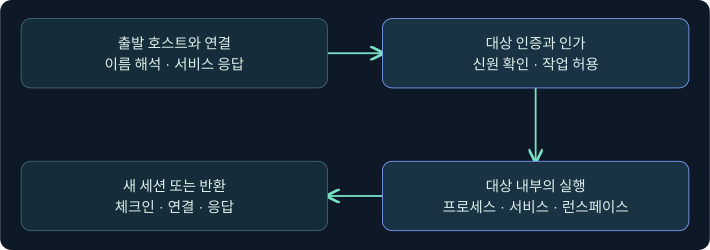
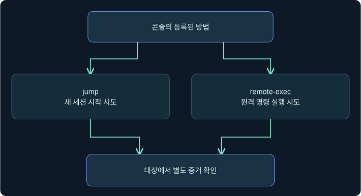
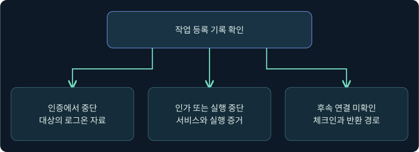

## 1. 횡적 이동은 호스트가 바뀌는 과정입니다

가상 조사에서 관리 단말 LAB-OPS12가 서버 LAB-SVC04로 연결했습니다. 같은 시간에 관리 도구에 작업 한 건이 등록됐지만 새 세션은 보이지 않습니다. 이때는 연결, 인증, 실행, 세션을 각각 확인해야 합니다. 횡적 이동은 이미 접근한 환경에서 다른 시스템으로 접근 범위를 넓히는 행위입니다. 같은 컴퓨터에서 사용자나 무결성 수준이 바뀌는 권한 상승, 다른 컴퓨터의 이름만 확인한 Discovery와 구별합니다.

원격 관리 자체는 정상 운영에 쓰입니다. 어떤 계정이 어떤 출발지에서 어떤 승인된 업무를 수행했는지에 따라 같은 연결의 의미가 달라집니다. 이 강의의 호스트·시간·결과는 합성입니다. 제품 콘솔·실제 대상 접속·파일 전달·원격 실행·세션 연결은 미실행입니다.

## 2. 도달성, 인증과 인가를 따로 판정합니다

**도달성**은 패킷이 서비스까지 전달되고 응답을 받을 수 있는 상태입니다. **인증**은 대상이 호출자의 신원을 확인하는 단계입니다. **인가**는 그 신원으로 특정 엔드포인트나 개별 작업을 사용할 수 있는지의 판단입니다. 예를 들어 서버가 네트워크 요청에 답해도 해당 계정의 원격 관리 권한이 없을 수 있습니다. 대상에서 로그온이 성공한 후에도 관리 작업의 종류에 따라 권한 부족이 나타납니다.

| 단계 | 관측할 자료 | 별도 확인이 필요한 부분 |
|---|---|---|
| 도달성 | 연결 요청·응답, 이름 해석, 연결한 서비스 | 로그온 성공과 작업 승인 |
| 인증 | 대상의 로그온 이벤트와 인증 방식 | 어떤 작업이 허용됐는지 |
| 인가 | 서비스·엔드포인트의 허용/거부, 작업 상태 | 프로세스 또는 명령이 실제로 실행됐는지 |
| 실행 | 대상에서 발생한 프로세스·서비스·런스페이스 증거 | 반환 전송과 새 세션 |
| 세션 | 체크인·링크·대상 호스트·시각 | 앞 단계와 동일한 작업에서 생겼는지 |

이 단계의 기록 순서는 수집 경로에 따라 달라질 수 있습니다. 예를 들어 콘솔에는 작업을 제출한 시각이 먼저 기록되지만, 네트워크에서 호출하는 시점은 에이전트가 그 작업을 받은 뒤입니다. 시계 오차와 수집 지연을 반영해 같은 시각이라고 단정하지 않습니다.

## 3. 원격 관리 경로마다 실행과 관측 위치가 다릅니다

Windows Remote Management(WinRM)는 WS-Management를 구현한 서비스입니다. 서비스 제어 관리자(SCM)는 서비스 객체의 구성·시작·상태를 관리합니다. Windows Management Instrumentation(WMI)은 관리 데이터를 제공하는 공급자와 메서드를 다루며, 호출 방식에 따라 전송 경로가 달라질 수 있습니다. 이 장의 WMI 실행 모듈 설명을 모든 WMI/CIM 클라이언트의 전송 방식으로 확대하지 않습니다.

| 관리 경로 | 주된 실행 경계 | 먼저 찾을 단서 |
|---|---|---|
| WinRM | 인증된 원격 관리 엔드포인트와 실행 호스트 | WinRM 및 PowerShell 기록, 대상 로그온 |
| SCM | 서비스 객체 접근과 시작, 서비스 프로세스 | 서비스 구성 및 시작 기록, 프로세스 생성 |
| WMI | 공급자 및 허용된 관리 메서드 | WMI 활동과 대상 프로세스의 문맥 |

정상 운영도 이 경로를 쓸 수 있습니다. 예를 들어 예약된 서버 점검에서 WinRM이 사용됐다면 승인 기록·출발 호스트·대상 목록·실행 시간대가 서로 맞는지 봅니다. 포트 번호 한 개나 프로세스 이름 한 개만으로 원격 작업의 목적을 판정하지 않습니다.

## 4. Cobalt Strike가 제공하는 두 작업의 목적을 구분합니다

Fortra 문서에서 **jump**는 등록된 모듈을 통해 원격 시스템에 새 Beacon 세션을 시작하려는 작업입니다. **remote-exec**는 등록된 방법으로 원격 명령 실행을 시도합니다. 도구가 새 세션을 목표로 삼는 경우와 실행 자체를 요청하는 경우는 성공 증거가 다릅니다. 제품에서 모듈을 “exploit”로 표시하는 경우도 관리 기능이나 인증된 동작에 기대는 모듈이 포함될 수 있습니다.

| 비교 항목 | jump | remote-exec |
|---|---|---|
| 작업의 목표 | 대상에서 새 Beacon 세션 시작 시도 | 대상에서 지정 명령 실행 시도 |
| 모듈 정보에 등장하는 항목 | 원격 기법과 모듈별 아키텍처 등 | 실행 방법과 설명 |
| 분석할 결과 | 실제 실행 증거와 별도 체크인·연결 | 대상 실행 및 방법별 결과 반환 |
| 공통 확인 | 대상, 인가, 도구 버전과 모듈 | 대상, 인가, 도구 버전과 모듈 |

파일 사용 여부나 정리 방식은 모듈과 버전에 따라 달라집니다. 파일이 나중에 삭제됐다는 기록과 파일이 존재한 적 없다는 설명은 구별합니다. 실행은 확인됐으나 체크인이 없으면, 후속 통신·세션 범위·대상 호스트 관측이 남습니다. 콘솔에 표시되는 아키텍처는 해당 모듈에 관한 정보입니다. 대상 운영체제, 호출 프로세스, 새 프로세스의 아키텍처는 자료를 구분해 비교합니다.

## 5. 요청 표시를 대상 실행으로 오인하지 않습니다

작업 행을 볼 때 단계마다 상태를 붙입니다. **요청 등록**은 클라이언트나 서버가 작업을 받았다는 뜻입니다. **대상 실행 관측**은 해당 대상에서 프로세스 또는 런스페이스가 기록됐다는 뜻입니다. **결과 반환**은 수집 경로를 거쳐 콘솔에 응답이 보였다는 뜻입니다. **새 세션 확인**은 대상 호스트의 새 세션을 식별하고 요청과 연결했다는 뜻입니다.

예를 들어 작업 제출 후 콘솔에 응답이 없어도, 모듈이 결과를 되돌려주는지, 대상의 로그는 보존됐는지, 조회 시간이 적절한지 먼저 확인합니다. 다른 방향으로는 과거부터 있던 세션이 뒤늦게 체크인했을 수 있습니다. 첫 체크인과 마지막 체크인, 호스트와 사용자, 부모·자식 관계가 있는 경우 그 방향을 대조합니다.

## 6. 실제 Beacon Console에서 등록된 방법을 확인합니다

### 실제 화면 111: Fortra Beacon Console의 입력 줄과 반환 영역

출처는 [Fortra Post Exploitation](https://hstechdocs.helpsystems.com/manuals/cobaltstrike/current/userguide/content/topics/post-exploitation_main.htm)입니다. 2026-11-06에 4.13 문서를 대조했습니다. 공식 그림은 이전 버전일 수 있으며 이번 모듈 목록이나 작업 결과를 보여 주지 않습니다.

1. **Cobalt Strike → Visualization → Session Table → 이미 승인된 가상 세션 행 우클릭 → Interact**를 선택하는 미실행 절차입니다. 예시 행의 호스트는 LAB-OPS12입니다. 입력 전에 세션이 가리키는 호스트와 사용자 문맥을 확인합니다.
2. 하단 입력 줄에 인수 없이 `jump`를 넣고 **Enter**를 누르는 문서상의 목록 조회입니다. 두 번째 확인은 같은 입력 칸에 인수 없이 `remote-exec`를 넣습니다. 등록된 방법과 설명을 비교하기 위한 값입니다. 대상·리스너·원격 명령은 입력하지 않으며 별도 설정 저장도 없습니다.
3. 상단 출력 영역의 모듈 이름과 종류를 현행 문서와 대조합니다. 설치된 확장에 따라 목록이 달라질 수 있습니다. 목록이 보이는 범위는 등록 상태입니다. 실제 목록 출력과 원격 실행 화면은 확보하지 못했습니다.

## 7. 실제 Sessions 화면에서 작업과 연결을 비교합니다

### 실제 화면 112: Fortra Sessions Table의 호스트와 체크인

출처는 [Fortra Session and Target Visualizations](https://hstechdocs.helpsystems.com/manuals/cobaltstrike/current/userguide/content/topics/ui_session-target-visualizations.htm)입니다. 2026-11-06에 확인했습니다. 그림은 공급사의 별도 환경이며 제품 버전과 레이아웃에 따라 열이 달라질 수 있습니다.

1. **Cobalt Strike → Visualization → Session Table**에서 확인할 행을 선택하고, 호스트 열에 가상 비교값 LAB-SVC04가 있는지 읽습니다. 이 값은 대상 자산을 대조하기 위한 예이며 명령 입력이 아닙니다. 세션의 사용자·프로세스·경로·마지막 체크인을 함께 확인합니다.
2. 작업 전 목록과 비교하고, 승인된 조사 시각과 같은 범위에 새 행이 나타났는지 확인합니다. 이 절차는 목록 확인이므로 저장하거나 실행하는 버튼을 누를 필요가 없습니다.
3. 새 행이 있어도 기존 행의 갱신인지, 다른 작업이 만든 연결인지 구분합니다. 별도 제품 활동 기록과 대상 이벤트의 호스트·시각을 비교합니다. 이번 합성 사례의 새 세션 화면은 확보하지 않았습니다.

## 8. 조건을 하나 바꿔 성공 경계를 찾아봅니다

| 합성 관측 | 말할 수 있는 범위 | 다음 증거 |
|---|---|---|
| 등록 기록만 있음 | 관리 도구에 작업이 접수됨 | 출발 에이전트 수신, 대상 연결 |
| 대상이 연결을 받았으나 인증이 실패함 | 도달했고 로그온은 실패함 | 대상 감사와 인증 방식 |
| 로그온 성공 뒤 서비스가 요청을 거부함 | 신원 확인과 작업 인가의 결과가 다름 | 엔드포인트 정책과 접근 기록 |
| 대상에서 실행이 보이나 새 세션 없음 | 실행과 후속 연결을 분리해야 함 | 반환 경로, 도구 방식, 체크인 |
| 새 세션이 보이지만 이전부터 존재 | 해당 작업과의 연결이 미확인 | 세션 첫 시각과 작업 대상 대조 |

조사 결론을 한 문장으로 묶을 때는 “대상 LAB-SVC04에서 14:07경 실행 관측이 있다. 요청 ID와 연결은 후보이고 새 세션은 조사 구간에 확인되지 않았다”처럼 범위를 적습니다. 여기의 시각과 호스트는 예시입니다.

## 9. 교차 검증에서는 식별자를 사용합니다

작업 ID와 프로세스 PID를 같은 번호라고 가정하지 않습니다. 도구 쪽 작업·세션 식별자, 대상 이벤트의 컴퓨터 이름·레코드 번호, 로그온 ID와 프로세스 시작 시각을 별도로 보관합니다. Windows 로그온 ID는 대상과 부팅 문맥 안에서 비교합니다. 출발지 IP가 중계 서버의 것이라면 승인된 네트워크 기록으로 한 단계씩 연결합니다. 다음 강의에서는 WinRM으로 좁혀 포트, 엔드포인트 인가, 실행 호스트와 두 번째 홉을 살펴봅니다.

## 10. 복습과 즉시 해설

### 복습 1. 대상 포트가 응답하면 원격 명령도 실행됐나요?
**해설:** 포트 응답은 도달성 단서입니다. 인증과 인가, 실행 증거를 각각 확인합니다.

### 복습 2. 같은 호스트에서 높은 권한을 얻는 사례는 무엇과 구분하나요?
**해설:** 권한 상승은 기존 호스트의 문맥 변화입니다. 횡적 이동은 다른 시스템으로 접근 범위가 바뀝니다.

### 복습 3. 인수 없는 jump와 remote-exec로 어떤 정보를 확인하나요?
**해설:** 해당 설치에 등록된 기법과 실행 방법을 확인하는 목록 조회입니다.

### 복습 4. 두 명령의 결과가 반드시 새 세션인가요?
**해설:** jump는 새 세션 시작을 시도합니다. remote-exec는 명령 실행 요청이며 세션은 별도 관측입니다.

### 복습 5. 콘솔이 작업을 접수한 뒤 대상 로그에서 무엇을 찾나요?
**해설:** 대상 연결, 인증·인가, 작업에 대응하는 프로세스나 실행 호스트를 순서대로 대조합니다.

### 복습 6. 반환이 비어 있으면 원격 실행이 실패했나요?
**해설:** 방법별 반환 특성과 수집 범위를 확인하고 대상 실행 증거를 대조합니다.

### 복습 7. 마지막 체크인이 갱신되면 이번 작업이 새 세션을 만든 건가요?
**해설:** 기존 행의 갱신일 수 있습니다. 첫 관측 시각, 대상, 작업과의 연관성을 확인합니다.

### 복습 8. 정상 관리와 비정상 동작을 어떻게 구분하나요?
**해설:** 사용한 프로토콜에 더해 승인된 작업, 주체, 출발지, 대상과 시간대를 대조합니다.

## 11. 공식 자료와 확인 범위

- 횡적 이동의 분류와 원격 서비스 경로를 대조했습니다. [MITRE ATT&CK Lateral Movement](https://attack.mitre.org/tactics/TA0008/) · [MITRE ATT&CK Windows Remote Management](https://attack.mitre.org/techniques/T1021/006/)
- 두 작업과 모듈 등록 범위, 4.13 릴리스 정보를 대조했습니다. [Fortra Lateral Movement](https://hstechdocs.helpsystems.com/manuals/cobaltstrike/current/userguide/content/topics/post-exploitation_lateral-movement.htm) · [Fortra 릴리스 노트](https://hstechdocs.helpsystems.com/releasenotes/Content/_ProductPages/Cobalt_Strike/Cobalt_Strike.htm)
