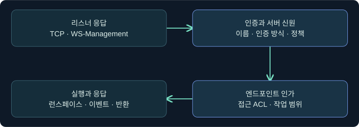
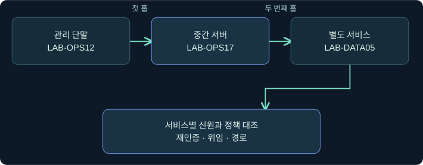
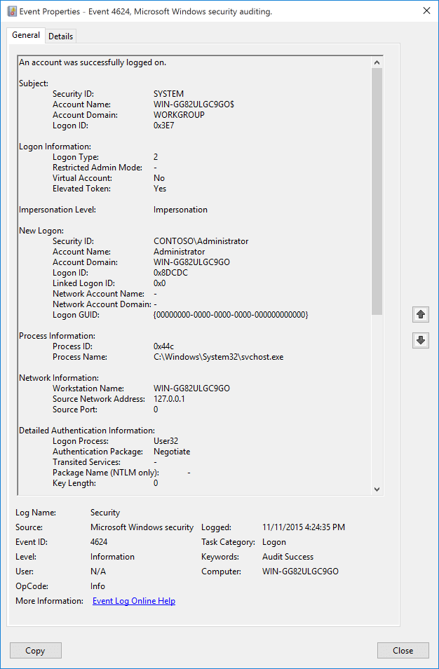
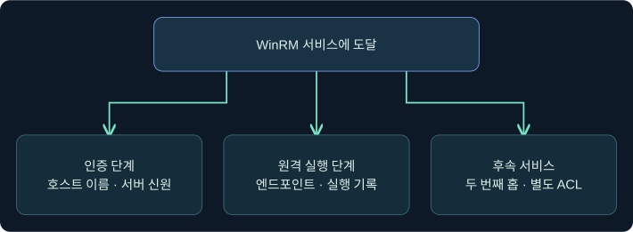

## 1. WinRM이 응답한 뒤에도 확인할 단계가 남습니다

가상의 LAB-OPS12에서 LAB-OPS17의 WinRM 서비스가 응답했습니다. 같은 장비를 조사한 두 담당자는 “연결 성공”과 “PowerShell 작업 성공”을 서로 다르게 보고했습니다. 두 관측은 동시에 성립할 수 있습니다. 이번 강의에서는 전송, 인증, 원격 PowerShell 엔드포인트 인가, 대상의 실행과 응답을 나눕니다.

가상의 이름·입력·로그를 사용합니다. Windows나 Cobalt Strike에서 연결·인증·원격 실행을 수행하지 않았습니다. 기존 로그를 여는 미실행 예제와 Microsoft의 공식 캡처를 별도로 표시합니다.

## 2. WinRM 서비스, 전송, PowerShell 엔드포인트를 구별합니다

WinRM은 Microsoft가 Windows에서 구현한 WS-Management입니다. Windows의 PowerShell 원격 관리에서 WinRM을 전송 경로로 쓸 수 있습니다. 원격 PowerShell에 다른 전송이 쓰이는 경우도 있으므로, PowerShell 원격 관리라는 말만으로 WinRM을 사용했다고 결론 내리지 않습니다.

WinRM 기본 리스너 포트는 HTTP 5985와 HTTPS 5986입니다. 환경이 다른 포트를 사용할 수도 있습니다. HTTPS는 TLS로 전송을 보호하며 서버 이름과 인증서를 대조합니다. HTTP 리스너도 Kerberos나 NTLM 등의 인증 방식과 정책에 따라 인증 후 메시지 수준 보호를 사용할 수 있습니다. 포트만으로 평문 여부나 서버 신원 검증 결과를 판단하기 어렵습니다. 인증되지 않은 서버나 보호 조건이 불분명한 사례는 운영 설정을 바꾸기 전에 증거와 승인 범위를 확인합니다.

| 확인한 것 | 가능한 결론 | 아직 남는 확인 |
|---|---|---|
| TCP 연결 성공 | 지정 주소와 포트에 응답이 있음 | 리스너가 WinRM인지 |
| WS-Management 식별 응답 | 서비스가 식별 요청에 응답함 | 지정 신원 인증 및 PowerShell 세션 |
| 인증 성공 | 대상이 호출 신원을 수락함 | 엔드포인트 ACL과 명령 제한 |
| 런스페이스가 열림 | 해당 구성의 실행 문맥이 생성됨 | 개별 요청의 실행·오류·반환 |

## 3. 이름과 인증 방식은 신원 검증의 조건입니다

도메인 환경에서 서버 이름과 서비스 주체 이름(SPN)이 맞는 기본 구성은 Kerberos를 사용할 수 있습니다. IP 주소나 작업 그룹 접속에서는 기본 경로가 달라질 수 있습니다. 이때 NTLM 등의 가능성을 정책·로그로 확인합니다. 같은 이름이 여러 서버를 가리키거나 인증서 이름이 맞지 않으면 포트가 열려 있어도 서버 확인이나 세션 생성 단계에서 실패할 수 있습니다.

엔드포인트는 실제 세션 구성을 선택하는 경계입니다. 인증된 사용자라도 해당 엔드포인트에 허용되지 않거나 명령 제한을 받을 수 있습니다. 운영 표준 구성, 위임된 관리 구성, JEA(Just Enough Administration)의 권한 범위가 서로 다를 수 있습니다. 연결한 사용자의 표기와 대상 프로세스가 가진 토큰은 실행 문맥 자료로 대조합니다.

## 4. 첫 번째 홉의 성공과 두 번째 홉의 접근을 나눕니다

첫 홉은 LAB-OPS12가 LAB-OPS17에 연결하는 단계입니다. 두 번째 홉은 LAB-OPS17에서 LAB-DATA05의 별도 서비스에 접근하는 단계입니다. 기본 Kerberos 또는 NTLM 원격 인증은 중간 서버에 사용자 자격 증명을 재사용 가능한 형태로 전달하는 동작으로 가정할 수 없습니다. 그래서 첫 세션에서 로컬 상태를 읽을 수 있어도 다른 서비스가 같은 사용자로의 접근을 허용하지 않을 수 있습니다.

두 번째 홉 실패에는 위임 문맥 외에도 이름 해석, 경로 차단, 다른 대상 서비스의 ACL이 관여합니다. 반대로 접근이 성공했다면 어떤 신원으로 인증됐는지 확인합니다. 별도 서비스 신원이나 승인된 엔드포인트 구성이 사용됐을 수 있습니다. 이 강의에서는 위임·보호 설정을 변경하지 않고 기존 정책과 기록만 비교합니다. 6강에서 로그온 유형과 네트워크 문맥을 다시 연결합니다.

## 5. 제품의 WinRM 작업과 Windows의 실행 증거를 대응시킵니다

Fortra 문서의 `jump` WinRM 계열은 새 Beacon 세션 시작을 시도하는 방법입니다. `remote-exec`의 WinRM 방법은 명령 실행을 요청합니다. Fortra의 Beacon 동작 설명은 이 경로에서 PowerShell 프로세스가 관여할 수 있고 일부 작업에서는 별도 스크립트 전달이 생길 수 있다고 설명합니다. 파일 미확인만으로 디스크 활동이나 기록 부재를 단정하기 어렵습니다.

| 자료 | 관측 범위 | 해석 경계 |
|---|---|---|
| Cobalt Strike 작업 목록·출력 | 요청과 제품이 표시한 상태 | 대상 호스트에서 실행됐다는 단독 증거가 아님 |
| 대상 WinRM Operational | 연결과 서비스 처리의 단서 | 감사 설정·버전에 따른 범위 확인 |
| 대상 Security 4624 | 대상에서 로그온 세션이 생성됨 | 유형 3만으로 특정 프로토콜을 확정할 수 없음 |
| 대상 프로세스/PowerShell 기록 | 실행 호스트나 스크립트 처리의 단서 | 모니터링 범위와 시간 대조가 필요 |
| 대상 후속 연결 또는 결과 | 응답이나 새 세션에 관한 단서 | 요청과 동일한 동작인지 추가 대조 |

예를 들어 Windows PowerShell에서 Script Block Logging이 적용된 경우 Operational 로그에서 4104를 찾을 수 있습니다. PowerShell 버전에 따라 채널 이름이 다릅니다. 프로세스 생성의 수집 여부나 명령줄 포함 여부도 감사 설정에 따라 달라집니다. 4624와 PowerShell 이벤트가 비슷한 시각에 있다는 점만으로 같은 요청임을 단정하지 않습니다.

## 6. 실제 Beacon Console에서 WinRM 방법이 등록됐는지 읽습니다

### 실제 화면 113: Fortra Beacon Console의 조회 입력과 응답 위치

출처는 [Fortra Post Exploitation](https://hstechdocs.helpsystems.com/manuals/cobaltstrike/current/userguide/content/topics/post-exploitation_main.htm)입니다. 2026-11-06에 4.13 문서를 대조했습니다. 캡처는 이전 버전일 수 있으며 이 강의의 WinRM 조회나 실행 결과는 보이지 않습니다.

1. **Cobalt Strike → Visualization → Session Table → 승인된 가상 LAB-OPS12 행 우클릭 → Interact**를 선택하는 미실행 절차입니다. 현재 열린 탭의 호스트와 문맥을 대조합니다.
2. 하단 입력 줄에 인수 없이 `remote-exec`를 입력하고 **Enter**를 누릅니다. 문서상 등록된 방법만 보는 값입니다. 대상 이름이나 명령을 보내지 않으며 저장 단계는 없습니다.
3. 상단 반환 목록에서 `winrm` 항목과 설명을 읽습니다. 이는 도구에 방식이 등록됐다는 단서입니다. 서비스 도달성·대상 권한·원격 실행을 확인하려면 별도 자료가 필요합니다. 목록 응답과 실제 WinRM 실행 화면은 확보하지 못했습니다.

## 7. 실제 이벤트 뷰어에서 대상 로그온 필드를 읽습니다

### 실제 화면 114: Microsoft 이벤트 4624의 필드 위치

출처는 [Microsoft Windows 보안 감사 이벤트 4624](https://learn.microsoft.com/en-us/windows/security/threat-protection/auditing/event-4624)입니다. Used with permission from Microsoft. 2026-11-06에 확인했습니다. Microsoft가 공개한 그림은 **유형 2(대화형)** 사례입니다. 가상 WinRM 상황의 유형 3 사진이나 실행 증거로 사용하지 않습니다. Windows 버전과 이벤트 스키마에 따라 필드와 화면이 다를 수 있습니다.

1. **Event Viewer → Action → Open Saved Log**를 누르고 파일 이름 칸에서 승인된 합성 자료의 예시 `ops17-security.evtx`를 선택한 뒤 **Open**을 누릅니다. 파일 이름은 대상 호스트와 Security 채널을 구별하기 위한 값입니다.
2. 저장 로그를 선택하고 **Filter Current Log**를 눌러 이벤트 ID 칸에 `4624`를 넣고 **OK**를 누릅니다. 보기 필터를 적용하는 단계이며 원본 로그를 수정하지 않습니다.
3. 이벤트를 열어 **General → Logon Information → Logon Type**과 대상 계정·인증 패키지·출발지 필드를 확인합니다. **Details → XML View**에서는 대상 `TargetLogonId`와 해당 컴퓨터·시각을 읽습니다. 로그온 유형이 3이면 네트워크 로그온임을 뜻합니다. WinRM 기록 및 대상 실행 정보와 맞는지 별도로 확인합니다. 파일 선택, 필터 입력창, 이번 가상 유형 3의 실제 사진은 미확보입니다.

## 8. 가상 조건을 바꿔 어느 증거가 달라지는지 확인합니다

| 합성 변경 | 기대할 관측 | 먼저 볼 항목 |
|---|---|---|
| 5985에 응답하지만 엔드포인트가 거부 | 서비스 도달 이후 원격 세션 생성 실패 가능 | 인증 성공과 엔드포인트 인가를 분리 |
| 같은 호스트를 이름 대신 IP로 지정 | 인증 경로나 서버 확인 결과가 달라질 수 있음 | 이름·SPN·인증 패키지와 설정 |
| 첫 세션에서 로컬 작업 성공, 후속 공유 접근 실패 | 첫 홉과 다른 서비스의 접근 결과가 다름 | 후속 서비스 신원·위임·경로·ACL |
| 4624 유형 3만 있고 WinRM 기록 없음 | 네트워크 로그온만 확인 | 다른 프로토콜 및 로그 수집 범위 |
| 스크립트 기록은 있고 제품 반환이 없음 | 대상의 스크립트 처리 후보 | 응답 채널과 작업 상관관계 |

승인된 실습의 식별 요청을 설명할 때 `Test-WSMan`은 WinRM 서비스가 식별 요청에 응답하는지 확인하는 도구입니다. 인증 인수를 생략하면 익명 요청을 시도하는 기본 동작이 문서에 설명됩니다. 성공하더라도 특정 사용자의 PowerShell 세션이나 실행 성공을 뜻하지 않습니다. 실제 서비스에 테스트 요청을 보내지 않았습니다.

## 9. 조사 메모는 대상과 시간으로 구체화합니다

“LAB-OPS17의 Security에서 네트워크 로그온을 확인했다. 해당 출발지의 WinRM 기록과 런스페이스가 동일한 작업인지 조사 중이다”처럼 관측과 미확인을 분리합니다. 로그온 ID는 같은 대상의 범위에서 비교하고 필요하면 서버·클라이언트 시계 차이를 반영합니다. 승인된 관리 작업이 있으면 업무 티켓에 명시된 자산과 시간 범위를 함께 대조합니다.

## 10. 복습과 즉시 해설

### 복습 1. 포트 5985가 응답하면 WinRM의 명령도 성공했나요?
**해설:** 포트 응답은 연결 단서입니다. WS-Management 식별, 인증, 인가와 실행을 확인합니다.

### 복습 2. HTTP 리스너라는 이유로 메시지가 평문이라고 결론 낼 수 있나요?
**해설:** 인증 후 메시지 보호가 사용될 수 있습니다. 전송과 인증 방식·정책을 대조합니다.

### 복습 3. 도메인 이름 대신 IP를 쓰면 무엇이 달라질 수 있나요?
**해설:** 서버 신원과 SPN 확인, 사용할 수 있는 인증 방식이 달라질 수 있습니다.

### 복습 4. 인증에 성공했는데 PowerShell 세션이 열리지 않는 이유는 무엇인가요?
**해설:** 엔드포인트 ACL, 구성 상태, 정책 등 인증 후 조건이 있을 수 있습니다.

### 복습 5. 두 번째 홉 실패는 첫 로그온도 실패했다는 뜻인가요?
**해설:** 두 홉은 별도입니다. 중간 서버가 후속 서비스에 어떤 신원과 경로로 접근했는지 확인합니다.

### 복습 6. 4624의 유형 3은 WinRM을 직접 증명하나요?
**해설:** 유형 3은 네트워크 로그온입니다. WinRM과 실행 호스트 기록을 연결해야 합니다.

### 복습 7. 4104가 없으면 PowerShell 실행이 없었나요?
**해설:** 채널, 버전, 로깅 정책과 보존 상태를 확인한 뒤 판단합니다.

### 복습 8. 콘솔에 WinRM 방법이 보이면 어떤 상태가 확인되나요?
**해설:** 해당 방식의 등록입니다. 연결, 인증, 실행이나 새 세션은 별도 증거입니다.

## 11. 공식 자료와 확인 범위

- 기본 포트·전송·인증과 두 번째 홉을 대조했습니다. [Microsoft WinRM 보안 고려 사항](https://learn.microsoft.com/en-us/powershell/scripting/security/remoting/winrm-security?view=powershell-7.6) · [Microsoft 두 번째 홉](https://learn.microsoft.com/en-us/powershell/scripting/security/remoting/ps-remoting-second-hop?view=powershell-7.6) · [Microsoft Test-WSMan](https://learn.microsoft.com/en-us/powershell/module/microsoft.wsman.management/test-wsman?view=powershell-7.5)
- 제품 작업과 PowerShell 기록 범위를 확인했습니다. [Fortra Beacon Command Behavior](https://hstechdocs.helpsystems.com/manuals/cobaltstrike/current/userguide/content/topics/appendix-a_beacon-opsec-considerations.htm) · [Microsoft Windows PowerShell 로깅](https://learn.microsoft.com/en-us/powershell/module/microsoft.powershell.core/about/about_logging?view=powershell-5.1)
