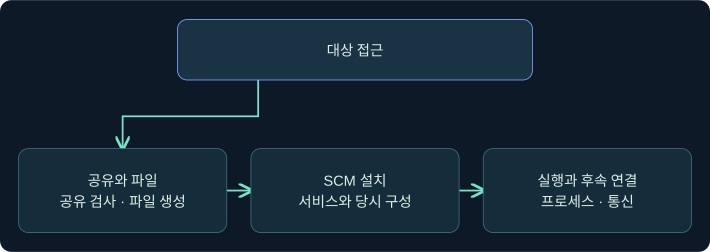
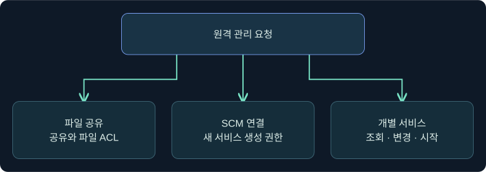
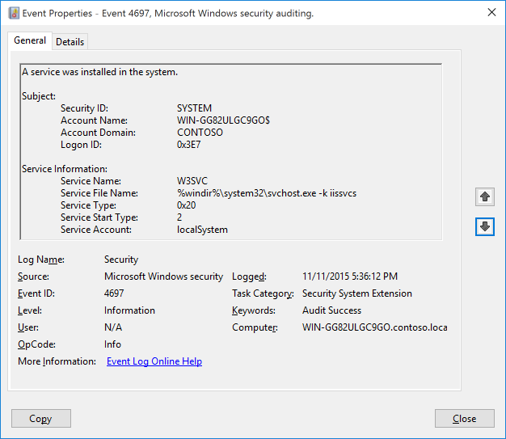
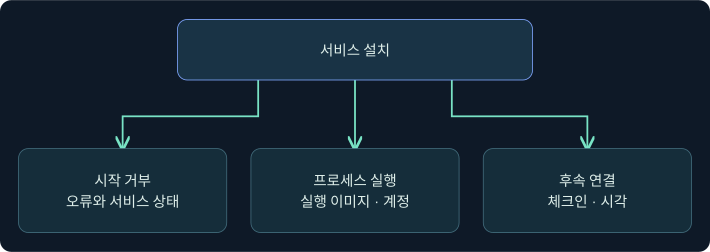

## 1. 새 서비스 설치는 어떤 증거인가요?

가상의 LAB-OPS21에서 관리 작업을 요청한 뒤 LAB-SRV09의 보안 로그에 새 서비스가 나타납니다. 대상에서 프로세스가 시작됐는지는 아직 알 수 없습니다. 이번 강의에서는 연결, 파일 접근, 설치, 시작, 실행, 후속 통신을 각각 확인합니다. 가상 호스트와 조사 예시만 사용합니다. Windows나 Cobalt Strike를 실행하거나 실제 대상에 연결하지 않았습니다.

## 2. PsExec와 Cobalt Strike의 서비스 방식

Sysinternals PsExec는 Microsoft의 원격 관리 도구입니다. Cobalt Strike에는 같은 이름을 사용하는 별도의 모듈이 있습니다. 이름이 같아도 서비스 이름이나 실행 계정, 대상 프로세스와 결과 반환 방식까지 같다고 볼 수 없습니다.

| 구분 | 문서가 설명하는 목적 | 찾아볼 증거 |
|---|---|---|
| Sysinternals PsExec | 관리자가 원격 프로세스 실행 | 도구 버전, 서비스와 실제 실행 신원 |
| Cobalt Strike jump의 서비스 실행 파일 방식 | 서비스에서 새 Beacon 세션 시작 시도 | 설치·시작, 대상 프로세스, 체크인 |
| Cobalt Strike jump의 PowerShell 방식 | 서비스에서 PowerShell 기반으로 새 세션 시작 시도 | 서비스와 PowerShell 관측, 별도 체크인 |
| Cobalt Strike remote-exec의 psexec | SCM을 통한 원격 명령 실행 시도 | 작업과 대상 실행의 대응 |

Fortra 문서의 x86·x64 표기는 해당 모듈의 속성입니다. 대상 OS와 실행 중인 프로세스의 아키텍처를 별도로 봅니다. 공급사가 설명하는 서비스 실행 파일에는 별도 프로세스를 띄워 코드를 넣는 구현이 있지만, 설치 이벤트만으로 주입이 발생했다고 판단하지 않습니다. 대상 프로세스 시작·접근 및 후속 통신을 교차 확인합니다.

## 3. 파일 공유, SCM, 서비스 권한을 분리합니다

SCM은 서비스 객체와 상태를 관리합니다. 원격 SCM 호출은 RPC로 전달되며 Windows가 지원하는 전송에는 RPC/TCP와 명명된 파이프가 있습니다. 파일을 배치하는 구현에서는 SMB 공유와 파일 권한도 관계합니다. 같은 서버에 도달한 다음에도 서로 다른 인가가 적용됩니다.

| 경계 | 확인할 자료 | 확인이 더 필요한 부분 |
|---|---|---|
| 공유와 파일 | 공유·파일 ACL, 파일 접근·생성 | 전송 완료와 내용 |
| SCM | SCM 연결과 새 서비스 생성 권한 | 설치 성공 |
| 서비스 객체 | 시작·조회·변경에 필요한 개별 권한 | 해당 요청의 결과 |
| 서비스 프로세스 | 설정 계정과 실제 실행 문맥 | 결과와 후속 연결 |

원격으로 요청한 신원과 서비스 프로세스 신원은 서로 다를 수 있습니다. LocalSystem으로 실행되는 경우에도 이름만 보고 모든 PsExec 실행을 SYSTEM으로 분류하지 않습니다. 서비스 계정 설정과 대상 실행 기록을 대조합니다.

## 4. 설치 이벤트는 당시의 설정을 보여 줍니다

Security 이벤트 **4697**은 해당 감사 조건에서 새 서비스 설치를 기록합니다. Subject는 설치 활동이 기록된 보안 문맥입니다. Service Account는 서비스 계정 설정이며 서비스 유형에 따라 비어 있을 수 있습니다. 이름, 파일 경로, 서비스 유형과 시작 유형도 비교합니다. 이후 경로나 계정이 바뀌어도 과거 기록은 그대로입니다.

System 채널에서 SCM 이벤트 7045를 수집했다면 대상·서비스 이름·경로·시각을 맞춥니다. 감사·수집·보존 범위에 따라 두 채널 모두에서 찾을 수 없는 경우도 있습니다. 4697은 있으나 4688이 없을 때는 시작 실패와 프로세스 생성 감사 누락을 별도 가설로 둡니다. 로그 경로에 적힌 문자열은 프로세스가 실제로 실행한 이미지와 대조해야 합니다.

## 5. 파일 접근·서비스 삭제를 실행 결과와 구분합니다

상세 파일 공유 감사 5145는 요청한 접근이 허용되는지 검사한 기록입니다. 전송이 완료됐는지는 파일 생성·크기·해시 등 별도 자료로 확인합니다. 서비스 삭제 요청은 먼저 삭제 표시를 남길 수 있고, 서비스가 정지하고 열린 서비스 핸들이 닫혀야 SCM 항목이 제거됩니다. 현재 목록의 공백은 과거 설치나 실행을 배제하지 않습니다. 파일 삭제, 서비스 제거, 프로세스 종료, 세션 종료도 별도 사건입니다.

## 6. 실제 콘솔에서 등록된 모듈을 읽습니다

### 실제 화면 115: Fortra Beacon Console

출처는 [Fortra Post Exploitation](https://hstechdocs.helpsystems.com/manuals/cobaltstrike/current/userguide/content/topics/post-exploitation_main.htm)입니다. 2026-11-09에 4.13 문서와 대조했습니다. 공식 화면은 이전 UI일 수 있으며 아래 예시의 출력은 표시하지 않습니다.

1. **Cobalt Strike → Visualization → Session Table → 승인된 가상 LAB-OPS21 행 우클릭 → Interact**로 콘솔을 여는 미실행 절차입니다. 선택한 행과 콘솔 호스트를 대조합니다.
2. 하단 입력 줄에 인수 없이 `jump`를 넣고 **Enter**를 눌러 등록 목록을 읽습니다. `psexec`과 `psexec64`를 비교하는 이유는 서비스 실행 파일 방식과 아키텍처 표시를 구별하기 위해서입니다. 같은 칸의 인수 없는 `remote-exec`는 원격 명령 방식 목록을 표시하는 문서상 예입니다. 대상·리스너·원격 명령을 지정하거나 설정을 저장하지 않습니다.
3. 상단 출력에서 이름과 설명을 대조합니다. 실제 모듈 목록과 설치·시작·새 세션의 캡처는 확보하지 못했습니다.

## 7. 실제 이벤트 화면에서 설치 정보를 찾습니다

### 실제 화면 116: Microsoft Windows 보안 감사 4697

출처는 [Microsoft 이벤트 4697](https://learn.microsoft.com/en-us/previous-versions/windows/it-pro/windows-10/security/threat-protection/auditing/event-4697)입니다. Used with permission from Microsoft. 공식 Windows 10 화면이며 2026-11-09에 확인했습니다. 화면의 일반 서비스 예시와 강의의 가상 사건은 별개입니다.

1. **Event Viewer → Action → Open Saved Log**에서 가상 파일 이름 `lab-srv09-security.evtx`를 선택하고 **Open**을 누르는 미실행 예입니다. 대상과 Security 채널을 구별하는 이름입니다.
2. **Filter Current Log**의 이벤트 ID 칸에 `4697`을 넣고 **OK**를 누릅니다. 해당 설치 이벤트를 좁혀 보기 위한 값입니다. 원본 로그를 저장하거나 변경하지 않습니다.
3. 이벤트를 열어 **General**의 이름·경로·계정을 읽고 **Details → XML View**에서 컴퓨터·시각·레코드 번호를 확인합니다. 파일 선택·필터 입력창과 가상 결과의 사진은 확보하지 못했습니다.

## 8. 가상의 조건을 바꿔 다음 증거를 고릅니다

| 관측 | 확인한 범위 | 다음 확인 |
|---|---|---|
| 파일은 생성됐으나 설치 기록 없음 | 파일이 대상에서 관측됨 | 설치 요청, 권한과 감사 범위 |
| 설치 뒤 시작 거부 | 등록과 시작의 결과가 다름 | 오류, 권한, 서비스 상태 |
| 실행 프로세스는 있으나 새 세션 없음 | 대상 실행 시작을 관측 | 응답과 후속 통신 |
| 정리 뒤 파일과 서비스가 보이지 않음 | 현재 조회 결과 | 설치·실행·제거 당시 자료 |

승인된 관리 에이전트 설치도 같은 종류의 이벤트를 남깁니다. 관리 기록의 출발지·대상·패키지·작업 시간과 관측을 비교합니다.

## 9. 무엇을 확인했는지 시점과 함께 적습니다

“LAB-SRV09에서 15:42경 새 서비스가 등록됐다. 경로는 당시 설정이며 대상 실행은 확인 중이다”처럼 관측과 판단을 나눕니다. 서비스 내부 이름과 표시 이름을 구분하고, 시계 오차를 감안해 대상 프로세스와 작업을 맞춥니다. 다음 강의에서는 새 설치 없이 기존 서비스 구성이 바뀌는 경우를 봅니다.

## 10. 복습과 즉시 해설

### 복습 1. PsExec와 같은 이름의 제품 모듈은 같은 구현인가요?
**해설:** 각 문서와 실제 서비스·파일·실행 신원을 확인합니다.

### 복습 2. 공유 접근에 성공하면 서비스 생성도 허용됐나요?
**해설:** 공유 접근과 SCM의 서비스 생성은 별도 인가입니다.

### 복습 3. 4697로 확인하는 단계는 무엇인가요?
**해설:** 대상의 새 서비스 설치와 당시 설정입니다. 실제 실행은 별도로 확인합니다.

### 복습 4. 설치 Subject와 Service Account는 같아야 하나요?
**해설:** 설치 문맥과 서비스 실행 계정 설정이므로 다를 수 있습니다.

### 복습 5. 프로세스 생성만으로 새 세션을 입증하나요?
**해설:** 실행과 후속 통신은 다른 관측입니다. 체크인과 호스트를 대조합니다.

### 복습 6. 서비스의 삭제 표시와 실제 제거가 다를 수 있나요?
**해설:** 실행 상태와 열린 핸들 때문에 SCM 항목 제거가 지연될 수 있습니다.

### 복습 7. 7045가 있으면 공격인가요?
**해설:** 정상 설치도 같은 기록을 남길 수 있습니다. 승인과 실제 실행을 대조합니다.

### 복습 8. 인수 없는 jump의 출력은 무엇을 보여 주나요?
**해설:** 등록된 모듈과 설명입니다. 대상 접근이나 실행은 별도 증거입니다.

## 11. 공식 자료와 확인 범위

- 도구와 모듈을 비교했습니다. [Sysinternals PsExec](https://learn.microsoft.com/en-us/sysinternals/downloads/psexec) · [Fortra Lateral Movement](https://hstechdocs.helpsystems.com/manuals/cobaltstrike/current/userguide/content/topics/post-exploitation_lateral-movement.htm)
- SCM 권한, RPC와 삭제 조건을 대조했습니다. [Microsoft Service Security](https://learn.microsoft.com/en-us/windows/win32/services/service-security-and-access-rights) · [Microsoft Services and RPC/TCP](https://learn.microsoft.com/en-us/windows/win32/services/services-and-rpc-tcp) · [Microsoft DeleteService](https://learn.microsoft.com/en-us/windows/win32/api/winsvc/nf-winsvc-deleteservice)
