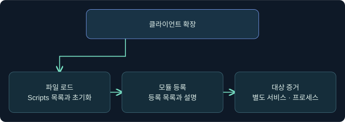
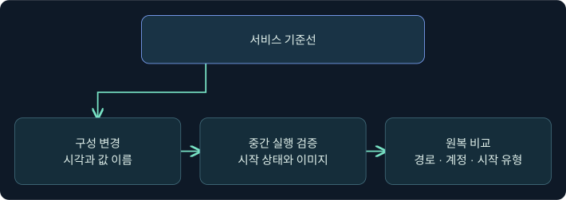
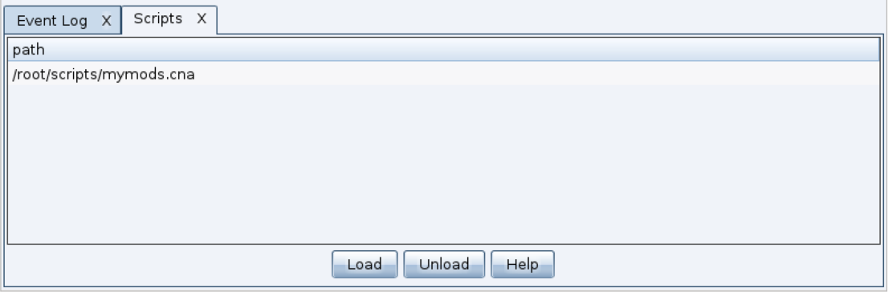
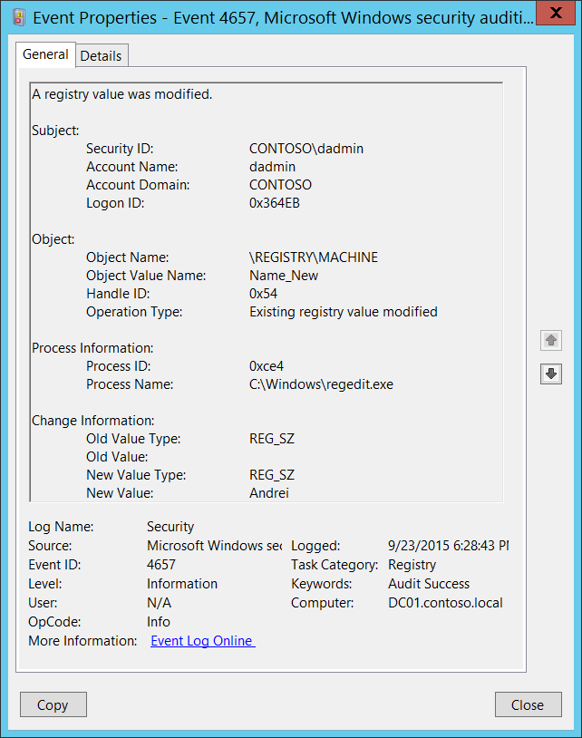
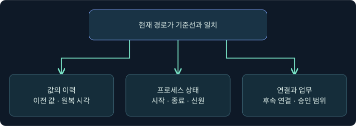

## 1. 현재 설정이 같아도 중간에 바뀌었을 수 있습니다

가상의 LAB-SRV11에서 오전 기준선과 오후 스냅샷의 서비스 경로는 같습니다. 사이의 감사 기록에는 값 변경이 두 건 있습니다. 무엇이 바뀌고 돌아왔는지, 그 사이에 서비스 시작이나 대상 실행이 있었는지 분리해 확인합니다. 호스트와 사례는 합성입니다. 제품 확장 로드, 대상 접속, 서비스 변경·시작·원복, 새 세션은 미실행입니다.

## 2. 확장 로드, 모듈 등록, 원격 실행은 다른 단계입니다

Aggressor Script는 Cobalt Strike 클라이언트의 기능을 확장할 수 있습니다. Fortra 문서의 `beacon_remote_exploit_register`는 jump용 모듈, `beacon_remote_exec_method_register`는 remote-exec용 방식을 추가합니다. 해당 기능이 보인다는 사실과 대상에서 작업이 성공했다는 사실은 독립적입니다.

| 관측 위치 | 말할 수 있는 범위 | 추가 확인 |
|---|---|---|
| Script Manager 경로 목록 | 파일이 목록에 표시됨 | 초기화 오류와 파일의 내용 |
| Event Log 또는 Script Console | 로드·초기화 관련 메시지 | 특정 기능의 등록 |
| 인수 없는 모듈 목록 | 방식과 설명이 표시됨 | 대상 접근, 인가와 실행 |
| 대상 이벤트 | 서비스와 프로세스 활동의 단서 | 작업 ID, 시간과 대상 일치 |

같은 파일 이름으로 다른 내용이 로드될 수 있으므로 승인된 버전·검토 기록·파일 해시를 비교합니다. 확장 로드는 클라이언트 코드 실행을 수반할 수 있습니다. 아래 화면 절차는 미리 검토한 표시용 가상 파일을 가정하며, 원격 모듈을 구현하거나 등록하지 않습니다.

## 3. 새 설치와 기존 서비스 변경을 비교합니다

SCShell의 공개 연구는 기존 서비스의 실행 경로를 일시 변경하고 뒤에 원래 구성으로 되돌리는 사례를 다룹니다. Windows는 기존 서비스 구성 조회, 구성 변경, 시작에 서로 다른 권한을 적용합니다. 각각 `SERVICE_QUERY_CONFIG`, `SERVICE_CHANGE_CONFIG`, `SERVICE_START`가 관련됩니다. 원격 SCM에 연결했거나 특정 설정을 읽었다는 점만으로 변경이나 시작이 허용됐다고 판단할 수 없습니다.

| 단계 | 기록할 내용 | 판단의 한계 |
|---|---|---|
| 기준선 | 내부 서비스 이름·실행 경로·계정·시작 유형·시점 | 오래된 기준선인지 확인 |
| 변경 | 대상 키·값·기록 시각 | 실행 이미지가 확인된 것은 아님 |
| 시작·실행 | 서비스 상태·프로세스 생성·실행 계정 | 요청자와 실행 계정이 다를 수 있음 |
| 원복 | 변경 전후 구성과 마지막 관측 시각 | 프로세스·연결의 현재 상태는 별도 |

실행 중인 서비스의 구성을 바꿔도 표시 이름 등의 예외를 제외한 변경은 서비스가 정지할 때까지 적용되지 않을 수 있습니다. 특정 연구의 파일 사용 여부를 모든 구현에 일반화하지 않고 파일·프로세스·네트워크 증거를 각각 확인합니다.

## 4. 기존 값 변경과 설치의 감사 범위를 구별합니다

4697은 새 서비스 설치에 관한 이벤트입니다. 기존 구성만 변경하면 변경 자체가 새 설치 기록을 만든다고 볼 수 없습니다. **4657**은 레지스트리 값 변경을 기록하며, 적용된 감사 정책과 객체의 Set Value 감사 SACL이 필요합니다. **Sysmon 13**은 포함 필터가 적용된 레지스트리 값 설정을 관측합니다. 수집기와 값의 종류에 따라 상세 데이터나 이전 값의 가시성이 달라집니다.

| 질문 | 확인할 자료 | 함께 볼 조건 |
|---|---|---|
| 어떤 값이 바뀌었나 | 개체 경로와 값 이름, 이전·이후 값 | 시각, 기준선과 데이터 형식 |
| 누가 요청했나 | Subject·기록 프로세스, 호출자 측 자료 | 대상 처리 프로세스와 원격 요청자 구분 |
| 실제로 무엇이 실행됐나 | 4688 또는 Sysmon 1·EDR, 서비스 상태 | 이미지·실행 계정·프로세스 시각 |
| 원래대로 돌아왔나 | 두 번째 변경 및 최신 스냅샷 | 다른 필드와 후속 프로세스·연결 |

기록 프로세스가 서비스 관리자인 경우 그 프로세스는 대상의 요청 처리자일 수 있습니다. 원격의 최초 주체를 확인하려면 대상 인증 기록과 승인된 작업 기록을 별도로 연결합니다.

## 5. 원복을 검증하는 합성 사례

서비스 내부 이름 LabTelemetrySvc의 경로가 10:14에 달라지고 10:17에 기준선과 같아졌다고 가정합니다. 경로 한 필드의 일치는 해당 값이 돌아왔음을 뒷받침합니다. 시작 유형이나 계정이 달랐다면 전체 구성이 같다고 말하기 어렵습니다. 중간에 새 이미지가 실행됐는지와 원복 뒤에도 해당 프로세스가 남았는지는 또 다른 질문입니다. 정상 업데이트나 잘못된 배포도 같은 종류의 변경을 남길 수 있으므로 승인 내역과 시간 범위를 함께 봅니다.

## 6. 실제 Script Manager에서 로드 위치를 읽습니다

### 실제 화면 117: Fortra Script Manager

출처는 [Fortra Scripting Cobalt Strike](https://hstechdocs.helpsystems.com/manuals/cobaltstrike/current/userguide/content/topics/welcome_cs-scripting.htm)입니다. 2026-11-09에 4.13 문서와 대조했습니다. 공식 캡처의 UI와 경로는 이전 버전의 별도 예시입니다.

1. 승인된 가상 클라이언트에서 **Cobalt Strike → Script Manager → Load**를 클릭하는 미실행 예입니다.
2. 파일 선택창의 파일 이름 칸에서 사전 검토된 표시 전용 `training-ui-label.cna`를 고르고 **Open**을 눌러 로드합니다. 이름은 원격 기능과 관계없는 가상 표시용 자료를 구별하기 위한 값입니다. 별도 **Save** 단계는 없으며, 이 강의는 스크립트 파일을 제공하거나 실행하지 않습니다.
3. **Scripts** 목록에서 경로를 확인하고 스크립트의 초기화 오류는 제품의 스크립트 콘솔에서 대조합니다. 해제 확인은 해당 행 선택 → **Unload** → 목록 재확인 순입니다. 실제 파일 선택창과 가상 로드·해제 결과 사진은 확보하지 못했습니다.

## 7. 실제 이벤트 뷰어의 값 변경 필드를 읽습니다

### 실제 화면 118: Microsoft Windows 보안 감사 4657

출처는 [Microsoft 이벤트 4657](https://learn.microsoft.com/en-us/previous-versions/windows/it-pro/windows-10/security/threat-protection/auditing/event-4657)입니다. Used with permission from Microsoft. 2026-11-09에 확인했습니다. 화면은 Windows 문서의 일반 값 변경 예시이며 가상 서비스의 실행 결과와 별개입니다.

1. **Event Viewer → Action → Open Saved Log**에서 합성 파일 `lab-srv11-security.evtx`를 골라 **Open**을 누르는 미실행 예입니다. 이름은 대상과 채널을 구분합니다.
2. **Filter Current Log**의 이벤트 ID 칸에 `4657`을 넣고 **OK**를 눌러 레지스트리 값 변경만 봅니다. 원본 로그를 수정하거나 저장하지 않습니다.
3. **General**과 **Details → XML View**에서 개체 경로·값 이름·이전/이후 값·프로세스·Subject를 비교합니다. 가상 사례에서는 서비스의 `ImagePath`인지 확인합니다. 파일 선택창·필터 입력창과 가상 사례의 실제 출력 사진은 확보하지 못했습니다.

## 8. 원복과 운영 영향의 증거를 대조합니다

| 가상 조건 | 가능한 설명 | 별도 확인 |
|---|---|---|
| 값이 바뀌었으나 실행 기록 없음 | 구성 변경 관측 | 서비스 상태와 실행 수집 범위 |
| 현재 값이 기준선과 같고 변경 기록 두 건 있음 | 변경 후 원복 후보 | 각 값과 시각, 다른 구성 |
| 원복 뒤 프로세스가 남음 | 설정과 현재 실행 상태가 다름 | 실행 신원, 종료와 네트워크 |
| 4697 없이 값 변경만 보임 | 기존 서비스 수정 가능 | 기존 서비스 존재와 변경 대상 |
| 클라이언트 파일 경로만 보임 | 확장 목록 상태 | 초기화·등록·대상 기록 |

## 9. 조사 결론에 관측의 한계를 적습니다

“LAB-SRV11의 기존 서비스 값에서 변경 두 건을 확인했다. 마지막 경로는 기준선과 같고, 중간 실행은 확인 중이다”라고 쓰면 각 자료의 역할이 드러납니다. 이후 강의에서는 서명된 Windows 도구의 정상 기능과 실행 흔적을 비교합니다.

## 10. 복습과 즉시 해설

### 복습 1. Script Manager에 경로가 보이면 원격 모듈도 등록됐나요?
**해설:** 파일 목록과 초기화·기능 등록을 따로 확인합니다.

### 복습 2. jump와 remote-exec의 확장 API는 같은 역할인가요?
**해설:** 각각 새 세션 시작을 시도하는 모듈과 원격 명령 실행 방식을 등록합니다.

### 복습 3. 구성 조회 권한으로 기존 서비스 경로를 바꿀 수 있나요?
**해설:** 조회와 구성 변경에 필요한 권한은 별개입니다.

### 복습 4. 실행 중 경로를 바꾸면 즉시 새 프로세스가 시작되나요?
**해설:** 설정의 적용 시점과 현재 실행 상태를 각각 확인합니다.

### 복습 5. 기존 서비스 값이 변경되면 반드시 4697이 기록되나요?
**해설:** 4697은 새 설치 기록입니다. 기존 값 변경은 별도 감사 자료를 봅니다.

### 복습 6. 4657이 없으면 변경이 없었나요?
**해설:** 감사 정책과 SACL, 로그 보존을 확인한 뒤 판단합니다.

### 복습 7. 기록된 프로세스가 최초 원격 요청자인가요?
**해설:** 대상에서 처리한 프로세스와 원격 요청자가 다를 수 있습니다.

### 복습 8. 경로 원복만으로 대상 연결의 종료도 입증하나요?
**해설:** 구성은 복구됐을 수 있습니다. 프로세스 종료와 연결은 별도 자료로 확인합니다.

## 11. 공식 자료와 확인 범위

- 제품 확장과 등록 API를 대조했습니다. [Fortra How to Load Scripts](https://hstechdocs.helpsystems.com/manuals/cobaltstrike/current/userguide/content/topics_aggressor-scripts/as_intro1_how-to-load-scripts.htm) · [Fortra Aggressor Beacon](https://hstechdocs.helpsystems.com/manuals/cobaltstrike/current/userguide/content/topics_aggressor-scripts/as_beacon.htm)
- 서비스 구성과 이벤트를 확인했습니다. [SCShell 작성자의 공개 연구](https://www.levelblue.com/blogs/spiderlabs-blog/scshell-fileless-lateral-movement-using-service-manager) · [Microsoft ChangeServiceConfigW](https://learn.microsoft.com/en-us/windows/win32/api/winsvc/nf-winsvc-changeserviceconfigw) · [Microsoft Sysmon](https://learn.microsoft.com/en-us/sysinternals/downloads/sysmon)
