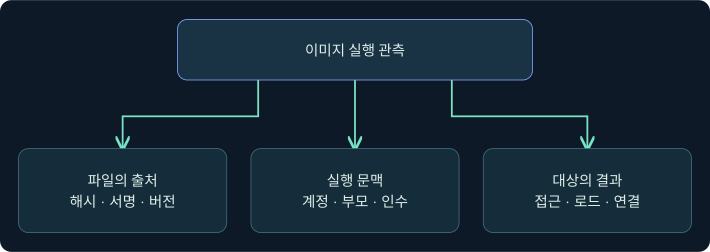
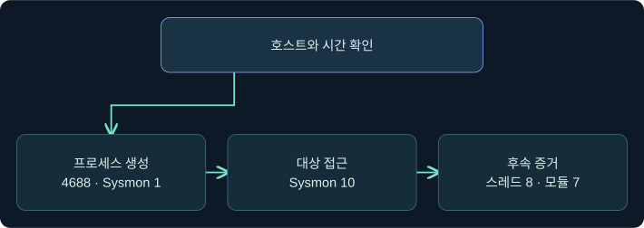
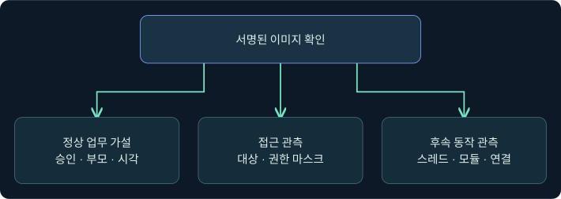

## 1. 서명된 도구가 실행된 뒤 무엇을 확인하나요?

가상의 LAB-APP17에서 승인된 유지보수 시간 밖에 Windows 구성 요소와 이름이 같은 프로세스가 관측됐습니다. 이름·서명을 확인한 뒤 실제 호출 주체와 대상 프로세스에 어떤 변화가 있었는지 확인하는 사례입니다. 학습 목표는 파일의 출처, 실행, 프로세스 접근, 모듈 로드, 후속 활동을 서로 다른 증거로 읽는 것입니다. 예시는 합성입니다. 파일 전달, 원격 실행, 주입, 제품 동작이나 정책 변경은 수행하지 않았습니다.

## 2. 정상 도구의 출처와 사용 목적을 구별합니다

LOTL(Living off the Land)은 환경에 이미 있거나 일반적으로 신뢰되는 기능을 이용하는 행위를 가리킵니다. LOLBAS는 그런 맥락에서 거론되는 바이너리·스크립트·라이브러리를 가리키기도 합니다. 운영 도구의 정상 사용과 비정상 사용은 동일한 파일 이름으로 보일 수 있습니다. 서명 검증은 서명 주체와 파일 무결성에 관한 근거를 제공합니다. 해당 호출의 목적이나 다른 프로세스의 동작은 별도의 질문입니다.

| 확인 항목 | 알 수 있는 범위 | 추가로 필요한 것 |
|---|---|---|
| 이름과 전체 경로 | 후보 파일과 위치 | 해시, 서명, 파일 버전 |
| 서명 검증 | 서명 주체와 검증된 파일 | 실행 계정, 승인된 업무 |
| 부모와 실행 인수 | 누가 무엇을 요청했는지에 관한 단서 | 대상 프로세스와 결과 |
| 대상 이미지 로드 | 특정 프로세스에서 모듈 로드가 관측됨 | 호출과의 인과관계, 후속 동작 |

파일 이름은 바꿀 수 있고 같은 이름의 파일이 여러 경로에 있을 수 있습니다. Microsoft에서 배포된 파일이라고 확인돼도 해당 실행의 목적은 부모·계정·작업 시간·경로·인수의 맥락으로 판단합니다.

## 3. MavInject의 기능과 관측 경계를 설명합니다

MavInject는 Microsoft App-V와 관련된 구성 요소로 다른 프로세스에 모듈을 적재하는 기능과 연결됩니다. 특정 시스템에서 파일의 존재와 정상 사용 여부는 OS와 설치 구성, 버전, 관리 정책을 확인해야 합니다. System32와 SysWOW64 이름만으로 관측한 프로세스의 비트 수를 단정하지 않고 실제 이미지와 프로세스 속성을 대조합니다.

모의 사례에서 WMI 또는 WinRM과 연관된 관리 요청이 먼저 관측되더라도, 이어진 프로세스 생성과 대상 프로세스 내부의 결과를 독립적으로 확인합니다. 원격 요청 접수, 파일 생성, 대상 프로세스 접근, 스레드 생성 또는 이미지 로드, 새 통신은 서로 다른 시점과 기록을 가질 수 있습니다. 이 강의는 그 순서를 읽는 방법을 다루며 실행 인수 조합이나 주입 절차를 제공하지 않습니다.

## 4. 이벤트별로 무엇을 입증하는지 비교합니다

| 자료 | 관측 가능한 내용 | 해석의 한계 |
|---|---|---|
| Security 4688 또는 Sysmon 1 | 프로세스 생성, 구성에 따른 명령줄·부모 정보 | 대상의 모듈 로드·코드 실행은 별도 |
| Sysmon 10 | 다른 프로세스에 대한 접근과 부여된 접근 마스크 등 | 접근만으로 메모리 쓰기나 실행을 입증하기 어려움 |
| Sysmon 8 | 한 프로세스가 다른 프로세스에 생성한 스레드 | 모든 주입 방식이 이 이벤트를 남기지는 않음 |
| Sysmon 7 | 모듈이 로드된 프로세스와 이미지 정보 | 정상 로드도 기록되며 기본적으로 비활성화 |
| Sysmon 3 또는 네트워크 수집 | 프로세스와 연결의 관측 범위 | 별도 정책·수집 조건에 좌우됨 |

Sysmon 8의 시작 모듈·함수는 추론된 값으로 공백일 수 있습니다. 이벤트가 없으면 필터, 센서 버전, 로그 보존, 호스트 범위를 먼저 확인합니다. 이벤트 ID 하나를 실행 성공 또는 실패의 만능 지표로 쓰지 않습니다.

## 5. 호스트·시간·프로세스 인스턴스를 맞춥니다

가상 기록에서 10:14에 관리 호출이 접수됐고 10:15에 의심 후보 이미지가 시작됐다고 가정합니다. PID가 같아도 프로세스가 종료된 후 번호가 재사용될 수 있습니다. Sysmon ProcessGuid가 있으면 호스트와 함께 대조하고, 그렇지 않으면 PID와 프로세스 시작 시각·이미지 경로·부팅 범위를 조합합니다. 원본 접근 이벤트의 Source와 Target은 순서를 바꾸지 않습니다.

예를 들어 대상 프로세스의 모듈 로드가 후보 실행보다 먼저 기록됐다면 시계 오차를 확인한 뒤 이전 로드 또는 별도 실행을 가설로 둡니다. 같은 호스트에서 시간만 가깝다는 이유로 인과관계를 확정하지 않습니다.

## 6. 실제 Process Browser에서 조회 위치를 확인합니다

### 실제 화면 119: Fortra Process Browser

출처는 [Fortra Process Browser](https://hstechdocs.helpsystems.com/manuals/cobaltstrike/current/userguide/content/topics/post-exploitation_process-browser.htm)입니다. 2026-11-09에 4.13 계열 문서와 대조했습니다. 공식 그림의 UI와 프로세스 목록은 별도 시연 자료입니다.

1. 승인된 가상 호스트 LAB-APP17의 세션 행에서 **우클릭 → Explore → Show Processes**를 선택하는 미실행 예입니다. 여러 호스트의 동일 PID를 혼동하지 않도록 가상 세션 하나를 기준으로 설명합니다.
2. 반환 목록의 오른쪽 상세에서 가상 후보 `LabInventory.exe`를 이미지 이름 열로 찾고 행을 선택합니다. 별도의 값 입력 필드는 없습니다. 이름·PID·사용자·부모 관계를 기록과 비교하기 위한 예시입니다.
3. 조회는 **Show Processes** 선택 시 요청됩니다. 별도 **Save** 또는 실행 버튼을 사용하는 단계는 없습니다. 목록의 호스트와 PID, 수집 시각을 비교합니다. 공식 사진은 현재 가상 대상 조회나 주입 결과를 보여 주지 않으며 해당 결과 사진은 확보하지 못했습니다.

## 7. 공식 콘솔에서 조회 요청과 결과를 구별합니다

### 실제 화면 120: Fortra Beacon Console

출처는 [Fortra Post Exploitation](https://hstechdocs.helpsystems.com/manuals/cobaltstrike/current/userguide/content/topics/post-exploitation_main.htm)입니다. 과거 UI가 포함될 수 있습니다. 승인된 가상 행 우클릭 → **Interact**로 콘솔을 연 뒤 하단 칸에 `help ps`를 입력하고 **Enter**를 누르는 미실행 예입니다. 이 값은 프로세스 조회 명령의 도움말을 확인하기 위한 값입니다. 저장 단계는 없습니다. 위쪽 출력의 도움말을 확인하며 도움말이 나온 사실과 프로세스 조회나 대상 실행은 구분합니다. 이 명령의 실제 출력과 대상 로그는 확보하지 못했습니다.

## 8. 조건이 바뀌면 판단도 바뀝니다

| 합성 조건 | 확인한 범위 | 다음 자료 |
|---|---|---|
| 서명 유효, 승인 시간대, 예상 부모 | 정상 업무 가설을 뒷받침 | 작업 기록, 실제 대상과 범위 |
| 후보 실행과 ProcessAccess만 있음 | 실행 및 프로세스 접근 | 메모리·스레드·모듈과 후속 활동 |
| 대상 로드가 다른 PID 인스턴스에서 발견 | 별도 실행일 수 있음 | ProcessGuid와 시작 시각 |
| 정책 감사에서 차단 후보만 기록 | 정책 적용 시의 차단 후보 | 강제 모드 및 실제 실행 결과 |

## 9. 방어 정책의 적용 범위를 증거로 확인합니다

App Control for Business나 AppLocker의 정책 설계는 업무 의존성, 해당 Windows 버전, 규칙 컬렉션과 적용 대상을 함께 봅니다. 감사 모드에서 차단 후보가 기록되는 것과 강제 모드에서 실제로 차단된 것은 별도입니다. 합성 사례의 결론은 “서명된 이미지의 실행과 대상 접근은 관측됐다. 후속 스레드·모듈과 정책 적용 결과는 조사 중이다”처럼 작성합니다. 이 강의에서 보호 정책을 변경하거나 우회하지 않았습니다.

## 10. 복습과 즉시 해설

### 복습 1. 유효한 서명은 호출 목적까지 보여 주나요?
**해설:** 서명 주체와 무결성의 단서입니다. 실행 맥락과 승인 업무를 별도로 확인합니다.

### 복습 2. Sysmon 10은 메모리 쓰기를 입증하나요?
**해설:** 프로세스 접근 관측입니다. 쓰기와 실행 근거를 별도로 확인합니다.

### 복습 3. Sysmon 8이 없으면 모든 주입을 배제하나요?
**해설:** 방식과 수집 조건에 따라 이벤트가 없을 수 있습니다.

### 복습 4. Sysmon 7이 있으면 주입이 확정되나요?
**해설:** 모듈 로드입니다. 정상 로드 가능성과 호출 문맥을 확인합니다.

### 복습 5. 같은 PID면 같은 프로세스인가요?
**해설:** PID는 재사용됩니다. 호스트, 시작 시각과 ProcessGuid를 확인합니다.

### 복습 6. 도구 이름이 같으면 파일도 같은가요?
**해설:** 경로·해시·버전과 서명 검증을 대조합니다.

### 복습 7. 감사 모드에서 차단 후보가 보이면 실제 차단됐나요?
**해설:** 감사와 강제의 적용 상태를 구분하고 실제 실행을 확인합니다.

### 복습 8. Process Browser의 목록으로 무엇을 확인하나요?
**해설:** 조회 시점의 프로세스 목록을 확인합니다. 과거 실행과 주입 여부는 별도 기록이 필요합니다.

## 11. 공식 자료와 확인 범위

- 이벤트별 관측 범위와 수집 조건을 확인했습니다. [Microsoft Sysinternals Sysmon](https://learn.microsoft.com/en-us/sysinternals/downloads/sysmon) · [MITRE ATT&CK Process Injection](https://attack.mitre.org/techniques/T1055/)
- 서명된 구성 요소와 정책의 관계를 대조했습니다. [Microsoft App Control 권장 차단 규칙](https://learn.microsoft.com/en-us/windows/security/application-security/application-control/windows-defender-application-control/design/applications-that-can-bypass-wdac) · [Microsoft Windows App-V](https://learn.microsoft.com/en-us/windows/application-management/app-v/appv-getting-started)
