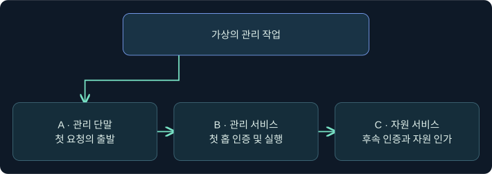
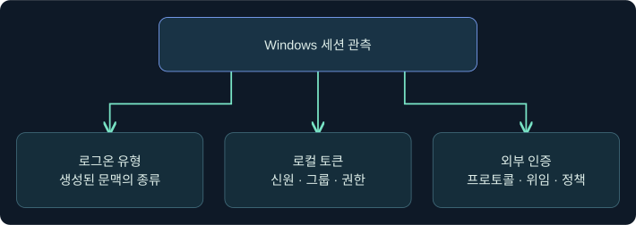
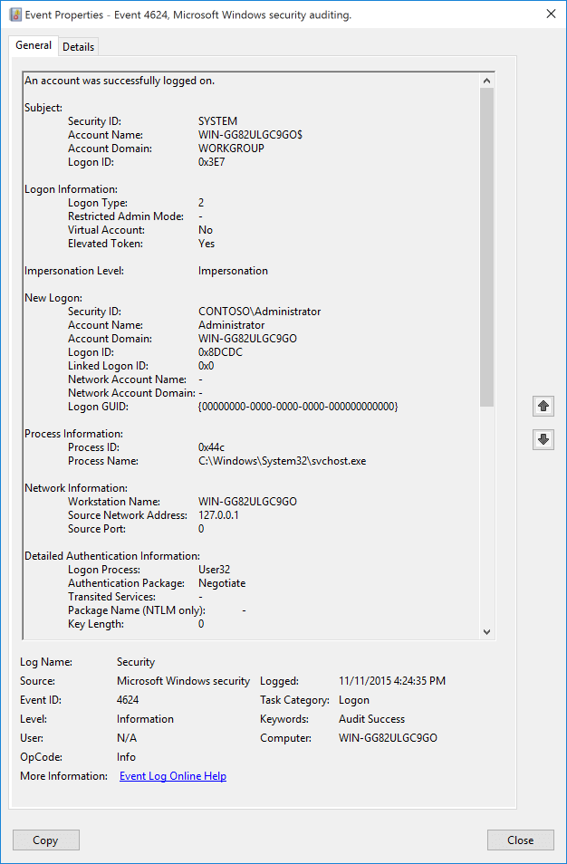
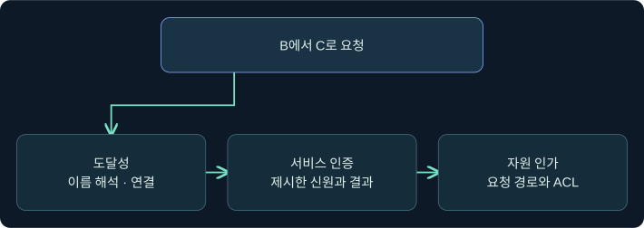

## 1. 첫 연결과 다음 연결을 구분합니다

가상의 LAB-OPS12에서 LAB-MGMT03으로 원격 관리 세션이 열렸지만, 그 세션에서 LAB-FILE09의 자원을 읽으려는 요청은 실패했습니다. 로컬 실행 문맥, 첫 연결의 인증, 후속 연결의 신원·위임·인가를 따로 확인합니다. 가상 기록과 공식 화면으로만 설명합니다. 실제 Windows·Cobalt Strike, 원격 인증·자격 증명 사용·위임 변경은 미실행입니다.

## 2. 로그온 유형은 생성된 문맥의 종류입니다

보안 감사 4624는 로그온 세션이 생성됐을 때 해당 컴퓨터에 기록됩니다. 같은 사용자가 대상에서 여러 세션을 가질 수 있으므로 대상 컴퓨터, 시각, New Logon의 계정과 Logon ID, Logon Type을 함께 읽습니다. Logon ID는 다른 호스트에 그대로 붙여 비교하는 전역 식별자가 아닙니다.

| 유형 | 이름 | 관측 해석 |
|---|---|---|
| 2 | Interactive | 해당 컴퓨터의 대화형 로그온 |
| 3 | Network | 네트워크에서 만들어진 로그온. 프로토콜은 별도 자료로 확인 |
| 4 | Batch | 배치 실행 문맥. 작업 설정과 실제 기록을 확인 |
| 5 | Service | SCM이 시작한 서비스의 로그온 문맥 |
| 8 | NetworkCleartext | 인증 패키지에 해시되지 않은 암호가 전달되는 유형 |
| 9 | NewCredentials | 로컬 신원을 유지하면서 외부 연결용 문맥을 별도로 지정 |
| 10 | RemoteInteractive | 원격 데스크톱 등 원격 대화형 로그온 |
| 11 | CachedInteractive | 로컬 캐시를 사용하는 대화형 로그온 |

유형 8의 이름은 전송 패킷의 평문 여부를 입증하지 않습니다. 유형 9도 외부 서버의 인증 성공을 보여 주는 이벤트가 아닙니다. 유형 3 한 건으로 SMB, WinRM, 특정 도구 중 하나를 확정하지 않습니다.

## 3. 로컬 토큰과 외부 서비스의 신원을 구별합니다

Windows 토큰은 로컬 권한 판단에 쓰이는 신원·그룹·권한의 정보를 포함합니다. 원격 서비스에 제출되는 인증 재료는 프로토콜과 로그온 방식, 위임 및 정책의 영향을 받습니다. 따라서 로컬의 사용자 이름이 기대와 같아도 후속 서비스가 동일 신원을 인정할지는 별도 질문입니다. 토큰의 계정 이름만 보고 암호·해시·TGT가 그 시스템에서 재사용 가능하다고 추론하지 않습니다.

## 4. 두 번째 홉을 실패 지점별로 나눕니다

첫 홉은 A에서 B의 관리 서비스로 인증하는 단계입니다. 두 번째 홉은 B의 해당 실행 문맥에서 C의 서비스로 요청하는 단계입니다. 일반적인 PowerShell 원격 관리에서 첫 연결이 성공해도 사용자의 자격 증명이 B에 전달돼 C로 다시 인증할 수 있다고 가정할 수 없습니다. 반대로 실패가 항상 위임 부족을 뜻하지도 않습니다.

| 질문 | 확인할 자료 | 고려할 다른 가설 |
|---|---|---|
| A에서 B로 접근했나요? | B의 4624와 WinRM 기록, A의 연결 시각 | 다른 네트워크 로그온 |
| B에서 C로 도달했나요? | 이름 해석·방화벽·서비스 상태의 기존 자료 | DNS, 라우팅, 연결 실패 |
| C가 어떤 신원을 봤나요? | C의 4624/4625와 애플리케이션 로그 | 다른 계정 또는 컴퓨터 신원 |
| 인증 이후 자원을 읽었나요? | C의 자원 인가 및 감사 | ACL, 공유 권한, 요청 경로 |

업무가 정말로 B를 경유해야 하는지와 승인된 관리 경로를 먼저 확인합니다. 위임 기능이나 다른 자격 증명 사용은 별도 승인과 설계가 필요한 주제이며 이 강의에서는 구성하지 않습니다.

## 5. Kerberos 티켓의 종류와 관측 위치를 읽습니다

TGT는 KDC에 서비스 티켓을 요청하는 데 쓰입니다. 서비스 티켓은 특정 서비스에 제출되는 자료입니다. B 서비스 대상의 티켓이 보인다는 점만으로 C에 대한 티켓을 얻었거나 위임이 허용됐다고 볼 수 없습니다. 티켓 목록을 해석한다면 어느 호스트, 어느 로그온 세션의 캐시인지 확인합니다. 빈 목록은 잘못된 세션을 열었거나 만료·정리됐을 수 있으므로 현재 시스템의 전체 상태로 일반화하지 않습니다.

도메인 컨트롤러의 **4769**는 서비스 티켓 요청 관측입니다. 결과 코드가 성공이어도 C에서 티켓이 제시됐거나 자원에 접근했다는 증거는 아닙니다. 반대로 기존 서비스 티켓 재사용, 다른 DC 또는 감사 누락으로 새 4769를 찾지 못할 수 있습니다. C의 인증·인가 기록을 함께 대조합니다.

## 6. 공식 Beacon Console에서 로컬 문맥의 조회 위치를 읽습니다

### 실제 화면 121: Fortra Beacon Console

출처는 [Fortra Post Exploitation](https://hstechdocs.helpsystems.com/manuals/cobaltstrike/current/userguide/content/topics/post-exploitation_main.htm)입니다. 2026-11-09에 4.13 계열 문서를 대조했습니다. 이미지의 UI와 결과는 별도 공식 사례입니다.

1. **Cobalt Strike → Visualization → Session Table → 승인된 가상 LAB-MGMT03 행 우클릭 → Interact**로 콘솔을 여는 미실행 예입니다. 선택한 호스트를 대조합니다.
2. 하단 입력 줄에 `getuid`를 넣고 **Enter**를 누르는 예입니다. 현재 Beacon이 보고하는 사용자 문맥을 확인하는 값이며 비밀, 대상 또는 원격 명령을 입력하지 않습니다. 별도 **Save** 단계는 없습니다.
3. 위 출력의 계정 표시를 선택한 가상 호스트·세션과 비교합니다. 로컬 문맥 관측으로만 기록하며 다른 서비스의 인증 가능성을 판정하지 않습니다. 가상 결과 및 인증 결과 사진은 확보하지 못했습니다.

## 7. 공식 이벤트 화면에서 로그온 유형을 확인합니다

### 실제 화면 122: Microsoft Windows 보안 감사 4624

출처는 [Microsoft 이벤트 4624](https://learn.microsoft.com/en-us/previous-versions/windows/it-pro/windows-10/security/threat-protection/auditing/event-4624)입니다. Used with permission from Microsoft. 공식 캡처는 유형 2 예시입니다. Windows 버전에 따라 필드가 다르며 가상 유형 3이나 두 번째 홉 결과와 별개입니다.

1. **Event Viewer → Action → Open Saved Log**에서 가상 파일 `lab-mgmt03-security.evtx`를 골라 **Open**을 누르는 미실행 절차입니다. 이름은 B의 호스트와 로그 채널을 구분합니다.
2. **Filter Current Log**의 이벤트 ID 칸에 `4624`를 넣고 **OK**를 누릅니다. 저장된 원본 로그에는 변경이 없습니다.
3. **General**에서 Logon Type, New Logon, Authentication Package, Source Network Address를 확인합니다. **Details → XML View**에서 대상 컴퓨터·시각과 Logon ID를 대조합니다. 필터 창과 합성 결과 사진은 확보하지 못했습니다.

## 8. 조건을 바꿔 결론을 비교합니다

| 가상 조건 | 확인한 범위 | 다음 확인 |
|---|---|---|
| B에서 유형 3 성공, C에서 연결 없음 | 첫 로그온의 근거만 있음 | B에서 C로의 도달성과 수집 범위 |
| C에서 유형 3 성공 후 자원 거부 | 인증과 자원 인가 결과가 다름 | 자원 ACL과 요청 경로 |
| DC에 4769 성공, C 로그 미확인 | 티켓 요청 성공 관측 | C의 실제 인증·자원 기록 |
| B의 로컬 계정과 C의 관측 계정이 다름 | 두 문맥이 다를 수 있음 | 세션·인증 방식과 승인된 정책 |

## 9. 조사 메모를 단계별로 작성합니다

“B에서 A의 원격 관리 로그온을 확인했다. C의 로그에는 자원 요청이 거부된 기록이 있으나 동일 작업의 요청인지 확인 중이다”처럼 관측과 가설을 나눕니다. 시간대·호스트·계정·서비스 이름·수집 범위도 기록합니다. 같은 계정 문자열만으로 연쇄 동작을 연결하지 않습니다. 13장의 서비스·프로세스·네트워크 관측을 적용해 어느 경계에서 근거가 끊기는지 설명합니다.

## 10. 복습과 즉시 해설

### 복습 1. 유형 3 한 건으로 WinRM을 확정하나요?
**해설:** 네트워크 로그온입니다. WinRM 기록과 다른 연결 자료를 대조합니다.

### 복습 2. 유형 8은 네트워크 평문 전송 증거인가요?
**해설:** 인증 패키지에 전달되는 암호의 형태를 뜻합니다. 전송 보호는 별도로 확인합니다.

### 복습 3. 유형 9가 있으면 외부 서버 인증이 성공했나요?
**해설:** 외부용 문맥을 가진 세션 생성입니다. 원격 서버의 결과는 별도입니다.

### 복습 4. 현재 사용자 이름은 외부 접근을 보장하나요?
**해설:** 로컬 표시와 외부 인증·인가 조건을 별도로 확인합니다.

### 복습 5. B 대상 서비스 티켓으로 C 접근을 입증하나요?
**해설:** 대상 서비스와 실제 요청을 각각 확인합니다.

### 복습 6. 4769 성공은 파일 열람 성공인가요?
**해설:** 서비스 티켓 요청 결과입니다. 대상의 인증·자원 로그를 봅니다.

### 복습 7. 두 번째 홉 실패는 항상 위임 문제인가요?
**해설:** DNS, 연결, 대상 서비스의 인증과 인가도 확인합니다.

### 복습 8. Logon ID가 같으면 다른 호스트의 세션을 연결할 수 있나요?
**해설:** 호스트 문맥의 값입니다. 호스트·시각·계정·서비스를 종합합니다.

## 11. 공식 자료와 확인 범위

- 유형과 관리 도구의 인증 문맥을 대조했습니다. [Microsoft 관리 도구 및 로그온 유형](https://learn.microsoft.com/en-us/windows-server/identity/securing-privileged-access/reference-tools-logon-types) · [Microsoft PowerShell 두 번째 홉](https://learn.microsoft.com/en-us/powershell/scripting/security/remoting/ps-remoting-second-hop)
- 서비스 티켓 요청과 실제 접근을 구분했습니다. [Microsoft 이벤트 4769](https://learn.microsoft.com/en-us/previous-versions/windows/it-pro/windows-10/security/threat-protection/auditing/event-4769)
