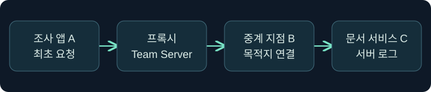
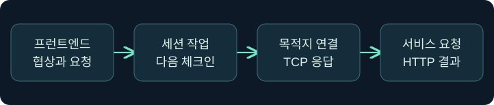
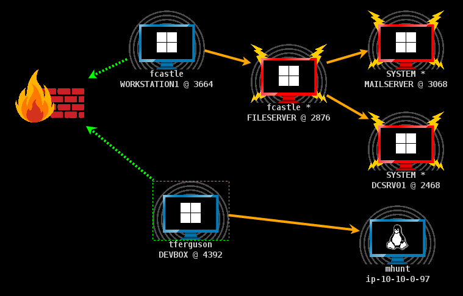
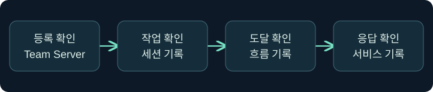

## 1. 접속 경로가 바뀌면 누가 연결을 시작하나요?

분리된 연습망에 조사 단말 A, 승인된 중계 역할 B, 정적 문서 서비스 C가 있습니다. A에서 C로 직접 가는 경로는 설계상 없습니다. A가 중계 서비스에 연결하고 B가 C 쪽 연결을 시작하는 구조를 모델링합니다. 방화벽에는 두 구간이 서로 다른 흐름으로 보입니다. C가 기록한 원본 주소는 NAT 등이 없다는 가정에서 B입니다. C의 주소 기록과 A의 사용자 신원을 같은 것으로 취급하면 최초 요청의 출처를 놓칩니다.

이 강의의 주소와 기록은 설명용입니다. 제품, 프록시, 대상 서비스, 방화벽을 실행하거나 변경하지 않았습니다. 승인 범위에는 대상과 포트뿐 아니라 중계 지점, 운영 시간, 기록 및 종료 조건이 포함되어야 합니다.

## 2. SOCKS 요청에서 협상과 연결을 나눕니다

SOCKS는 애플리케이션의 통신을 중계하는 프로토콜입니다. 클라이언트는 먼저 프록시 자체에 도달해야 합니다. SOCKS5에서는 방식 협상 및 선택된 인증 뒤에 CONNECT 같은 요청을 보냅니다. CONNECT의 주소 필드는 IPv4·IPv6·도메인 이름을 표현할 수 있습니다. 어느 주소형을 실제로 쓰는지는 클라이언트 설정과 구현에 달려 있습니다. 서버 응답에는 결과 코드가 들어갑니다. 성공 응답 다음에는 상위 프로토콜의 TLS, HTTP 또는 서비스 인증이 따로 이어집니다.

SOCKS 인증은 중계 서비스를 이용할 수 있는지에 관한 조건입니다. 내부 웹이나 디렉터리의 로그인·인가를 대신하지 않습니다. SOCKS 프로토콜 자체가 모든 트래픽의 암호화를 제공한다고 가정하지 않습니다. TLS를 쓰는 서비스라면 인증서 이름과 목적지 검증은 계속 적용됩니다.

| 구분 | SOCKS4a | SOCKS5 |
|---|---|---|
| 대상 표현 | IPv4 중심, 이름 전달 확장 | IPv4·IPv6·도메인 주소형 |
| 프록시 이용 조건 | SOCKS5 방식 협상과 다름 | 방식 협상과 구현별 인증 |
| 이 강의의 범위 | TCP 연결의 관측 | TCP CONNECT의 관측 |
| 주의 | 이름 처리 지원을 양쪽에서 확인 | 표준의 기능과 제품·버전 지원을 구분 |

## 3. Team Server와 Beacon의 책임을 나눕니다

공식 제품 구조에서 SOCKS 프런트엔드는 Team Server에 있습니다. 클라이언트가 프록시와 협상한 뒤 제출한 요청은 관련 Beacon이 처리할 연결·읽기·쓰기·종료 작업으로 전달됩니다. Beacon은 자체 네트워크 위치에서 서비스를 향한 연결을 처리합니다. 응답도 중계 경로를 거쳐 클라이언트로 돌아옵니다. 따라서 서버에 포트가 보이는 사실, Beacon이 작업을 받아 처리한 사실, 서비스가 요청을 받은 사실은 시간과 장비가 다릅니다.

| 관측 지점 | 확인할 수 있는 것 | 추가로 필요한 근거 |
|---|---|---|
| Team Server 목록 | 프런트엔드와 세션 연결 정보 | 대상 연결의 결과 |
| Beacon 체크인·흐름 기록 | 작업 처리 시점 또는 후보 연결 | 대상 애플리케이션 기록 |
| 서비스 로그 | 실제 요청·응답과 서비스 관점의 주소 | 최초 클라이언트 및 중계 흐름 상관관계 |

## 4. 체크인 지연을 연결 실패와 구별합니다

체크인 기반 전달에서는 요청이 도착한 시각과 세션이 작업을 가져가는 시각 사이에 대기가 생깁니다. 가상 기록에서 A의 대기 한도는 4초인데 B의 다음 체크인이 6초 뒤라면, A는 B가 내부 서비스에 연결을 시도하기 전에 이미 시간 초과를 낼 수 있습니다. 반대로 체크인이 빈번해도 B의 라우팅 또는 서비스 상태가 잘못되면 연결은 실패합니다.

요청 하나가 여러 차례 데이터를 주고받는 경우 전달 지연이 누적될 수 있습니다. 따라서 한 번의 관측을 채널 전체의 처리량으로 일반화하지 않습니다. 조사에서는 세션 설정을 바꾸기 전에 클라이언트 시각, 프록시 응답, 체크인, 대상 기록의 시각 기준을 맞춥니다.

## 5. 피벗 경로와 별도 기능을 비교합니다

| 구조 | 최초 연결 수신 위치 | 목적지 선택 기준 |
|---|---|---|
| SOCKS | 프록시 서비스 | 클라이언트가 요청한 주소와 포트 |
| 역방향 포트 전달 | 중계 호스트의 바인딩 포트 | 미리 정한 전달 목적지 |
| Beacon 세션 연결 | 부모·자식 세션의 통신 경로 | 세션 연결 설정 |
| 직접 연결 | 최종 서비스 | 클라이언트가 서비스에 직접 연결 |

피벗 그래프의 화살표는 세션 간 채널을 설명합니다. 같은 시각에 열린 내부 웹 연결을 보여 주는 흐름 기록은 별도로 확인합니다. 클라이언트 도구가 다른 단말에서 실행되더라도 중계 호스트의 소켓, 프로세스, 방화벽과 목적지의 애플리케이션 기록이 남을 수 있습니다.

## 6. 공식 화면에서 중계 세션을 식별합니다

### 실제 화면 123: Fortra Pivot Graph

출처는 [Fortra Session and Target Visualizations](https://hstechdocs.helpsystems.com/manuals/cobaltstrike/current/userguide/content/topics/ui_session-target-visualizations.htm)입니다. 2026년 11월 9일 현행 안내서와 대조했습니다. 이 공식 화면은 세션 그래프 예시이며 제품 버전에 따라 메뉴와 아이콘이 달라질 수 있습니다.

1. **Cobalt Strike → Visualization → Pivot Graph**로 이동하고 승인된 검토 대상의 세션을 선택하는 미실행 절차입니다. 가상의 이름 `LAB-RELAY07`은 표의 행과 기록을 같은 단위로 대조하기 위한 표식입니다.
2. 이 화면에는 입력 칸이나 저장 버튼이 없습니다. 부모와 자식, 외부 연결, 끊긴 링크 표시를 읽은 뒤 세션 목록과 식별자를 대조합니다.
3. 공식 설정 경로는 해당 세션 우클릭 → **Pivoting → SOCKS Server**입니다. 문서에 명시된 버전·포트의 비교값으로 `SOCKS5`와 `18082`를 사용합니다. 전자는 클라이언트와 맞춰야 할 협상 규격이고 후자는 기존 서비스와의 충돌 여부를 검토할 가상 비특권 포트입니다. 실제 설정창과 저장 버튼의 레이블은 확인할 공식 화면을 확보하지 못했습니다. 설정·저장은 미실행입니다.

## 7. 목록 등록과 연결 결과를 따로 확인합니다

### 실제 화면 124: Fortra Beacon Console

출처는 [Fortra Post Exploitation](https://hstechdocs.helpsystems.com/manuals/cobaltstrike/current/userguide/content/topics/post-exploitation_main.htm)입니다. 공식 캡처는 일반 콘솔 화면입니다. 아래의 도움말 응답이나 SOCKS 등록 결과를 보여 주지 않습니다.

1. **Session Table → 승인된 세션 행 우클릭 → Interact**에서 콘솔을 여는 미실행 예입니다.
2. 하단 입력 줄에 `help socks`를 넣고 **Enter**를 누르는 위치를 확인합니다. 설치 버전의 옵션 설명을 읽는 값입니다. 저장 없이 위쪽 반환 영역에서 도움말을 확인하는 절차입니다.
3. **View → Proxy Pivots**를 열어 승인된 기존 항목이 있다면 팀 서버와 포트, 세션 연결 정보를 대조합니다. 목록 창과 가상 도움말 반환 사진은 확보하지 못했습니다. 목록은 등록 근거이고 프록시 요청의 성공 증거는 대상 서비스 기록까지 확인해야 합니다.

## 8. 조건을 바꿔 관측 결과를 비교합니다

| 가상 관측 | 가능한 해석 | 다음 확인 |
|---|---|---|
| 프록시 자체에 TCP 연결 실패 | 주소·바인딩·클라이언트 경로 문제 | 프런트엔드 주소와 승인된 흐름 |
| 프록시는 응답, 협상 거부 | 버전 또는 인증 방식 불일치 | 클라이언트와 서버 지원 조합 |
| 프록시 협상 후 대기 | 체크인 대기 또는 목적지 연결 지연 | 작업 시각과 B의 송신 기록 |
| 서비스가 HTTP 403 반환 | 서버 또는 중간 HTTP 구성요소가 거부 | 실제 응답 생성 지점과 서비스 권한 |

## 9. 검증 메모에 반증 조건을 넣습니다

가상 사례에서 A가 10시 00분 01초에 프록시를 선택했고 C는 같은 분에 B 주소로부터 두 요청을 받았습니다. 그 분의 흐름만으로는 어느 요청이 A에서 왔는지 식별할 수 없습니다. 시간 동기화 상태, 애플리케이션이 기록한 고유 요청 식별자, B의 대상 주소·포트, 시각을 모아 후보를 좁힙니다. 동일 중계기를 쓰는 다른 클라이언트가 있으면 시간만으로 연결하지 않습니다. 관측 자료가 끊겼다면 어느 구간이 확인됐는지 기록합니다.

## 10. 복습과 즉시 해설

### 복습 1. C에서 B 주소를 봤다면 최초 요청은 B에서 생성됐나요?
**해설:** C와 직접 연결한 쪽의 주소를 본 것입니다. 최초 앱을 찾으려면 앞 구간까지 연결해야 합니다.

### 복습 2. SOCKS 협상이 성공하면 웹 로그인이 성공했나요?
**해설:** 협상은 프록시 이용 조건을 통과한 단계입니다. 대상 연결과 서비스 로그인은 별도입니다.

### 복습 3. Team Server에 포트가 등록되면 Beacon이 작업을 실행했나요?
**해설:** 등록과 처리 증거는 다릅니다. 세션 체크인과 목적지 방향 기록을 확인합니다.

### 복습 4. SOCKS5 표준에 있는 기능은 전부 지원되나요?
**해설:** 표준과 실제 구현은 구별합니다. 특정 주소형·명령·인증 조합은 설치 버전 문서에서 확인합니다.

### 복습 5. Pivot Graph가 웹 요청의 증거인가요?
**해설:** 세션 구조입니다. 웹 요청은 서비스와 네트워크 기록으로 대조합니다.

### 복습 6. 시간 초과를 방화벽 차단으로 기록해도 되나요?
**해설:** 체크인 대기와 클라이언트 제한도 후보입니다. 첫 미확인 경계를 찾아 기록합니다.

### 복습 7. TLS 검증은 프록시 인증으로 대체되나요?
**해설:** 별개입니다. 프록시와 최종 서비스의 신뢰 조건을 각각 확인합니다.

### 복습 8. 도구가 A에서 실행되면 B에는 관측 자료가 없나요?
**해설:** B는 중계 작업과 대상 소켓을 처리합니다. 로컬 실행 흔적과 네트워크 관측을 분리합니다.

## 11. 공식 자료와 확인 범위

- [IETF RFC 1928 · SOCKS5 방식 협상, 요청 및 응답](https://www.rfc-editor.org/rfc/rfc1928.html)
- [Fortra · SOCKS Proxy와 Proxy Pivots](https://hstechdocs.helpsystems.com/manuals/cobaltstrike/current/userguide/content/topics/pivoting_socks-proxy.htm)
- [Fortra · Reverse Port Forward](https://hstechdocs.helpsystems.com/manuals/cobaltstrike/current/userguide/content/topics/pivoting_reverse-port-forward.htm)
- [MITRE ATT&CK · Proxy T1090](https://attack.mitre.org/techniques/T1090/)

공식 자료 확인일은 2026년 11월 9일입니다. 설명은 TCP CONNECT와 승인된 관측 범위에 한정합니다. 실제 연결, 제품 설정, 체크인 변경 및 대상 서비스 실행은 미실행입니다.
