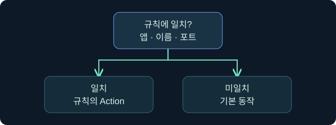
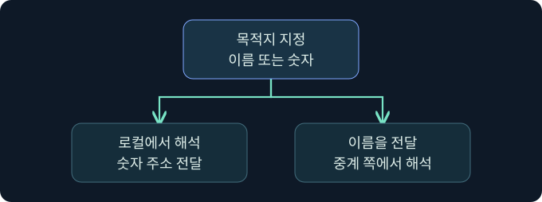
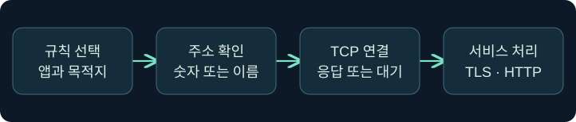

## 1. 프록시를 등록한 뒤에도 경로를 확인해야 합니다

가상 점검에서 Windows의 문서 뷰어는 중계를 통과하지만 같은 단말의 상태 확인 앱은 직접 연결을 시도합니다. Linux에서는 프로그램이 주소를 숫자로 받으면 성공하고 이름을 받으면 실패합니다. 프록시 프로필 등록, 개별 프로세스의 규칙 적용, 이름 해석, 서비스 연결을 분리하면 두 현상을 설명할 수 있습니다. 이 강의는 이미 승인된 경로의 검토를 가정합니다. 실제 도구 설치·설정, 연결, 이름 해석 변경, 인증은 미실행입니다.

## 2. 프록시 주소와 서비스 주소는 서로 다른 입력입니다

가상 프로필에는 문서 예제용 주소 `192.0.2.42`와 포트 `18082`가 있습니다. 이는 프록시 프런트엔드를 뜻합니다. 목적지 `catalog.example.test`와 `443`은 요청이 도달해야 하는 정적 문서 서비스입니다. 프로필에 목적지 주소를 넣거나 규칙의 대상에 프록시 주소를 넣으면 서로 다른 단계가 뒤바뀝니다. 주소와 이름은 교육용이며 실제 접속에 쓰지 않습니다.

| 항목 | 가상 값 | 검증할 이유 |
|---|---|---|
| 프런트엔드 주소·포트 | 192.0.2.42 · 18082 | 프록시 협상을 시작하는 구간 |
| 프런트엔드 프로토콜 | SOCKS5 | 서버와 클라이언트의 프로토콜 일치 |
| 대상 이름·포트 | catalog.example.test · 443 | 규칙 범위와 실제 서비스 식별 |
| 앱 범위 | LabReader.exe | 관계없는 트래픽이 매칭되는 것을 방지 |
| 기본 동작 | 승인된 기존 정책과 대조 | 규칙 미일치가 직접·차단·다른 경로 중 무엇인지 확인 |

## 3. Windows에서 프록시 규칙과 적용 결과를 읽습니다

Proxifier v4 문서를 기준으로 한 미실행 검토입니다. **Profile → Proxy Servers → Add**에서 Address, Port, Protocol을 각각 앞 표와 대조합니다. **OK**는 프록시 항목을 등록하는 단계입니다. 새 항목을 Default로 적용하라는 제안이 나오면 실습 검토에서는 기존 기본 경로를 유지한다고 가정합니다. 전체 앱의 기본 경로를 바꾸면 관측 대상 밖 트래픽까지 이동할 수 있습니다.

**Profile → Proxification Rules → Add**에서 Applications, Target Hosts, Target Ports를 지정하고 Action에 해당 프록시를 선택하는 위치를 확인합니다. **OK** 이후에는 규칙의 순서와 사용 여부를 읽습니다. 앞의 포괄 규칙이 먼저 매칭되면 세부 규칙이 있어도 의도대로 적용되지 않을 수 있습니다. 기존 연결의 로그가 있다면 기본 화면의 Application, Target, Rule : Proxy 열을 확인합니다. 등록 결과와 실제 전송 결과를 따로 기록합니다. 공급사 문서에서 [설정 화면](https://www.proxifier.com/docs/win-v4/proxy.html)과 [규칙 화면](https://www.proxifier.com/docs/win-v4/rules.html)을 볼 수 있습니다. 강의의 가상 프로필 및 결과 화면은 확보하지 못했습니다.

## 4. Linux에서 감싸서 실행한 프로그램의 범위를 확인합니다

ProxyChains-NG는 동적 링크 프로그램의 소켓 관련 호출을 가로채는 방식입니다. 특정 실행의 연결을 중계할 수 있어도 시스템의 기본 라우팅 테이블을 전부 교체하는 기능과는 다릅니다. 정적 바이너리, 가로채기를 제한하는 실행 문맥, 다른 호출 경로를 쓰는 앱 등은 기대한 방식으로 작동하지 않을 수 있습니다. 프로젝트가 명시하는 연결 범위는 TCP입니다. ICMP 응답이나 UDP 결과를 TCP 중계가 적용된 것으로 처리하지 않습니다.

가상 검토 기록에서는 관리자가 저장한 설정의 체인 정책, 활성 프록시 항목, 주소형과 이름 해석 방식을 읽습니다. 어떤 파일이 적용됐는지 실행 기록과 함께 확인합니다. 배포판이나 버전에 따라 설정 파일 위치·옵션·검색 순서가 달라지므로 특정 줄 번호를 그대로 옮겨 적지 않습니다. 애플리케이션이 별도로 실행한 자식 프로세스나 외부 해석기까지 동일한 경로를 쓴다는 판단에는 추가 자료가 필요합니다.

## 5. 이름을 어디에서 해석했는지 확인합니다

이름을 사용하는 앱은 먼저 로컬에서 주소를 얻어 프록시에 숫자 주소를 전달할 수 있습니다. 다른 경우에는 지원되는 SOCKS 주소형으로 도메인 이름을 전달합니다. 어느 쪽에 질의가 보이는지는 실제 경로의 해석기, 캐시와 제품 옵션에 달려 있습니다. 로컬 DNS 로그에 기록이 없으면 캐시를 썼거나 프록시 쪽에서 해석했을 수도 있습니다. 그 사실만으로 이름 질의가 없었다고 단정하지 않습니다.

숫자 주소에서 연결되고 이름에서는 실패한다면 이름 해석뿐 아니라 이름 기반 규칙, TLS 서버 이름, HTTP 가상 호스트 차이도 후보입니다. 같은 IP의 이름 두 개가 서로 다른 인증서나 콘텐츠를 제공할 수 있습니다. IP가 같다는 이유로 결과를 동일하게 기대하지 않습니다.

## 6. 공식 제품 화면에서 등록 목록의 진입점을 확인합니다

### 실제 화면 125: Fortra Sessions Table

출처는 [Fortra Session and Target Visualizations](https://hstechdocs.helpsystems.com/manuals/cobaltstrike/current/userguide/content/topics/ui_session-target-visualizations.htm)입니다. 2026년 11월 9일 현행 안내서와 대조했습니다. 공식 화면의 세션·주소와 강의의 가상 표식은 별개이며 버전에 따라 열과 메뉴가 다를 수 있습니다.

1. **Cobalt Strike → Visualization → Session Table**에서 승인된 가상 행 `LAB-RELAY07`을 선택합니다. 이 값은 중계 후보를 확인하는 가상 호스트 표식입니다. 이 단계의 표에는 주소 입력이나 Save 버튼이 없습니다.
2. **View → Proxy Pivots**를 눌러 이미 등록된 항목을 읽는 미실행 절차입니다. 가상 포트 `18082`와 프로토콜 `SOCKS5`를 클라이언트 설정과 비교합니다. 이 값은 등록을 새로 만드는 입력이 아니라 대조 기준입니다.
3. 일치하는 항목이 있다면 대상 경로가 성공했다는 결론을 보류하고 클라이언트 규칙 및 서비스 로그를 확인합니다. 실제 Proxy Pivots 창과 가상 비교 결과 화면은 확보하지 못했습니다.

## 7. 콘솔 도움말과 클라이언트 설정의 역할을 구별합니다

### 실제 화면 126: Fortra Beacon Console

출처는 [Fortra Post Exploitation](https://hstechdocs.helpsystems.com/manuals/cobaltstrike/current/userguide/content/topics/post-exploitation_main.htm)입니다. 그림은 공식 일반 콘솔 예시입니다. 강의에서 제품을 실행하거나 등록한 결과는 없습니다.

**Session Table → 세션 행 우클릭 → Interact**를 선택하고 하단 입력 줄에 `help socks`를 넣어 **Enter**를 누르는 미실행 읽기 절차입니다. 별도 저장 없이 위쪽 반환 영역에서 현재 버전이 설명하는 지원 버전·옵션을 읽는 데 쓰는 값입니다. 도움말 화면 및 응답은 확보하지 못했습니다. 실제 규칙 적용 결과는 제품 콘솔 밖 클라이언트 기록에서 확인합니다. 공식 안내서의 **Proxy Pivots → Tunnel**은 특정 도구용 설정 안내 기능으로 설명되며, 이 동작을 Proxifier나 Linux 클라이언트의 적용 증거로 기록하지 않습니다.

## 8. 네 가지 관측 결과를 비교합니다

| 가상 관측 | 해석 | 다음 근거 |
|---|---|---|
| 규칙 로그에 Direct가 보임 | 요청이 직접 경로에 매칭됨 | 실행 파일 이름, 앞선 규칙, 기본 동작 |
| 프록시 로그에 연결은 보이나 대상 이름 오류 | 이름 처리 경로 또는 주소형이 후보 | 실제로 보낸 주소형과 해석기 |
| 요청은 도달, TLS 검증 실패 | 전송과 서비스 신뢰 단계가 다름 | 요청 이름, 인증서 이름, 적용 정책 |
| 서버에서 응답, 앱에 기록 없음 | 반환 구간이나 앱 수신 처리도 후보 | 프록시의 송수신 종료, 타임아웃 |

## 9. 검증 기록을 다른 팀이 다시 읽게 만듭니다

먼저 적용된 프로필, 규칙의 순서와 가상 요청의 앱·대상·포트를 기록합니다. 이어 프록시가 선택됐는지, 이름이 어느 경로에서 처리됐는지, 대상 앱에서 같은 요청 식별자를 볼 수 있는지 확인합니다. 장애 조사에서 이름과 IP를 비교할 때는 바뀐 조건이 이름 해석뿐인지 확인합니다. 요청 자체가 달라졌다면 관측 차이를 다른 원인과 분리합니다. 다음 강의에서는 같은 중계 경로 위에 놓이는 인증과 인가를 분석합니다.

## 10. 복습과 즉시 해설

### 복습 1. 프록시 주소 칸에 목적지 이름을 넣나요?
**해설:** 그 칸은 협상을 시작할 프런트엔드입니다. 서비스 이름은 별도의 대상 조건입니다.

### 복습 2. 등록된 프로필이 모든 앱에 적용됐나요?
**해설:** 앱·목적지·포트·규칙 순서의 실제 매칭을 확인해야 합니다.

### 복습 3. 첫 규칙이 너무 넓으면 어떤 일이 생기나요?
**해설:** 더 구체적인 뒤쪽 규칙이 적용되지 않을 수 있습니다. 결과 로그의 규칙 이름을 확인합니다.

### 복습 4. ProxyChains-NG에서 ICMP 응답으로 TCP 경로를 입증하나요?
**해설:** 중계 범위는 TCP입니다. 그 요청의 TCP 연결 관측을 확인합니다.

### 복습 5. 로컬 DNS 로그가 없으면 이름을 쓰지 않았나요?
**해설:** 캐시나 다른 위치에서 해석했을 가능성이 있습니다. 프록시에 전달한 주소형도 확인합니다.

### 복습 6. 숫자 IP로 성공했다면 TLS 이름도 일치하나요?
**해설:** TCP 연결과 인증서 이름 검증은 별도입니다. 숫자 주소로 바꾸면 요청 조건 자체가 달라질 수 있습니다.

### 복습 7. Proxy Pivots에 항목이 보이면 규칙이 적용됐나요?
**해설:** 서버 쪽 등록 정보입니다. 어느 경로를 앱이 선택했는지는 클라이언트 자료로 확인합니다.

### 복습 8. 대상을 연결할 수 있으면 디렉터리 조회 권한도 있나요?
**해설:** TCP 경로, 신원 인증, 자원 인가를 각각 확인합니다.

## 11. 공식 자료와 확인 범위

- [Fortra · SOCKS Proxy와 Proxy Pivots](https://hstechdocs.helpsystems.com/manuals/cobaltstrike/current/userguide/content/topics/pivoting_socks-proxy.htm)
- [Proxifier v4 · Proxy Server Settings](https://www.proxifier.com/docs/win-v4/proxy.html)
- [Proxifier v4 · Proxification Rules](https://www.proxifier.com/docs/win-v4/rules.html)
- [Proxifier v4 · User Interface](https://www.proxifier.com/docs/win-v4/ui.html)
- [ProxyChains-NG · 공식 프로젝트 README](https://github.com/rofl0r/proxychains-ng)
- [IETF RFC 1928 · SOCKS5 주소형](https://www.rfc-editor.org/rfc/rfc1928.html)

공식 자료 확인일은 2026년 11월 9일입니다. 제품, Windows·Linux 클라이언트, 대상 연결·인증·설정 변경은 미실행입니다.
