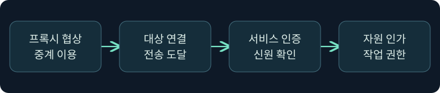
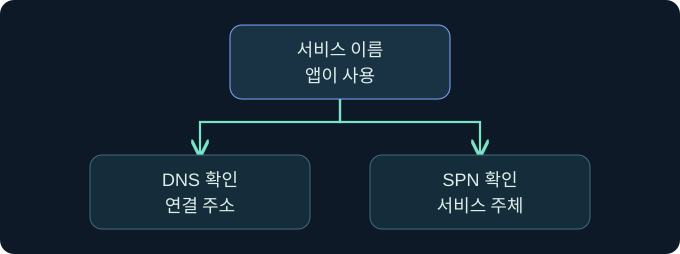
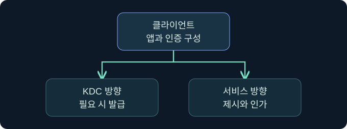

## 1. 연결됐다는 말은 어디까지인가요?

가상의 조사 단말 A는 승인된 프록시를 거쳐 디렉터리 서비스 D에 TCP 연결을 열었습니다. 클라이언트는 서비스 이름을 확인한 뒤 인증을 시도했지만 서버는 요청을 거부했습니다. 같은 시각 KDC에는 서비스 티켓 요청 성공이 보입니다. 세 관측은 모순 없이 성립합니다. TCP 응답, 티켓 발급, 서비스의 신원 확인, 자원 인가는 각각 다른 단계입니다. 가상 기록과 공식 화면만 사용하며 실제 인증·프록시 연결·자격 증명 사용은 미실행입니다.

## 2. 중계 인증과 디렉터리 인증을 구별합니다

| 단계 | 질문 | 관측 후보 |
|---|---|---|
| 프록시 협상 | 이 클라이언트가 중계를 이용할 수 있나요? | 클라이언트와 프런트엔드의 응답 |
| 대상 연결 | 중계 호스트에서 서비스까지 연결되나요? | 양쪽 흐름 기록과 대상 수신 |
| 서비스 인증 | 서비스가 어떤 계정과 인증 방식을 확인했나요? | 서비스 감사와 대상 보안 이벤트 |
| 자원 인가 | 그 신원으로 요청한 항목을 읽을 수 있나요? | 대상 응용 프로그램 및 자원 감사 |

SOCKS가 이용자를 확인하더라도 그 신원이 디렉터리의 로그인으로 전파되지는 않습니다. 반대로 대상은 전송 계층에서 중계 호스트의 주소를 보면서 서비스 인증에서는 원래 애플리케이션이 제시한 계정을 볼 수 있습니다. 서비스 주소가 같아도 요청의 보안 문맥이 다르면 결과가 달라집니다.

## 3. 이름 해석과 서비스 이름은 다른 문제입니다

DNS는 이름에 대응하는 주소를 찾는 데 쓰입니다. Kerberos 서비스 주체 이름인 SPN은 인증할 서비스의 이름입니다. 가상 예제의 `ldap/catalog.example.test`에서 앞부분은 서비스 종류이고 뒷부분은 호스트 이름입니다. DNS에서 이 호스트의 주소를 찾았다는 사실은 해당 SPN의 등록·고유성·적절한 계정 연결을 보장하지 않습니다. 별칭이 같은 주소를 반환해도 앱이 어느 서비스 이름을 선택했는지 따로 확인합니다.

Windows의 기본 동작에서는 IP 주소로 연결할 때 Kerberos를 시도하지 않고, 허용된 다른 인증 방식으로 넘어갈 수 있습니다. Microsoft가 설명하는 IP 기반 SPN 예외는 클라이언트 설정 및 SPN 등록에 의존합니다. 예외 설정의 존재를 추정하거나 정책을 바꾸지 않고, 실제 협상된 방식을 서비스 기록과 대조합니다.

## 4. 캐시에 보이는 항목의 범위를 읽습니다

TGT는 KDC에 서비스 티켓을 요청하는 데 쓰입니다. 서비스 티켓은 특정 서비스에 제시하는 자료입니다. 현재 사용자의 창에 표시되는 항목은 Windows의 해당 로그온 세션에 속할 수 있습니다. 같은 단말과 계정 이름이어도 다른 프로세스가 다른 로그온 문맥을 사용하면 관측 결과가 달라집니다. 유형 9 로그온은 외부 연결 문맥을 분리할 수 있지만 그 생성만으로 외부 인증을 입증할 수 없습니다.

MIT Kerberos 환경에서 ccache는 클라이언트·서비스 주체, 수명·플래그, 자격 자료를 포함합니다. 구현에 따라 파일이나 캐시 컬렉션을 사용합니다. `KRB5CCNAME`은 기본 캐시 위치 선택에 관여하며 설정에 값이 있다는 것만으로 캐시의 존재나 유효성을 확인할 수 없습니다. Windows 로그온 캐시, Kerberos 메시지를 담는 교환 형식, MIT 캐시의 저장 표현을 동일한 객체로 취급하지 않습니다. 조사 기록에는 주체와 시각 등 필요한 메타데이터만 남깁니다.

## 5. KDC와 서비스 방향을 별도로 그립니다

서비스 방향의 TCP 연결이 통과해도 KDC 방향은 다른 이름, 목적지, 전송, 규칙을 사용할 수 있습니다. 이미 유효한 서비스 티켓을 가진 프로세스는 같은 요청에서 새 발급 이벤트를 만들지 않을 수 있습니다. 새 티켓이 필요하면 KDC 도달성·SPN·시간·정책 조건이 별도로 중요합니다. 프록시 규칙에 업무 앱이 포함된다고 해서 OS 인증 구성 요소의 연결이 모두 따라간다고 가정하지 않습니다.

| 관측 | 어디서 확인하나요? | 한계 |
|---|---|---|
| 4768 | TGT 요청을 처리한 DC | 서비스 인증의 결과는 별개 |
| 4769 | 서비스 티켓 요청을 처리한 DC | 성공해도 사용·인가를 입증하지 못함 |
| 4624 또는 4625 | 로그온을 처리한 대상 컴퓨터 | 같은 요청인지 시간과 문맥을 대조 |
| 디렉터리나 앱 감사 | 실제 작업을 처리한 서비스 | 감사 설정·수집 범위에 의존 |

## 6. 공식 Beacon Console에서 문맥 조회 위치를 확인합니다

### 실제 화면 127: Fortra Beacon Console

출처는 [Fortra Post Exploitation](https://hstechdocs.helpsystems.com/manuals/cobaltstrike/current/userguide/content/topics/post-exploitation_main.htm)입니다. 2026년 11월 9일 현행 문서와 대조했습니다. 공식 일반 콘솔 예시와 가상 단말은 별개이며 메뉴나 배치는 버전에 따라 달라질 수 있습니다.

1. **Cobalt Strike → Visualization → Session Table → 검토 대상 가상 행 우클릭 → Interact** 순으로 여는 미실행 절차입니다. 가상 행 `LAB-RELAY07`은 이전 강의와 같은 중계 후보를 뜻합니다.
2. 콘솔 하단 입력 줄에 `getuid`를 넣고 **Enter**를 누르는 읽기 예입니다. 중계 세션이 보고하는 사용자 문맥을 비교하기 위한 값입니다. 별도 저장은 없습니다.
3. 결과가 있다면 위쪽 반환 영역을 보고 호스트와 세션을 맞춥니다. 이는 클라이언트 앱의 티켓 캐시나 디렉터리가 인정한 계정과 별개입니다. 이 명령의 가상 반환 사진 및 현재 제품의 티켓 캐시 화면은 확보하지 못했습니다.

## 7. 공식 이벤트 화면에서 확인 지점을 짚습니다

### 실제 화면 128: Microsoft 이벤트 4768

출처는 [Microsoft Kerberos RC4 조사 안내](https://learn.microsoft.com/en-us/windows-server/security/kerberos/detect-remediate-rc4-kerberos)입니다. Used with permission from Microsoft. 사진은 4768 공식 사례입니다. DC 버전과 업데이트에 따라 세부 항목이 다르며 이 그림은 가상의 4769 결과를 보여 주지 않습니다.

**Event Viewer → Action → Open Saved Log**에서 가상 `lab-kdc-security.evtx`를 골라 **Open**을 누르는 미실행 절차입니다. 파일명은 KDC의 보안 채널임을 구별합니다. **Filter Current Log**의 이벤트 ID 칸에 `4768,4769`를 넣고 **OK**를 누르면 두 요청 유형을 함께 검토할 수 있습니다. 별도 원본 저장은 없습니다. **General** 또는 **Details → XML View**에서 계정·서비스·시각·상태를 확인합니다. 필터 창과 가상 요청의 실제 반환 사진은 확보하지 못했습니다.

## 8. 조건을 바꾸어 결론을 비교합니다

| 가상 조건 | 지금 말할 수 있는 것 | 다음 확인 |
|---|---|---|
| 대상 연결 성공, 4769 실패 | 새 서비스 티켓 요청이 거절됨 | 실제 요청 이름과 KDC 결과 코드 |
| 4769 성공, 대상에 요청 없음 | 발급이 관측됐지만 대상 수신은 미확인 | 프록시 반환과 대상 수집 범위 |
| 새 4769 없음, 대상 Kerberos 로그온 | 캐시 재사용 또는 다른 DC가 후보 | 기존 수명·다른 DC·감사 상태 |
| 대상 인증 성공, 검색 범위 제한 | 신원 확인 뒤 자원 인가가 따로 적용됨 | 검색 권한, 필터와 범위 |

## 9. 관측 순서를 조사 메모로 남깁니다

가상의 A에서 오전 10시 12분에 연결이 성립했고, DC는 같은 분에 성공한 4769를 기록했습니다. 대상에서는 10시 13분에 접근 거부가 관측됐습니다. 메모에는 시간 동기화 상태, 실제 서비스와 인증 방식, 대상이 기록한 계정, 동일 요청을 묶을 키를 적습니다. 같은 분의 비슷한 계정은 상관관계 후보입니다. 앱의 요청 ID나 대상 서비스 로그가 없으면 세 기록이 같은 요청인지 보류합니다.

## 10. 복습과 즉시 해설

### 복습 1. 프록시 인증을 통과하면 디렉터리 권한이 생기나요?
**해설:** 중계 이용 조건을 통과했습니다. 디렉터리 인증과 자원 인가를 별도로 확인합니다.

### 복습 2. 같은 IP를 쓰는 두 이름은 SPN도 같나요?
**해설:** 앱이 요청한 서비스 이름과 실제 등록을 확인합니다. 주소가 같아도 서비스 이름은 다를 수 있습니다.

### 복습 3. IP 기반 Kerberos는 항상 불가능한가요?
**해설:** Windows 기본 동작과 문서화된 IP SPN 예외를 구별합니다.

### 복습 4. 캐시 위치가 표시되면 티켓이 사용됐나요?
**해설:** 위치 정보입니다. 유효한 항목과 대상에 실제 제시된 증거가 추가로 필요합니다.

### 복습 5. 서비스가 응답하면 KDC에도 도달했나요?
**해설:** 서비스 경로와 KDC 경로를 따로 확인합니다.

### 복습 6. 4769 성공은 검색이 허용됐다는 뜻인가요?
**해설:** 서비스 티켓 요청이 성공한 기록입니다. 대상의 인증과 검색 권한을 확인합니다.

### 복습 7. 새 4769가 없으면 Kerberos를 배제하나요?
**해설:** 캐시 재사용, 다른 DC 또는 감사 누락이 가능하므로 대상의 인증 기록을 대조합니다.

### 복습 8. Beacon의 사용자 표시로 앱의 캐시를 특정할 수 있나요?
**해설:** 세션과 프로세스 문맥이 다를 수 있습니다. 앱의 로그온 문맥과 캐시를 별도로 식별합니다.

## 11. 공식 자료와 확인 범위

- [Microsoft · IP 주소의 Kerberos 예외](https://learn.microsoft.com/en-us/windows-server/security/kerberos/configuring-kerberos-over-ip)
- [Microsoft · Windows klist와 로그온 세션](https://learn.microsoft.com/en-us/windows-server/administration/windows-commands/klist)
- [Microsoft · 서비스 티켓 요청 4769](https://learn.microsoft.com/en-us/previous-versions/windows/it-pro/windows-10/security/threat-protection/auditing/event-4769)
- [MIT Kerberos · Credential cache](https://web.mit.edu/kerberos/krb5-current/doc/basic/ccache_def.html)

공식 자료 확인일은 2026년 11월 9일입니다. 제품 실행, 티켓 요청·변환·적용, 인증, 비밀 수집, 이름·정책 변경은 모두 미실행입니다.
