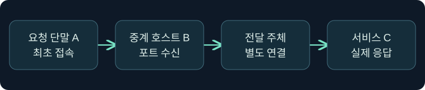
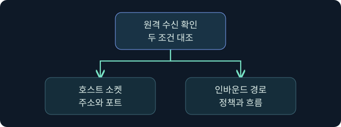
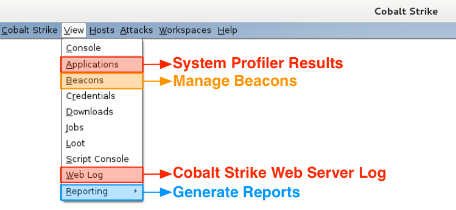
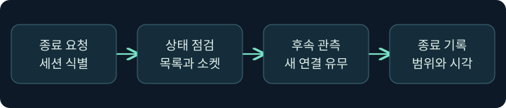

## 1. 첫 연결을 받는 위치를 먼저 그립니다

가상의 분리망에서 A는 승인된 중계 호스트 B와 통신할 수 있습니다. 정적 안내 서비스를 가진 C는 B와 다른 네트워크에 있습니다. 역방향 포트 전달을 모델링하면 A는 B의 바인딩 포트에 연결하고, 반대쪽 전달 주체가 C에 별도의 연결을 시작합니다. 반환 데이터도 같은 논리 경로를 거칩니다. 이 강의는 합성 사례의 승인 범위와 증거 검토를 설명합니다. 실제 중계 개설, 서비스 요청, 원격 실행, 방화벽 변경은 미실행입니다.

## 2. 바인딩과 최종 목적지는 서로 다른 위치입니다

바인딩은 특정 호스트에서 연결을 받을 로컬 주소·포트를 준비하는 일입니다. 전달 목적지는 별도 호스트·포트이며 해당 연결을 만드는 주체의 관점에서 해석합니다. 포트 숫자만 같다고 같은 소켓이나 서비스가 되는 것은 아닙니다. 승인 문서에는 호스트, 전송 프로토콜, 바인딩 범위, 송신 주체, 전달 목적지 및 종료 시각을 기록합니다.

| 확인할 항목 | 가상 검토값 | 값의 의미 |
|---|---|---|
| 수신 호스트 | LAB-RELAY07 | 최초 연결을 받는 중계 후보 |
| 수신 포트 | 18447/TCP | 목적지 포트와 구별하기 위한 가상 값 |
| 전달 목적지 | 192.0.2.86 | 문서 예제용 주소, 정적 서비스의 표식 |
| 전달 포트 | 8081/TCP | 가상 서비스가 응답한다고 가정한 포트 |
| 종료 조건 | 점검 창 만료 또는 승인 취소 | 수신과 추가 연결의 정리 기준 |

## 3. SOCKS 및 두 가지 전달 주체를 비교합니다

| 구조 | 첫 연결을 받는 곳 | 최종 연결 주체 | 목적지 선택 |
|---|---|---|---|
| SOCKS | Team Server의 프록시 | 연결된 Beacon | 클라이언트 요청의 주소·포트 |
| 기본 역방향 포트 전달 | Beacon 쪽 바인딩 | Team Server | 사전에 정한 주소·포트 |
| 클라이언트 경유 변형 | Beacon 쪽 바인딩 | Cobalt Strike 클라이언트 | 사전에 정한 주소·포트 |

공식 안내서에서 `rportfwd`와 `rportfwd_local`은 최종 연결 주체가 다릅니다. 특히 루프백 주소는 연결을 시작하는 주체 자신을 가리킵니다. 같은 목적지 문자열을 적어도 Team Server의 루프백과 클라이언트의 루프백은 다른 곳입니다. 최종 서비스의 원본 주소도 이 주체 및 NAT 경로에 따라 달라질 수 있습니다.

## 4. 소켓 수신과 방화벽 허용을 독립적으로 확인합니다

소켓이 열렸어도 상대 호스트의 패킷이 도착하거나 허용된다는 보장은 없습니다. 바인딩 인터페이스, 동일 주소와 포트의 충돌, 운영체제의 포트 예약·권한, 방화벽 프로필·규칙, 상위 네트워크 정책을 각각 확인합니다. 특정 포트 번호 하나로 Windows 관리자 필요 여부를 일반화하지 않습니다. 허용 규칙 하나가 있는 경우에도 적용 프로필과 범위, 중앙 정책, 실제 흐름을 대조합니다.

가상의 B가 루프백에서만 수신하면 B 자체의 관측과 다른 단말 A의 관측이 달라질 수 있습니다. 수신 범위와 방화벽을 조사할 때는 승인된 기존 설정 및 기록을 읽습니다. 응답이 없다는 이유로 보호 기능을 변경하지 않습니다.

## 5. 반환 메시지로 검증할 수 있는 범위를 정합니다

| 가상 기록 | 확인한 범위 | 남은 확인 |
|---|---|---|
| 제품이 설정을 접수 | 구성 요청 등록 | 실제 수신과 프로세스 |
| A에서 TCP 접속 성립 | 해당 수신 지점 응답 | 전달 목적지와 실제 응답 생성자 |
| HTTP 404 수신 | 어느 HTTP 구성요소가 요청에 응답 | 의도한 서버인지, 요청 경로와 서버 로그 |
| C가 같은 요청 ID를 기록 | 의도한 서비스 도달의 근거 | 응답 내용 및 A로의 반환 |
| 종료 요청 기록 | 종료 의사와 작업 제출 | 바인딩 해제와 후속 연결 상태 |

HTTP 404는 연결 자체가 거부됐다는 뜻과 다릅니다. 중간 게이트웨이가 응답을 만들 수도 있으므로 목적지의 같은 요청을 확인합니다. 반대로 대상 서비스에서 접수 로그를 봤어도 클라이언트가 응답을 받았는지는 반환 경로 자료로 별도 확인합니다.

## 6. 공식 콘솔에서 설정 도움말의 위치를 읽습니다

### 실제 화면 129: Fortra Beacon Console

출처는 [Fortra Post Exploitation](https://hstechdocs.helpsystems.com/manuals/cobaltstrike/current/userguide/content/topics/post-exploitation_main.htm)입니다. 2026년 11월 9일 현행 문서와 대조했습니다. 그림은 일반 콘솔의 공식 실제 화면이며 제품 버전에 따라 메뉴나 배치가 다릅니다.

1. **Cobalt Strike → Visualization → Session Table → 가상 LAB-RELAY07 우클릭 → Interact**에서 콘솔로 들어가는 미실행 절차입니다. 바인딩을 검토할 중계 세션을 먼저 확인합니다.
2. 하단 입력 줄에 `help rportfwd`를 넣고 **Enter**를 누르는 위치를 확인합니다. 이 값은 설치 버전의 도움말을 읽기 위한 것이며 별도 저장은 없습니다.
3. 반환 영역에서 바인딩 포트, 전달 호스트, 전달 포트의 역할을 읽고 앞 표의 가상 값과 대응합니다. 도움말 반환 및 실제 포트 등록 결과의 사진은 확보하지 못했습니다. 상태를 바꾸는 설정·실행은 하지 않았습니다.

## 7. Web Log 메뉴와 서비스 측 관측을 연결합니다

### 실제 화면 130: Fortra View 메뉴의 Web Log

출처는 [Cobalt Strike 공식 기능 안내](https://www.cobaltstrike.com/blog/map-of-cobalt-strike-features-for-armitage-users)입니다. 표시된 화살표는 공식 원본에 있습니다. 과거 버전의 실제 메뉴이며 현재 버전의 탭 본문이나 강의의 실행 결과와 별개입니다.

**View → Web Log**를 선택해 제품의 자체 웹 서버 접속 로그를 확인하는 미실행 절차입니다. 이 메뉴에는 주소·포트 입력과 저장 버튼이 없습니다. 목적지가 그 웹 서버라는 가상 조건에서는 요청 경로 `/training-status`, 시각, 응답 코드가 비교 기준입니다. 가상 경로는 합성 요청을 다른 기록과 분리하는 표식입니다. 목적지가 외부의 별도 서비스라면 해당 서비스 로그를 확인합니다. 로그 본문 탭과 가상의 전달 결과 사진은 확보하지 못했습니다.

## 8. 종료는 작업 완료와 상태 확인으로 나눕니다

종료 티켓에는 누가 어떤 포트와 세션을 대상으로 종료를 요청했는지 기록합니다. 다음으로 기존 관측에서 해당 소켓의 해제, 새 연결 유입 여부, 남은 연결 및 예외 정책을 확인합니다. 제품 목록에서 항목이 사라져도 운영체제 소켓과 상위 정책의 상태를 함께 대조합니다. 기존 정상 서비스와 같은 포트 번호를 쓴다면 호스트·인터페이스·프로세스까지 구별해 다른 서비스를 종료 대상으로 착각하지 않습니다.

## 9. 조건을 바꿔 같은 증거의 해석을 점검합니다

가상 사례에서 A의 404와 C의 404가 같은 분에 기록됐습니다. 같은 응답 코드만으로 두 사건을 연결할 수 없습니다. C가 고유 요청 ID를 기록하고 A가 같은 값을 응답에서 확인하면 상관관계가 강화됩니다. C 대신 중간 게이트웨이가 해당 응답을 만들었다면 C의 요청 로그를 찾을 수 없을 수 있습니다. 또 클라이언트 경유 변형으로 바뀌면 최종 연결의 송신 주소가 달라질 수 있으므로 흐름 기록의 수집 지점도 다시 확인합니다.

## 10. 복습과 즉시 해설

### 복습 1. 바인딩 포트는 어느 쪽에 있나요?
**해설:** 최초 연결을 받는 Beacon 쪽의 포트입니다. 최종 서비스의 포트와 구별합니다.

### 복습 2. 기본 전달과 클라이언트 경유 전달의 차이는 무엇인가요?
**해설:** 각각 Team Server와 Cobalt Strike 클라이언트가 최종 연결을 만듭니다.

### 복습 3. 목적지가 루프백이면 항상 Beacon 자신인가요?
**해설:** 최종 연결 주체 자신의 루프백입니다. 적용된 전달 방식부터 확인합니다.

### 복습 4. 수신 소켓이 열리면 외부 단말도 연결할 수 있나요?
**해설:** 인터페이스와 방화벽, 네트워크 정책의 조건을 별도로 확인합니다.

### 복습 5. 404가 반환되면 전달 전체가 입증되나요?
**해설:** HTTP 응답을 받았습니다. 의도한 서비스가 생성했는지 대조합니다.

### 복습 6. 별도 서비스의 요청을 Cobalt Strike Web Log에서 찾나요?
**해설:** 제품 자체 웹 서버의 로그입니다. 별도 서비스는 해당 서비스 쪽을 확인합니다.

### 복습 7. 목록에 종료가 표시되면 검증이 끝났나요?
**해설:** 바인딩 상태와 후속 연결을 따로 확인합니다.

### 복습 8. SOCKS와 역방향 전달에서 목적지를 누가 정하나요?
**해설:** SOCKS는 클라이언트의 요청이 목적지를 제시하고, 역방향 전달은 사전 구성된 목적지를 씁니다.

## 11. 공식 자료와 확인 범위

- [Fortra · Reverse Port Forward와 클라이언트 경유 변형](https://hstechdocs.helpsystems.com/manuals/cobaltstrike/current/userguide/content/topics/pivoting_reverse-port-forward.htm)
- [Fortra · Everything Logs](https://hstechdocs.helpsystems.com/manuals/cobaltstrike/current/userguide/content/topics/blog_let-the-logs-out.htm)
- [Microsoft · Windows Firewall 규칙의 동작](https://learn.microsoft.com/en-us/windows/security/operating-system-security/network-security/windows-firewall/rules)
- [RFC 9110 · HTTP 404 의미](https://www.rfc-editor.org/rfc/rfc9110.html#name-404-not-found)

공식 자료 확인일은 2026년 11월 9일입니다. 제품 실행, 포트 바인딩·종료, 원격 접근·다운로드, 인증 및 방화벽 변경은 미실행입니다.
