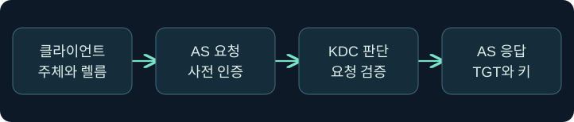
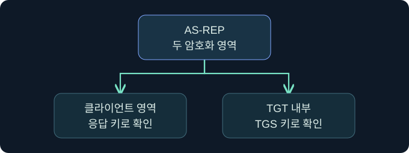
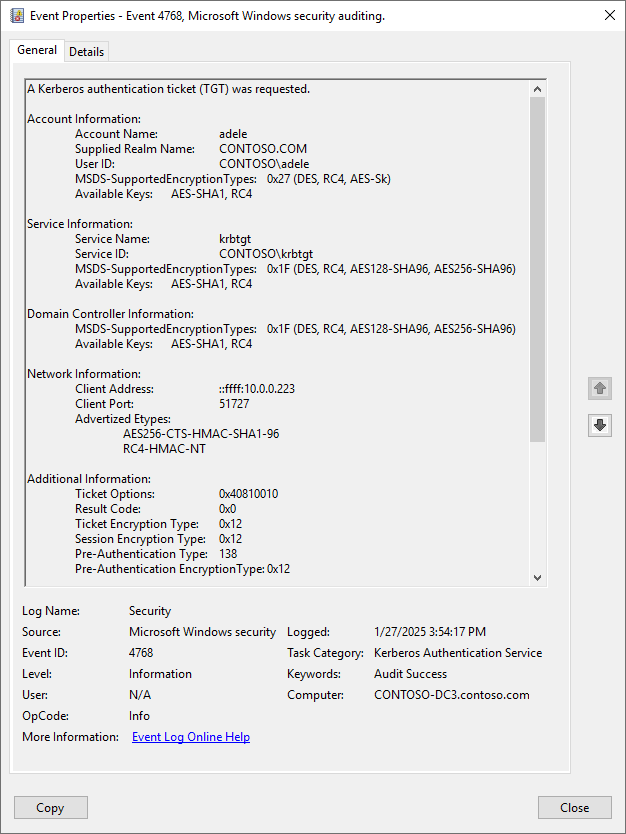
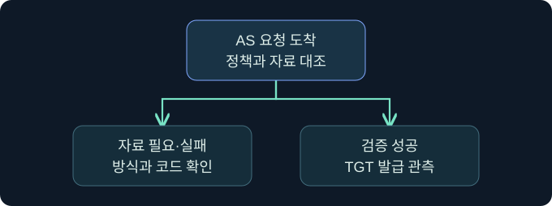

## 1. 로그인 뒤에도 암호를 다시 입력하지 않는 이유

가상의 연구 단말에서 한 번 로그인한 뒤 문서 서비스와 일정 서비스를 각각 엽니다. 두 서비스는 이용자의 암호를 받을 필요가 없습니다. Kerberos는 신뢰하는 발급자가 만든 티켓과 대응하는 세션 키로 요청을 인증합니다. 이 강의는 첫 티켓을 만드는 AS 교환을 메시지와 키 단위로 추적합니다. 10장에서 살펴본 로그온 캐시의 항목이 어떤 과정에서 생기는지 연결합니다. 예시 이름과 시각은 모두 가상이며 제품이나 네트워크 요청은 미실행입니다.

## 2. 발급자와 주체를 구별합니다

프린터 예약 시스템을 생각해 봅시다. 본인 확인 창구에서 발급한 이용권을 다른 창구에 가져가면 프린터 전용 이용권을 받을 수 있습니다. 여기서 첫 창구는 AS, 두 번째 창구는 TGS입니다. 둘은 KDC가 제공하는 논리적 역할입니다. Windows 도메인에서는 도메인 컨트롤러가 KDC 역할을 맡습니다. 주체는 사용자, 컴퓨터, 서비스처럼 Kerberos에서 이름을 가진 엔터티입니다. 렐름은 해당 이름과 발급자의 관리 경계를 표현합니다.

| 용어 | 가상 표현 | 검토할 경계 |
|---|---|---|
| 클라이언트 주체 | reader@TRAINING.EXAMPLE | 누구의 첫 인증인가 |
| KDC의 AS | 발급 창구 | 초기 신원 확인과 TGT 발급 |
| KDC의 TGS | 교환 창구 | TGT를 근거로 서비스 티켓 요청 처리 |
| 서비스 주체 | HTTP/library.training.example | 서비스별 이름과 장기 키의 연결 |

같은 사용자 표시 이름을 쓰더라도 다른 렐름이면 동일 주체로 취급하지 않습니다. 앱에서 보이는 이름과 인증 기록의 계정 및 렐름을 따로 비교합니다.

## 3. 요청과 사전 인증의 순서를 읽습니다

AS-REQ는 클라이언트 주체, 렐름, 요청 서비스 및 지원하는 암호 형식 등을 전달합니다. KDC가 필요한 사전 인증 자료를 받지 않았다면 요구하는 방식의 힌트와 함께 사전 인증이 필요하다고 응답할 수 있습니다. 클라이언트가 처음부터 적절한 자료를 포함할 수도 있으므로 모든 정상 흐름에 같은 오류가 선행한다고 가정하지 않습니다.

암호 기반 예에서 클라이언트는 장기 키로 보호한 시간 정보를 보내고 KDC는 이를 검증합니다. 시간 차이가 지나치게 크거나 자료가 틀리면 실패할 수 있습니다. 인증서 기반 PKINIT처럼 키를 얻고 사전 인증을 하는 다른 방식도 있습니다. 암호 기반 예의 메시지 구조를 모든 구현의 로그인 방식으로 확대하지 않습니다. 사전 인증이 필요하다는 응답 한 건과 이미 제출한 자료가 틀렸다는 실패를 구별합니다.

## 4. AS-REP의 두 암호화 영역을 나눕니다

| 영역 | 암호화에 쓰이는 키 | 누가 읽고 무엇을 얻나요? |
|---|---|---|
| AS 응답의 클라이언트용 부분 | 해당 교환의 응답 키 | 클라이언트가 TGT 세션 키와 발급 정보를 얻음 |
| TGT 내부 | TGS 서비스의 장기 키 | KDC의 TGS가 나중에 같은 세션 키와 티켓 정보를 얻음 |
| 티켓 바깥의 일부 필드 | 해당 필드는 암호문 바깥에 있음 | 메시지 종류와 일부 이름은 관찰 가능 |

클라이언트는 TGT 내부를 열지 않고도 TGT와 세션 키를 보관해 다음 단계에서 사용합니다. 암호 기반 응답 키를 모든 암호 형식에서 단일한 비밀번호 해시로 부르면 파생 방식의 차이가 사라집니다. 장기 키, 티켓의 암호화 형식, 세션 키 형식은 서로 다른 항목입니다. Kerberos의 메시지 보호와 이후 애플리케이션 트래픽의 암호화도 별도입니다.

## 5. 발급 성공을 캐시·사용·인가와 분리합니다

DC의 4768 성공 기록은 해당 DC에서 처리된 TGT 요청의 증거입니다. 클라이언트가 응답을 받아 어떤 로그온 세션에 보관했는지는 다른 기록으로 확인합니다. 가상 사용자가 09시 00분에 첫 인증을 마치고 09시 05분에 다른 프로세스를 시작해도 프로세스의 로그온 문맥을 확인하기 전에는 같은 캐시라고 가정할 수 없습니다. 기존 TGT 재사용, 다른 DC, 감사 수집 공백은 새 4768이 안 보이는 이유가 될 수 있습니다.

## 6. 공식 화면에서 DC 이벤트 필드를 읽습니다

### 실제 화면 131: Microsoft 이벤트 4768

출처는 [Microsoft Kerberos RC4 조사 안내](https://learn.microsoft.com/en-us/windows-server/security/kerberos/detect-remediate-rc4-kerberos)입니다. Used with permission from Microsoft. 공식 사례와 이번 가상 예제의 계정·상태는 별개입니다. DC 버전과 누적 업데이트에 따라 필드가 다릅니다.

**Event Viewer → Action → Open Saved Log**에서 가상 `lab-auth-dc.evtx`를 고르고 **Open**을 누르는 미실행 절차입니다. 파일명은 DC 보안 로그를 구분합니다. **Filter Current Log**의 이벤트 ID 칸에 `4768,4771`을 넣고 **OK**를 누르는 가정입니다. 발급 관측과 사전 인증 실패를 구별하기 위한 값입니다. 원본 로그의 별도 저장은 없습니다. **General** 또는 **Details → XML View**에서 이벤트 번호, 계정, 발급 DC, 시각과 결과를 대조합니다. 필터 입력창과 이번 결과 사진은 확보하지 못했습니다.

## 7. 공식 콘솔에서 조회 문맥을 점검합니다

### 실제 화면 132: Fortra Beacon Console

출처는 [Fortra Post Exploitation](https://hstechdocs.helpsystems.com/manuals/cobaltstrike/current/userguide/content/topics/post-exploitation_main.htm)입니다. 2026년 11월 9일 현행 안내서를 확인했습니다. 캡처는 공식 일반 콘솔이며 버전에 따라 메뉴나 배치가 다를 수 있습니다.

**Cobalt Strike → Visualization → Session Table → 승인된 가상 LAB-AUTH07 행 우클릭 → Interact**로 이동하는 미실행 예입니다. 하단 입력 줄에 `getuid`를 넣고 **Enter**를 누르는 위치를 확인합니다. 사용자 문맥을 비교하기 위한 읽기 값입니다. 별도 **Save**는 없습니다. 위쪽 반환 영역에서 선택한 세션의 보고값을 확인하되 DC의 인증 결과나 캐시 항목으로 해석하지 않습니다. 이 명령의 이번 반환 사진은 확보하지 못했습니다.

## 8. 조건이 바뀌면 같은 결과도 달리 해석합니다

| 가상 관측 | 지금 확인한 사실 | 다음 확인 |
|---|---|---|
| 사전 인증 필요 응답 뒤 발급 성공 | 초기 요청에 방식 안내가 있었음 | 실제로 사용한 방식과 결과 |
| 사전 인증 실패만 확인 | KDC가 자료를 받아들일 수 없었음 | 결과 코드, 계정, 시간 상태 |
| 성공 이벤트는 있지만 앱 로그인 실패 | 첫 티켓 발급이 관측됨 | 캐시 문맥과 서비스 쪽 교환 |
| 사전 인증 없는 계정이 정책 검토에 포함됨 | 계정의 설정이 예외임 | 변경 승인, 사용 이력, 담당자 |

사전 인증 예외는 암호 기반 계정에서 오프라인 추측 위험을 높일 수 있습니다. 이 검토에는 비밀 요청이나 추측 작업 없이 승인된 정책과 변경 기록을 사용합니다.

## 9. 조사 메모를 재현 가능하게 남깁니다

가상 사례의 메모에 DC, 렐름, 계정, 시각 기준, 결과 코드, 로그 수집 범위를 기록합니다. 4768의 티켓 암호 형식과 세션 키 형식을 각각 옮기고 필드가 없으면 미확인으로 표시합니다. 이후 앱 요청의 시각과 프로세스 문맥을 연결해 어디까지 확인했는지 적습니다. 다음 강의에서 서비스 티켓 요청과 제시를 이어 봅니다.

## 10. 복습과 즉시 해설

### 복습 1. AS와 TGS가 꼭 다른 서버인가요?
**해설:** 서로 다른 논리 역할입니다. 한 KDC에서 두 역할을 제공할 수 있습니다.

### 복습 2. TGT가 문서 서비스에 제시되나요?
**해설:** 일반 흐름에서는 TGT가 KDC에 제시되고 문서 서비스에는 그 서비스용 티켓이 제시됩니다.

### 복습 3. 모든 AS-REQ가 사전 인증 필요 오류를 한 번 받나요?
**해설:** 클라이언트가 처음부터 적절한 자료를 포함할 수 있습니다.

### 복습 4. 클라이언트가 TGT 내부를 열어 세션 키를 얻나요?
**해설:** 클라이언트는 응답의 자신용 암호화 영역을 읽습니다.

### 복습 5. 세션 키와 장기 키는 같은 값인가요?
**해설:** 서로 다른 역할입니다. 세션 키는 해당 교환 이후 인증에 쓰이고 장기 키는 반복해서 사용될 수 있습니다.

### 복습 6. 4768 성공으로 대상 자원 읽기가 확인되나요?
**해설:** 첫 티켓 요청의 성공입니다. 서비스 교환과 인가 자료를 확인합니다.

### 복습 7. 새 4768이 없으면 Kerberos를 쓰지 않았나요?
**해설:** 기존 TGT 사용이나 다른 DC, 감사 공백도 가능합니다.

### 복습 8. 콘솔의 사용자 이름으로 DC 발급을 판단하나요?
**해설:** 로컬 문맥과 DC의 발급 기록을 따로 대조합니다.

## 11. 공식 자료와 확인 범위

- [IETF RFC 4120 · Kerberos V5](https://www.rfc-editor.org/rfc/rfc4120.html)
- [IETF RFC 4556 · PKINIT](https://www.rfc-editor.org/rfc/rfc4556.html)
- [Microsoft · 이벤트 4768](https://learn.microsoft.com/en-us/previous-versions/windows/it-pro/windows-10/security/threat-protection/auditing/event-4768)
- [Microsoft · 이벤트 4771](https://learn.microsoft.com/en-us/previous-versions/windows/it-pro/windows-10/security/threat-protection/auditing/event-4771)

공식 자료 확인일은 2026년 11월 9일입니다. Windows·Cobalt Strike·티켓 요청·수집·캐시 변경은 미실행입니다.
